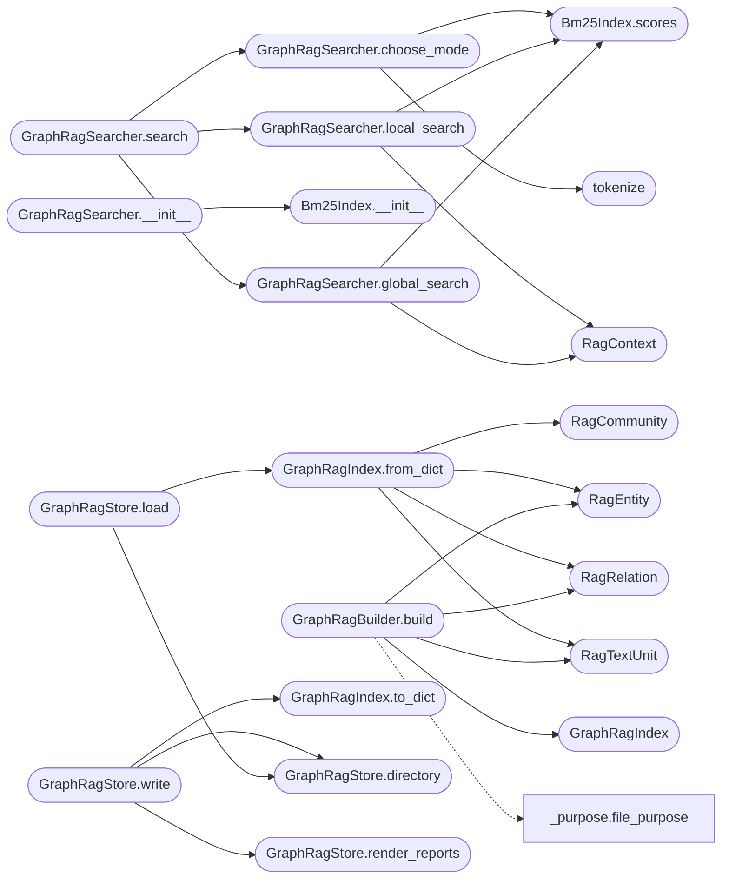

# `readmenator._graphrag`

> Source: [readmenator/_graphrag.py:1](../../readmenator/_graphrag.py#L1) | language `py` | coverage 100.0% | [API index](../index.md)

Zero-token GraphRAG index and retrieval for AI agents.

Builds a Microsoft-GraphRAG style index from the static scan without
calling any language model: typed entities (files, symbols, concepts,
external modules), typed relationships, source text units, and a
hierarchy of community reports (Louvain communities, Louvain themes
over the community quotient graph, and a project root). Reports are
extractive: every sentence is computed from measured structure
(PageRank, fan-in, findings, cycles, hotspots, layer violations).

Retrieval follows two complementary strategies:

- local search (HippoRAG style): BM25 over entities and text units
  seeds a Personalized PageRank walk on the entity graph; the top
  entities, the relationships between them, their community reports,
  and their source text units are packed into a token-budgeted
  Markdown context.
- global search (GraphRAG map-reduce): community reports are scored
  against the query, the matching findings of each report are mapped
  out, and the results are reduced into one ranked answer context.

## Contents

- **Classes:** [`RagEntity`](#ragentity), [`RagRelation`](#ragrelation), [`RagTextUnit`](#ragtextunit), [`RagCommunity`](#ragcommunity), [`GraphRagIndex`](#graphragindex), [`RagContext`](#ragcontext), [`Bm25Index`](#bm25index), [`GraphRagBuilder`](#graphragbuilder), [`GraphRagSearcher`](#graphragsearcher), [`GraphRagStore`](#graphragstore)
- **Functions:** [`tokenize`](#tokenize)
- **Constants:** [`SCHEMA_VERSION`](#schema_version)

## Type Diagram

```mermaid
classDiagram
    direction LR
    class RagEntity
    RagEntity : str entity_id
    RagEntity : str name
    RagEntity : str kind
    RagEntity : str file
    RagEntity : int line
    RagEntity : str description
    RagEntity : int community
    RagEntity : int degree
    RagEntity : float rank
    class RagRelation
    RagRelation : str source
    RagRelation : str target
    RagRelation : str relation
    RagRelation : float weight
    RagRelation : str confidence
    RagRelation : str description
    class RagTextUnit
    RagTextUnit : str unit_id
    RagTextUnit : str file
    RagTextUnit : str entity_id
    RagTextUnit : int start_line
    RagTextUnit : int end_line
    RagTextUnit : str text
    class RagCommunity
    RagCommunity : str community_id
    RagCommunity : int level
    RagCommunity : str parent
    RagCommunity : List[str] children
    RagCommunity : str title
    RagCommunity : List[str] file_ids
    RagCommunity : str summary
    RagCommunity : List[str] findings
    RagCommunity : List[str] key_entities
    RagCommunity : List[str] key_relations
    RagCommunity : float rating
    RagCommunity : str rating_explanation
    class GraphRagIndex
    GraphRagIndex : List[RagEntity] entities
    GraphRagIndex : List[RagRelation] relationships
    GraphRagIndex : List[RagCommunity] communities
    GraphRagIndex : List[RagTextUnit] text_units
    GraphRagIndex : Dict[str, object] meta
    GraphRagIndex : to_dict()
    GraphRagIndex : from_dict()
    class RagContext
    RagContext : str query
    RagContext : str mode
    RagContext : List[Tuple[str, float]] entities
    RagContext : List[str] relations
    RagContext : List[str] reports
    RagContext : List[str] text_units
    RagContext : str markdown
    RagContext : int approx_tokens
    class Bm25Index
    Bm25Index : __init__()
    Bm25Index : scores()
    class GraphRagBuilder
    GraphRagBuilder : __init__()
    GraphRagBuilder : build()
    class GraphRagSearcher
    GraphRagSearcher : __init__()
    GraphRagSearcher : choose_mode()
    GraphRagSearcher : search()
    GraphRagSearcher : local_search()
    GraphRagSearcher : global_search()
    class GraphRagStore
    GraphRagStore : __init__()
    GraphRagStore : directory()
    GraphRagStore : write()
    GraphRagStore : load()
    GraphRagStore : render_reports()
```



## Call Graph

Solid arrows stay in this module, dashed arrows leave it.



## Classes

<a id="ragentity"></a>

### `RagEntity`

`class` `dataclass` | [readmenator/_graphrag.py:67](../../readmenator/_graphrag.py#L67)

Decorators: `@dataclass(frozen=True)`

```python
class RagEntity
```

A typed node of the GraphRAG entity graph.

**Attributes**

| Name | Type | Default | Description |
|---|---|---|---|
| [`entity_id`](#ragentity-entity_id) | `str` |  | Stable identifier (``file:``, ``sym:``, ``concept:``, ``ext:``). |
| [`name`](#ragentity-name) | `str` |  | Human-readable name. |
| [`kind`](#ragentity-kind) | `str` |  | file, symbol kind (class, function, ...), concept, or external. |
| [`file`](#ragentity-file) | `str` |  | Owning file path ("" for concepts and externals). |
| [`line`](#ragentity-line) | `int` |  | Definition line (0 when not applicable). |
| [`description`](#ragentity-description) | `str` |  | Extractive description (purpose, signature, doc). |
| [`community`](#ragentity-community) | `int` |  | Level-0 community index, -1 when unassigned. |
| [`degree`](#ragentity-degree) | `int` |  | Number of relationships touching the entity. |
| [`rank`](#ragentity-rank) | `float` |  | Global PageRank of the entity on the entity graph. |

---

<a id="ragrelation"></a>

### `RagRelation`

`class` `dataclass` | [readmenator/_graphrag.py:94](../../readmenator/_graphrag.py#L94)

Decorators: `@dataclass(frozen=True)`

```python
class RagRelation
```

A typed, weighted edge between two entities.

**Attributes**

| Name | Type | Default | Description |
|---|---|---|---|
| [`source`](#ragrelation-source) | `str` |  | Source entity id. |
| [`target`](#ragrelation-target) | `str` |  | Target entity id. |
| [`relation`](#ragrelation-relation) | `str` |  | defines, resolved_imports, calls, inherits, documents, imports. |
| [`weight`](#ragrelation-weight) | `float` |  | Semantic edge weight from the category model. |
| [`confidence`](#ragrelation-confidence) | `str` |  | EXTRACTED or INFERRED. |
| [`description`](#ragrelation-description) | `str` |  | One-line extractive description. |

---

<a id="ragtextunit"></a>

### `RagTextUnit`

`class` `dataclass` | [readmenator/_graphrag.py:115](../../readmenator/_graphrag.py#L115)

Decorators: `@dataclass(frozen=True)`

```python
class RagTextUnit
```

A source chunk anchored to one entity.

**Attributes**

| Name | Type | Default | Description |
|---|---|---|---|
| [`unit_id`](#ragtextunit-unit_id) | `str` |  | Stable identifier. |
| [`file`](#ragtextunit-file) | `str` |  | Source file path. |
| [`entity_id`](#ragtextunit-entity_id) | `str` |  | Entity the chunk belongs to. |
| [`start_line`](#ragtextunit-start_line) | `int` |  | First line of the chunk (1-based). |
| [`end_line`](#ragtextunit-end_line) | `int` |  | Last line of the chunk (1-based, inclusive). |
| [`text`](#ragtextunit-text) | `str` |  | Chunk text (source excerpt or signature plus doc in privacy mode). |

---

<a id="ragcommunity"></a>

### `RagCommunity`

`class` `dataclass` | [readmenator/_graphrag.py:136](../../readmenator/_graphrag.py#L136)

Decorators: `@dataclass`

```python
class RagCommunity
```

One node of the community report hierarchy.

**Attributes**

| Name | Type | Default | Description |
|---|---|---|---|
| [`community_id`](#ragcommunity-community_id) | `str` |  | ``c<n>`` for communities, ``t<n>`` for themes, ``root``. |
| [`level`](#ragcommunity-level) | `int` |  | 0 community, 1 theme, 2 project root. |
| [`parent`](#ragcommunity-parent) | `str` |  | Parent report id ("" for root). |
| [`children`](#ragcommunity-children) | `List[str]` |  | Child report ids. |
| [`title`](#ragcommunity-title) | `str` |  | Report title. |
| [`file_ids`](#ragcommunity-file_ids) | `List[str]` |  | Files covered by the report. |
| [`summary`](#ragcommunity-summary) | `str` |  | Extractive summary paragraph. |
| [`findings`](#ragcommunity-findings) | `List[str]` |  | Ranked extractive findings. |
| [`key_entities`](#ragcommunity-key_entities) | `List[str]` |  | Most central entity ids inside the report. |
| [`key_relations`](#ragcommunity-key_relations) | `List[str]` |  | Most informative relationship lines. |
| [`rating`](#ragcommunity-rating) | `float` |  | Impact rating in [0, 10]. |
| [`rating_explanation`](#ragcommunity-rating_explanation) | `str` |  | How the rating was computed. |

---

<a id="graphragindex"></a>

### `GraphRagIndex`

`class` `dataclass` | [readmenator/_graphrag.py:169](../../readmenator/_graphrag.py#L169)

Decorators: `@dataclass`

```python
class GraphRagIndex
```

Complete GraphRAG index persisted beside the knowledge base.

**Attributes**

| Name | Type | Default | Description |
|---|---|---|---|
| [`entities`](#graphragindex-entities) | `List[RagEntity]` | `field(default_factory=list)` | Entity table. |
| [`relationships`](#graphragindex-relationships) | `List[RagRelation]` | `field(default_factory=list)` | Relationship table. |
| [`communities`](#graphragindex-communities) | `List[RagCommunity]` | `field(default_factory=list)` | Community report hierarchy (communities, themes, root). |
| [`text_units`](#graphragindex-text_units) | `List[RagTextUnit]` | `field(default_factory=list)` | Source chunk table. |
| [`meta`](#graphragindex-meta) | `Dict[str, object]` | `field(default_factory=dict)` | Counts and schema metadata. |

**Members**

| Member | Kind | Summary |
|---|---|---|
| [`to_dict`](#graphragindex-to_dict) | method | Serialise the index into JSON-compatible primitives. |
| [`from_dict`](#graphragindex-from_dict) | classmethod | Rebuild an index from [`to_dict`](#graphragindex-to_dict) output. |

<a id="graphragindex-to_dict"></a>

#### `GraphRagIndex.to_dict`

`method` | [readmenator/_graphrag.py:186](../../readmenator/_graphrag.py#L186)

```python
def to_dict(self) -> Dict[str, object]
```

Serialise the index into JSON-compatible primitives.

**Returns:** `Dict[str, object]`

*Called by:* [`GraphRagStore.write`](#graphragstore-write)

<a id="graphragindex-from_dict"></a>

#### `GraphRagIndex.from_dict`

`classmethod` | [readmenator/_graphrag.py:197](../../readmenator/_graphrag.py#L197)

Decorators: `@classmethod`

```python
def from_dict(cls, data: Dict[str, object]) -> 'GraphRagIndex'
```

Rebuild an index from [`to_dict`](#graphragindex-to_dict) output.

**Parameters**

| Name | Type | Default | Description |
|---|---|---|---|
| `data` | `Dict[str, object]` |  | Dictionary produced by to_dict (or loaded from index.json). |

**Returns:** `'GraphRagIndex'` - Reconstructed GraphRagIndex.

*Calls:* [`RagCommunity`](#ragcommunity), [`RagEntity`](#ragentity), [`RagRelation`](#ragrelation), [`RagTextUnit`](#ragtextunit)

*Called by:* [`GraphRagStore.load`](#graphragstore-load)

---

<a id="ragcontext"></a>

### `RagContext`

`class` `dataclass` | [readmenator/_graphrag.py:216](../../readmenator/_graphrag.py#L216)

Decorators: `@dataclass`

```python
class RagContext
```

Result of a GraphRAG search ready for an agent prompt.

**Attributes**

| Name | Type | Default | Description |
|---|---|---|---|
| [`query`](#ragcontext-query) | `str` |  | Original query text. |
| [`mode`](#ragcontext-mode) | `str` |  | local or global. |
| [`entities`](#ragcontext-entities) | `List[Tuple[str, float]]` |  | Ranked (entity id, score) pairs. |
| [`relations`](#ragcontext-relations) | `List[str]` |  | Selected relationship lines. |
| [`reports`](#ragcontext-reports) | `List[str]` |  | Selected report ids. |
| [`text_units`](#ragcontext-text_units) | `List[str]` |  | Selected text unit ids. |
| [`markdown`](#ragcontext-markdown) | `str` |  | Token-budgeted Markdown context. |
| [`approx_tokens`](#ragcontext-approx_tokens) | `int` |  | Approximate token count of the Markdown. |

---

<a id="bm25index"></a>

### `Bm25Index`

`class` | [readmenator/_graphrag.py:267](../../readmenator/_graphrag.py#L267)

```python
class Bm25Index
```

Okapi BM25 ranking over a fixed corpus of token lists.

**Members**

| Member | Kind | Summary |
|---|---|---|
| [`__init__`](#bm25index-__init__) | constructor | Index token documents. |
| [`scores`](#bm25index-scores) | method | Return the BM25 score of every document for the query tokens. |

<a id="bm25index-__init__"></a>

#### `Bm25Index.__init__`

`constructor` | [readmenator/_graphrag.py:270](../../readmenator/_graphrag.py#L270)

```python
def __init__(self, documents: Sequence[Sequence[str]], k1: float, b: float) -> None
```

Index token documents.

**Parameters**

| Name | Type | Default | Description |
|---|---|---|---|
| `documents` | `Sequence[Sequence[str]]` |  | Token list per document. |
| `k1` | `float` |  | Term-frequency saturation. |
| `b` | `float` |  | Length normalisation strength. |

*Called by:* [`GraphRagSearcher.__init__`](#graphragsearcher-__init__)

<a id="bm25index-scores"></a>

#### `Bm25Index.scores`

`method` | [readmenator/_graphrag.py:298](../../readmenator/_graphrag.py#L298)

```python
def scores(self, query: Sequence[str]) -> List[float]
```

Return the BM25 score of every document for the query tokens.

**Parameters**

| Name | Type | Default | Description |
|---|---|---|---|
| `query` | `Sequence[str]` |  | Query tokens. |

**Returns:** `List[float]` - One score per indexed document, in corpus order.

*Called by:* [`GraphRagSearcher.choose_mode`](#graphragsearcher-choose_mode), [`GraphRagSearcher.global_search`](#graphragsearcher-global_search), [`GraphRagSearcher.local_search`](#graphragsearcher-local_search)

---

<a id="graphragbuilder"></a>

### `GraphRagBuilder`

`class` | [readmenator/_graphrag.py:345](../../readmenator/_graphrag.py#L345)

```python
class GraphRagBuilder
```

Builds the zero-token GraphRAG index from scan and analysis results.

**Members**

| Member | Kind | Summary |
|---|---|---|
| [`__init__`](#graphragbuilder-__init__) | constructor | Initialise with application configuration. |
| [`build`](#graphragbuilder-build) | method | Build entities, relationships, text units, and community reports. |

<a id="graphragbuilder-__init__"></a>

#### `GraphRagBuilder.__init__`

`constructor` | [readmenator/_graphrag.py:348](../../readmenator/_graphrag.py#L348)

```python
def __init__(self, config: Config) -> None
```

Initialise with application configuration.

**Parameters**

| Name | Type | Default | Description |
|---|---|---|---|
| `config` | `Config` |  | GRAPHRAG_* budgets, weights, and privacy settings. |

*Called by:* [`AnalyzerFactory.graphrag`](readmenator._pipeline.py.md#analyzerfactory-graphrag)

<a id="graphragbuilder-build"></a>

#### `GraphRagBuilder.build`

`method` | [readmenator/_graphrag.py:358](../../readmenator/_graphrag.py#L358)

```python
def build(self, nodes: List[Node], edges: List[Edge], resolved_edges: Optional[List[Edge]] = None, analysis: Optional[AnalysisResult] = None, layers: Optional[Dict[str, str]] = None, findings: Optional[List[SecurityFinding]] = None, analysis_v2: Optional[AnalysisResultV2] = None, concept_graph: Optional[ConceptGraph] = None, content_map: Optional[Dict[str, str]] = None, memory_notes: Optional[List[Tuple[str, str, str]]] = None) -> GraphRagIndex
```

Build entities, relationships, text units, and community reports.

**Parameters**

| Name | Type | Default | Description |
|---|---|---|---|
| `nodes` | `List[Node]` |  | Scanned file nodes. |
| `edges` | `List[Edge]` |  | Raw edges (imports, calls, inherits). |
| `resolved_edges` | `Optional[List[Edge]]` | `None` | Project-internal resolved import edges. |
| `analysis` | `Optional[AnalysisResult]` | `None` | Community and god-node analysis. |
| `layers` | `Optional[Dict[str, str]]` | `None` | File to architectural layer mapping. |
| `findings` | `Optional[List[SecurityFinding]]` | `None` | Security findings. |
| `analysis_v2` | `Optional[AnalysisResultV2]` | `None` | Hotspots, cycles, taint, violations, dataflow. |
| `concept_graph` | `Optional[ConceptGraph]` | `None` | Semantic noun graph (falls back to analysis_v2). |
| `content_map` | `Optional[Dict[str, str]]` | `None` | File contents for source text units. |
| `memory_notes` | `Optional[List[Tuple[str, str, str]]]` | `None` | Session-log notes as (date, kind, text) from MEMORY.md. |

**Returns:** `GraphRagIndex` - Deterministic GraphRagIndex.

*Calls:* [`GraphRagIndex`](#graphragindex), [`RagEntity`](#ragentity), [`RagRelation`](#ragrelation), [`RagTextUnit`](#ragtextunit), [`file_purpose`](readmenator._purpose.py.md#file_purpose), [`first_sentence`](readmenator._purpose.py.md#first_sentence), [`truncate_words`](readmenator._purpose.py.md#truncate_words), [`ImportResolver.__init__`](readmenator._resolver.py.md#importresolver-__init__), [`ImportResolver.resolve`](readmenator._resolver.py.md#importresolver-resolve)

---

<a id="graphragsearcher"></a>

### `GraphRagSearcher`

`class` | [readmenator/_graphrag.py:942](../../readmenator/_graphrag.py#L942)

```python
class GraphRagSearcher
```

Local (BM25 + Personalized PageRank) and global (map-reduce) retrieval.

**Members**

| Member | Kind | Summary |
|---|---|---|
| [`__init__`](#graphragsearcher-__init__) | constructor | Prepare lexical indexes and the entity random-walk graph. |
| [`choose_mode`](#graphragsearcher-choose_mode) | method | Pick local or global retrieval for a query. |
| [`search`](#graphragsearcher-search) | method | Run local, global, or automatically chosen retrieval. |
| [`local_search`](#graphragsearcher-local_search) | method | Entity-centric retrieval: BM25 seeds expanded by Personalized PageRank. |
| [`global_search`](#graphragsearcher-global_search) | method | Map-reduce over community reports for broad, corpus-level questions. |

<a id="graphragsearcher-__init__"></a>

#### `GraphRagSearcher.__init__`

`constructor` | [readmenator/_graphrag.py:945](../../readmenator/_graphrag.py#L945)

```python
def __init__(self, config: Config, index: GraphRagIndex) -> None
```

Prepare lexical indexes and the entity random-walk graph.

**Parameters**

| Name | Type | Default | Description |
|---|---|---|---|
| `config` | `Config` |  | GRAPHRAG_* retrieval budgets. |
| `index` | `GraphRagIndex` |  | Built or loaded GraphRagIndex. |

*Calls:* [`Bm25Index.__init__`](#bm25index-__init__)

*Called by:* [`readmenatorApplication.graphrag_search`](readmenator._app.py.md#readmenatorapplication-graphrag_search)

<a id="graphragsearcher-choose_mode"></a>

#### `GraphRagSearcher.choose_mode`

`method` | [readmenator/_graphrag.py:987](../../readmenator/_graphrag.py#L987)

```python
def choose_mode(self, query: str) -> str
```

Pick local or global retrieval for a query.

**Parameters**

| Name | Type | Default | Description |
|---|---|---|---|
| `query` | `str` |  | Natural-language query. |

**Returns:** `str` - ``global`` for broad questions or when no entity matches, else ``local``.

*Calls:* [`Bm25Index.scores`](#bm25index-scores), [`tokenize`](#tokenize)

*Called by:* [`GraphRagSearcher.search`](#graphragsearcher-search)

<a id="graphragsearcher-search"></a>

#### `GraphRagSearcher.search`

`method` | [readmenator/_graphrag.py:1004](../../readmenator/_graphrag.py#L1004)

```python
def search(self, query: str, mode: str = 'auto', budget_tokens: int = 0) -> RagContext
```

Run local, global, or automatically chosen retrieval.

**Parameters**

| Name | Type | Default | Description |
|---|---|---|---|
| `query` | `str` |  | Natural-language query. |
| `mode` | `str` | `'auto'` | ``local``, ``global``, or ``auto``. |
| `budget_tokens` | `int` | `0` | Context budget; 0 uses GRAPHRAG_CONTEXT_BUDGET_TOKENS. |

**Returns:** `RagContext` - RagContext with the packed Markdown context.

*Calls:* [`GraphRagSearcher.choose_mode`](#graphragsearcher-choose_mode), [`GraphRagSearcher.global_search`](#graphragsearcher-global_search), [`GraphRagSearcher.local_search`](#graphragsearcher-local_search)

*Called by:* [`readmenatorApplication.graphrag_search`](readmenator._app.py.md#readmenatorapplication-graphrag_search)

<a id="graphragsearcher-local_search"></a>

#### `GraphRagSearcher.local_search`

`method` | [readmenator/_graphrag.py:1025](../../readmenator/_graphrag.py#L1025)

```python
def local_search(self, query: str, budget_tokens: int = 0) -> RagContext
```

Entity-centric retrieval: BM25 seeds expanded by Personalized PageRank.

**Parameters**

| Name | Type | Default | Description |
|---|---|---|---|
| `query` | `str` |  | Natural-language query. |
| `budget_tokens` | `int` | `0` | Context budget; 0 uses the configured default. |

**Returns:** `RagContext` - RagContext with entities, relationships, reports, and sources.

*Calls:* [`Bm25Index.scores`](#bm25index-scores), [`RagContext`](#ragcontext), [`personalized_pagerank`](readmenator._rank.py.md#personalized_pagerank)

*Called by:* [`GraphRagSearcher.search`](#graphragsearcher-search)

<a id="graphragsearcher-global_search"></a>

#### `GraphRagSearcher.global_search`

`method` | [readmenator/_graphrag.py:1106](../../readmenator/_graphrag.py#L1106)

```python
def global_search(self, query: str, budget_tokens: int = 0) -> RagContext
```

Map-reduce over community reports for broad, corpus-level questions.

**Parameters**

| Name | Type | Default | Description |
|---|---|---|---|
| `query` | `str` |  | Natural-language query. |
| `budget_tokens` | `int` | `0` | Context budget; 0 uses the configured default. |

**Returns:** `RagContext` - RagContext with the overview plus the most relevant reports.

*Calls:* [`Bm25Index.scores`](#bm25index-scores), [`RagContext`](#ragcontext)

*Called by:* [`GraphRagSearcher.search`](#graphragsearcher-search)

---

<a id="graphragstore"></a>

### `GraphRagStore`

`class` | [readmenator/_graphrag.py:1212](../../readmenator/_graphrag.py#L1212)

```python
class GraphRagStore
```

Persists and loads the GraphRAG index as JSON, JSONL tables, and Markdown.

**Members**

| Member | Kind | Summary |
|---|---|---|
| [`__init__`](#graphragstore-__init__) | constructor | Initialise with application configuration. |
| [`directory`](#graphragstore-directory) | method | Return the output directory for a project root. |
| [`write`](#graphragstore-write) | method | Write index.json, JSONL tables, and REPORTS.md. |
| [`load`](#graphragstore-load) | method | Load a previously written index, or None when missing or invalid. |
| [`render_reports`](#graphragstore-render_reports) | staticmethod | Render the community report hierarchy as greppable Markdown. |

<a id="graphragstore-__init__"></a>

#### `GraphRagStore.__init__`

`constructor` | [readmenator/_graphrag.py:1215](../../readmenator/_graphrag.py#L1215)

```python
def __init__(self, config: Config) -> None
```

Initialise with application configuration.

**Parameters**

| Name | Type | Default | Description |
|---|---|---|---|
| `config` | `Config` |  | GRAPHRAG_OUTPUT_DIR location. |

*Called by:* [`AnalyzerFactory.graphrag_store`](readmenator._pipeline.py.md#analyzerfactory-graphrag_store)

<a id="graphragstore-directory"></a>

#### `GraphRagStore.directory`

`method` | [readmenator/_graphrag.py:1223](../../readmenator/_graphrag.py#L1223)

```python
def directory(self, project_root: str) -> Path
```

Return the output directory for a project root.

**Parameters**

| Name | Type | Default | Description |
|---|---|---|---|
| `project_root` | `str` |  |  |

**Returns:** `Path`

*Called by:* [`GraphRagStore.load`](#graphragstore-load), [`GraphRagStore.write`](#graphragstore-write)

<a id="graphragstore-write"></a>

#### `GraphRagStore.write`

`method` | [readmenator/_graphrag.py:1227](../../readmenator/_graphrag.py#L1227)

```python
def write(self, index: GraphRagIndex, project_root: str) -> List[Path]
```

Write index.json, JSONL tables, and REPORTS.md.

**Parameters**

| Name | Type | Default | Description |
|---|---|---|---|
| `index` | `GraphRagIndex` |  | Built GraphRagIndex. |
| `project_root` | `str` |  | Project root directory. |

**Returns:** `List[Path]` - Paths of written files.

*Calls:* [`GraphRagIndex.to_dict`](#graphragindex-to_dict), [`GraphRagStore.directory`](#graphragstore-directory), [`GraphRagStore.render_reports`](#graphragstore-render_reports)

<a id="graphragstore-load"></a>

#### `GraphRagStore.load`

`method` | [readmenator/_graphrag.py:1257](../../readmenator/_graphrag.py#L1257)

```python
def load(self, project_root: str) -> Optional[GraphRagIndex]
```

Load a previously written index, or None when missing or invalid.

**Parameters**

| Name | Type | Default | Description |
|---|---|---|---|
| `project_root` | `str` |  | Project root directory. |

**Returns:** `Optional[GraphRagIndex]` - GraphRagIndex or None.

*Calls:* [`GraphRagIndex.from_dict`](#graphragindex-from_dict), [`GraphRagStore.directory`](#graphragstore-directory)

<a id="graphragstore-render_reports"></a>

#### `GraphRagStore.render_reports`

`staticmethod` | [readmenator/_graphrag.py:1279](../../readmenator/_graphrag.py#L1279)

Decorators: `@staticmethod`

```python
def render_reports(index: GraphRagIndex) -> str
```

Render the community report hierarchy as greppable Markdown.

**Parameters**

| Name | Type | Default | Description |
|---|---|---|---|
| `index` | `GraphRagIndex` |  | Built GraphRagIndex. |

**Returns:** `str` - Markdown text with one section per report, root first.

*Called by:* [`GraphRagStore.write`](#graphragstore-write)

---

## Functions

<a id="tokenize"></a>

### `tokenize`

`function` | [readmenator/_graphrag.py:240](../../readmenator/_graphrag.py#L240)

```python
def tokenize(text: str, min_len: int, stopwords: Set[str]) -> List[str]
```

Split text into lowercase retrieval tokens.

Identifiers are split on camelCase, digits-to-letters boundaries and
separators; the joined lowercase identifier is kept too so exact
symbol names still match.

**Parameters**

| Name | Type | Default | Description |
|---|---|---|---|
| `text` | `str` |  | Raw text (names, paths, docs, code). |
| `min_len` | `int` |  | Minimum token length. |
| `stopwords` | `Set[str]` |  | Lowercase tokens to drop. |

**Returns:** `List[str]` - Ordered token list (duplicates preserved for term frequency).

*Called by:* [`GraphRagSearcher.choose_mode`](#graphragsearcher-choose_mode)

---

## Constants

<a id="schema_version"></a>

### `SCHEMA_VERSION`

`constant` | [readmenator/_graphrag.py:50](../../readmenator/_graphrag.py#L50)

```python
SCHEMA_VERSION = 1
```

---
