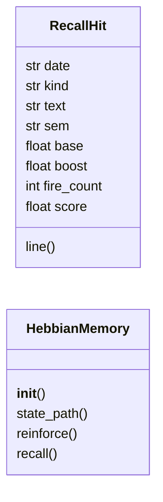
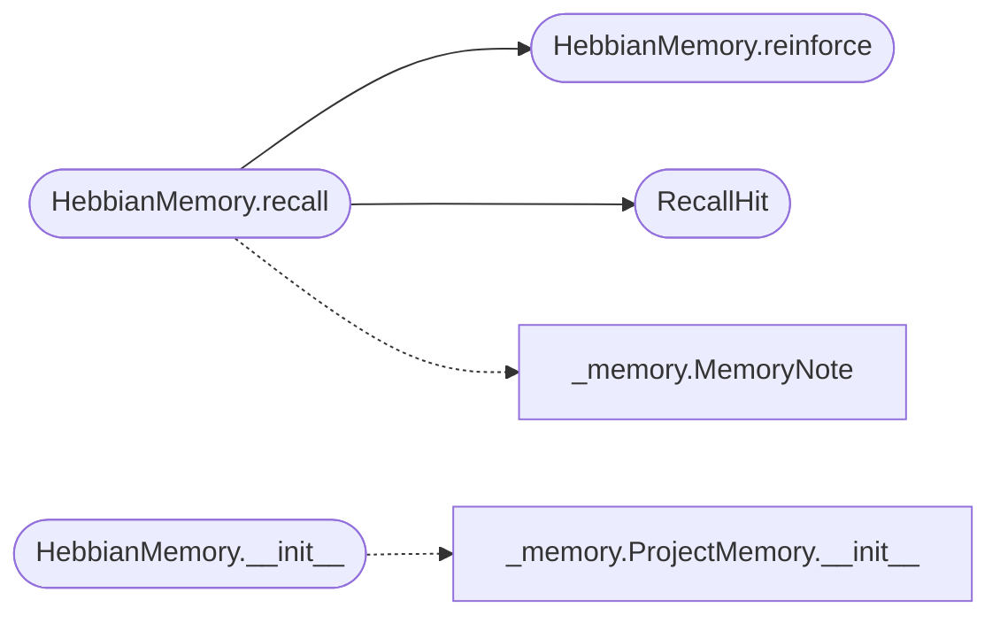

# `readmenator._hebbian`

> Source: [readmenator/_hebbian.py:1](../../readmenator/_hebbian.py#L1) | language `py` | coverage 100.0% | [API index](../index.md)

Zero-inference recall over the preserved session log, hebbmesh style.

MEMORY.md notes become recallable in under a millisecond with zero
embeddings and zero LLM calls:

- Write-time semantic seeding: ``readmenator . remember "<note>" --sem
  "synonym, synonym"`` stores 3-5 explicit synonyms as a ``| sem:``
  suffix. They act as high-weight dendrites, so a query in different
  words still finds the note (no embedding model needed).
- Hebbian reinforcement: every recall strengthens the co-activation
  weights between the notes that fired together ("cells that fire
  together wire together"). Weights live in MEMORY_STATE.json next to
  MEMORY.md and persist across sessions; nothing is inferred, only
  counted.
- Recall = lexical base score (note body + seeded synonyms) plus a
  saturating boost from co-activation with every primed note, so the
  graph of past recalls guides retrieval without any model.

The state file is deterministic JSON (sorted keys, capped pairs), lives
inside the agent output directory the scanner already skips, and is
bounded by configuration so it can never grow without limit.

## Contents

- **Classes:** [`RecallHit`](#recallhit), [`HebbianMemory`](#hebbianmemory)

## Type Diagram



## Call Graph

Solid arrows stay in this module, dashed arrows leave it.



## Classes

<a id="recallhit"></a>

### `RecallHit`

`class` `dataclass` | [readmenator/_hebbian.py:42](../../readmenator/_hebbian.py#L42)

Decorators: `@dataclass(frozen=True)`

```python
class RecallHit
```

One scored memory note.

**Attributes**

| Name | Type | Default | Description |
|---|---|---|---|
| [`date`](#recallhit-date) | `str` |  | ISO date of the note. |
| [`kind`](#recallhit-kind) | `str` |  | Note kind. |
| [`text`](#recallhit-text) | `str` |  | Note body (without the sem suffix). |
| [`sem`](#recallhit-sem) | `str` |  | Write-time semantic seeds ("" when absent). |
| [`base`](#recallhit-base) | `float` |  | Lexical score from body + seeds. |
| [`boost`](#recallhit-boost) | `float` |  | Hebbian co-activation boost added on top of base. |
| [`fire_count`](#recallhit-fire_count) | `int` |  | Times this note has been a recall winner before. |
| [`score`](#recallhit-score) | `float` |  | Final score (base + boost), the sort key. |

**Members**

| Member | Kind | Summary |
|---|---|---|
| [`line`](#recallhit-line) | method | Render the hit as one greppable line. |

<a id="recallhit-line"></a>

#### `RecallHit.line`

`method` | [readmenator/_hebbian.py:65](../../readmenator/_hebbian.py#L65)

```python
def line(self) -> str
```

Render the hit as one greppable line.

**Returns:** `str`

---

<a id="hebbianmemory"></a>

### `HebbianMemory`

`class` | [readmenator/_hebbian.py:74](../../readmenator/_hebbian.py#L74)

```python
class HebbianMemory
```

Recall and Hebbian reinforcement over MEMORY.md session notes.

**Members**

| Member | Kind | Summary |
|---|---|---|
| [`__init__`](#hebbianmemory-__init__) | constructor | Store configuration and the memory reader. |
| [`state_path`](#hebbianmemory-state_path) | method | Return the co-activation state file location. |
| [`reinforce`](#hebbianmemory-reinforce) | method | Strengthen co-activation between the notes that fired together. |
| [`recall`](#hebbianmemory-recall) | method | Score notes against the query and reinforce the winners. |

<a id="hebbianmemory-__init__"></a>

#### `HebbianMemory.__init__`

`constructor` | [readmenator/_hebbian.py:77](../../readmenator/_hebbian.py#L77)

```python
def __init__(self, config: Config, memory: Optional[ProjectMemory] = None) -> None
```

Store configuration and the memory reader.

**Parameters**

| Name | Type | Default | Description |
|---|---|---|---|
| `config` | `Config` |  | MEMORY_*/HEBBIAN_* settings and output directories. |
| `memory` | `Optional[ProjectMemory]` | `None` | Project memory reader (defaults to a fresh one). |

*Calls:* [`ProjectMemory.__init__`](readmenator._memory.py.md#projectmemory-__init__)

*Called by:* [`AnalyzerFactory.hebbian`](readmenator._pipeline.py.md#analyzerfactory-hebbian)

<a id="hebbianmemory-state_path"></a>

#### `HebbianMemory.state_path`

`method` | [readmenator/_hebbian.py:87](../../readmenator/_hebbian.py#L87)

```python
def state_path(self, project_root: str) -> Path
```

Return the co-activation state file location.

**Parameters**

| Name | Type | Default | Description |
|---|---|---|---|
| `project_root` | `str` |  |  |

**Returns:** `Path`

<a id="hebbianmemory-reinforce"></a>

#### `HebbianMemory.reinforce`

`method` | [readmenator/_hebbian.py:129](../../readmenator/_hebbian.py#L129)

```python
def reinforce(self, project_root: str, winners: List[MemoryNote]) -> None
```

Strengthen co-activation between the notes that fired together.

**Parameters**

| Name | Type | Default | Description |
|---|---|---|---|
| `project_root` | `str` |  | Project root directory. |
| `winners` | `List[MemoryNote]` |  | Notes selected by the last recall, in score order. |

*Called by:* [`HebbianMemory.recall`](#hebbianmemory-recall)

<a id="hebbianmemory-recall"></a>

#### `HebbianMemory.recall`

`method` | [readmenator/_hebbian.py:148](../../readmenator/_hebbian.py#L148)

```python
def recall(self, project_root: str, query: str, top_k: int = 0, reinforce_winners: bool = True) -> List[RecallHit]
```

Score notes against the query and reinforce the winners.

Base score: unique query tokens found in the note body count 1.0
each, tokens found in the ``| sem:`` seeds count MEMORY_SEM_WEIGHT
each (seeded dendrites fire easier). Hebbian boost: every note
that shares co-activation history with a primed note (any note
with base > 0) gains a saturating MEMORY_HEBBIAN_BOOST * w/(w+k)
per such neighbour, so notes that repeatedly proved useful
together surface first without any model.

**Parameters**

| Name | Type | Default | Description |
|---|---|---|---|
| `project_root` | `str` |  | Project root directory. |
| `query` | `str` |  | Free-text query (any language). |
| `top_k` | `int` | `0` | Winners kept; 0 uses MEMORY_RECALL_TOP_K. |
| `reinforce_winners` | `bool` | `True` | Whether the winners strengthen the graph. |

**Returns:** `List[RecallHit]` - Scored hits, best first, only notes with score > 0.

*Calls:* [`HebbianMemory.reinforce`](#hebbianmemory-reinforce), [`RecallHit`](#recallhit), [`MemoryNote`](readmenator._memory.py.md#memorynote)

---
