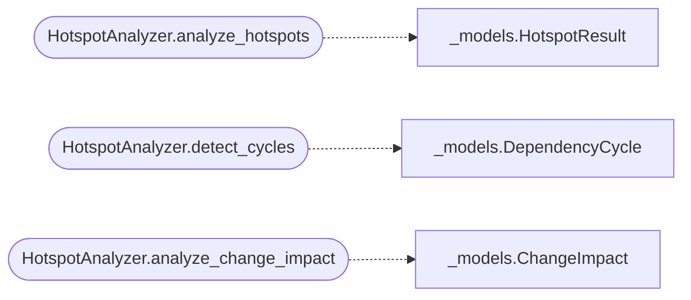

# `readmenator._hotspots`

> Source: [readmenator/_hotspots.py:1](../../readmenator/_hotspots.py#L1) | language `py` | coverage 83.3% | [API index](../index.md)

Hotspot, dependency cycle, and change impact analysis.

Scores files by complexity plus centrality, finds import cycles with DFS,
and measures transitive dependents with bounded BFS.

## Contents

- **Classes:** [`HotspotAnalyzer`](#hotspotanalyzer)

## Call Graph

Solid arrows stay in this module, dashed arrows leave it.



## Classes

<a id="hotspotanalyzer"></a>

### `HotspotAnalyzer`

`class` | [readmenator/_hotspots.py:22](../../readmenator/_hotspots.py#L22)

```python
class HotspotAnalyzer
```

Hotspot detection, cycle analysis, and change impact analysis.

Hotspots are files with high complexity (many symbols) and high
centrality (many connections). Cycle detection finds circular
dependencies in the resolved import graph. Change impact analysis
computes transitive-dependent lists for every file.

**Members**

| Member | Kind | Summary |
|---|---|---|
| [`__init__`](#hotspotanalyzer-__init__) | constructor |  |
| [`analyze_hotspots`](#hotspotanalyzer-analyze_hotspots) | method | Rank files by combined complexity and centrality scores. |
| [`detect_cycles`](#hotspotanalyzer-detect_cycles) | method | Detect cycles in the resolved import graph using DFS. |
| [`analyze_change_impact`](#hotspotanalyzer-analyze_change_impact) | method | Compute change impact for every file in the project. |

<a id="hotspotanalyzer-__init__"></a>

#### `HotspotAnalyzer.__init__`

`constructor` | [readmenator/_hotspots.py:31](../../readmenator/_hotspots.py#L31)

```python
def __init__(self, config: Config) -> None
```

**Parameters**

| Name | Type | Default | Description |
|---|---|---|---|
| `config` | `Config` |  |  |

*Called by:* [`AnalyzerFactory.hotspots`](readmenator._pipeline.py.md#analyzerfactory-hotspots)

<a id="hotspotanalyzer-analyze_hotspots"></a>

#### `HotspotAnalyzer.analyze_hotspots`

`method` | [readmenator/_hotspots.py:34](../../readmenator/_hotspots.py#L34)

```python
def analyze_hotspots(self, nodes: List[Node], edges: List[Edge], resolved_edges: Optional[List[Edge]] = None) -> List[HotspotResult]
```

Rank files by combined complexity and centrality scores.

Complexity is normalised symbol count. Centrality is normalised
connection count (in-degree + out-degree). The combined score
uses configured weights.

**Parameters**

| Name | Type | Default | Description |
|---|---|---|---|
| `nodes` | `List[Node]` |  |  |
| `edges` | `List[Edge]` |  |  |
| `resolved_edges` | `Optional[List[Edge]]` | `None` |  |

**Returns:** `List[HotspotResult]`

*Calls:* [`HotspotResult`](readmenator._models.py.md#hotspotresult)

<a id="hotspotanalyzer-detect_cycles"></a>

#### `HotspotAnalyzer.detect_cycles`

`method` | [readmenator/_hotspots.py:90](../../readmenator/_hotspots.py#L90)

```python
def detect_cycles(self, nodes: List[Node], resolved_edges: Optional[List[Edge]] = None) -> List[DependencyCycle]
```

Detect cycles in the resolved import graph using DFS.

Uses Tarjan's algorithm variant with three-colour DFS to find
all elementary cycles. Returns each cycle as a DependencyCycle.

**Parameters**

| Name | Type | Default | Description |
|---|---|---|---|
| `nodes` | `List[Node]` |  |  |
| `resolved_edges` | `Optional[List[Edge]]` | `None` |  |

**Returns:** `List[DependencyCycle]`

*Calls:* [`DependencyCycle`](readmenator._models.py.md#dependencycycle)

<a id="hotspotanalyzer-analyze_change_impact"></a>

#### `HotspotAnalyzer.analyze_change_impact`

`method` | [readmenator/_hotspots.py:155](../../readmenator/_hotspots.py#L155)

```python
def analyze_change_impact(self, nodes: List[Node], resolved_edges: Optional[List[Edge]] = None) -> List[ChangeImpact]
```

Compute change impact for every file in the project.

For each file, finds all files that would be affected if it
changed (direct and transitive dependents via reverse import
graph traversal).

**Parameters**

| Name | Type | Default | Description |
|---|---|---|---|
| `nodes` | `List[Node]` |  |  |
| `resolved_edges` | `Optional[List[Edge]]` | `None` |  |

**Returns:** `List[ChangeImpact]`

*Calls:* [`ChangeImpact`](readmenator._models.py.md#changeimpact)

---
