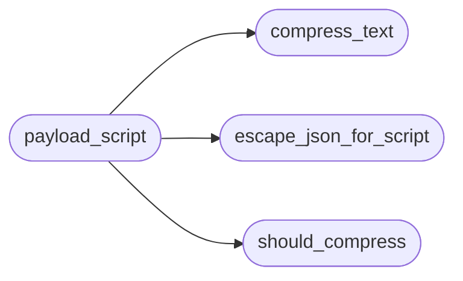

# `readmenator._htmlpack`

> Source: [readmenator/_htmlpack.py:1](../../readmenator/_htmlpack.py#L1) | language `py` | coverage 100.0% | [API index](../index.md)

Compact JSON payload embedding for self-contained HTML pages.

Large pages embed their data as one JSON document. Generated API data
is highly repetitive (file paths, kinds, signatures, parameter names),
so payloads above PAYLOAD_COMPRESSION_MIN_BYTES are gzip-compressed and
base64-encoded into the script tag. The page decodes them offline with
the browser's native DecompressionStream: zero dependencies, zero
requests, and it works from file:// as well as static hosting.
Small payloads stay plain JSON so they remain greppable.

## Contents

- **Functions:** [`escape_json_for_script`](#escape_json_for_script), [`should_compress`](#should_compress), [`compress_text`](#compress_text), [`payload_script`](#payload_script), [`read_payload_script`](#read_payload_script)
- **Constants:** [`PAYLOAD_ENCODING_GZIP`](#payload_encoding_gzip), [`PAYLOAD_LOADER_JS`](#payload_loader_js)

## Call Graph

Solid arrows stay in this module, dashed arrows leave it.



## Functions

<a id="escape_json_for_script"></a>

### `escape_json_for_script`

`function` | [readmenator/_htmlpack.py:49](../../readmenator/_htmlpack.py#L49)

```python
def escape_json_for_script(text: str, chars: str = '<>&') -> str
```

Escape JSON text so it can never close or confuse a script element.

**Parameters**

| Name | Type | Default | Description |
|---|---|---|---|
| `text` | `str` |  | Serialized JSON. |
| `chars` | `str` | `'<>&'` | Characters to unicode-escape; "<" is always included. |

**Returns:** `str` - JSON text with the requested characters unicode-escaped.

*Called by:* [`payload_script`](#payload_script)

---

<a id="should_compress"></a>

### `should_compress`

`function` | [readmenator/_htmlpack.py:64](../../readmenator/_htmlpack.py#L64)

```python
def should_compress(raw_size: int, config: Config) -> bool
```

Decide whether a payload of raw_size bytes gets compressed.

**Parameters**

| Name | Type | Default | Description |
|---|---|---|---|
| `raw_size` | `int` |  | Size of the serialized JSON in UTF-8 bytes. |
| `config` | `Config` |  | Application configuration. |

**Returns:** `bool` - True when compression is enabled and the payload reaches the threshold.

*Called by:* [`payload_script`](#payload_script)

---

<a id="compress_text"></a>

### `compress_text`

`function` | [readmenator/_htmlpack.py:77](../../readmenator/_htmlpack.py#L77)

```python
def compress_text(text: str, config: Config) -> str
```

Gzip and base64-encode text deterministically (mtime fixed at zero).

**Parameters**

| Name | Type | Default | Description |
|---|---|---|---|
| `text` | `str` |  | Text to compress. |
| `config` | `Config` |  | Application configuration (PAYLOAD_COMPRESSION_LEVEL). |

**Returns:** `str` - ASCII base64 string of the gzip stream.

*Called by:* [`payload_script`](#payload_script)

---

<a id="payload_script"></a>

### `payload_script`

`function` | [readmenator/_htmlpack.py:92](../../readmenator/_htmlpack.py#L92)

```python
def payload_script(element_id: str, payload: object, config: Config, compact: bool = True, escape: str = '<>&') -> str
```

Render the script element carrying a page payload.

Plain payloads keep the exact serialization each page used before
(separators and escaped characters), so small pages are unchanged.

**Parameters**

| Name | Type | Default | Description |
|---|---|---|---|
| `element_id` | `str` |  | DOM id the page loader reads. |
| `payload` | `object` |  | JSON-serializable payload. |
| `config` | `Config` |  | Application configuration. |
| `compact` | `bool` | `True` | True for "," / ":" separators, False for json.dumps defaults. |
| `escape` | `str` | `'<>&'` | Characters unicode-escaped in plain JSON ("<" always is). |

**Returns:** `str` - A plain application/json script element, or a gzip+base64
application/octet-stream element when the payload is large.

*Calls:* [`compress_text`](#compress_text), [`escape_json_for_script`](#escape_json_for_script), [`should_compress`](#should_compress)

*Called by:* [`render_api_site`](readmenator._apidocs_page.py.md#render_api_site), [`BundleGraphRenderer.render`](readmenator._bundlegraph.py.md#bundlegraphrenderer-render), [`InteractiveMapRenderer.render`](readmenator._diagrams.py.md#interactivemaprenderer-render), [`VisNetworkRenderer.render`](readmenator._diagrams.py.md#visnetworkrenderer-render), [`render_flows_page`](readmenator._flowpage.py.md#render_flows_page), [`ForceGraphRenderer.render`](readmenator._forcegraph.py.md#forcegraphrenderer-render)

---

<a id="read_payload_script"></a>

### `read_payload_script`

`function` | [readmenator/_htmlpack.py:119](../../readmenator/_htmlpack.py#L119)

```python
def read_payload_script(document: str, element_id: str) -> Optional[object]
```

Decode a payload script element from a rendered page (plain or gzip+base64).

**Parameters**

| Name | Type | Default | Description |
|---|---|---|---|
| `document` | `str` |  | Rendered HTML document. |
| `element_id` | `str` |  | DOM id of the payload script element. |

**Returns:** `Optional[object]` - The decoded JSON value, or None when the element is missing or empty.

---

## Constants

<a id="payload_encoding_gzip"></a>

### `PAYLOAD_ENCODING_GZIP`

`constant` | [readmenator/_htmlpack.py:24](../../readmenator/_htmlpack.py#L24)

```python
PAYLOAD_ENCODING_GZIP = 'gzip+base64'
```

---

<a id="payload_loader_js"></a>

### `PAYLOAD_LOADER_JS`

`constant` | [readmenator/_htmlpack.py:26](../../readmenator/_htmlpack.py#L26)

```python
PAYLOAD_LOADER_JS
```

---
