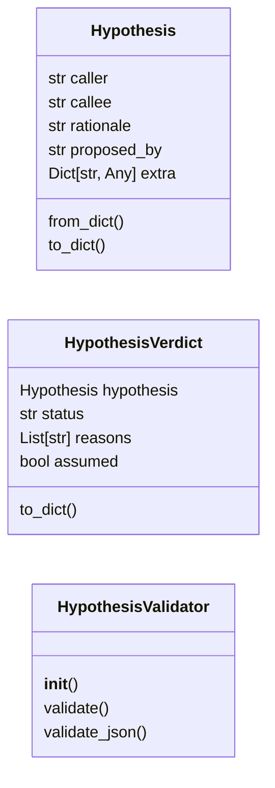
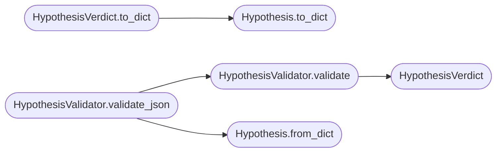

# `readmenator._hypotheses`

> Source: [readmenator/_hypotheses.py:1](../../readmenator/_hypotheses.py#L1) | language `py` | coverage 30.0% | [API index](../index.md)

Hypothesis validator: LLM/agent proposals are never facts.

The LLM proposes, the model scores, but only this validator (backed by
the AST symbol index, the static graph and receipts) decides whether a
proposed edge enters the graph as verified or is rejected with the
reason recorded. Works fully offline: proposals arrive as JSON from
any agent; no LLM is invoked here.

## Contents

- **Classes:** [`Hypothesis`](#hypothesis), [`HypothesisVerdict`](#hypothesisverdict), [`HypothesisValidator`](#hypothesisvalidator)
- **Constants:** [`STATUS_VERIFIED`](#status_verified), [`STATUS_REJECTED`](#status_rejected), [`REQUIRED_FIELDS`](#required_fields)

## Type Diagram



## Call Graph

Solid arrows stay in this module, dashed arrows leave it.



## Classes

<a id="hypothesis"></a>

### `Hypothesis`

`class` `dataclass` | [readmenator/_hypotheses.py:25](../../readmenator/_hypotheses.py#L25)

Decorators: `@dataclass`

```python
class Hypothesis
```

**Attributes**

| Name | Type | Default | Description |
|---|---|---|---|
| [`caller`](#hypothesis-caller) | `str` |  |  |
| [`callee`](#hypothesis-callee) | `str` |  |  |
| [`rationale`](#hypothesis-rationale) | `str` | `''` |  |
| [`proposed_by`](#hypothesis-proposed_by) | `str` | `'agent'` |  |
| [`extra`](#hypothesis-extra) | `Dict[str, Any]` | `field(default_factory=dict)` |  |

**Members**

| Member | Kind | Summary |
|---|---|---|
| [`from_dict`](#hypothesis-from_dict) | classmethod |  |
| [`to_dict`](#hypothesis-to_dict) | method |  |

<a id="hypothesis-from_dict"></a>

#### `Hypothesis.from_dict`

`classmethod` | [readmenator/_hypotheses.py:33](../../readmenator/_hypotheses.py#L33)

Decorators: `@classmethod`

```python
def from_dict(cls, data: Dict[str, Any]) -> 'Hypothesis'
```

**Parameters**

| Name | Type | Default | Description |
|---|---|---|---|
| `data` | `Dict[str, Any]` |  |  |

**Returns:** `'Hypothesis'`

**Raises**

- `ValueError`: (raised in the body, not documented)

*Called by:* [`HypothesisValidator.validate_json`](#hypothesisvalidator-validate_json)

<a id="hypothesis-to_dict"></a>

#### `Hypothesis.to_dict`

`method` | [readmenator/_hypotheses.py:49](../../readmenator/_hypotheses.py#L49)

```python
def to_dict(self) -> Dict[str, Any]
```

**Returns:** `Dict[str, Any]`

*Called by:* [`HypothesisVerdict.to_dict`](#hypothesisverdict-to_dict)

---

<a id="hypothesisverdict"></a>

### `HypothesisVerdict`

`class` `dataclass` | [readmenator/_hypotheses.py:58](../../readmenator/_hypotheses.py#L58)

Decorators: `@dataclass(frozen=True)`

```python
class HypothesisVerdict
```

**Attributes**

| Name | Type | Default | Description |
|---|---|---|---|
| [`hypothesis`](#hypothesisverdict-hypothesis) | `Hypothesis` |  |  |
| [`status`](#hypothesisverdict-status) | `str` |  |  |
| [`reasons`](#hypothesisverdict-reasons) | `List[str]` | `field(default_factory=list)` |  |
| [`assumed`](#hypothesisverdict-assumed) | `bool` | `False` |  |

**Members**

| Member | Kind | Summary |
|---|---|---|
| [`to_dict`](#hypothesisverdict-to_dict) | method |  |

<a id="hypothesisverdict-to_dict"></a>

#### `HypothesisVerdict.to_dict`

`method` | [readmenator/_hypotheses.py:64](../../readmenator/_hypotheses.py#L64)

```python
def to_dict(self) -> Dict[str, Any]
```

**Returns:** `Dict[str, Any]`

*Calls:* [`Hypothesis.to_dict`](#hypothesis-to_dict)

---

<a id="hypothesisvalidator"></a>

### `HypothesisValidator`

`class` | [readmenator/_hypotheses.py:73](../../readmenator/_hypotheses.py#L73)

```python
class HypothesisValidator
```

Constraint checker for proposed caller->callee edges.

A proposal is verified only when every constraint passes:
  1. well-formed (required fields present);
  2. the callee exists in the symbol universe (static graph /
     symbol index / receipts);
  3. the caller is known, or the proposal marks it `[`assumed`](#hypothesisverdict-assumed)`
     with an explicit user approval note.

**Members**

| Member | Kind | Summary |
|---|---|---|
| [`__init__`](#hypothesisvalidator-__init__) | constructor |  |
| [`validate`](#hypothesisvalidator-validate) | method |  |
| [`validate_json`](#hypothesisvalidator-validate_json) | method | Validate a JSON list (or single object) of LLM proposals. |

<a id="hypothesisvalidator-__init__"></a>

#### `HypothesisValidator.__init__`

`constructor` | [readmenator/_hypotheses.py:84](../../readmenator/_hypotheses.py#L84)

```python
def __init__(self, known_edges: Optional[Set[Tuple[str, str]]] = None, known_symbols: Optional[Set[str]] = None) -> None
```

**Parameters**

| Name | Type | Default | Description |
|---|---|---|---|
| `known_edges` | `Optional[Set[Tuple[str, str]]]` | `None` |  |
| `known_symbols` | `Optional[Set[str]]` | `None` |  |

<a id="hypothesisvalidator-validate"></a>

#### `HypothesisValidator.validate`

`method` | [readmenator/_hypotheses.py:92](../../readmenator/_hypotheses.py#L92)

```python
def validate(self, hypothesis: Hypothesis, allow_assumed: bool = False) -> HypothesisVerdict
```

**Parameters**

| Name | Type | Default | Description |
|---|---|---|---|
| `hypothesis` | `Hypothesis` |  |  |
| `allow_assumed` | `bool` | `False` |  |

**Returns:** `HypothesisVerdict`

*Calls:* [`HypothesisVerdict`](#hypothesisverdict)

*Called by:* [`HypothesisValidator.validate_json`](#hypothesisvalidator-validate_json)

<a id="hypothesisvalidator-validate_json"></a>

#### `HypothesisValidator.validate_json`

`method` | [readmenator/_hypotheses.py:126](../../readmenator/_hypotheses.py#L126)

```python
def validate_json(self, raw_json: str, allow_assumed: bool = False) -> List[HypothesisVerdict]
```

Validate a JSON list (or single object) of LLM proposals.

**Parameters**

| Name | Type | Default | Description |
|---|---|---|---|
| `raw_json` | `str` |  |  |
| `allow_assumed` | `bool` | `False` |  |

**Returns:** `List[HypothesisVerdict]`

**Raises**

- `ValueError`: (raised in the body, not documented)

*Calls:* [`Hypothesis.from_dict`](#hypothesis-from_dict), [`HypothesisValidator.validate`](#hypothesisvalidator-validate)

---

## Constants

<a id="status_verified"></a>

### `STATUS_VERIFIED`

`constant` | [readmenator/_hypotheses.py:18](../../readmenator/_hypotheses.py#L18)

```python
STATUS_VERIFIED = 'verified'
```

---

<a id="status_rejected"></a>

### `STATUS_REJECTED`

`constant` | [readmenator/_hypotheses.py:19](../../readmenator/_hypotheses.py#L19)

```python
STATUS_REJECTED = 'rejected'
```

---

<a id="required_fields"></a>

### `REQUIRED_FIELDS`

`constant` | [readmenator/_hypotheses.py:21](../../readmenator/_hypotheses.py#L21)

```python
REQUIRED_FIELDS: Tuple[str, ...] = ('caller', 'callee')
```

---
