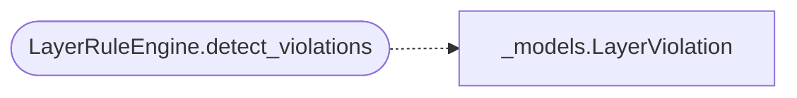

# `readmenator._layer_rules`

> Source: [readmenator/_layer_rules.py:1](../../readmenator/_layer_rules.py#L1) | language `py` | coverage 80.0% | [API index](../index.md)

Architecture layer rule engine: forbidden and warning edges between layers.

## Contents

- **Classes:** [`LayerRuleEngine`](#layerruleengine)

## Call Graph

Solid arrows stay in this module, dashed arrows leave it.



## Classes

<a id="layerruleengine"></a>

### `LayerRuleEngine`

`class` | [readmenator/_layer_rules.py:11](../../readmenator/_layer_rules.py#L11)

```python
class LayerRuleEngine
```

Architectural layer violation detection engine.

Defines a set of permitted and forbidden layer-to-layer import
rules. Scans all resolved import edges and flags violations
where one layer imports from another in a way that violates
the architecture.

**Attributes**

| Name | Type | Default | Description |
|---|---|---|---|
| [`FORBIDDEN_EDGES`](#layerruleengine-forbidden_edges) | `Set[Tuple[str, str]]` | `{('testing', 'presentation'), ('presentation', 'data_access')}` |  |
| [`ALLOWED_EDGES`](#layerruleengine-allowed_edges) | `Set[Tuple[str, str]]` | `{('testing', 'business_logic'), ('testing', 'infrastructure'), ('testing', 'data_access')}` |  |
| [`WARN_EDGES`](#layerruleengine-warn_edges) | `Set[Tuple[str, str]]` | `{('data_access', 'presentation'), ('infrastructure', 'presentation')}` |  |

**Members**

| Member | Kind | Summary |
|---|---|---|
| [`__init__`](#layerruleengine-__init__) | constructor |  |
| [`detect_violations`](#layerruleengine-detect_violations) | method | Detect architectural layer violations. |
| [`violation_summary`](#layerruleengine-violation_summary) | staticmethod | Summarise violations by severity. |

<a id="layerruleengine-__init__"></a>

#### `LayerRuleEngine.__init__`

`constructor` | [readmenator/_layer_rules.py:36](../../readmenator/_layer_rules.py#L36)

```python
def __init__(self, config: Config) -> None
```

**Parameters**

| Name | Type | Default | Description |
|---|---|---|---|
| `config` | `Config` |  |  |

*Called by:* [`AnalyzerFactory.layer_rules`](readmenator._pipeline.py.md#analyzerfactory-layer_rules)

<a id="layerruleengine-detect_violations"></a>

#### `LayerRuleEngine.detect_violations`

`method` | [readmenator/_layer_rules.py:39](../../readmenator/_layer_rules.py#L39)

```python
def detect_violations(self, nodes: List[Node], edges: List[Edge], resolved_edges: Optional[List[Edge]] = None, layers: Optional[Dict[str, str]] = None) -> List[LayerViolation]
```

Detect architectural layer violations.

**Parameters**

| Name | Type | Default | Description |
|---|---|---|---|
| `nodes` | `List[Node]` |  | Scanned file nodes. |
| `edges` | `List[Edge]` |  | Import edges. |
| `resolved_edges` | `Optional[List[Edge]]` | `None` | Optional resolved import edges. |
| `layers` | `Optional[Dict[str, str]]` | `None` | Dict mapping node_id to layer name. If None, imports _layers.LayerDetector for automatic detection. |

**Returns:** `List[LayerViolation]` - List of LayerViolation instances.

*Calls:* [`LayerViolation`](readmenator._models.py.md#layerviolation)

<a id="layerruleengine-violation_summary"></a>

#### `LayerRuleEngine.violation_summary`

`staticmethod` | [readmenator/_layer_rules.py:111](../../readmenator/_layer_rules.py#L111)

Decorators: `@staticmethod`

```python
def violation_summary(violations: List[LayerViolation]) -> Dict[str, int]
```

Summarise violations by severity.

**Parameters**

| Name | Type | Default | Description |
|---|---|---|---|
| `violations` | `List[LayerViolation]` |  |  |

**Returns:** `Dict[str, int]`

---
