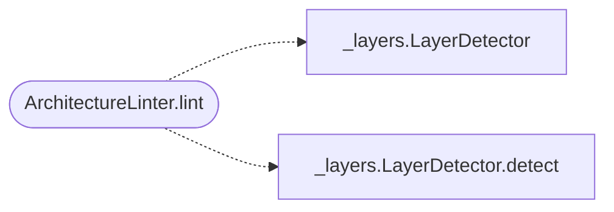

# `readmenator._linter`

> Source: [readmenator/_linter.py:1](../../readmenator/_linter.py#L1) | language `py` | coverage 75.0% | [API index](../index.md)

Architecture linter for the readmenator knowledge graph.

Evaluates files against predefined architectural rules: file length
limits, cross-layer import violations, circular dependency detection,
and unresolved call targets. All rules are deterministic and
token-free; call targets resolve through the symbol index with file
and line evidence.

## Contents

- **Classes:** [`ArchitectureLinter`](#architecturelinter)

## Call Graph

Solid arrows stay in this module, dashed arrows leave it.



## Classes

<a id="architecturelinter"></a>

### `ArchitectureLinter`

`class` | [readmenator/_linter.py:21](../../readmenator/_linter.py#L21)

```python
class ArchitectureLinter
```

Enforces architectural rules over scanned nodes and edges.

Checks file length, cross-layer import violations, circular
dependencies, and calls that resolve to no project definition.
Returns structured LinterViolation instances for each issue.

**Attributes**

| Name | Type | Default | Description |
|---|---|---|---|
| [`FORBIDDEN_IMPORTS`](#architecturelinter-forbidden_imports) | `Dict[str, Set[str]]` | `{'presentation': {'data_access', 'repository', 'database', 'dao', 'orm', 'migration'}, 'testing': {'presentation'}}` |  |

**Members**

| Member | Kind | Summary |
|---|---|---|
| [`__init__`](#architecturelinter-__init__) | constructor |  |
| [`lint`](#architecturelinter-lint) | method | Run all linter rules and return violations. |

<a id="architecturelinter-__init__"></a>

#### `ArchitectureLinter.__init__`

`constructor` | [readmenator/_linter.py:34](../../readmenator/_linter.py#L34)

```python
def __init__(self, config: Config) -> None
```

**Parameters**

| Name | Type | Default | Description |
|---|---|---|---|
| `config` | `Config` |  |  |

*Called by:* [`readmenatorApplication.generate_cursorrules`](readmenator._app.py.md#readmenatorapplication-generate_cursorrules), [`readmenatorApplication.lint`](readmenator._app.py.md#readmenatorapplication-lint)

<a id="architecturelinter-lint"></a>

#### `ArchitectureLinter.lint`

`method` | [readmenator/_linter.py:37](../../readmenator/_linter.py#L37)

```python
def lint(self, nodes: List[Node], edges: List[Edge], resolved_edges: Optional[List[Edge]] = None, layers: Optional[Dict[str, str]] = None, content_map: Optional[Dict[str, str]] = None) -> List[LinterViolation]
```

Run all linter rules and return violations.

**Parameters**

| Name | Type | Default | Description |
|---|---|---|---|
| `nodes` | `List[Node]` |  | Scanned file nodes. |
| `edges` | `List[Edge]` |  | Import edges. |
| `resolved_edges` | `Optional[List[Edge]]` | `None` | Optional resolved-import edges. |
| `layers` | `Optional[Dict[str, str]]` | `None` | Optional mapping from node_id to layer name. |
| `content_map` | `Optional[Dict[str, str]]` | `None` | Optional mapping from node_id to file content. |

**Returns:** `List[LinterViolation]` - List of LinterViolation instances sorted by severity.

*Calls:* [`LayerDetector`](readmenator._layers.py.md#layerdetector), [`LayerDetector.detect`](readmenator._layers.py.md#layerdetector-detect)

*Called by:* [`readmenatorApplication.generate_cursorrules`](readmenator._app.py.md#readmenatorapplication-generate_cursorrules), [`readmenatorApplication.lint`](readmenator._app.py.md#readmenatorapplication-lint)

---
