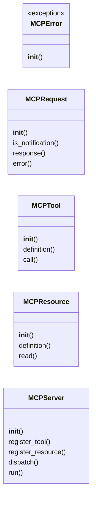
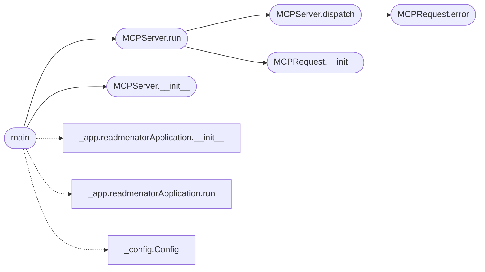

# `readmenator._mcp_server`

> Source: [readmenator/_mcp_server.py:1](../../readmenator/_mcp_server.py#L1) | language `py` | coverage 8.7% | [API index](../index.md)

MCP (Model Context Protocol) stdio server for ReadMenator.

Exposes the full codebase knowledge graph as MCP tools and resources,
allowing AI agents to query structural information without parsing
KNOWLEDGE_BASE.md as text. Each query costs ~50-200 tokens vs
2000-8000+ tokens of reading the full KB file.

Tools:
  readmenator.summary       — codebase overview (files, symbols, langs)
  readmenator.query         — free-text symbol/file search
  readmenator.explain       — detailed symbol explanation
  readmenator.path          — dependency chain between two symbols
  readmenator.findings      — security findings
  readmenator.taint         — taint propagation analysis
  readmenator.hotspots      — hotspot analysis
  readmenator.cycles        — dependency cycles
  readmenator.communities   — community detection
  readmenator.layers        — architectural layers
  readmenator.layer_violations — layer rule violations
  readmenator.rebuild       — regenerate KNOWLEDGE_BASE.md
  readmenator.update        — incremental update (SHA256 cache)
  readmenator.export_json   — export graph.json
  readmenator.security_summary — security audit summary
  readmenator.graphrag      — GraphRAG local/global context retrieval
  readmenator.memory        — project memory (rules, workflow, session log)
  readmenator.remember      — append to the preserved session log

Resources:
  readmenator://summary     — structured JSON summary
  readmenator://graph       — graph data (nodes + edges)
  readmenator://file/{path} — file details
  readmenator://symbol/{name} — symbol details
  readmenator://findings    — security findings
  readmenator://analysis    — full analysis result
  readmenator://kb          — full KNOWLEDGE_BASE.md text
  readmenator://graphrag    — GraphRAG community reports

## Contents

- **Classes:** [`MCPRequest`](#mcprequest), [`MCPTool`](#mcptool), [`MCPResource`](#mcpresource), [`MCPServer`](#mcpserver)
- **Exceptions:** [`MCPError`](#mcperror)
- **Functions:** [`main`](#main)
- **Constants:** [`TOOL_CALL_ERROR`](#tool_call_error), [`INVALID_PARAMS`](#invalid_params), [`METHOD_NOT_FOUND`](#method_not_found), [`INTERNAL_ERROR`](#internal_error)

## Type Diagram



## Call Graph

Solid arrows stay in this module, dashed arrows leave it.



## Classes

<a id="mcprequest"></a>

### `MCPRequest`

`class` | [readmenator/_mcp_server.py:71](../../readmenator/_mcp_server.py#L71)

```python
class MCPRequest
```

**Members**

| Member | Kind | Summary |
|---|---|---|
| [`__init__`](#mcprequest-__init__) | constructor |  |
| [`is_notification`](#mcprequest-is_notification) | property |  |
| [`response`](#mcprequest-response) | method |  |
| [`error`](#mcprequest-error) | method |  |

<a id="mcprequest-__init__"></a>

#### `MCPRequest.__init__`

`constructor` | [readmenator/_mcp_server.py:72](../../readmenator/_mcp_server.py#L72)

```python
def __init__(self, msg: Dict[str, Any])
```

**Parameters**

| Name | Type | Default | Description |
|---|---|---|---|
| `msg` | `Dict[str, Any]` |  |  |

*Called by:* [`MCPServer.run`](#mcpserver-run)

<a id="mcprequest-is_notification"></a>

#### `MCPRequest.is_notification`

`property` | [readmenator/_mcp_server.py:79](../../readmenator/_mcp_server.py#L79)

Decorators: `@property`

```python
def is_notification(self) -> bool
```

**Returns:** `bool`

<a id="mcprequest-response"></a>

#### `MCPRequest.response`

`method` | [readmenator/_mcp_server.py:82](../../readmenator/_mcp_server.py#L82)

```python
def response(self, result: Any = None) -> Dict[str, Any]
```

**Parameters**

| Name | Type | Default | Description |
|---|---|---|---|
| `result` | `Any` | `None` |  |

**Returns:** `Dict[str, Any]`

<a id="mcprequest-error"></a>

#### `MCPRequest.error`

`method` | [readmenator/_mcp_server.py:85](../../readmenator/_mcp_server.py#L85)

```python
def error(self, code: int, message: str, data: Any = None) -> Dict[str, Any]
```

**Parameters**

| Name | Type | Default | Description |
|---|---|---|---|
| `code` | `int` |  |  |
| `message` | `str` |  |  |
| `data` | `Any` | `None` |  |

**Returns:** `Dict[str, Any]`

*Called by:* [`MCPServer.dispatch`](#mcpserver-dispatch)

---

<a id="mcptool"></a>

### `MCPTool`

`class` | [readmenator/_mcp_server.py:92](../../readmenator/_mcp_server.py#L92)

```python
class MCPTool
```

**Members**

| Member | Kind | Summary |
|---|---|---|
| [`__init__`](#mcptool-__init__) | constructor |  |
| [`definition`](#mcptool-definition) | method |  |
| [`call`](#mcptool-call) | method |  |

<a id="mcptool-__init__"></a>

#### `MCPTool.__init__`

`constructor` | [readmenator/_mcp_server.py:93](../../readmenator/_mcp_server.py#L93)

```python
def __init__(self, name: str, description: str, handler: Callable, input_schema: Optional[Dict[str, Any]] = None)
```

**Parameters**

| Name | Type | Default | Description |
|---|---|---|---|
| `name` | `str` |  |  |
| `description` | `str` |  |  |
| `handler` | `Callable` |  |  |
| `input_schema` | `Optional[Dict[str, Any]]` | `None` |  |

<a id="mcptool-definition"></a>

#### `MCPTool.definition`

`method` | [readmenator/_mcp_server.py:108](../../readmenator/_mcp_server.py#L108)

```python
def definition(self) -> Dict[str, Any]
```

**Returns:** `Dict[str, Any]`

<a id="mcptool-call"></a>

#### `MCPTool.call`

`method` | [readmenator/_mcp_server.py:115](../../readmenator/_mcp_server.py#L115)

```python
def call(self, arguments: Dict[str, Any]) -> Any
```

**Parameters**

| Name | Type | Default | Description |
|---|---|---|---|
| `arguments` | `Dict[str, Any]` |  |  |

**Returns:** `Any`

---

<a id="mcpresource"></a>

### `MCPResource`

`class` | [readmenator/_mcp_server.py:119](../../readmenator/_mcp_server.py#L119)

```python
class MCPResource
```

**Members**

| Member | Kind | Summary |
|---|---|---|
| [`__init__`](#mcpresource-__init__) | constructor |  |
| [`definition`](#mcpresource-definition) | method |  |
| [`read`](#mcpresource-read) | method |  |

<a id="mcpresource-__init__"></a>

#### `MCPResource.__init__`

`constructor` | [readmenator/_mcp_server.py:120](../../readmenator/_mcp_server.py#L120)

```python
def __init__(self, uri: str, name: str, description: str, mime_type: str, handler: Callable)
```

**Parameters**

| Name | Type | Default | Description |
|---|---|---|---|
| `uri` | `str` |  |  |
| `name` | `str` |  |  |
| `description` | `str` |  |  |
| `mime_type` | `str` |  |  |
| `handler` | `Callable` |  |  |

<a id="mcpresource-definition"></a>

#### `MCPResource.definition`

`method` | [readmenator/_mcp_server.py:134](../../readmenator/_mcp_server.py#L134)

```python
def definition(self) -> Dict[str, Any]
```

**Returns:** `Dict[str, Any]`

<a id="mcpresource-read"></a>

#### `MCPResource.read`

`method` | [readmenator/_mcp_server.py:142](../../readmenator/_mcp_server.py#L142)

```python
def read(self) -> Any
```

**Returns:** `Any`

---

<a id="mcpserver"></a>

### `MCPServer`

`class` | [readmenator/_mcp_server.py:146](../../readmenator/_mcp_server.py#L146)

```python
class MCPServer
```

**Members**

| Member | Kind | Summary |
|---|---|---|
| [`__init__`](#mcpserver-__init__) | constructor |  |
| [`register_tool`](#mcpserver-register_tool) | method |  |
| [`register_resource`](#mcpserver-register_resource) | method |  |
| [`dispatch`](#mcpserver-dispatch) | method |  |
| [`run`](#mcpserver-run) | method |  |

<a id="mcpserver-__init__"></a>

#### `MCPServer.__init__`

`constructor` | [readmenator/_mcp_server.py:147](../../readmenator/_mcp_server.py#L147)

```python
def __init__(self, app: readmenatorApplication, target_dir: str)
```

**Parameters**

| Name | Type | Default | Description |
|---|---|---|---|
| `app` | `readmenatorApplication` |  |  |
| `target_dir` | `str` |  |  |

*Called by:* [`main`](#main)

<a id="mcpserver-register_tool"></a>

#### `MCPServer.register_tool`

`method` | [readmenator/_mcp_server.py:155](../../readmenator/_mcp_server.py#L155)

```python
def register_tool(self, tool: MCPTool) -> None
```

**Parameters**

| Name | Type | Default | Description |
|---|---|---|---|
| `tool` | `MCPTool` |  |  |

<a id="mcpserver-register_resource"></a>

#### `MCPServer.register_resource`

`method` | [readmenator/_mcp_server.py:158](../../readmenator/_mcp_server.py#L158)

```python
def register_resource(self, resource: MCPResource) -> None
```

**Parameters**

| Name | Type | Default | Description |
|---|---|---|---|
| `resource` | `MCPResource` |  |  |

<a id="mcpserver-dispatch"></a>

#### `MCPServer.dispatch`

`method` | [readmenator/_mcp_server.py:241](../../readmenator/_mcp_server.py#L241)

```python
def dispatch(self, req: MCPRequest) -> Optional[Dict[str, Any]]
```

**Parameters**

| Name | Type | Default | Description |
|---|---|---|---|
| `req` | `MCPRequest` |  |  |

**Returns:** `Optional[Dict[str, Any]]`

*Calls:* [`MCPRequest.error`](#mcprequest-error)

*Called by:* [`MCPServer.run`](#mcpserver-run)

<a id="mcpserver-run"></a>

#### `MCPServer.run`

`method` | [readmenator/_mcp_server.py:261](../../readmenator/_mcp_server.py#L261)

```python
def run(self) -> None
```

*Calls:* [`MCPRequest.__init__`](#mcprequest-__init__), [`MCPServer.dispatch`](#mcpserver-dispatch)

*Called by:* [`main`](#main)

---

## Exceptions

<a id="mcperror"></a>

### `MCPError`

`exception` | [readmenator/_mcp_server.py:58](../../readmenator/_mcp_server.py#L58)

```python
class MCPError(Exception)
```

Bases: `Exception`

**Members**

| Member | Kind | Summary |
|---|---|---|
| [`__init__`](#mcperror-__init__) | constructor |  |

<a id="mcperror-__init__"></a>

#### `MCPError.__init__`

`constructor` | [readmenator/_mcp_server.py:59](../../readmenator/_mcp_server.py#L59)

```python
def __init__(self, code: int, message: str, data: Any = None)
```

**Parameters**

| Name | Type | Default | Description |
|---|---|---|---|
| `code` | `int` |  |  |
| `message` | `str` |  |  |
| `data` | `Any` | `None` |  |

---

## Functions

<a id="main"></a>

### `main`

`function` | [readmenator/_mcp_server.py:1074](../../readmenator/_mcp_server.py#L1074)

```python
def main() -> None
```

CLI entry point for `readmenator serve <path>`.

*Calls:* [`readmenatorApplication.__init__`](readmenator._app.py.md#readmenatorapplication-__init__), [`readmenatorApplication.run`](readmenator._app.py.md#readmenatorapplication-run), [`Config`](readmenator._config.py.md#config), [`MCPServer.__init__`](#mcpserver-__init__), [`MCPServer.run`](#mcpserver-run)

---

## Constants

<a id="tool_call_error"></a>

### `TOOL_CALL_ERROR`

`constant` | [readmenator/_mcp_server.py:65](../../readmenator/_mcp_server.py#L65)

```python
TOOL_CALL_ERROR = -32000
```

---

<a id="invalid_params"></a>

### `INVALID_PARAMS`

`constant` | [readmenator/_mcp_server.py:66](../../readmenator/_mcp_server.py#L66)

```python
INVALID_PARAMS = -32602
```

---

<a id="method_not_found"></a>

### `METHOD_NOT_FOUND`

`constant` | [readmenator/_mcp_server.py:67](../../readmenator/_mcp_server.py#L67)

```python
METHOD_NOT_FOUND = -32601
```

---

<a id="internal_error"></a>

### `INTERNAL_ERROR`

`constant` | [readmenator/_mcp_server.py:68](../../readmenator/_mcp_server.py#L68)

```python
INTERNAL_ERROR = -32603
```

---
