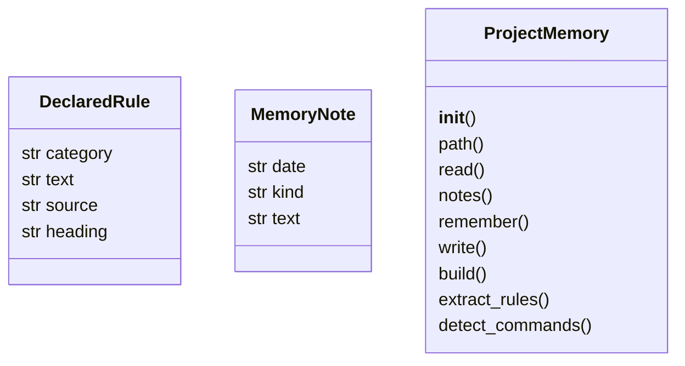
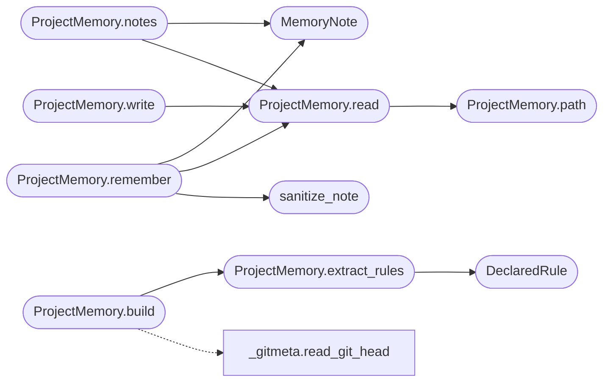

# `readmenator._memory`

> Source: [readmenator/_memory.py:1](../../readmenator/_memory.py#L1) | language `py` | coverage 100.0% | [API index](../index.md)

Persistent project memory for agents, generated with zero tokens.

MEMORY.md is the cross-session context file an agent reads first. Its
generated sections are rebuilt from the source tree on every run:

1. Purpose and domain: README lead sentence, domain vocabulary from the
   concept graph, and the main subsystems.
2. Workflow: build/test/run commands detected from project manifests,
   plus the knowledge refresh and session protocol.
3. Rules and constraints, 4. Style norms, 5. Minimum deliverables: each
   splits into *declared* lines extracted verbatim from instruction files
   (cited ``file:line``) and *measured* baselines computed from the code.
6. Risks to respect: god nodes, cycles, findings, hotspots.

Section 7 is the session log. Agents append decisions, business rules,
and workflow notes with ``readmenator . remember "<note>"`` (or the MCP
``readmenator.remember`` tool); the block is preserved byte for byte
across rebuilds, so knowledge survives between sessions without any
model writing the rest of the file.

## Contents

- **Classes:** [`DeclaredRule`](#declaredrule), [`MemoryNote`](#memorynote), [`ProjectMemory`](#projectmemory)
- **Functions:** [`sanitize_note`](#sanitize_note)
- **Constants:** [`NOTES_BEGIN`](#notes_begin), [`NOTES_END`](#notes_end)

## Type Diagram



## Call Graph

Solid arrows stay in this module, dashed arrows leave it.



## Classes

<a id="declaredrule"></a>

### `DeclaredRule`

`class` `dataclass` | [readmenator/_memory.py:53](../../readmenator/_memory.py#L53)

Decorators: `@dataclass(frozen=True)`

```python
class DeclaredRule
```

One rule line extracted verbatim from an instruction file.

**Attributes**

| Name | Type | Default | Description |
|---|---|---|---|
| [`category`](#declaredrule-category) | `str` |  | constraints, style, or deliverables. |
| [`text`](#declaredrule-text) | `str` |  | The rule text (single line). |
| [`source`](#declaredrule-source) | `str` |  | ``file:line`` citation. |
| [`heading`](#declaredrule-heading) | `str` |  | Heading the line was found under. |

---

<a id="memorynote"></a>

### `MemoryNote`

`class` `dataclass` | [readmenator/_memory.py:70](../../readmenator/_memory.py#L70)

Decorators: `@dataclass(frozen=True)`

```python
class MemoryNote
```

One entry of the preserved session log.

**Attributes**

| Name | Type | Default | Description |
|---|---|---|---|
| [`date`](#memorynote-date) | `str` |  | ISO date the note was recorded. |
| [`kind`](#memorynote-kind) | `str` |  | Note kind from MEMORY_NOTE_KINDS. |
| [`text`](#memorynote-text) | `str` |  | Single-line note text. |

---

<a id="projectmemory"></a>

### `ProjectMemory`

`class` | [readmenator/_memory.py:102](../../readmenator/_memory.py#L102)

```python
class ProjectMemory
```

Builds, preserves, and appends to the agent memory file.

**Members**

| Member | Kind | Summary |
|---|---|---|
| [`__init__`](#projectmemory-__init__) | constructor | Initialise with application configuration. |
| [`path`](#projectmemory-path) | method | Return the MEMORY.md location for a project root. |
| [`read`](#projectmemory-read) | method | Return the current memory file text ("" when missing). |
| [`notes`](#projectmemory-notes) | method | Parse the preserved session log into notes. |
| [`remember`](#projectmemory-remember) | method | Append one note to the preserved session log. |
| [`write`](#projectmemory-write) | method | Write generated sections while preserving the existing session log. |
| [`build`](#projectmemory-build) | method | Render the generated memory document (with an empty notes block). |
| [`extract_rules`](#projectmemory-extract_rules) | method | Extract categorised rule lines from the project's instruction files. |
| [`detect_commands`](#projectmemory-detect_commands) | method | Detect workflow commands from project manifests. |

<a id="projectmemory-__init__"></a>

#### `ProjectMemory.__init__`

`constructor` | [readmenator/_memory.py:105](../../readmenator/_memory.py#L105)

```python
def __init__(self, config: Config) -> None
```

Initialise with application configuration.

**Parameters**

| Name | Type | Default | Description |
|---|---|---|---|
| `config` | `Config` |  | MEMORY_* settings and output directories. |

*Called by:* [`AnalyzerFactory.memory`](readmenator._pipeline.py.md#analyzerfactory-memory)

<a id="projectmemory-path"></a>

#### `ProjectMemory.path`

`method` | [readmenator/_memory.py:113](../../readmenator/_memory.py#L113)

```python
def path(self, project_root: str) -> Path
```

Return the MEMORY.md location for a project root.

**Parameters**

| Name | Type | Default | Description |
|---|---|---|---|
| `project_root` | `str` |  |  |

**Returns:** `Path`

*Called by:* [`ProjectMemory.read`](#projectmemory-read)

<a id="projectmemory-read"></a>

#### `ProjectMemory.read`

`method` | [readmenator/_memory.py:117](../../readmenator/_memory.py#L117)

```python
def read(self, project_root: str) -> str
```

Return the current memory file text ("" when missing).

**Parameters**

| Name | Type | Default | Description |
|---|---|---|---|
| `project_root` | `str` |  |  |

**Returns:** `str`

*Calls:* [`ProjectMemory.path`](#projectmemory-path)

*Called by:* [`ProjectMemory.notes`](#projectmemory-notes), [`ProjectMemory.remember`](#projectmemory-remember), [`ProjectMemory.write`](#projectmemory-write)

<a id="projectmemory-notes"></a>

#### `ProjectMemory.notes`

`method` | [readmenator/_memory.py:124](../../readmenator/_memory.py#L124)

```python
def notes(self, project_root: str) -> List[MemoryNote]
```

Parse the preserved session log into notes.

**Parameters**

| Name | Type | Default | Description |
|---|---|---|---|
| `project_root` | `str` |  | Project root directory. |

**Returns:** `List[MemoryNote]` - Notes in file order.

*Calls:* [`MemoryNote`](#memorynote), [`ProjectMemory.read`](#projectmemory-read)

<a id="projectmemory-remember"></a>

#### `ProjectMemory.remember`

`method` | [readmenator/_memory.py:149](../../readmenator/_memory.py#L149)

```python
def remember(self, project_root: str, note: str, kind: str = 'note', today: Optional[str] = None) -> MemoryNote
```

Append one note to the preserved session log.

Creates a minimal MEMORY.md when none exists yet; the next rebuild
fills the generated sections around the preserved log.

**Parameters**

| Name | Type | Default | Description |
|---|---|---|---|
| `project_root` | `str` |  | Project root directory. |
| `note` | `str` |  | Note text (collapsed to one line). |
| `kind` | `str` | `'note'` | One of MEMORY_NOTE_KINDS. |
| `today` | `Optional[str]` | `None` | ISO date override (defaults to the local date). |

**Returns:** `MemoryNote` - The stored note.

**Raises**

- `ValueError`: Unknown kind or empty note.

*Calls:* [`MemoryNote`](#memorynote), [`ProjectMemory.read`](#projectmemory-read), [`sanitize_note`](#sanitize_note)

<a id="projectmemory-write"></a>

#### `ProjectMemory.write`

`method` | [readmenator/_memory.py:218](../../readmenator/_memory.py#L218)

```python
def write(self, project_root: str, generated: str) -> Path
```

Write generated sections while preserving the existing session log.

**Parameters**

| Name | Type | Default | Description |
|---|---|---|---|
| `project_root` | `str` |  | Project root directory. |
| `generated` | `str` |  | Output of [`build`](#projectmemory-build) (contains an empty notes block). |

**Returns:** `Path` - Path of the written MEMORY.md.

*Calls:* [`ProjectMemory.read`](#projectmemory-read)

<a id="projectmemory-build"></a>

#### `ProjectMemory.build`

`method` | [readmenator/_memory.py:231](../../readmenator/_memory.py#L231)

```python
def build(self, project_root: str, nodes: List[Node], analysis: Optional[AnalysisResult] = None, analysis_v2: Optional[AnalysisResultV2] = None, findings: Optional[List[SecurityFinding]] = None, concept_graph: Optional[ConceptGraph] = None, content_map: Optional[Dict[str, str]] = None) -> str
```

Render the generated memory document (with an empty notes block).

**Parameters**

| Name | Type | Default | Description |
|---|---|---|---|
| `project_root` | `str` |  | Project root directory. |
| `nodes` | `List[Node]` |  | Scanned file nodes. |
| `analysis` | `Optional[AnalysisResult]` | `None` | Community and god-node analysis. |
| `analysis_v2` | `Optional[AnalysisResultV2]` | `None` | Cycles, hotspots, and other deep results. |
| `findings` | `Optional[List[SecurityFinding]]` | `None` | Security findings. |
| `concept_graph` | `Optional[ConceptGraph]` | `None` | Semantic noun graph for the domain vocabulary. |
| `content_map` | `Optional[Dict[str, str]]` | `None` | File contents for line-length baselines. |

**Returns:** `str` - Markdown text of MEMORY.md.

*Calls:* [`read_git_head`](readmenator._gitmeta.py.md#read_git_head), [`ProjectMemory.extract_rules`](#projectmemory-extract_rules)

<a id="projectmemory-extract_rules"></a>

#### `ProjectMemory.extract_rules`

`method` | [readmenator/_memory.py:291](../../readmenator/_memory.py#L291)

```python
def extract_rules(self, project_root: str) -> List[DeclaredRule]
```

Extract categorised rule lines from the project's instruction files.

Only bullet or numbered lines under headings that match the
configured keywords are kept; readmenator's own injected blocks are
skipped. Files are read when they are regular, non-symlink files
under MAX_FILE_SIZE_MB.

**Parameters**

| Name | Type | Default | Description |
|---|---|---|---|
| `project_root` | `str` |  | Project root directory. |

**Returns:** `List[DeclaredRule]` - Rules in file order, capped per file and category and per category overall.

*Calls:* [`DeclaredRule`](#declaredrule)

*Called by:* [`ProjectMemory.build`](#projectmemory-build)

<a id="projectmemory-detect_commands"></a>

#### `ProjectMemory.detect_commands`

`method` | [readmenator/_memory.py:419](../../readmenator/_memory.py#L419)

```python
def detect_commands(self, root: Path, nodes: Sequence[Node]) -> List[Tuple[str, str]]
```

Detect workflow commands from project manifests.

**Parameters**

| Name | Type | Default | Description |
|---|---|---|---|
| `root` | `Path` |  | Project root. |
| `nodes` | `Sequence[Node]` |  | Scanned nodes (languages and test layout). |

**Returns:** `List[Tuple[str, str]]` - (command, source) pairs in a stable order.

---

## Functions

<a id="sanitize_note"></a>

### `sanitize_note`

`function` | [readmenator/_memory.py:84](../../readmenator/_memory.py#L84)

```python
def sanitize_note(text: str, max_chars: int) -> str
```

Collapse a note to one safe line that cannot break the preserved block.

**Parameters**

| Name | Type | Default | Description |
|---|---|---|---|
| `text` | `str` |  | Raw note text. |
| `max_chars` | `int` |  | Maximum characters kept. |

**Returns:** `str` - Single-line note without control characters or HTML comment markers.

*Called by:* [`ProjectMemory.remember`](#projectmemory-remember)

---

## Constants

<a id="notes_begin"></a>

### `NOTES_BEGIN`

`constant` | [readmenator/_memory.py:36](../../readmenator/_memory.py#L36)

```python
NOTES_BEGIN = '<!-- readmenator:memory:notes:begin -->'
```

---

<a id="notes_end"></a>

### `NOTES_END`

`constant` | [readmenator/_memory.py:37](../../readmenator/_memory.py#L37)

```python
NOTES_END = '<!-- readmenator:memory:notes:end -->'
```

---
