# `readmenator._models`

> Source: [readmenator/_models.py:1](../../readmenator/_models.py#L1) | language `py` | coverage 100.0% | [API index](../index.md)

Data model types for the readmenator knowledge graph.

Defines the core entity types -- Symbol, Node, Edge -- plus a
utility function for pluralising symbol kind labels and a helper
for constructing community analysis results. Every parser, scanner,
renderer, and query engine depends on these definitions.

## Contents

- **Classes:** [`Symbol`](#symbol), [`Node`](#node), [`Edge`](#edge), [`SecurityFinding`](#securityfinding), [`CommunityResult`](#communityresult), [`AnalysisResult`](#analysisresult), [`TaintPath`](#taintpath), [`TaintAnalysisResult`](#taintanalysisresult), [`DependencyCycle`](#dependencycycle), [`ChangeImpact`](#changeimpact), [`HotspotResult`](#hotspotresult), [`SuggestedRule`](#suggestedrule), [`LayerViolation`](#layerviolation), [`AnalysisResultV2`](#analysisresultv2), [`DataflowIssue`](#dataflowissue), [`LinterViolation`](#linterviolation), [`DeadCodeReport`](#deadcodereport), [`RefactoringAction`](#refactoringaction), [`RefactoringPlan`](#refactoringplan), [`ConceptNode`](#conceptnode), [`ConceptRelation`](#conceptrelation), [`ConceptGraph`](#conceptgraph)
- **Functions:** [`pluralize_symbol_kind`](#pluralize_symbol_kind)

## Type Diagram

```mermaid
classDiagram
    class Symbol
    Symbol : str name
    Symbol : str kind
    Symbol : int line
    Symbol : str doc
    Symbol : str signature
    class Node
    Node : str node_id
    Node : str label
    Node : str kind
    Node : str language
    Node : str doc
    Node : List[Symbol] symbols
    class Edge
    Edge : str source
    Edge : str target
    Edge : str relation
    Edge : str confidence
    Edge : Optional[EdgeKind] kind
    class SecurityFinding
    SecurityFinding : str file_path
    SecurityFinding : int line
    SecurityFinding : str severity
    SecurityFinding : str rule_id
    SecurityFinding : str description
    SecurityFinding : str snippet
    SecurityFinding : str cwe
    SecurityFinding : str mitre_attack
    class CommunityResult
    CommunityResult : int community_id
    CommunityResult : str label
    CommunityResult : set file_ids
    CommunityResult : float cohesion
    CommunityResult : int size
    class AnalysisResult
    AnalysisResult : List[tuple] god_nodes
    AnalysisResult : List[CommunityResult] communities
    AnalysisResult : List[tuple] surprising_connections
    AnalysisResult : List[str] suggested_questions
    AnalysisResult : int node_count
    AnalysisResult : int edge_count
    class TaintPath
    TaintPath : str source_file
    TaintPath : str sink_file
    TaintPath : List[str] path
    TaintPath : int hops
    TaintPath : str dangerous_import
    TaintPath : str severity
    class TaintAnalysisResult
    TaintAnalysisResult : List[TaintPath] paths
    TaintAnalysisResult : int source_count
    TaintAnalysisResult : int sink_count
    class DependencyCycle
    DependencyCycle : List[str] cycle
    DependencyCycle : int length
    class ChangeImpact
    ChangeImpact : str file_id
    ChangeImpact : List[str] direct_dependents
    ChangeImpact : List[str] transitive_dependents
    ChangeImpact : int total_impact
    class HotspotResult
    HotspotResult : str file_id
    HotspotResult : float complexity_score
    HotspotResult : float centrality_score
    HotspotResult : float combined_score
    HotspotResult : int symbol_count
    HotspotResult : int connection_count
    class SuggestedRule
    SuggestedRule : str rule_id
    SuggestedRule : str severity
    SuggestedRule : str description
    SuggestedRule : str pattern
    SuggestedRule : List[str] file_examples
    SuggestedRule : int match_count
    SuggestedRule : str language
    SuggestedRule : str semgrep_yaml
    class LayerViolation
    LayerViolation : str source_file
    LayerViolation : str source_layer
    LayerViolation : str target_file
    LayerViolation : str target_layer
    LayerViolation : str description
    LayerViolation : str severity
    class AnalysisResultV2
    AnalysisResultV2 : TaintAnalysisResult  None taint
    AnalysisResultV2 : List[DependencyCycle] cycles
    AnalysisResultV2 : List[ChangeImpact] change_impacts
    AnalysisResultV2 : List[HotspotResult] hotspots
    AnalysisResultV2 : List[SuggestedRule] suggested_rules
    AnalysisResultV2 : List[LayerViolation] layer_violations
    AnalysisResultV2 : List[DataflowIssue] dataflow_issues
    AnalysisResultV2 : ConceptGraph  None concept_graph
    class DataflowIssue
    DataflowIssue : str file_path
    DataflowIssue : str function
    DataflowIssue : int line
    DataflowIssue : str kind
    DataflowIssue : str variable
    DataflowIssue : str description
    DataflowIssue : str confidence
    class LinterViolation
    LinterViolation : str file_path
    LinterViolation : str rule_id
    LinterViolation : str severity
    LinterViolation : str message
    class DeadCodeReport
    DeadCodeReport : str file_path
    DeadCodeReport : str symbol_name
    DeadCodeReport : str symbol_type
    DeadCodeReport : str recommendation
    class RefactoringAction
    RefactoringAction : str action_type
    RefactoringAction : str source_file
    RefactoringAction : int start_line
    RefactoringAction : int end_line
    RefactoringAction : str target_file
    RefactoringAction : str description
    class RefactoringPlan
    RefactoringPlan : str file_path
    RefactoringPlan : List[RefactoringAction] actions
    RefactoringPlan : int estimated_impact
    RefactoringPlan : int current_lines
    class ConceptNode
    ConceptNode : str name
    ConceptNode : set file_ids
    ConceptNode : int mention_count
    ConceptNode : str confidence
    class ConceptRelation
    ConceptRelation : str source
    ConceptRelation : str target
    ConceptRelation : str verb
    ConceptRelation : List[str] file_evidence
    ConceptRelation : float strength
    ConceptRelation : str confidence
    class ConceptGraph
    ConceptGraph : List[ConceptNode] concepts
    ConceptGraph : List[ConceptRelation] relations
    ConceptGraph : List[str] dialectic_questions
```



## Classes

<a id="symbol"></a>

### `Symbol`

`class` `dataclass` | [readmenator/_models.py:18](../../readmenator/_models.py#L18)

Decorators: `@dataclass`

```python
class Symbol
```

A single code symbol extracted from a source file.

**Attributes**

| Name | Type | Default | Description |
|---|---|---|---|
| [`name`](#symbol-name) | `str` |  | Identifier of the symbol (class name, function name, etc.). |
| [`kind`](#symbol-kind) | `str` |  | Semantic type (class, function, struct, enum, ...). |
| [`line`](#symbol-line) | `int` |  | One-based line number where the symbol is defined. |
| [`doc`](#symbol-doc) | `str` | `''` | Optional docstring or comment extracted from the source. |
| [`signature`](#symbol-signature) | `str` | `''` | Optional method or function signature snippet. |

---

<a id="node"></a>

### `Node`

`class` `dataclass` | [readmenator/_models.py:37](../../readmenator/_models.py#L37)

Decorators: `@dataclass`

```python
class Node
```

A file node in the knowledge graph, containing its symbols.

**Attributes**

| Name | Type | Default | Description |
|---|---|---|---|
| [`node_id`](#node-node_id) | `str` |  | Relative path of the file used as a unique identifier. |
| [`label`](#node-label) | `str` |  | Base file name for display purposes. |
| [`kind`](#node-kind) | `str` |  | Type of node (typically "module"). |
| [`language`](#node-language) | `str` |  | Programming language derived from the file extension. |
| [`doc`](#node-doc) | `str` | `''` | Optional file-level documentation string. |
| [`symbols`](#node-symbols) | `List[Symbol]` | `field(default_factory=list)` | List of Symbol instances defined in this file. |

---

<a id="edge"></a>

### `Edge`

`class` `dataclass` | [readmenator/_models.py:58](../../readmenator/_models.py#L58)

Decorators: `@dataclass`

```python
class Edge
```

A directed relationship between two nodes in the knowledge graph.

**Attributes**

| Name | Type | Default | Description |
|---|---|---|---|
| [`source`](#edge-source) | `str` |  | Node ID of the source (dependent) file. |
| [`target`](#edge-target) | `str` |  | Node ID of the target (dependency) file or module. |
| [`relation`](#edge-relation) | `str` |  | Semantic relation label (e.g. "imports", "resolved_imports"). |
| [`confidence`](#edge-confidence) | `str` | `'EXTRACTED'` | Confidence tier ("EXTRACTED" for structural, "INFERRED" for heuristic). |
| [`kind`](#edge-kind) | `Optional[EdgeKind]` | `None` | Optional typed edge kind for ranking-aware computations. |

---

<a id="securityfinding"></a>

### `SecurityFinding`

`class` `dataclass` | [readmenator/_models.py:77](../../readmenator/_models.py#L77)

Decorators: `@dataclass`

```python
class SecurityFinding
```

A security-relevant pattern detected in a source file.

**Attributes**

| Name | Type | Default | Description |
|---|---|---|---|
| [`file_path`](#securityfinding-file_path) | `str` |  | Relative path of the file containing the finding. |
| [`line`](#securityfinding-line) | `int` |  | One-based line number where the pattern was found. |
| [`severity`](#securityfinding-severity) | `str` |  | Severity level (critical, high, medium, low, info). |
| [`rule_id`](#securityfinding-rule_id) | `str` |  | Unique identifier for the detection rule (e.g. "PY001"). |
| [`description`](#securityfinding-description) | `str` |  | Human-readable explanation of the issue. |
| [`snippet`](#securityfinding-snippet) | `str` |  | The offending source code line. |
| [`cwe`](#securityfinding-cwe) | `str` |  | CWE identifier string (e.g. "CWE-78"). |
| [`mitre_attack`](#securityfinding-mitre_attack) | `str` | `''` | MITRE ATT&CK technique ID (e.g. "T1059.001"). |

---

<a id="communityresult"></a>

### `CommunityResult`

`class` `dataclass` | [readmenator/_models.py:111](../../readmenator/_models.py#L111)

Decorators: `@dataclass`

```python
class CommunityResult
```

Result of community detection on the import graph.

**Attributes**

| Name | Type | Default | Description |
|---|---|---|---|
| [`community_id`](#communityresult-community_id) | `int` |  | Integer identifier of the community. |
| [`label`](#communityresult-label) | `str` |  | Human-readable name for the community. |
| [`file_ids`](#communityresult-file_ids) | `set` |  | Set of node IDs belonging to this community. |
| [`cohesion`](#communityresult-cohesion) | `float` |  | Cohesion score (internal edges / total edges involving community). |
| [`size`](#communityresult-size) | `int` |  | Number of files in the community. |

---

<a id="analysisresult"></a>

### `AnalysisResult`

`class` `dataclass` | [readmenator/_models.py:130](../../readmenator/_models.py#L130)

Decorators: `@dataclass`

```python
class AnalysisResult
```

Complete graph analysis output.

**Attributes**

| Name | Type | Default | Description |
|---|---|---|---|
| [`god_nodes`](#analysisresult-god_nodes) | `List[tuple]` |  | List of (node_id, score) for most central nodes. |
| [`communities`](#analysisresult-communities) | `List[CommunityResult]` |  | List of CommunityResult instances. |
| [`surprising_connections`](#analysisresult-surprising_connections) | `List[tuple]` |  | List of (source_node, target_node, hops, bridging_communities). |
| [`suggested_questions`](#analysisresult-suggested_questions) | `List[str]` |  | List of plain-language exploration questions. |
| [`node_count`](#analysisresult-node_count) | `int` |  | Total nodes in the graph. |
| [`edge_count`](#analysisresult-edge_count) | `int` |  | Total edges in the graph. |

---

<a id="taintpath"></a>

### `TaintPath`

`class` `dataclass` | [readmenator/_models.py:151](../../readmenator/_models.py#L151)

Decorators: `@dataclass`

```python
class TaintPath
```

A taint propagation path from source to sink through the import graph.

**Attributes**

| Name | Type | Default | Description |
|---|---|---|---|
| [`source_file`](#taintpath-source_file) | `str` |  | The file that introduces the dangerous import. |
| [`sink_file`](#taintpath-sink_file) | `str` |  | The file that transitively receives the taint. |
| [`path`](#taintpath-path) | `List[str]` |  | List of file node IDs forming the propagation chain. |
| [`hops`](#taintpath-hops) | `int` |  | Number of hops in the propagation path. |
| [`dangerous_import`](#taintpath-dangerous_import) | `str` |  | The specific dangerous module or function imported. |
| [`severity`](#taintpath-severity) | `str` |  | Inferred severity of the taint path. |

---

<a id="taintanalysisresult"></a>

### `TaintAnalysisResult`

`class` `dataclass` | [readmenator/_models.py:172](../../readmenator/_models.py#L172)

Decorators: `@dataclass`

```python
class TaintAnalysisResult
```

Complete taint propagation analysis output.

**Attributes**

| Name | Type | Default | Description |
|---|---|---|---|
| [`paths`](#taintanalysisresult-paths) | `List[TaintPath]` |  | List of TaintPath instances discovered. |
| [`source_count`](#taintanalysisresult-source_count) | `int` |  | Number of unique taint source files. |
| [`sink_count`](#taintanalysisresult-sink_count) | `int` |  | Number of unique taint sink files. |

---

<a id="dependencycycle"></a>

### `DependencyCycle`

`class` `dataclass` | [readmenator/_models.py:187](../../readmenator/_models.py#L187)

Decorators: `@dataclass`

```python
class DependencyCycle
```

A cycle detected in the resolved import graph.

**Attributes**

| Name | Type | Default | Description |
|---|---|---|---|
| [`cycle`](#dependencycycle-cycle) | `List[str]` |  | List of file node IDs forming the cycle. |
| [`length`](#dependencycycle-length) | `int` |  | Number of files in the cycle. |

---

<a id="changeimpact"></a>

### `ChangeImpact`

`class` `dataclass` | [readmenator/_models.py:200](../../readmenator/_models.py#L200)

Decorators: `@dataclass`

```python
class ChangeImpact
```

Change impact analysis for a single file.

**Attributes**

| Name | Type | Default | Description |
|---|---|---|---|
| [`file_id`](#changeimpact-file_id) | `str` |  | The file that would be changed. |
| [`direct_dependents`](#changeimpact-direct_dependents) | `List[str]` |  | Files that directly import this file. |
| [`transitive_dependents`](#changeimpact-transitive_dependents) | `List[str]` |  | Files that transitively depend on this file. |
| [`total_impact`](#changeimpact-total_impact) | `int` |  | Total number of affected files (direct + transitive). |

---

<a id="hotspotresult"></a>

### `HotspotResult`

`class` `dataclass` | [readmenator/_models.py:217](../../readmenator/_models.py#L217)

Decorators: `@dataclass`

```python
class HotspotResult
```

A hotspot file combining complexity and centrality metrics.

**Attributes**

| Name | Type | Default | Description |
|---|---|---|---|
| [`file_id`](#hotspotresult-file_id) | `str` |  | The file node ID. |
| [`complexity_score`](#hotspotresult-complexity_score) | `float` |  | Normalised symbol count score (0-1). |
| [`centrality_score`](#hotspotresult-centrality_score) | `float` |  | Normalised god node score (0-1). |
| [`combined_score`](#hotspotresult-combined_score) | `float` |  | Weighted combination of complexity and centrality. |
| [`symbol_count`](#hotspotresult-symbol_count) | `int` |  | Raw symbol count. |
| [`connection_count`](#hotspotresult-connection_count) | `int` |  | Raw connection count. |

---

<a id="suggestedrule"></a>

### `SuggestedRule`

`class` `dataclass` | [readmenator/_models.py:238](../../readmenator/_models.py#L238)

Decorators: `@dataclass`

```python
class SuggestedRule
```

A suggested linting/security rule derived from code patterns.

**Attributes**

| Name | Type | Default | Description |
|---|---|---|---|
| [`rule_id`](#suggestedrule-rule_id) | `str` |  | Suggested rule identifier (e.g. "RM001"). |
| [`severity`](#suggestedrule-severity) | `str` |  | Suggested severity (info, warning, error). |
| [`description`](#suggestedrule-description) | `str` |  | Human-readable description of the pattern. |
| [`pattern`](#suggestedrule-pattern) | `str` |  | The detected pattern or code snippet. |
| [`file_examples`](#suggestedrule-file_examples) | `List[str]` |  | Example file paths where the pattern was found. |
| [`match_count`](#suggestedrule-match_count) | `int` |  | Number of times the pattern was matched. |
| [`language`](#suggestedrule-language) | `str` |  | Target language for the rule. |
| [`semgrep_yaml`](#suggestedrule-semgrep_yaml) | `str` |  | Optional Semgrep rule YAML string. |

---

<a id="layerviolation"></a>

### `LayerViolation`

`class` `dataclass` | [readmenator/_models.py:263](../../readmenator/_models.py#L263)

Decorators: `@dataclass`

```python
class LayerViolation
```

A detected architectural layer violation.

**Attributes**

| Name | Type | Default | Description |
|---|---|---|---|
| [`source_file`](#layerviolation-source_file) | `str` |  | The file causing the violation. |
| [`source_layer`](#layerviolation-source_layer) | `str` |  | The layer of the source file. |
| [`target_file`](#layerviolation-target_file) | `str` |  | The file being imported. |
| [`target_layer`](#layerviolation-target_layer) | `str` |  | The layer of the target file. |
| [`description`](#layerviolation-description) | `str` |  | Description of the violation. |
| [`severity`](#layerviolation-severity) | `str` |  | Severity (strict, warn, info). |

---

<a id="analysisresultv2"></a>

### `AnalysisResultV2`

`class` `dataclass` | [readmenator/_models.py:284](../../readmenator/_models.py#L284)

Decorators: `@dataclass`

```python
class AnalysisResultV2
```

Extended analysis result combining all new analysis modules.

**Attributes**

| Name | Type | Default | Description |
|---|---|---|---|
| [`taint`](#analysisresultv2-taint) | `TaintAnalysisResult \| None` | `None` | Optional taint analysis result. |
| [`cycles`](#analysisresultv2-cycles) | `List[DependencyCycle]` | `field(default_factory=list)` | List of dependency cycles. |
| [`change_impacts`](#analysisresultv2-change_impacts) | `List[ChangeImpact]` | `field(default_factory=list)` | List of change impact results for key files. |
| [`hotspots`](#analysisresultv2-hotspots) | `List[HotspotResult]` | `field(default_factory=list)` | List of hotspot results. |
| [`suggested_rules`](#analysisresultv2-suggested_rules) | `List[SuggestedRule]` | `field(default_factory=list)` | List of suggested linting rules. |
| [`layer_violations`](#analysisresultv2-layer_violations) | `List[LayerViolation]` | `field(default_factory=list)` | List of layer violations. |
| [`dataflow_issues`](#analysisresultv2-dataflow_issues) | `List[DataflowIssue]` | `field(default_factory=list)` | List of procedural dataflow findings. |
| [`concept_graph`](#analysisresultv2-concept_graph) | `ConceptGraph \| None` | `None` | Optional semantic noun/verb layer. |

---

<a id="dataflowissue"></a>

### `DataflowIssue`

`class` `dataclass` | [readmenator/_models.py:309](../../readmenator/_models.py#L309)

Decorators: `@dataclass`

```python
class DataflowIssue
```

A procedural intra-function dataflow finding.

**Attributes**

| Name | Type | Default | Description |
|---|---|---|---|
| [`file_path`](#dataflowissue-file_path) | `str` |  | Relative path of the file containing the issue. |
| [`function`](#dataflowissue-function) | `str` |  | Name of the enclosing function. |
| [`line`](#dataflowissue-line) | `int` |  | One-based line number of the suspicious operation. |
| [`kind`](#dataflowissue-kind) | `str` |  | Issue kind (UNINIT_USE, DEAD_STORE, UNCHECKED_ALLOC). |
| [`variable`](#dataflowissue-variable) | `str` |  | Name of the involved local variable. |
| [`description`](#dataflowissue-description) | `str` |  | Human-readable explanation of the suspicion. |
| [`confidence`](#dataflowissue-confidence) | `str` | `'INFERRED'` | Confidence tier (always INFERRED for heuristics). |

---

<a id="linterviolation"></a>

### `LinterViolation`

`class` `dataclass` | [readmenator/_models.py:332](../../readmenator/_models.py#L332)

Decorators: `@dataclass`

```python
class LinterViolation
```

A violation detected by the architecture linter.

**Attributes**

| Name | Type | Default | Description |
|---|---|---|---|
| [`file_path`](#linterviolation-file_path) | `str` |  | Relative path of the file containing the violation. |
| [`rule_id`](#linterviolation-rule_id) | `str` |  | Unique identifier for the linter rule (e.g. "ARC001"). |
| [`severity`](#linterviolation-severity) | `str` |  | Severity level (error, warning, info). |
| [`message`](#linterviolation-message) | `str` |  | Human-readable description of the violation. |

---

<a id="deadcodereport"></a>

### `DeadCodeReport`

`class` `dataclass` | [readmenator/_models.py:349](../../readmenator/_models.py#L349)

Decorators: `@dataclass`

```python
class DeadCodeReport
```

A dead code symbol identified by the stripper.

**Attributes**

| Name | Type | Default | Description |
|---|---|---|---|
| [`file_path`](#deadcodereport-file_path) | `str` |  | Relative path of the file containing the symbol. |
| [`symbol_name`](#deadcodereport-symbol_name) | `str` |  | Name of the dead symbol. |
| [`symbol_type`](#deadcodereport-symbol_type) | `str` |  | Type of symbol (function, class, method, etc.). |
| [`recommendation`](#deadcodereport-recommendation) | `str` |  | Recommended action (MOVE_TO_TRASH, REVIEW, KEEP). |

---

<a id="refactoringaction"></a>

### `RefactoringAction`

`class` `dataclass` | [readmenator/_models.py:366](../../readmenator/_models.py#L366)

Decorators: `@dataclass`

```python
class RefactoringAction
```

A single refactoring action within a plan.

**Attributes**

| Name | Type | Default | Description |
|---|---|---|---|
| [`action_type`](#refactoringaction-action_type) | `str` |  | Type of action (EXTRACT_CLASS, EXTRACT_FUNCTION, MOVE_SYMBOL). |
| [`source_file`](#refactoringaction-source_file) | `str` |  | The file to refactor. |
| [`start_line`](#refactoringaction-start_line) | `int` |  | Start line of the code range to extract. |
| [`end_line`](#refactoringaction-end_line) | `int` |  | End line of the code range to extract. |
| [`target_file`](#refactoringaction-target_file) | `str` |  | The new file to create (for EXTRACT actions). |
| [`description`](#refactoringaction-description) | `str` |  | Human-readable description of the action. |

---

<a id="refactoringplan"></a>

### `RefactoringPlan`

`class` `dataclass` | [readmenator/_models.py:387](../../readmenator/_models.py#L387)

Decorators: `@dataclass`

```python
class RefactoringPlan
```

A complete refactoring plan for a monolithic file.

**Attributes**

| Name | Type | Default | Description |
|---|---|---|---|
| [`file_path`](#refactoringplan-file_path) | `str` |  | The file to refactor. |
| [`actions`](#refactoringplan-actions) | `List[RefactoringAction]` |  | List of refactoring actions to perform. |
| [`estimated_impact`](#refactoringplan-estimated_impact) | `int` |  | Number of files affected by the refactoring. |
| [`current_lines`](#refactoringplan-current_lines) | `int` |  | Current line count of the file. |

---

<a id="conceptnode"></a>

### `ConceptNode`

`class` `dataclass` | [readmenator/_models.py:404](../../readmenator/_models.py#L404)

Decorators: `@dataclass`

```python
class ConceptNode
```

A semantic noun node in the concept graph.

**Attributes**

| Name | Type | Default | Description |
|---|---|---|---|
| [`name`](#conceptnode-name) | `str` |  | Normalised noun label (lowercase token). |
| [`file_ids`](#conceptnode-file_ids) | `set` |  | Set of file node IDs where the noun appears. |
| [`mention_count`](#conceptnode-mention_count) | `int` | `0` | Total atomic mentions across paths and symbols. |
| [`confidence`](#conceptnode-confidence) | `str` | `'EXTRACTED'` | Confidence tier (always EXTRACTED for parsed tokens). |

---

<a id="conceptrelation"></a>

### `ConceptRelation`

`class` `dataclass` | [readmenator/_models.py:421](../../readmenator/_models.py#L421)

Decorators: `@dataclass`

```python
class ConceptRelation
```

A verb edge between two concept noun nodes.

**Attributes**

| Name | Type | Default | Description |
|---|---|---|---|
| [`source`](#conceptrelation-source) | `str` |  | Source concept name. |
| [`target`](#conceptrelation-target) | `str` |  | Target concept name. |
| [`verb`](#conceptrelation-verb) | `str` |  | Verb label (consumes, invokes, extends, depends_on, bridges). |
| [`file_evidence`](#conceptrelation-file_evidence) | `List[str]` | `field(default_factory=list)` | Sorted file pairs proving the relation. |
| [`strength`](#conceptrelation-strength) | `float` | `0.0` | Normalised strength in [0, 1]. |
| [`confidence`](#conceptrelation-confidence) | `str` | `'INFERRED'` | Confidence tier (always INFERRED for heuristics). |

---

<a id="conceptgraph"></a>

### `ConceptGraph`

`class` `dataclass` | [readmenator/_models.py:442](../../readmenator/_models.py#L442)

Decorators: `@dataclass`

```python
class ConceptGraph
```

Deterministic semantic layer over the structural graph.

**Attributes**

| Name | Type | Default | Description |
|---|---|---|---|
| [`concepts`](#conceptgraph-concepts) | `List[ConceptNode]` | `field(default_factory=list)` | Ordered concept noun nodes (ranked by file coverage). |
| [`relations`](#conceptgraph-relations) | `List[ConceptRelation]` | `field(default_factory=list)` | Ordered verb edges between concepts. |
| [`dialectic_questions`](#conceptgraph-dialectic_questions) | `List[str]` | `field(default_factory=list)` | Deterministic thesis/antithesis prompts. |

---

## Functions

<a id="pluralize_symbol_kind"></a>

### `pluralize_symbol_kind`

`function` | [readmenator/_models.py:101](../../readmenator/_models.py#L101)

```python
def pluralize_symbol_kind(kind: str, plural_map: Dict[str, str]) -> str
```

Return the plural form of *kind* according to *plural_map*.

Falls back to appending ``"s"`` when the kind is not found.
This prevents obvious misspellings like ``"Classs"``.

**Parameters**

| Name | Type | Default | Description |
|---|---|---|---|
| `kind` | `str` |  |  |
| `plural_map` | `Dict[str, str]` |  |  |

**Returns:** `str`

---
