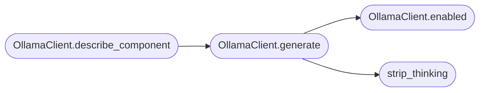

# `readmenator._ollama`

> Source: [readmenator/_ollama.py:1](../../readmenator/_ollama.py#L1) | language `py` | coverage 100.0% | [API index](../index.md)

Local Ollama client for optional LLM enrichment.

Stdlib-only HTTP against a local Ollama daemon. Every call is
bounded by a timeout and never raises: failures return "" so the
deterministic zero-token output always survives. Used only for
prose (component descriptions), never for structure.

## Contents

- **Classes:** [`OllamaClient`](#ollamaclient)
- **Functions:** [`strip_thinking`](#strip_thinking)

## Call Graph

Solid arrows stay in this module, dashed arrows leave it.



## Classes

<a id="ollamaclient"></a>

### `OllamaClient`

`class` | [readmenator/_ollama.py:33](../../readmenator/_ollama.py#L33)

```python
class OllamaClient
```

Minimal generate-only client for a local Ollama daemon.

**Members**

| Member | Kind | Summary |
|---|---|---|
| [`__init__`](#ollamaclient-__init__) | constructor | Initialise with application configuration. |
| [`enabled`](#ollamaclient-enabled) | method | Return True when Ollama enrichment is switched on. |
| [`available`](#ollamaclient-available) | method | Probe the daemon without generating text. |
| [`generate`](#ollamaclient-generate) | method | Generate one completion, bounded and infallible. |
| [`describe_component`](#ollamaclient-describe_component) | method | Draft a one-paragraph component description via Ollama. |

<a id="ollamaclient-__init__"></a>

#### `OllamaClient.__init__`

`constructor` | [readmenator/_ollama.py:36](../../readmenator/_ollama.py#L36)

```python
def __init__(self, config: Config) -> None
```

Initialise with application configuration.

**Parameters**

| Name | Type | Default | Description |
|---|---|---|---|
| `config` | `Config` |  | Settings for host, model, timeout, and max chars. |

*Called by:* [`ComponentDiagramBuilder.__init__`](readmenator._components.py.md#componentdiagrambuilder-__init__), [`AnalyzerFactory.ollama`](readmenator._pipeline.py.md#analyzerfactory-ollama)

<a id="ollamaclient-enabled"></a>

#### `OllamaClient.enabled`

`method` | [readmenator/_ollama.py:44](../../readmenator/_ollama.py#L44)

```python
def enabled(self) -> bool
```

Return True when Ollama enrichment is switched on.

**Returns:** `bool`

*Called by:* [`OllamaClient.generate`](#ollamaclient-generate)

<a id="ollamaclient-available"></a>

#### `OllamaClient.available`

`method` | [readmenator/_ollama.py:48](../../readmenator/_ollama.py#L48)

```python
def available(self, timeout: Optional[float] = None) -> bool
```

Probe the daemon without generating text.

**Parameters**

| Name | Type | Default | Description |
|---|---|---|---|
| `timeout` | `Optional[float]` | `None` | Optional probe timeout override. |

**Returns:** `bool` - True when /api/tags answers, False otherwise.

<a id="ollamaclient-generate"></a>

#### `OllamaClient.generate`

`method` | [readmenator/_ollama.py:69](../../readmenator/_ollama.py#L69)

```python
def generate(self, prompt: str, system: Optional[str] = None) -> str
```

Generate one completion, bounded and infallible.

**Parameters**

| Name | Type | Default | Description |
|---|---|---|---|
| `prompt` | `str` |  | User prompt text. |
| `system` | `Optional[str]` | `None` | Optional system instruction. |

**Returns:** `str` - Completion text (thinking stripped, capped), or "" on any
failure, including a disabled client.

*Calls:* [`OllamaClient.enabled`](#ollamaclient-enabled), [`strip_thinking`](#strip_thinking)

*Called by:* [`OllamaClient.describe_component`](#ollamaclient-describe_component)

<a id="ollamaclient-describe_component"></a>

#### `OllamaClient.describe_component`

`method` | [readmenator/_ollama.py:104](../../readmenator/_ollama.py#L104)

```python
def describe_component(self, name: str, files: list, symbols: list, imports: list) -> str
```

Draft a one-paragraph component description via Ollama.

**Parameters**

| Name | Type | Default | Description |
|---|---|---|---|
| `name` | `str` |  | Component label. |
| `files` | `list` |  | Member file paths (capped by the caller). |
| `symbols` | `list` |  | Top symbol names (capped by the caller). |
| `imports` | `list` |  | Outgoing dependency labels (capped by the caller). |

**Returns:** `str` - One-paragraph description, or "" when unavailable.

*Calls:* [`OllamaClient.generate`](#ollamaclient-generate)

---

## Functions

<a id="strip_thinking"></a>

### `strip_thinking`

`function` | [readmenator/_ollama.py:21](../../readmenator/_ollama.py#L21)

```python
def strip_thinking(text: str) -> str
```

Remove reasoning-model thinking blocks from a completion.

**Parameters**

| Name | Type | Default | Description |
|---|---|---|---|
| `text` | `str` |  | Raw model output. |

**Returns:** `str` - Output without <think> sections, stripped.

*Called by:* [`OllamaClient.generate`](#ollamaclient-generate)

---
