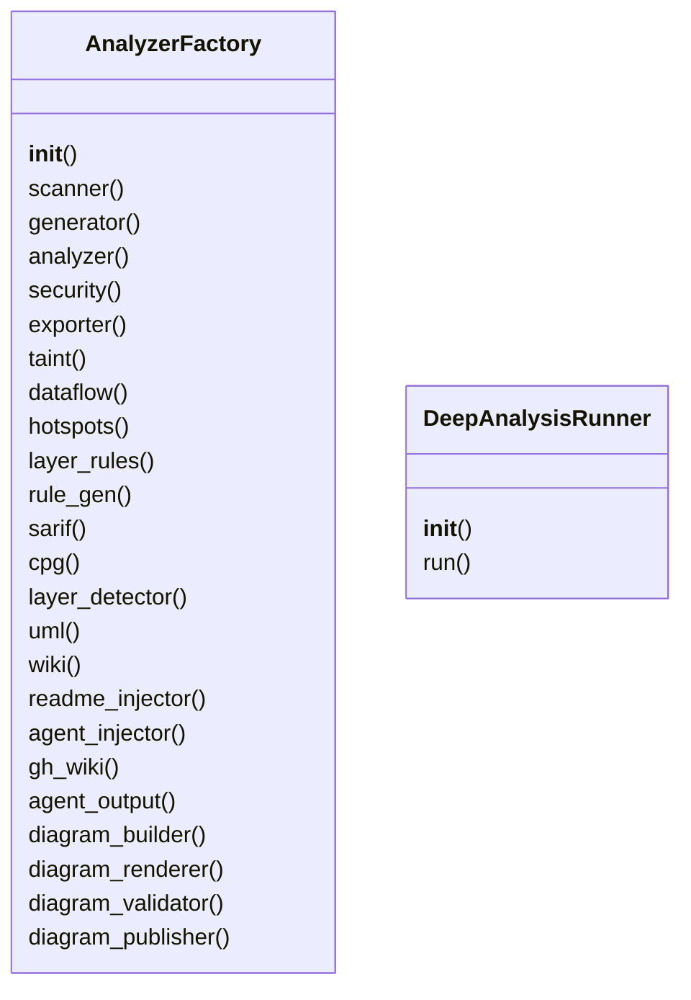

# `readmenator._pipeline`

> Source: [readmenator/_pipeline.py:1](../../readmenator/_pipeline.py#L1) | language `py` | coverage 58.5% | [API index](../index.md)

AnalyzerFactory (lazy component construction) and DeepAnalysisRunner.

Decouples the application orchestrator from concrete analyzers and runs
the v2 analyses (taint, cycles, impact, hotspots, rules, layers, dataflow).

## Contents

- **Classes:** [`AnalyzerFactory`](#analyzerfactory), [`DeepAnalysisRunner`](#deepanalysisrunner)

## Type Diagram



## Call Graph

Solid arrows stay in this module, dashed arrows leave it.

```mermaid
flowchart LR
    n_readmenator__pipeline_py__AnalyzerFactory_scanner(["AnalyzerFactory.scanner"])
    n_readmenator__scanner_py__PolyglotScanner___init__["_scanner.PolyglotScanner.__init__"]
    n_readmenator__pipeline_py__AnalyzerFactory_generator(["AnalyzerFactory.generator"])
    n_readmenator__documentation_py__DocumentationGenerator___init__["_documentation.DocumentationGenerator.__init__"]
    n_readmenator__pipeline_py__AnalyzerFactory_analyzer(["AnalyzerFactory.analyzer"])
    n_readmenator__analyzer_py__GraphAnalyzer___init__["_analyzer.GraphAnalyzer.__init__"]
    n_readmenator__pipeline_py__AnalyzerFactory_security(["AnalyzerFactory.security"])
    n_readmenator__security_py__SecurityAnalyzer___init__["_security.SecurityAnalyzer.__init__"]
    n_readmenator__pipeline_py__AnalyzerFactory_exporter(["AnalyzerFactory.exporter"])
    n_readmenator__exporter_py__GraphExporter___init__["_exporter.GraphExporter.__init__"]
    n_readmenator__pipeline_py__AnalyzerFactory_taint(["AnalyzerFactory.taint"])
    n_readmenator__taint_py__TaintAnalyzer___init__["_taint.TaintAnalyzer.__init__"]
    n_readmenator__pipeline_py__AnalyzerFactory_dataflow(["AnalyzerFactory.dataflow"])
    n_readmenator__dataflow_py__DataflowAnalyzer___init__["_dataflow.DataflowAnalyzer.__init__"]
    n_readmenator__pipeline_py__AnalyzerFactory_hotspots(["AnalyzerFactory.hotspots"])
    n_readmenator__hotspots_py__HotspotAnalyzer___init__["_hotspots.HotspotAnalyzer.__init__"]
    n_readmenator__pipeline_py__AnalyzerFactory_layer_rules(["AnalyzerFactory.layer_rules"])
    n_readmenator__layer_rules_py__LayerRuleEngine___init__["_layer_rules.LayerRuleEngine.__init__"]
    n_readmenator__pipeline_py__AnalyzerFactory_rule_gen(["AnalyzerFactory.rule_gen"])
    n_readmenator__rule_gen_py__RuleGenerator___init__["_rule_gen.RuleGenerator.__init__"]
    n_readmenator__pipeline_py__AnalyzerFactory_sarif(["AnalyzerFactory.sarif"])
    n_readmenator__sarif_py__SarifExporter___init__["_sarif.SarifExporter.__init__"]
    n_readmenator__pipeline_py__AnalyzerFactory_cpg(["AnalyzerFactory.cpg"])
    n_readmenator__cpg_py__CodePropertyGraph___init__["_cpg.CodePropertyGraph.__init__"]
    n_readmenator__pipeline_py__AnalyzerFactory_layer_detector(["AnalyzerFactory.layer_detector"])
    n_readmenator__layers_py__LayerDetector["_layers.LayerDetector"]
    n_readmenator__pipeline_py__AnalyzerFactory_uml(["AnalyzerFactory.uml"])
    n_readmenator__uml_py__UmlGenerator___init__["_uml.UmlGenerator.__init__"]
    n_readmenator__pipeline_py__AnalyzerFactory_wiki(["AnalyzerFactory.wiki"])
    n_readmenator__wiki_py__WikiGenerator___init__["_wiki.WikiGenerator.__init__"]
    n_readmenator__pipeline_py__AnalyzerFactory_readme_injector(["AnalyzerFactory.readme_injector"])
    n_readmenator__readme_injector_py__ReadmeInjector___init__["_readme_injector.ReadmeInjector.__init__"]
    n_readmenator__pipeline_py__AnalyzerFactory_agent_injector(["AnalyzerFactory.agent_injector"])
    n_readmenator__agent_injector_py__AgentInjector___init__["_agent_injector.AgentInjector.__init__"]
    n_readmenator__pipeline_py__AnalyzerFactory_gh_wiki(["AnalyzerFactory.gh_wiki"])
    n_readmenator__gh_wiki_py__GitHubWikiPublisher___init__["_gh_wiki.GitHubWikiPublisher.__init__"]
    n_readmenator__pipeline_py__AnalyzerFactory_agent_output(["AnalyzerFactory.agent_output"])
    n_readmenator__agent_output_py__AgentOutputGenerator___init__["_agent_output.AgentOutputGenerator.__init__"]
    n_readmenator__pipeline_py__AnalyzerFactory_diagram_builder(["AnalyzerFactory.diagram_builder"])
    n_readmenator__diagrams_py__SystemMapBuilder___init__["_diagrams.SystemMapBuilder.__init__"]
    n_readmenator__pipeline_py__AnalyzerFactory_diagram_renderer(["AnalyzerFactory.diagram_renderer"])
    n_readmenator__diagrams_py__InteractiveMapRenderer___init__["_diagrams.InteractiveMapRenderer.__init__"]
    n_readmenator__pipeline_py__AnalyzerFactory_diagram_validator(["AnalyzerFactory.diagram_validator"])
    n_readmenator__diagrams_py__SystemMapValidator___init__["_diagrams.SystemMapValidator.__init__"]
    n_readmenator__pipeline_py__AnalyzerFactory_diagram_publisher(["AnalyzerFactory.diagram_publisher"])
    n_readmenator__diagrams_py__DocsSitePublisher___init__["_diagrams.DocsSitePublisher.__init__"]
    n_readmenator__pipeline_py__AnalyzerFactory_vis_renderer(["AnalyzerFactory.vis_renderer"])
    n_readmenator__diagrams_py__VisNetworkRenderer___init__["_diagrams.VisNetworkRenderer.__init__"]
    n_readmenator__pipeline_py__AnalyzerFactory_scanner -.-> n_readmenator__scanner_py__PolyglotScanner___init__
    n_readmenator__pipeline_py__AnalyzerFactory_generator -.-> n_readmenator__documentation_py__DocumentationGenerator___init__
    n_readmenator__pipeline_py__AnalyzerFactory_analyzer -.-> n_readmenator__analyzer_py__GraphAnalyzer___init__
    n_readmenator__pipeline_py__AnalyzerFactory_security -.-> n_readmenator__security_py__SecurityAnalyzer___init__
    n_readmenator__pipeline_py__AnalyzerFactory_exporter -.-> n_readmenator__exporter_py__GraphExporter___init__
    n_readmenator__pipeline_py__AnalyzerFactory_taint -.-> n_readmenator__taint_py__TaintAnalyzer___init__
    n_readmenator__pipeline_py__AnalyzerFactory_dataflow -.-> n_readmenator__dataflow_py__DataflowAnalyzer___init__
    n_readmenator__pipeline_py__AnalyzerFactory_hotspots -.-> n_readmenator__hotspots_py__HotspotAnalyzer___init__
    n_readmenator__pipeline_py__AnalyzerFactory_layer_rules -.-> n_readmenator__layer_rules_py__LayerRuleEngine___init__
    n_readmenator__pipeline_py__AnalyzerFactory_rule_gen -.-> n_readmenator__rule_gen_py__RuleGenerator___init__
    n_readmenator__pipeline_py__AnalyzerFactory_sarif -.-> n_readmenator__sarif_py__SarifExporter___init__
    n_readmenator__pipeline_py__AnalyzerFactory_cpg -.-> n_readmenator__cpg_py__CodePropertyGraph___init__
    n_readmenator__pipeline_py__AnalyzerFactory_layer_detector -.-> n_readmenator__layers_py__LayerDetector
    n_readmenator__pipeline_py__AnalyzerFactory_uml -.-> n_readmenator__uml_py__UmlGenerator___init__
    n_readmenator__pipeline_py__AnalyzerFactory_wiki -.-> n_readmenator__wiki_py__WikiGenerator___init__
    n_readmenator__pipeline_py__AnalyzerFactory_readme_injector -.-> n_readmenator__readme_injector_py__ReadmeInjector___init__
    n_readmenator__pipeline_py__AnalyzerFactory_agent_injector -.-> n_readmenator__agent_injector_py__AgentInjector___init__
    n_readmenator__pipeline_py__AnalyzerFactory_gh_wiki -.-> n_readmenator__gh_wiki_py__GitHubWikiPublisher___init__
    n_readmenator__pipeline_py__AnalyzerFactory_agent_output -.-> n_readmenator__agent_output_py__AgentOutputGenerator___init__
    n_readmenator__pipeline_py__AnalyzerFactory_diagram_builder -.-> n_readmenator__diagrams_py__SystemMapBuilder___init__
    n_readmenator__pipeline_py__AnalyzerFactory_diagram_renderer -.-> n_readmenator__diagrams_py__InteractiveMapRenderer___init__
    n_readmenator__pipeline_py__AnalyzerFactory_diagram_validator -.-> n_readmenator__diagrams_py__SystemMapValidator___init__
    n_readmenator__pipeline_py__AnalyzerFactory_diagram_publisher -.-> n_readmenator__diagrams_py__DocsSitePublisher___init__
    n_readmenator__pipeline_py__AnalyzerFactory_vis_renderer -.-> n_readmenator__diagrams_py__VisNetworkRenderer___init__
```



## Classes

<a id="analyzerfactory"></a>

### `AnalyzerFactory`

`class` | [readmenator/_pipeline.py:66](../../readmenator/_pipeline.py#L66)

```python
class AnalyzerFactory
```

Lazy factory for all readmenator analyzer and generator instances.

Decouples the application orchestrator from the concrete
instantiation of analysis modules. Each component is created
on first access and cached for the lifetime of the factory.

**Members**

| Member | Kind | Summary |
|---|---|---|
| [`__init__`](#analyzerfactory-__init__) | constructor |  |
| [`scanner`](#analyzerfactory-scanner) | property |  |
| [`generator`](#analyzerfactory-generator) | property |  |
| [`analyzer`](#analyzerfactory-analyzer) | property |  |
| [`security`](#analyzerfactory-security) | property |  |
| [`exporter`](#analyzerfactory-exporter) | property |  |
| [`taint`](#analyzerfactory-taint) | property |  |
| [`dataflow`](#analyzerfactory-dataflow) | property | Return the lazily initialised dataflow analyzer. |
| [`hotspots`](#analyzerfactory-hotspots) | property |  |
| [`layer_rules`](#analyzerfactory-layer_rules) | property |  |
| [`rule_gen`](#analyzerfactory-rule_gen) | property |  |
| [`sarif`](#analyzerfactory-sarif) | property |  |
| [`cpg`](#analyzerfactory-cpg) | property |  |
| [`layer_detector`](#analyzerfactory-layer_detector) | property |  |
| [`uml`](#analyzerfactory-uml) | property |  |
| [`wiki`](#analyzerfactory-wiki) | property | Return the lazily initialised agent wiki generator. |
| [`readme_injector`](#analyzerfactory-readme_injector) | property |  |
| [`agent_injector`](#analyzerfactory-agent_injector) | property |  |
| [`gh_wiki`](#analyzerfactory-gh_wiki) | property | Return the lazily initialised GitHub wiki publisher. |
| [`agent_output`](#analyzerfactory-agent_output) | property |  |
| [`diagram_builder`](#analyzerfactory-diagram_builder) | property | Return the lazily initialised system map builder. |
| [`diagram_renderer`](#analyzerfactory-diagram_renderer) | property | Return the lazily initialised interactive map renderer. |
| [`diagram_validator`](#analyzerfactory-diagram_validator) | property | Return the lazily initialised system map validator. |
| [`diagram_publisher`](#analyzerfactory-diagram_publisher) | property | Return the lazily initialised documentation site publisher. |
| [`vis_renderer`](#analyzerfactory-vis_renderer) | property | Return the lazily initialised vis.js network renderer. |
| [`video`](#analyzerfactory-video) | property | Return the lazily initialised cinematic video renderer. |
| [`concepts`](#analyzerfactory-concepts) | property | Return the lazily initialised semantic concept extractor. |
| [`forcegraph`](#analyzerfactory-forcegraph) | property | Return the lazily initialised force-graph renderer. |
| [`bundlegraph`](#analyzerfactory-bundlegraph) | property | Return the lazily initialised edge bundle explorer renderer. |
| [`analytics`](#analyzerfactory-analytics) | property | Return the lazily initialised corpus analytics builder. |
| [`scantext`](#analyzerfactory-scantext) | property | Return the lazily initialised scan-text builder. |
| [`provenance`](#analyzerfactory-provenance) | property | Return the lazily initialised provenance auditor. |
| [`exclusions`](#analyzerfactory-exclusions) | property | Return the lazily initialised FP exclusion list. |
| [`embedder`](#analyzerfactory-embedder) | property | Return the lazily initialised semantic embedder. |
| [`graphrag`](#analyzerfactory-graphrag) | property | Return the lazily initialised GraphRAG index builder. |
| [`graphrag_store`](#analyzerfactory-graphrag_store) | property | Return the lazily initialised GraphRAG index store. |
| [`memory`](#analyzerfactory-memory) | property | Return the lazily initialised project memory. |
| [`skills`](#analyzerfactory-skills) | property | Return the lazily initialised agent skill installer. |
| [`sourceview`](#analyzerfactory-sourceview) | property | Return the lazily initialised source viewer builder. |
| [`symindex`](#analyzerfactory-symindex) | property | Return the lazily initialised symbol index. |
| [`components`](#analyzerfactory-components) | property | Return the lazily initialised component diagram builder. |
| [`apidocs`](#analyzerfactory-apidocs) | property | Return the lazily initialised API reference builder. |
| [`apidocs_writer`](#analyzerfactory-apidocs_writer) | property | Return the lazily initialised API reference writer. |
| [`ollama`](#analyzerfactory-ollama) | property | Return the lazily initialised local Ollama client. |
| [`build_typed_graph`](#analyzerfactory-build_typed_graph) | method |  |
| [`make_ranker`](#analyzerfactory-make_ranker) | method | Create a CompositeRanker for the given typed graph. |
| [`last_category`](#analyzerfactory-last_category) | property |  |
| [`last_typed_graph`](#analyzerfactory-last_typed_graph) | property |  |

<a id="analyzerfactory-__init__"></a>

#### `AnalyzerFactory.__init__`

`constructor` | [readmenator/_pipeline.py:74](../../readmenator/_pipeline.py#L74)

```python
def __init__(self, config: Config) -> None
```

**Parameters**

| Name | Type | Default | Description |
|---|---|---|---|
| `config` | `Config` |  |  |

*Called by:* [`readmenatorApplication.__init__`](readmenator._app.py.md#readmenatorapplication-__init__)

<a id="analyzerfactory-scanner"></a>

#### `AnalyzerFactory.scanner`

`property` | [readmenator/_pipeline.py:123](../../readmenator/_pipeline.py#L123)

Decorators: `@property`

```python
def scanner(self) -> PolyglotScanner
```

**Returns:** `PolyglotScanner`

*Calls:* [`PolyglotScanner.__init__`](readmenator._scanner.py.md#polyglotscanner-__init__)

<a id="analyzerfactory-generator"></a>

#### `AnalyzerFactory.generator`

`property` | [readmenator/_pipeline.py:129](../../readmenator/_pipeline.py#L129)

Decorators: `@property`

```python
def generator(self) -> DocumentationGenerator
```

**Returns:** `DocumentationGenerator`

*Calls:* [`DocumentationGenerator.__init__`](readmenator._documentation.py.md#documentationgenerator-__init__)

*Called by:* [`UmlGenerator.generate_code`](readmenator._uml.py.md#umlgenerator-generate_code)

<a id="analyzerfactory-analyzer"></a>

#### `AnalyzerFactory.analyzer`

`property` | [readmenator/_pipeline.py:135](../../readmenator/_pipeline.py#L135)

Decorators: `@property`

```python
def analyzer(self) -> GraphAnalyzer
```

**Returns:** `GraphAnalyzer`

*Calls:* [`GraphAnalyzer.__init__`](readmenator._analyzer.py.md#graphanalyzer-__init__)

<a id="analyzerfactory-security"></a>

#### `AnalyzerFactory.security`

`property` | [readmenator/_pipeline.py:141](../../readmenator/_pipeline.py#L141)

Decorators: `@property`

```python
def security(self) -> SecurityAnalyzer
```

**Returns:** `SecurityAnalyzer`

*Calls:* [`SecurityAnalyzer.__init__`](readmenator._security.py.md#securityanalyzer-__init__)

<a id="analyzerfactory-exporter"></a>

#### `AnalyzerFactory.exporter`

`property` | [readmenator/_pipeline.py:147](../../readmenator/_pipeline.py#L147)

Decorators: `@property`

```python
def exporter(self) -> GraphExporter
```

**Returns:** `GraphExporter`

*Calls:* [`GraphExporter.__init__`](readmenator._exporter.py.md#graphexporter-__init__)

<a id="analyzerfactory-taint"></a>

#### `AnalyzerFactory.taint`

`property` | [readmenator/_pipeline.py:153](../../readmenator/_pipeline.py#L153)

Decorators: `@property`

```python
def taint(self) -> TaintAnalyzer
```

**Returns:** `TaintAnalyzer`

*Calls:* [`TaintAnalyzer.__init__`](readmenator._taint.py.md#taintanalyzer-__init__)

<a id="analyzerfactory-dataflow"></a>

#### `AnalyzerFactory.dataflow`

`property` | [readmenator/_pipeline.py:159](../../readmenator/_pipeline.py#L159)

Decorators: `@property`

```python
def dataflow(self) -> DataflowAnalyzer
```

Return the lazily initialised dataflow analyzer.

**Returns:** `DataflowAnalyzer`

*Calls:* [`DataflowAnalyzer.__init__`](readmenator._dataflow.py.md#dataflowanalyzer-__init__)

<a id="analyzerfactory-hotspots"></a>

#### `AnalyzerFactory.hotspots`

`property` | [readmenator/_pipeline.py:166](../../readmenator/_pipeline.py#L166)

Decorators: `@property`

```python
def hotspots(self) -> HotspotAnalyzer
```

**Returns:** `HotspotAnalyzer`

*Calls:* [`HotspotAnalyzer.__init__`](readmenator._hotspots.py.md#hotspotanalyzer-__init__)

<a id="analyzerfactory-layer_rules"></a>

#### `AnalyzerFactory.layer_rules`

`property` | [readmenator/_pipeline.py:172](../../readmenator/_pipeline.py#L172)

Decorators: `@property`

```python
def layer_rules(self) -> LayerRuleEngine
```

**Returns:** `LayerRuleEngine`

*Calls:* [`LayerRuleEngine.__init__`](readmenator._layer_rules.py.md#layerruleengine-__init__)

<a id="analyzerfactory-rule_gen"></a>

#### `AnalyzerFactory.rule_gen`

`property` | [readmenator/_pipeline.py:178](../../readmenator/_pipeline.py#L178)

Decorators: `@property`

```python
def rule_gen(self) -> RuleGenerator
```

**Returns:** `RuleGenerator`

*Calls:* [`RuleGenerator.__init__`](readmenator._rule_gen.py.md#rulegenerator-__init__)

<a id="analyzerfactory-sarif"></a>

#### `AnalyzerFactory.sarif`

`property` | [readmenator/_pipeline.py:184](../../readmenator/_pipeline.py#L184)

Decorators: `@property`

```python
def sarif(self) -> SarifExporter
```

**Returns:** `SarifExporter`

*Calls:* [`SarifExporter.__init__`](readmenator._sarif.py.md#sarifexporter-__init__)

<a id="analyzerfactory-cpg"></a>

#### `AnalyzerFactory.cpg`

`property` | [readmenator/_pipeline.py:190](../../readmenator/_pipeline.py#L190)

Decorators: `@property`

```python
def cpg(self) -> CodePropertyGraph
```

**Returns:** `CodePropertyGraph`

*Calls:* [`CodePropertyGraph.__init__`](readmenator._cpg.py.md#codepropertygraph-__init__)

<a id="analyzerfactory-layer_detector"></a>

#### `AnalyzerFactory.layer_detector`

`property` | [readmenator/_pipeline.py:199](../../readmenator/_pipeline.py#L199)

Decorators: `@property`

```python
def layer_detector(self) -> LayerDetector
```

**Returns:** `LayerDetector`

*Calls:* [`LayerDetector`](readmenator._layers.py.md#layerdetector)

<a id="analyzerfactory-uml"></a>

#### `AnalyzerFactory.uml`

`property` | [readmenator/_pipeline.py:205](../../readmenator/_pipeline.py#L205)

Decorators: `@property`

```python
def uml(self) -> UmlGenerator
```

**Returns:** `UmlGenerator`

*Calls:* [`UmlGenerator.__init__`](readmenator._uml.py.md#umlgenerator-__init__)

<a id="analyzerfactory-wiki"></a>

#### `AnalyzerFactory.wiki`

`property` | [readmenator/_pipeline.py:211](../../readmenator/_pipeline.py#L211)

Decorators: `@property`

```python
def wiki(self) -> WikiGenerator
```

Return the lazily initialised agent wiki generator.

**Returns:** `WikiGenerator`

*Calls:* [`WikiGenerator.__init__`](readmenator._wiki.py.md#wikigenerator-__init__)

<a id="analyzerfactory-readme_injector"></a>

#### `AnalyzerFactory.readme_injector`

`property` | [readmenator/_pipeline.py:218](../../readmenator/_pipeline.py#L218)

Decorators: `@property`

```python
def readme_injector(self) -> ReadmeInjector
```

**Returns:** `ReadmeInjector`

*Calls:* [`ReadmeInjector.__init__`](readmenator._readme_injector.py.md#readmeinjector-__init__)

<a id="analyzerfactory-agent_injector"></a>

#### `AnalyzerFactory.agent_injector`

`property` | [readmenator/_pipeline.py:242](../../readmenator/_pipeline.py#L242)

Decorators: `@property`

```python
def agent_injector(self) -> AgentInjector
```

**Returns:** `AgentInjector`

*Calls:* [`AgentInjector.__init__`](readmenator._agent_injector.py.md#agentinjector-__init__)

<a id="analyzerfactory-gh_wiki"></a>

#### `AnalyzerFactory.gh_wiki`

`property` | [readmenator/_pipeline.py:252](../../readmenator/_pipeline.py#L252)

Decorators: `@property`

```python
def gh_wiki(self) -> GitHubWikiPublisher
```

Return the lazily initialised GitHub wiki publisher.

**Returns:** `GitHubWikiPublisher`

*Calls:* [`GitHubWikiPublisher.__init__`](readmenator._gh_wiki.py.md#githubwikipublisher-__init__)

<a id="analyzerfactory-agent_output"></a>

#### `AnalyzerFactory.agent_output`

`property` | [readmenator/_pipeline.py:259](../../readmenator/_pipeline.py#L259)

Decorators: `@property`

```python
def agent_output(self) -> AgentOutputGenerator
```

**Returns:** `AgentOutputGenerator`

*Calls:* [`AgentOutputGenerator.__init__`](readmenator._agent_output.py.md#agentoutputgenerator-__init__)

<a id="analyzerfactory-diagram_builder"></a>

#### `AnalyzerFactory.diagram_builder`

`property` | [readmenator/_pipeline.py:265](../../readmenator/_pipeline.py#L265)

Decorators: `@property`

```python
def diagram_builder(self) -> SystemMapBuilder
```

Return the lazily initialised system map builder.

**Returns:** `SystemMapBuilder`

*Calls:* [`SystemMapBuilder.__init__`](readmenator._diagrams.py.md#systemmapbuilder-__init__)

<a id="analyzerfactory-diagram_renderer"></a>

#### `AnalyzerFactory.diagram_renderer`

`property` | [readmenator/_pipeline.py:272](../../readmenator/_pipeline.py#L272)

Decorators: `@property`

```python
def diagram_renderer(self) -> InteractiveMapRenderer
```

Return the lazily initialised interactive map renderer.

**Returns:** `InteractiveMapRenderer`

*Calls:* [`InteractiveMapRenderer.__init__`](readmenator._diagrams.py.md#interactivemaprenderer-__init__)

<a id="analyzerfactory-diagram_validator"></a>

#### `AnalyzerFactory.diagram_validator`

`property` | [readmenator/_pipeline.py:279](../../readmenator/_pipeline.py#L279)

Decorators: `@property`

```python
def diagram_validator(self) -> SystemMapValidator
```

Return the lazily initialised system map validator.

**Returns:** `SystemMapValidator`

*Calls:* [`SystemMapValidator.__init__`](readmenator._diagrams.py.md#systemmapvalidator-__init__)

<a id="analyzerfactory-diagram_publisher"></a>

#### `AnalyzerFactory.diagram_publisher`

`property` | [readmenator/_pipeline.py:286](../../readmenator/_pipeline.py#L286)

Decorators: `@property`

```python
def diagram_publisher(self) -> DocsSitePublisher
```

Return the lazily initialised documentation site publisher.

**Returns:** `DocsSitePublisher`

*Calls:* [`DocsSitePublisher.__init__`](readmenator._diagrams.py.md#docssitepublisher-__init__)

<a id="analyzerfactory-vis_renderer"></a>

#### `AnalyzerFactory.vis_renderer`

`property` | [readmenator/_pipeline.py:293](../../readmenator/_pipeline.py#L293)

Decorators: `@property`

```python
def vis_renderer(self) -> VisNetworkRenderer
```

Return the lazily initialised vis.js network renderer.

**Returns:** `VisNetworkRenderer`

*Calls:* [`VisNetworkRenderer.__init__`](readmenator._diagrams.py.md#visnetworkrenderer-__init__)

<a id="analyzerfactory-video"></a>

#### `AnalyzerFactory.video`

`property` | [readmenator/_pipeline.py:300](../../readmenator/_pipeline.py#L300)

Decorators: `@property`

```python
def video(self) -> CinematicVideoRenderer
```

Return the lazily initialised cinematic video renderer.

**Returns:** `CinematicVideoRenderer`

*Calls:* [`CinematicVideoRenderer`](readmenator._video.py.md#cinematicvideorenderer)

<a id="analyzerfactory-concepts"></a>

#### `AnalyzerFactory.concepts`

`property` | [readmenator/_pipeline.py:307](../../readmenator/_pipeline.py#L307)

Decorators: `@property`

```python
def concepts(self) -> ConceptExtractor
```

Return the lazily initialised semantic concept extractor.

**Returns:** `ConceptExtractor`

*Calls:* [`ConceptExtractor.__init__`](readmenator._concepts.py.md#conceptextractor-__init__)

<a id="analyzerfactory-forcegraph"></a>

#### `AnalyzerFactory.forcegraph`

`property` | [readmenator/_pipeline.py:314](../../readmenator/_pipeline.py#L314)

Decorators: `@property`

```python
def forcegraph(self) -> ForceGraphRenderer
```

Return the lazily initialised force-graph renderer.

**Returns:** `ForceGraphRenderer`

*Calls:* [`ForceGraphRenderer.__init__`](readmenator._forcegraph.py.md#forcegraphrenderer-__init__)

<a id="analyzerfactory-bundlegraph"></a>

#### `AnalyzerFactory.bundlegraph`

`property` | [readmenator/_pipeline.py:321](../../readmenator/_pipeline.py#L321)

Decorators: `@property`

```python
def bundlegraph(self) -> BundleGraphRenderer
```

Return the lazily initialised edge bundle explorer renderer.

**Returns:** `BundleGraphRenderer`

*Calls:* [`BundleGraphRenderer.__init__`](readmenator._bundlegraph.py.md#bundlegraphrenderer-__init__)

<a id="analyzerfactory-analytics"></a>

#### `AnalyzerFactory.analytics`

`property` | [readmenator/_pipeline.py:328](../../readmenator/_pipeline.py#L328)

Decorators: `@property`

```python
def analytics(self) -> AnalyticsBuilder
```

Return the lazily initialised corpus analytics builder.

**Returns:** `AnalyticsBuilder`

*Calls:* [`AnalyticsBuilder.__init__`](readmenator._analytics.py.md#analyticsbuilder-__init__)

<a id="analyzerfactory-scantext"></a>

#### `AnalyzerFactory.scantext`

`property` | [readmenator/_pipeline.py:335](../../readmenator/_pipeline.py#L335)

Decorators: `@property`

```python
def scantext(self) -> ScanTextBuilder
```

Return the lazily initialised scan-text builder.

**Returns:** `ScanTextBuilder`

*Calls:* [`ScanTextBuilder.__init__`](readmenator._scantext.py.md#scantextbuilder-__init__)

<a id="analyzerfactory-provenance"></a>

#### `AnalyzerFactory.provenance`

`property` | [readmenator/_pipeline.py:342](../../readmenator/_pipeline.py#L342)

Decorators: `@property`

```python
def provenance(self) -> ProvenanceAuditor
```

Return the lazily initialised provenance auditor.

**Returns:** `ProvenanceAuditor`

*Calls:* [`ProvenanceAuditor.__init__`](readmenator._provenance.py.md#provenanceauditor-__init__)

<a id="analyzerfactory-exclusions"></a>

#### `AnalyzerFactory.exclusions`

`property` | [readmenator/_pipeline.py:349](../../readmenator/_pipeline.py#L349)

Decorators: `@property`

```python
def exclusions(self) -> ExclusionList
```

Return the lazily initialised FP exclusion list.

**Returns:** `ExclusionList`

*Calls:* [`ExclusionList.__init__`](readmenator._exclusions.py.md#exclusionlist-__init__)

<a id="analyzerfactory-embedder"></a>

#### `AnalyzerFactory.embedder`

`property` | [readmenator/_pipeline.py:356](../../readmenator/_pipeline.py#L356)

Decorators: `@property`

```python
def embedder(self) -> Embedder
```

Return the lazily initialised semantic embedder.

**Returns:** `Embedder`

*Calls:* [`Embedder.__init__`](readmenator._embed.py.md#embedder-__init__)

<a id="analyzerfactory-graphrag"></a>

#### `AnalyzerFactory.graphrag`

`property` | [readmenator/_pipeline.py:363](../../readmenator/_pipeline.py#L363)

Decorators: `@property`

```python
def graphrag(self) -> GraphRagBuilder
```

Return the lazily initialised GraphRAG index builder.

**Returns:** `GraphRagBuilder`

*Calls:* [`GraphRagBuilder.__init__`](readmenator._graphrag.py.md#graphragbuilder-__init__)

<a id="analyzerfactory-graphrag_store"></a>

#### `AnalyzerFactory.graphrag_store`

`property` | [readmenator/_pipeline.py:370](../../readmenator/_pipeline.py#L370)

Decorators: `@property`

```python
def graphrag_store(self) -> GraphRagStore
```

Return the lazily initialised GraphRAG index store.

**Returns:** `GraphRagStore`

*Calls:* [`GraphRagStore.__init__`](readmenator._graphrag.py.md#graphragstore-__init__)

<a id="analyzerfactory-memory"></a>

#### `AnalyzerFactory.memory`

`property` | [readmenator/_pipeline.py:377](../../readmenator/_pipeline.py#L377)

Decorators: `@property`

```python
def memory(self) -> ProjectMemory
```

Return the lazily initialised project memory.

**Returns:** `ProjectMemory`

*Calls:* [`ProjectMemory.__init__`](readmenator._memory.py.md#projectmemory-__init__)

<a id="analyzerfactory-skills"></a>

#### `AnalyzerFactory.skills`

`property` | [readmenator/_pipeline.py:384](../../readmenator/_pipeline.py#L384)

Decorators: `@property`

```python
def skills(self) -> SkillInstaller
```

Return the lazily initialised agent skill installer.

**Returns:** `SkillInstaller`

*Calls:* [`SkillInstaller.__init__`](readmenator._skill_installer.py.md#skillinstaller-__init__)

<a id="analyzerfactory-sourceview"></a>

#### `AnalyzerFactory.sourceview`

`property` | [readmenator/_pipeline.py:391](../../readmenator/_pipeline.py#L391)

Decorators: `@property`

```python
def sourceview(self) -> SourceViewBuilder
```

Return the lazily initialised source viewer builder.

**Returns:** `SourceViewBuilder`

*Calls:* [`SourceViewBuilder.__init__`](readmenator._sourceview.py.md#sourceviewbuilder-__init__)

<a id="analyzerfactory-symindex"></a>

#### `AnalyzerFactory.symindex`

`property` | [readmenator/_pipeline.py:398](../../readmenator/_pipeline.py#L398)

Decorators: `@property`

```python
def symindex(self) -> SymbolIndex
```

Return the lazily initialised symbol index.

**Returns:** `SymbolIndex`

*Calls:* [`SymbolIndex.__init__`](readmenator._symindex.py.md#symbolindex-__init__)

<a id="analyzerfactory-components"></a>

#### `AnalyzerFactory.components`

`property` | [readmenator/_pipeline.py:405](../../readmenator/_pipeline.py#L405)

Decorators: `@property`

```python
def components(self) -> ComponentDiagramBuilder
```

Return the lazily initialised component diagram builder.

**Returns:** `ComponentDiagramBuilder`

*Calls:* [`ComponentDiagramBuilder.__init__`](readmenator._components.py.md#componentdiagrambuilder-__init__)

<a id="analyzerfactory-apidocs"></a>

#### `AnalyzerFactory.apidocs`

`property` | [readmenator/_pipeline.py:412](../../readmenator/_pipeline.py#L412)

Decorators: `@property`

```python
def apidocs(self) -> ApiReferenceBuilder
```

Return the lazily initialised API reference builder.

**Returns:** `ApiReferenceBuilder`

*Calls:* [`ApiReferenceBuilder.__init__`](readmenator._apidocs.py.md#apireferencebuilder-__init__)

<a id="analyzerfactory-apidocs_writer"></a>

#### `AnalyzerFactory.apidocs_writer`

`property` | [readmenator/_pipeline.py:419](../../readmenator/_pipeline.py#L419)

Decorators: `@property`

```python
def apidocs_writer(self) -> ApiDocsWriter
```

Return the lazily initialised API reference writer.

**Returns:** `ApiDocsWriter`

*Calls:* [`ApiDocsWriter.__init__`](readmenator._apidocs_render.py.md#apidocswriter-__init__)

<a id="analyzerfactory-ollama"></a>

#### `AnalyzerFactory.ollama`

`property` | [readmenator/_pipeline.py:426](../../readmenator/_pipeline.py#L426)

Decorators: `@property`

```python
def ollama(self) -> OllamaClient
```

Return the lazily initialised local Ollama client.

**Returns:** `OllamaClient`

*Calls:* [`OllamaClient.__init__`](readmenator._ollama.py.md#ollamaclient-__init__)

<a id="analyzerfactory-build_typed_graph"></a>

#### `AnalyzerFactory.build_typed_graph`

`method` | [readmenator/_pipeline.py:432](../../readmenator/_pipeline.py#L432)

```python
def build_typed_graph(self, nodes: List[Node], edges: List[Edge], resolved_edges: Optional[List[Edge]] = None) -> Category
```

**Parameters**

| Name | Type | Default | Description |
|---|---|---|---|
| `nodes` | `List[Node]` |  |  |
| `edges` | `List[Edge]` |  |  |
| `resolved_edges` | `Optional[List[Edge]]` | `None` |  |

**Returns:** `Category`

*Calls:* [`TypedGraph.__init__`](readmenator._category.py.md#typedgraph-__init__), [`build_category_from_edges`](readmenator._category.py.md#build_category_from_edges)

*Called by:* [`readmenatorApplication.rank_query`](readmenator._app.py.md#readmenatorapplication-rank_query), [`readmenatorApplication.run`](readmenator._app.py.md#readmenatorapplication-run)

<a id="analyzerfactory-make_ranker"></a>

#### `AnalyzerFactory.make_ranker`

`method` | [readmenator/_pipeline.py:442](../../readmenator/_pipeline.py#L442)

```python
def make_ranker(self, typed_graph: TypedGraph) -> CompositeRanker
```

Create a CompositeRanker for the given typed graph.

**Parameters**

| Name | Type | Default | Description |
|---|---|---|---|
| `typed_graph` | `TypedGraph` |  |  |

**Returns:** `CompositeRanker`

*Calls:* [`CompositeRanker.__init__`](readmenator._rank.py.md#compositeranker-__init__), [`RankConfig`](readmenator._rank.py.md#rankconfig)

*Called by:* [`readmenatorApplication.rank_query`](readmenator._app.py.md#readmenatorapplication-rank_query), [`readmenatorApplication.run`](readmenator._app.py.md#readmenatorapplication-run)

<a id="analyzerfactory-last_category"></a>

#### `AnalyzerFactory.last_category`

`property` | [readmenator/_pipeline.py:459](../../readmenator/_pipeline.py#L459)

Decorators: `@property`

```python
def last_category(self) -> Optional[Category]
```

**Returns:** `Optional[Category]`

<a id="analyzerfactory-last_typed_graph"></a>

#### `AnalyzerFactory.last_typed_graph`

`property` | [readmenator/_pipeline.py:463](../../readmenator/_pipeline.py#L463)

Decorators: `@property`

```python
def last_typed_graph(self) -> Optional[TypedGraph]
```

**Returns:** `Optional[TypedGraph]`

---

<a id="deepanalysisrunner"></a>

### `DeepAnalysisRunner`

`class` | [readmenator/_pipeline.py:467](../../readmenator/_pipeline.py#L467)

```python
class DeepAnalysisRunner
```

Orchestrates the extended V2 analysis pipeline.

Runs taint propagation, hotspot detection, cycle detection,
change impact, layer violations, and rule generation as a
coordinated batch. Isolated from the main app to reduce
coupling in the primary orchestration layer.

**Members**

| Member | Kind | Summary |
|---|---|---|
| [`__init__`](#deepanalysisrunner-__init__) | constructor |  |
| [`run`](#deepanalysisrunner-run) | method |  |

<a id="deepanalysisrunner-__init__"></a>

#### `DeepAnalysisRunner.__init__`

`constructor` | [readmenator/_pipeline.py:476](../../readmenator/_pipeline.py#L476)

```python
def __init__(self, factory: AnalyzerFactory) -> None
```

**Parameters**

| Name | Type | Default | Description |
|---|---|---|---|
| `factory` | `AnalyzerFactory` |  |  |

*Called by:* [`readmenatorApplication.__init__`](readmenator._app.py.md#readmenatorapplication-__init__)

<a id="deepanalysisrunner-run"></a>

#### `DeepAnalysisRunner.run`

`method` | [readmenator/_pipeline.py:479](../../readmenator/_pipeline.py#L479)

```python
def run(self, nodes: List[Node], edges: List[Edge], resolved_edges: Optional[List[Edge]] = None, layers: Optional[Dict[str, str]] = None, content_map: Optional[Dict[str, str]] = None) -> AnalysisResultV2
```

**Parameters**

| Name | Type | Default | Description |
|---|---|---|---|
| `nodes` | `List[Node]` |  |  |
| `edges` | `List[Edge]` |  |  |
| `resolved_edges` | `Optional[List[Edge]]` | `None` |  |
| `layers` | `Optional[Dict[str, str]]` | `None` |  |
| `content_map` | `Optional[Dict[str, str]]` | `None` |  |

**Returns:** `AnalysisResultV2`

*Calls:* [`AnalysisResultV2`](readmenator._models.py.md#analysisresultv2)

*Called by:* [`readmenatorApplication.audit_deep`](readmenator._app.py.md#readmenatorapplication-audit_deep), [`readmenatorApplication.build_graphrag`](readmenator._app.py.md#readmenatorapplication-build_graphrag), [`readmenatorApplication.export_video`](readmenator._app.py.md#readmenatorapplication-export_video), [`readmenatorApplication.export_wiki`](readmenator._app.py.md#readmenatorapplication-export_wiki), [`readmenatorApplication.memory`](readmenator._app.py.md#readmenatorapplication-memory), [`readmenatorApplication.run`](readmenator._app.py.md#readmenatorapplication-run), [`readmenatorApplication.update`](readmenator._app.py.md#readmenatorapplication-update)

---
