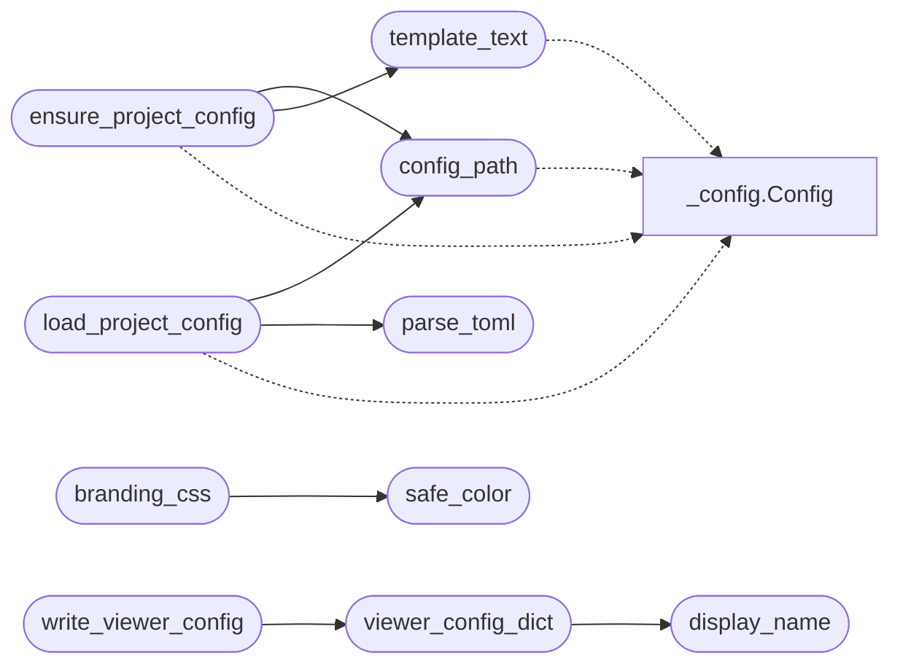

# `readmenator._project_config`

> Source: [readmenator/_project_config.py:1](../../readmenator/_project_config.py#L1) | language `py` | coverage 100.0% | [API index](../index.md)

Per-project persistent configuration (readmenator.toml).

The generic defaults live in Config (_config.py). Project-specific
choices -- which deliverables are built, under which directory names,
whether the GitHub wiki is published, scan scope, and viewer tuning --
live in a ``readmenator.toml`` file at the analysed project root.

On every ``run``/`[`rebuild`](readmenator._app.py.md#readmenatorapplication-rebuild)` the application ensures the file exists
(creating it from an embedded template when missing, never overwriting
an existing file) and then loads it as the source of truth for the
allow-listed keys. Explicit CLI flags always win over the TOML file:
a field whose current value already differs from the Config default is
left untouched by the TOML load.

## Contents

- **Functions:** [`template_text`](#template_text), [`config_path`](#config_path), [`ensure_project_config`](#ensure_project_config), [`parse_toml`](#parse_toml), [`load_project_config`](#load_project_config), [`display_name`](#display_name), [`safe_url`](#safe_url), [`safe_color`](#safe_color), [`branding_css`](#branding_css), [`viewer_config_dict`](#viewer_config_dict), [`write_viewer_config`](#write_viewer_config)
- **Constants:** [`PROJECT_CONFIG_VERSION`](#project_config_version), [`TOML_MAP`](#toml_map), [`CONFIG_TO_TOML`](#config_to_toml), [`VIEWER_TOML_KEYS`](#viewer_toml_keys), [`BRANDING_TOML_KEYS`](#branding_toml_keys), [`MESSAGES_TOML_KEYS`](#messages_toml_keys), [`MAPS_TOML_KEYS`](#maps_toml_keys)

## Call Graph

Solid arrows stay in this module, dashed arrows leave it.



## Functions

<a id="template_text"></a>

### `template_text`

`function` | [readmenator/_project_config.py:159](../../readmenator/_project_config.py#L159)

```python
def template_text(config: Optional[Config] = None) -> str
```

Render the example ``readmenator.toml`` content from Config defaults.

**Parameters**

| Name | Type | Default | Description |
|---|---|---|---|
| `config` | `Optional[Config]` | `None` | Base configuration whose values seed the template. |

**Returns:** `str` - TOML document as a string.

*Calls:* [`Config`](readmenator._config.py.md#config)

*Called by:* [`ensure_project_config`](#ensure_project_config)

---

<a id="config_path"></a>

### `config_path`

`function` | [readmenator/_project_config.py:286](../../readmenator/_project_config.py#L286)

```python
def config_path(project_root: Union[str, Path], config: Optional[Config] = None) -> Path
```

Return the readmenator.toml path for a project root.

**Parameters**

| Name | Type | Default | Description |
|---|---|---|---|
| `project_root` | `Union[str, Path]` |  | Project directory. |
| `config` | `Optional[Config]` | `None` | Optional configuration carrying the filename. |

**Returns:** `Path` - Absolute path of the TOML file.

*Calls:* [`Config`](readmenator._config.py.md#config)

*Called by:* [`ensure_project_config`](#ensure_project_config), [`load_project_config`](#load_project_config)

---

<a id="ensure_project_config"></a>

### `ensure_project_config`

`function` | [readmenator/_project_config.py:300](../../readmenator/_project_config.py#L300)

```python
def ensure_project_config(project_root: Union[str, Path], config: Optional[Config] = None) -> Path
```

Create ``readmenator.toml`` from the template when missing.

Never overwrites an existing file and refuses symlinked paths.

**Parameters**

| Name | Type | Default | Description |
|---|---|---|---|
| `project_root` | `Union[str, Path]` |  | Project directory to configure. |
| `config` | `Optional[Config]` | `None` | Base configuration seeding the template. |

**Returns:** `Path` - Path of the ensured TOML file.

*Calls:* [`Config`](readmenator._config.py.md#config), [`config_path`](#config_path), [`template_text`](#template_text)

*Called by:* [`main`](readmenator.__main__.py.md#main)

---

<a id="parse_toml"></a>

### `parse_toml`

`function` | [readmenator/_project_config.py:450](../../readmenator/_project_config.py#L450)

```python
def parse_toml(text: str) -> Dict[str, Dict[str, Any]]
```

Parse TOML text with the stdlib when available, else the mini parser.

**Parameters**

| Name | Type | Default | Description |
|---|---|---|---|
| `text` | `str` |  | TOML document text. |

**Returns:** `Dict[str, Dict[str, Any]]` - Nested mapping of section to key/value pairs.

*Called by:* [`load_project_config`](#load_project_config)

---

<a id="load_project_config"></a>

### `load_project_config`

`function` | [readmenator/_project_config.py:544](../../readmenator/_project_config.py#L544)

```python
def load_project_config(project_root: Union[str, Path], base: Optional[Config] = None) -> Config
```

Load ``readmenator.toml`` over a base Config (CLI flags win).

Fields whose base value already differs from the Config default are
treated as explicit CLI overrides and are never clobbered by TOML.

**Parameters**

| Name | Type | Default | Description |
|---|---|---|---|
| `project_root` | `Union[str, Path]` |  | Project directory holding readmenator.toml. |
| `base` | `Optional[Config]` | `None` | Base configuration (defaults plus CLI flags). |

**Returns:** `Config` - Effective configuration with TOML overrides applied.

*Calls:* [`Config`](readmenator._config.py.md#config), [`config_path`](#config_path), [`parse_toml`](#parse_toml)

*Called by:* [`main`](readmenator.__main__.py.md#main)

---

<a id="display_name"></a>

### `display_name`

`function` | [readmenator/_project_config.py:595](../../readmenator/_project_config.py#L595)

```python
def display_name(config: Config, fallback: str = '') -> str
```

Return the configured project name, falling back to a default.

**Parameters**

| Name | Type | Default | Description |
|---|---|---|---|
| `config` | `Config` |  | Effective configuration. |
| `fallback` | `str` | `''` | Name used when PROJECT_NAME is empty (directory name). |

**Returns:** `str` - Stripped project name or the fallback.

*Called by:* [`DocsSitePublisher.render_index`](readmenator._diagrams.py.md#docssitepublisher-render_index), [`render_flows_page`](readmenator._flowpage.py.md#render_flows_page), [`viewer_config_dict`](#viewer_config_dict)

---

<a id="safe_url"></a>

### `safe_url`

`function` | [readmenator/_project_config.py:609](../../readmenator/_project_config.py#L609)

```python
def safe_url(url: Any) -> str
```

Return a URL only when it is an absolute http(s) link.

**Parameters**

| Name | Type | Default | Description |
|---|---|---|---|
| `url` | `Any` |  | Raw configured value. |

**Returns:** `str` - The stripped URL, or "" when it is not an absolute http(s) link.

*Called by:* [`home_anchor`](readmenator._viewer_ui.py.md#home_anchor), [`project_links`](readmenator._viewer_ui.py.md#project_links)

---

<a id="safe_color"></a>

### `safe_color`

`function` | [readmenator/_project_config.py:624](../../readmenator/_project_config.py#L624)

```python
def safe_color(value: Any, fallback: str = '') -> str
```

Return a hex color only when it matches #rgb/#rrggbb/#rrggbbaa.

**Parameters**

| Name | Type | Default | Description |
|---|---|---|---|
| `value` | `Any` |  | Raw configured value. |
| `fallback` | `str` | `''` | Value returned when the input is not a hex color. |

**Returns:** `str` - The validated color string or the fallback.

*Called by:* [`branding_css`](#branding_css)

---

<a id="branding_css"></a>

### `branding_css`

`function` | [readmenator/_project_config.py:642](../../readmenator/_project_config.py#L642)

```python
def branding_css(config: Config) -> str
```

Return a CSS override block with the configured accent colors.

**Parameters**

| Name | Type | Default | Description |
|---|---|---|---|
| `config` | `Config` |  | Effective configuration. |

**Returns:** `str` - CSS text setting --accent/--accent2, or "" when unset/invalid.

*Calls:* [`safe_color`](#safe_color)

*Called by:* [`BundleGraphRenderer.render`](readmenator._bundlegraph.py.md#bundlegraphrenderer-render), [`render_flows_page`](readmenator._flowpage.py.md#render_flows_page), [`ForceGraphRenderer.render`](readmenator._forcegraph.py.md#forcegraphrenderer-render), [`branding_style`](readmenator._viewer_ui.py.md#branding_style)

---

<a id="viewer_config_dict"></a>

### `viewer_config_dict`

`function` | [readmenator/_project_config.py:663](../../readmenator/_project_config.py#L663)

```python
def viewer_config_dict(config: Config, project_root: Union[str, Path, None] = None) -> Dict[str, Any]
```

Return the viewer-facing subset of Config for maps pages + config.json.

Includes the [viewer] keys plus the [branding] identity used by page
headers, footers, and the Config modal, the [messages] injection
overrides, and the [maps] source-viewer budgets.

**Parameters**

| Name | Type | Default | Description |
|---|---|---|---|
| `config` | `Config` |  | Effective configuration. |
| `project_root` | `Union[str, Path, None]` | `None` | Optional project root used for the meta block. |

**Returns:** `Dict[str, Any]` - JSON-serializable viewer configuration with a _meta block.

*Calls:* [`display_name`](#display_name)

*Called by:* [`main`](readmenator.__main__.py.md#main), [`write_viewer_config`](#write_viewer_config)

---

<a id="write_viewer_config"></a>

### `write_viewer_config`

`function` | [readmenator/_project_config.py:717](../../readmenator/_project_config.py#L717)

```python
def write_viewer_config(maps_dir: Union[str, Path], config: Config, project_root: Union[str, Path, None] = None) -> Optional[Path]
```

Write ``config.json`` beside the maps gallery (never fatal).

**Parameters**

| Name | Type | Default | Description |
|---|---|---|---|
| `maps_dir` | `Union[str, Path]` |  | Directory holding the gallery index. |
| `config` | `Config` |  | Effective configuration. |
| `project_root` | `Union[str, Path, None]` | `None` | Optional project root for the meta block. |

**Returns:** `Optional[Path]` - Written file path, or None when the write fails.

*Calls:* [`viewer_config_dict`](#viewer_config_dict)

---

## Constants

<a id="project_config_version"></a>

### `PROJECT_CONFIG_VERSION`

`constant` | [readmenator/_project_config.py:29](../../readmenator/_project_config.py#L29)

```python
PROJECT_CONFIG_VERSION = 4
```

---

<a id="toml_map"></a>

### `TOML_MAP`

`constant` | [readmenator/_project_config.py:32](../../readmenator/_project_config.py#L32)

```python
TOML_MAP: Dict[Tuple[str, str], str]
```

---

<a id="config_to_toml"></a>

### `CONFIG_TO_TOML`

`constant` | [readmenator/_project_config.py:108](../../readmenator/_project_config.py#L108)

```python
CONFIG_TO_TOML: Dict[str, Tuple[str, str]] = {v: k for k, v in TOML_MAP.items()}
```

---

<a id="viewer_toml_keys"></a>

### `VIEWER_TOML_KEYS`

`constant` | [readmenator/_project_config.py:111](../../readmenator/_project_config.py#L111)

```python
VIEWER_TOML_KEYS
```

---

<a id="branding_toml_keys"></a>

### `BRANDING_TOML_KEYS`

`constant` | [readmenator/_project_config.py:118](../../readmenator/_project_config.py#L118)

```python
BRANDING_TOML_KEYS
```

---

<a id="messages_toml_keys"></a>

### `MESSAGES_TOML_KEYS`

`constant` | [readmenator/_project_config.py:124](../../readmenator/_project_config.py#L124)

```python
MESSAGES_TOML_KEYS
```

---

<a id="maps_toml_keys"></a>

### `MAPS_TOML_KEYS`

`constant` | [readmenator/_project_config.py:131](../../readmenator/_project_config.py#L131)

```python
MAPS_TOML_KEYS = ('sourceview_max_files', 'sourceview_max_total_chars')
```

---
