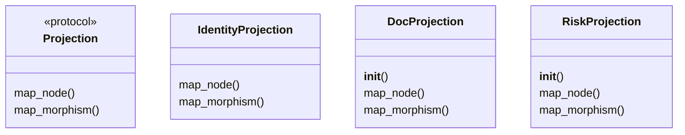
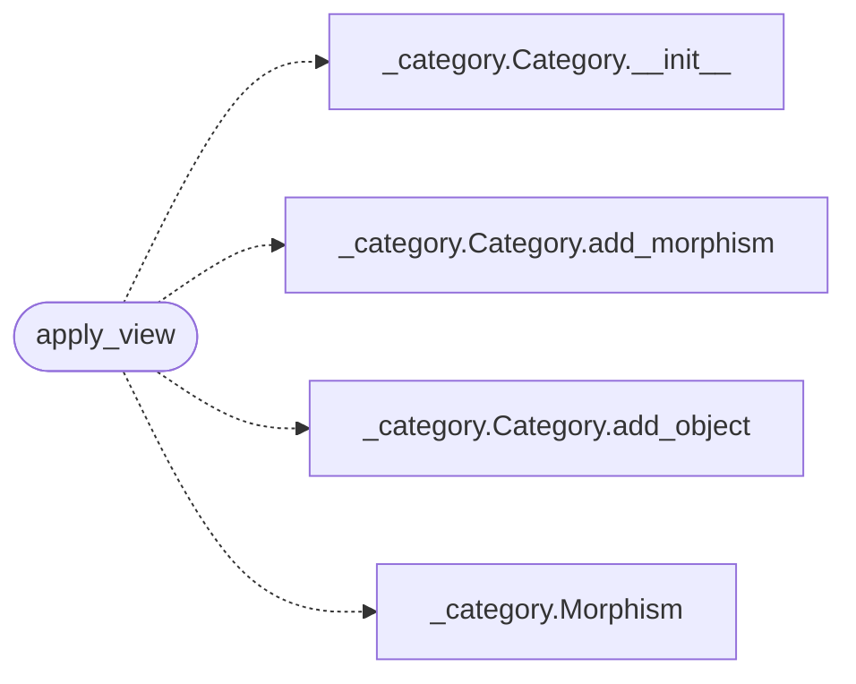

# `readmenator._projections`

> Source: [readmenator/_projections.py:1](../../readmenator/_projections.py#L1) | language `py` | coverage 50.0% | [API index](../index.md)

Functors and projections for the readmenator code category.

Defines projection functors that preserve structure but change the
point of view: F_docs (code -> documentation), F_risk (code -> risk),
and view-based projections for architecture, execution, quality, and
change impact analysis.

## Contents

- **Classes:** [`IdentityProjection`](#identityprojection), [`DocProjection`](#docprojection), [`RiskProjection`](#riskprojection)
- **Protocols:** [`Projection`](#projection)
- **Functions:** [`apply_view`](#apply_view)
- **Constants:** [`VIEWS`](#views)

## Type Diagram



## Call Graph

Solid arrows stay in this module, dashed arrows leave it.



## Classes

<a id="identityprojection"></a>

### `IdentityProjection`

`class` | [readmenator/_projections.py:32](../../readmenator/_projections.py#L32)

```python
class IdentityProjection
```

Identity functor: maps everything to itself.

**Members**

| Member | Kind | Summary |
|---|---|---|
| [`map_node`](#identityprojection-map_node) | method |  |
| [`map_morphism`](#identityprojection-map_morphism) | method |  |

<a id="identityprojection-map_node"></a>

#### `IdentityProjection.map_node`

`method` | [readmenator/_projections.py:35](../../readmenator/_projections.py#L35)

```python
def map_node(self, node: Node) -> Optional[Node]
```

**Parameters**

| Name | Type | Default | Description |
|---|---|---|---|
| `node` | `Node` |  |  |

**Returns:** `Optional[Node]`

<a id="identityprojection-map_morphism"></a>

#### `IdentityProjection.map_morphism`

`method` | [readmenator/_projections.py:38](../../readmenator/_projections.py#L38)

```python
def map_morphism(self, m: Morphism) -> Optional[Morphism]
```

**Parameters**

| Name | Type | Default | Description |
|---|---|---|---|
| `m` | `Morphism` |  |  |

**Returns:** `Optional[Morphism]`

---

<a id="docprojection"></a>

### `DocProjection`

`class` | [readmenator/_projections.py:42](../../readmenator/_projections.py#L42)

```python
class DocProjection
```

F_docs: project code to documentation.

Keeps only nodes that have docstrings or are referenced in README.
Useful for quantifying documentation gaps.

**Members**

| Member | Kind | Summary |
|---|---|---|
| [`__init__`](#docprojection-__init__) | constructor |  |
| [`map_node`](#docprojection-map_node) | method |  |
| [`map_morphism`](#docprojection-map_morphism) | method |  |

<a id="docprojection-__init__"></a>

#### `DocProjection.__init__`

`constructor` | [readmenator/_projections.py:49](../../readmenator/_projections.py#L49)

```python
def __init__(self, documented_ids: Set[str]) -> None
```

**Parameters**

| Name | Type | Default | Description |
|---|---|---|---|
| `documented_ids` | `Set[str]` |  |  |

<a id="docprojection-map_node"></a>

#### `DocProjection.map_node`

`method` | [readmenator/_projections.py:52](../../readmenator/_projections.py#L52)

```python
def map_node(self, node: Node) -> Optional[Node]
```

**Parameters**

| Name | Type | Default | Description |
|---|---|---|---|
| `node` | `Node` |  |  |

**Returns:** `Optional[Node]`

<a id="docprojection-map_morphism"></a>

#### `DocProjection.map_morphism`

`method` | [readmenator/_projections.py:57](../../readmenator/_projections.py#L57)

```python
def map_morphism(self, m: Morphism) -> Optional[Morphism]
```

**Parameters**

| Name | Type | Default | Description |
|---|---|---|---|
| `m` | `Morphism` |  |  |

**Returns:** `Optional[Morphism]`

---

<a id="riskprojection"></a>

### `RiskProjection`

`class` | [readmenator/_projections.py:63](../../readmenator/_projections.py#L63)

```python
class RiskProjection
```

F_risk: project code to risk/fragility nodes.

Nodes are transformed with risk attributes: fan-in, fan-out,
symbol count, test absence, and public API exposure.

**Members**

| Member | Kind | Summary |
|---|---|---|
| [`__init__`](#riskprojection-__init__) | constructor |  |
| [`map_node`](#riskprojection-map_node) | method |  |
| [`map_morphism`](#riskprojection-map_morphism) | method |  |

<a id="riskprojection-__init__"></a>

#### `RiskProjection.__init__`

`constructor` | [readmenator/_projections.py:70](../../readmenator/_projections.py#L70)

```python
def __init__(self, fan_in: Dict[str, int], fan_out: Dict[str, int], test_files: Set[str]) -> None
```

**Parameters**

| Name | Type | Default | Description |
|---|---|---|---|
| `fan_in` | `Dict[str, int]` |  |  |
| `fan_out` | `Dict[str, int]` |  |  |
| `test_files` | `Set[str]` |  |  |

<a id="riskprojection-map_node"></a>

#### `RiskProjection.map_node`

`method` | [readmenator/_projections.py:80](../../readmenator/_projections.py#L80)

```python
def map_node(self, node: Node) -> Optional[Node]
```

**Parameters**

| Name | Type | Default | Description |
|---|---|---|---|
| `node` | `Node` |  |  |

**Returns:** `Optional[Node]`

<a id="riskprojection-map_morphism"></a>

#### `RiskProjection.map_morphism`

`method` | [readmenator/_projections.py:91](../../readmenator/_projections.py#L91)

```python
def map_morphism(self, m: Morphism) -> Optional[Morphism]
```

**Parameters**

| Name | Type | Default | Description |
|---|---|---|---|
| `m` | `Morphism` |  |  |

**Returns:** `Optional[Morphism]`

---

## Protocols

<a id="projection"></a>

### `Projection`

`protocol` | [readmenator/_projections.py:17](../../readmenator/_projections.py#L17)

```python
class Projection(Protocol)
```

Bases: `Protocol`

A functor from C_code to another category.

Maps nodes and morphisms while preserving composition structure.

**Members**

| Member | Kind | Summary |
|---|---|---|
| [`map_node`](#projection-map_node) | method | Map a code node. |
| [`map_morphism`](#projection-map_morphism) | method | Map a morphism. |

<a id="projection-map_node"></a>

#### `Projection.map_node`

`method` | [readmenator/_projections.py:23](../../readmenator/_projections.py#L23)

```python
def map_node(self, node: Node) -> Optional[Node]
```

Map a code node.

Return None to exclude.

**Parameters**

| Name | Type | Default | Description |
|---|---|---|---|
| `node` | `Node` |  |  |

**Returns:** `Optional[Node]`

<a id="projection-map_morphism"></a>

#### `Projection.map_morphism`

`method` | [readmenator/_projections.py:27](../../readmenator/_projections.py#L27)

```python
def map_morphism(self, m: Morphism) -> Optional[Morphism]
```

Map a morphism.

Return None to exclude.

**Parameters**

| Name | Type | Default | Description |
|---|---|---|---|
| `m` | `Morphism` |  |  |

**Returns:** `Optional[Morphism]`

---

## Functions

<a id="apply_view"></a>

### `apply_view`

`function` | [readmenator/_projections.py:95](../../readmenator/_projections.py#L95)

```python
def apply_view(category: Category, view_config: Dict) -> Category
```

Apply a named view to produce a projected category.

View config format::
    {
        "edge_types": [EdgeKind.IMPORTS, EdgeKind.DEFINES, ...],
        "direction": "forward" | "reverse",  # default "forward"
    }

**Parameters**

| Name | Type | Default | Description |
|---|---|---|---|
| `category` | `Category` |  | Source category. |
| `view_config` | `Dict` |  | View definition dict. |

**Returns:** `Category` - A new Category with only matching morphisms.

*Calls:* [`Category.__init__`](readmenator._category.py.md#category-__init__), [`Category.add_morphism`](readmenator._category.py.md#category-add_morphism), [`Category.add_object`](readmenator._category.py.md#category-add_object), [`Morphism`](readmenator._category.py.md#morphism)

---

## Constants

<a id="views"></a>

### `VIEWS`

`constant` | [readmenator/_projections.py:142](../../readmenator/_projections.py#L142)

```python
VIEWS: Dict[str, Dict]
```

---
