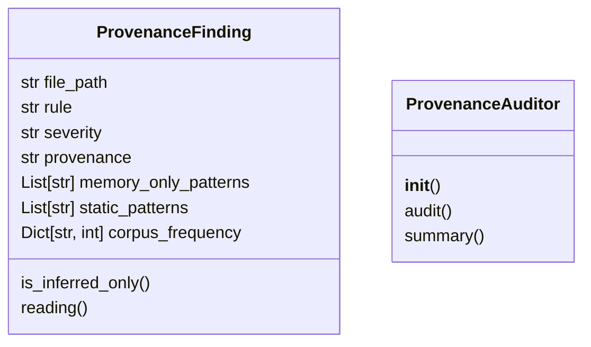
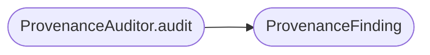

# `readmenator._provenance`

> Source: [readmenator/_provenance.py:1](../../readmenator/_provenance.py#L1) | language `py` | coverage 100.0% | [API index](../index.md)

Evidence-provenance audit for readmenator security findings.

Every match must answer which evidence tier supports it. Findings
resting only on weak or inferred signals (no snippet, inferred
confidence) are flagged as `inferred_only`; findings with static
extracts are `static`. Corpus frequency tells shared boilerplate
apart from file-unique signals.

## Contents

- **Classes:** [`ProvenanceFinding`](#provenancefinding), [`ProvenanceAuditor`](#provenanceauditor)

## Type Diagram



## Call Graph

Solid arrows stay in this module, dashed arrows leave it.



## Classes

<a id="provenancefinding"></a>

### `ProvenanceFinding`

`class` `dataclass` | [readmenator/_provenance.py:20](../../readmenator/_provenance.py#L20)

Decorators: `@dataclass(frozen=True)`

```python
class ProvenanceFinding
```

A single finding classified by evidence provenance.

**Attributes**

| Name | Type | Default | Description |
|---|---|---|---|
| [`file_path`](#provenancefinding-file_path) | `str` |  |  |
| [`rule`](#provenancefinding-rule) | `str` |  |  |
| [`severity`](#provenancefinding-severity) | `str` |  |  |
| [`provenance`](#provenancefinding-provenance) | `str` |  |  |
| [`memory_only_patterns`](#provenancefinding-memory_only_patterns) | `List[str]` | `field(default_factory=list)` |  |
| [`static_patterns`](#provenancefinding-static_patterns) | `List[str]` | `field(default_factory=list)` |  |
| [`corpus_frequency`](#provenancefinding-corpus_frequency) | `Dict[str, int]` | `field(default_factory=dict)` |  |

**Members**

| Member | Kind | Summary |
|---|---|---|
| [`is_inferred_only`](#provenancefinding-is_inferred_only) | property | Return True when no static evidence supports the finding. |
| [`reading`](#provenancefinding-reading) | property | Explain which way an inferred-only hit points. |

<a id="provenancefinding-is_inferred_only"></a>

#### `ProvenanceFinding.is_inferred_only`

`property` | [readmenator/_provenance.py:32](../../readmenator/_provenance.py#L32)

Decorators: `@property`

```python
def is_inferred_only(self) -> bool
```

Return True when no static evidence supports the finding.

**Returns:** `bool`

<a id="provenancefinding-reading"></a>

#### `ProvenanceFinding.reading`

`property` | [readmenator/_provenance.py:37](../../readmenator/_provenance.py#L37)

Decorators: `@property`

```python
def reading(self) -> str
```

Explain which way an inferred-only hit points.

**Returns:** `str`

---

<a id="provenanceauditor"></a>

### `ProvenanceAuditor`

`class` | [readmenator/_provenance.py:46](../../readmenator/_provenance.py#L46)

```python
class ProvenanceAuditor
```

Classifies security findings by static versus inferred evidence.

**Members**

| Member | Kind | Summary |
|---|---|---|
| [`__init__`](#provenanceauditor-__init__) | constructor | Initialise with application configuration. |
| [`audit`](#provenanceauditor-audit) | method | Audit findings for evidence provenance. |
| [`summary`](#provenanceauditor-summary) | method | Summarize provenance findings by provenance class. |

<a id="provenanceauditor-__init__"></a>

#### `ProvenanceAuditor.__init__`

`constructor` | [readmenator/_provenance.py:49](../../readmenator/_provenance.py#L49)

```python
def __init__(self, config: Config) -> None
```

Initialise with application configuration.

**Parameters**

| Name | Type | Default | Description |
|---|---|---|---|
| `config` | `Config` |  | Settings guarding the provenance audit flag. |

*Called by:* [`AnalyzerFactory.provenance`](readmenator._pipeline.py.md#analyzerfactory-provenance)

<a id="provenanceauditor-audit"></a>

#### `ProvenanceAuditor.audit`

`method` | [readmenator/_provenance.py:57](../../readmenator/_provenance.py#L57)

```python
def audit(self, findings: List[SecurityFinding], content_map: Dict[str, str] | None = None) -> List[ProvenanceFinding]
```

Audit findings for evidence provenance.

**Parameters**

| Name | Type | Default | Description |
|---|---|---|---|
| `findings` | `List[SecurityFinding]` |  | Security findings to classify. |
| `content_map` | `Dict[str, str] \| None` | `None` | Optional mapping of file path to raw content. |

**Returns:** `List[ProvenanceFinding]` - Provenance findings sorted by severity then file path.

*Calls:* [`ProvenanceFinding`](#provenancefinding)

<a id="provenanceauditor-summary"></a>

#### `ProvenanceAuditor.summary`

`method` | [readmenator/_provenance.py:98](../../readmenator/_provenance.py#L98)

```python
def summary(self, findings: List[ProvenanceFinding]) -> Dict[str, Any]
```

Summarize provenance findings by provenance class.

**Parameters**

| Name | Type | Default | Description |
|---|---|---|---|
| `findings` | `List[ProvenanceFinding]` |  | Classified provenance findings. |

**Returns:** `Dict[str, Any]` - Counts of static, inferred-only, and affected files.

---
