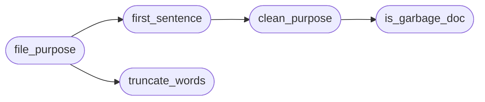

# `readmenator._purpose`

> Source: [readmenator/_purpose.py:1](../../readmenator/_purpose.py#L1) | language `py` | coverage 100.0% | [API index](../index.md)

Purpose extraction shared by every agent-facing document generator.

Turns raw file and symbol docstrings into one clean, bounded sentence
that tells a reader what a file is for. Banner rules, SPDX headers,
encoding cookies, and bare file names are rejected; files without a
module docstring fall back to the docstring of their primary symbol so
agent indexes never show an empty purpose when the code explains itself.

## Contents

- **Functions:** [`is_garbage_doc`](#is_garbage_doc), [`clean_purpose`](#clean_purpose), [`escape_cell`](#escape_cell), [`truncate_words`](#truncate_words), [`first_sentence`](#first_sentence), [`file_purpose`](#file_purpose)

## Call Graph

Solid arrows stay in this module, dashed arrows leave it.



## Functions

<a id="is_garbage_doc"></a>

### `is_garbage_doc`

`function` | [readmenator/_purpose.py:26](../../readmenator/_purpose.py#L26)

```python
def is_garbage_doc(text: str) -> bool
```

Return True for doc lines that carry no purpose signal.

**Parameters**

| Name | Type | Default | Description |
|---|---|---|---|
| `text` | `str` |  | One doc line. |

**Returns:** `bool` - Whether the line is too short, an encoding cookie, or symbol noise.

*Called by:* [`clean_purpose`](#clean_purpose)

---

<a id="clean_purpose"></a>

### `clean_purpose`

`function` | [readmenator/_purpose.py:43](../../readmenator/_purpose.py#L43)

```python
def clean_purpose(text: str) -> str
```

Return the purpose signal of a doc first line, or an empty string.

**Parameters**

| Name | Type | Default | Description |
|---|---|---|---|
| `text` | `str` |  | First line of a file or symbol docstring. |

**Returns:** `str` - The line without banners, SPDX tags, and leading file names.

*Calls:* [`is_garbage_doc`](#is_garbage_doc)

*Called by:* [`first_sentence`](#first_sentence)

---

<a id="escape_cell"></a>

### `escape_cell`

`function` | [readmenator/_purpose.py:66](../../readmenator/_purpose.py#L66)

```python
def escape_cell(text: str) -> str
```

Escape markdown table breaking characters in one line of text.

**Parameters**

| Name | Type | Default | Description |
|---|---|---|---|
| `text` | `str` |  | Arbitrary text destined for a table cell. |

**Returns:** `str` - Single-line text with pipes escaped.

---

<a id="truncate_words"></a>

### `truncate_words`

`function` | [readmenator/_purpose.py:78](../../readmenator/_purpose.py#L78)

```python
def truncate_words(text: str, max_chars: int) -> str
```

Truncate text at a word boundary and mark the cut with an ellipsis.

**Parameters**

| Name | Type | Default | Description |
|---|---|---|---|
| `text` | `str` |  | Text to shorten. |
| `max_chars` | `int` |  | Maximum length of the returned string. |

**Returns:** `str` - The original text when short enough, otherwise a word-aligned prefix.

*Called by:* [`GraphRagBuilder.build`](readmenator._graphrag.py.md#graphragbuilder-build), [`file_purpose`](#file_purpose)

---

<a id="first_sentence"></a>

### `first_sentence`

`function` | [readmenator/_purpose.py:98](../../readmenator/_purpose.py#L98)

```python
def first_sentence(doc: str) -> str
```

Return the first clean sentence of the first meaningful paragraph.

**Parameters**

| Name | Type | Default | Description |
|---|---|---|---|
| `doc` | `str` |  | Full docstring text. |

**Returns:** `str` - One sentence with whitespace collapsed, or an empty string.

*Calls:* [`clean_purpose`](#clean_purpose)

*Called by:* [`GraphRagBuilder.build`](readmenator._graphrag.py.md#graphragbuilder-build), [`file_purpose`](#file_purpose)

---

<a id="file_purpose"></a>

### `file_purpose`

`function` | [readmenator/_purpose.py:140](../../readmenator/_purpose.py#L140)

```python
def file_purpose(node: Node, max_chars: int) -> str
```

Return a bounded one-sentence purpose for a file node.

**Parameters**

| Name | Type | Default | Description |
|---|---|---|---|
| `node` | `Node` |  | Scanned file node. |
| `max_chars` | `int` |  | Maximum characters of the returned purpose. |

**Returns:** `str` - Module doc sentence, else ``Symbol: sentence`` from the primary
documented symbol, else an empty string.

*Calls:* [`first_sentence`](#first_sentence), [`truncate_words`](#truncate_words)

*Called by:* [`GraphRagBuilder.build`](readmenator._graphrag.py.md#graphragbuilder-build)

---
