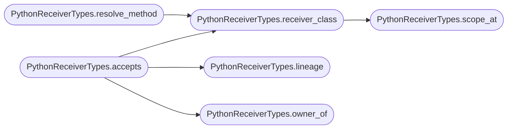

# `readmenator._pytypes`

> Source: [readmenator/_pytypes.py:1](../../readmenator/_pytypes.py#L1) | language `py` | coverage 100.0% | [API index](../index.md)

Lightweight, deterministic receiver typing for Python attribute calls.

Resolving ``obj.method()`` by method name alone invents edges whenever
two classes share a method name. This module recovers just enough type
information from the ``ast`` to decide which class a receiver holds:

* method ownership (which class defines the function at a given line),
* local variables assigned from a project class constructor or
  annotated with a project class (``app = App()``, ``app: App``,
  parameters ``def f(app: App)``),
* instance attributes assigned or annotated in any method
  (``self.engine = Engine()``, ``self.engine: Engine``),
* class-level annotated fields (dataclass style), and
* ``self`` / ``cls`` / ``super()`` and bare class names.

No inference across returns or containers is attempted: unknown stays
unknown, so callers can stay conservative.

## Contents

- **Classes:** [`PythonReceiverTypes`](#pythonreceivertypes)

## Call Graph

Solid arrows stay in this module, dashed arrows leave it.



## Classes

<a id="pythonreceivertypes"></a>

### `PythonReceiverTypes`

`class` | [readmenator/_pytypes.py:78](../../readmenator/_pytypes.py#L78)

```python
class PythonReceiverTypes
```

Per-project receiver type index for Python sources.

**Members**

| Member | Kind | Summary |
|---|---|---|
| [`__init__`](#pythonreceivertypes-__init__) | constructor | Index every Python file in *contents*. |
| [`classes`](#pythonreceivertypes-classes) | property | Return every project class name seen. |
| [`scope_at`](#pythonreceivertypes-scope_at) | method | Return the innermost function scope spanning *line*. |
| [`owner_of`](#pythonreceivertypes-owner_of) | method | Return the class that defines the function starting at *line* ("" if none). |
| [`receiver_class`](#pythonreceivertypes-receiver_class) | method | Return the project class a receiver expression holds at a call site. |
| [`lineage`](#pythonreceivertypes-lineage) | method | Return *class_name* plus every project base class it derives from. |
| [`resolve_method`](#pythonreceivertypes-resolve_method) | method | Return the (file, line) of the method a typed receiver dispatches to. |
| [`accepts`](#pythonreceivertypes-accepts) | method | Decide whether a Python attribute call can target a definition. |
| [`is_self_receiver`](#pythonreceivertypes-is_self_receiver) | method | Return True for ``self``, ``cls``, and ``super()`` receivers. |

<a id="pythonreceivertypes-__init__"></a>

#### `PythonReceiverTypes.__init__`

`constructor` | [readmenator/_pytypes.py:81](../../readmenator/_pytypes.py#L81)

```python
def __init__(self, contents: Dict[str, str], language: Dict[str, str]) -> None
```

Index every Python file in *contents*.

**Parameters**

| Name | Type | Default | Description |
|---|---|---|---|
| `contents` | `Dict[str, str]` |  | File id to source text. |
| `language` | `Dict[str, str]` |  | File id to scanner language label. |

*Called by:* [`ExecutionFlowBuilder.call_graph`](readmenator._flowcharts.py.md#executionflowbuilder-call_graph)

<a id="pythonreceivertypes-classes"></a>

#### `PythonReceiverTypes.classes`

`property` | [readmenator/_pytypes.py:118](../../readmenator/_pytypes.py#L118)

Decorators: `@property`

```python
def classes(self) -> Set[str]
```

Return every project class name seen.

**Returns:** `Set[str]`

<a id="pythonreceivertypes-scope_at"></a>

#### `PythonReceiverTypes.scope_at`

`method` | [readmenator/_pytypes.py:179](../../readmenator/_pytypes.py#L179)

```python
def scope_at(self, file_id: str, line: int) -> Optional[_Scope]
```

Return the innermost function scope spanning *line*.

**Parameters**

| Name | Type | Default | Description |
|---|---|---|---|
| `file_id` | `str` |  |  |
| `line` | `int` |  |  |

**Returns:** `Optional[_Scope]`

*Called by:* [`PythonReceiverTypes.receiver_class`](#pythonreceivertypes-receiver_class)

<a id="pythonreceivertypes-owner_of"></a>

#### `PythonReceiverTypes.owner_of`

`method` | [readmenator/_pytypes.py:187](../../readmenator/_pytypes.py#L187)

```python
def owner_of(self, file_id: str, line: int) -> str
```

Return the class that defines the function starting at *line* ("" if none).

**Parameters**

| Name | Type | Default | Description |
|---|---|---|---|
| `file_id` | `str` |  |  |
| `line` | `int` |  |  |

**Returns:** `str`

*Called by:* [`ExecutionFlowBuilder.call_graph`](readmenator._flowcharts.py.md#executionflowbuilder-call_graph), [`PythonReceiverTypes.accepts`](#pythonreceivertypes-accepts)

<a id="pythonreceivertypes-receiver_class"></a>

#### `PythonReceiverTypes.receiver_class`

`method` | [readmenator/_pytypes.py:191](../../readmenator/_pytypes.py#L191)

```python
def receiver_class(self, file_id: str, line: int, receiver: str) -> str
```

Return the project class a receiver expression holds at a call site.

**Parameters**

| Name | Type | Default | Description |
|---|---|---|---|
| `file_id` | `str` |  | Caller file. |
| `line` | `int` |  | Call line. |
| `receiver` | `str` |  | Receiver text from the call site (``self``, ``app``, ``self.engine``, ``Engine()``, ``Engine``). |

**Returns:** `str` - Class name, or "" when it cannot be proven.

*Calls:* [`PythonReceiverTypes.scope_at`](#pythonreceivertypes-scope_at)

*Called by:* [`PythonReceiverTypes.accepts`](#pythonreceivertypes-accepts), [`PythonReceiverTypes.resolve_method`](#pythonreceivertypes-resolve_method)

<a id="pythonreceivertypes-lineage"></a>

#### `PythonReceiverTypes.lineage`

`method` | [readmenator/_pytypes.py:233](../../readmenator/_pytypes.py#L233)

```python
def lineage(self, class_name: str) -> Set[str]
```

Return *class_name* plus every project base class it derives from.

**Parameters**

| Name | Type | Default | Description |
|---|---|---|---|
| `class_name` | `str` |  |  |

**Returns:** `Set[str]`

*Called by:* [`PythonReceiverTypes.accepts`](#pythonreceivertypes-accepts)

<a id="pythonreceivertypes-resolve_method"></a>

#### `PythonReceiverTypes.resolve_method`

`method` | [readmenator/_pytypes.py:245](../../readmenator/_pytypes.py#L245)

```python
def resolve_method(self, file_id: str, line: int, receiver: str, name: str) -> Optional[Tuple[str, int]]
```

Return the (file, line) of the method a typed receiver dispatches to.

Walks the receiver class lineage in base order; returns None when
the receiver type is unknown or no project class in the lineage
defines *name*.

**Parameters**

| Name | Type | Default | Description |
|---|---|---|---|
| `file_id` | `str` |  |  |
| `line` | `int` |  |  |
| `receiver` | `str` |  |  |
| `name` | `str` |  |  |

**Returns:** `Optional[Tuple[str, int]]`

*Calls:* [`PythonReceiverTypes.receiver_class`](#pythonreceivertypes-receiver_class)

*Called by:* [`ExecutionFlowBuilder.call_graph`](readmenator._flowcharts.py.md#executionflowbuilder-call_graph)

<a id="pythonreceivertypes-accepts"></a>

#### `PythonReceiverTypes.accepts`

`method` | [readmenator/_pytypes.py:269](../../readmenator/_pytypes.py#L269)

```python
def accepts(self, file_id: str, line: int, receiver: str, target_file: str, target_line: int, target_name: str) -> Optional[bool]
```

Decide whether a Python attribute call can target a definition.

**Parameters**

| Name | Type | Default | Description |
|---|---|---|---|
| `file_id` | `str` |  | Caller file. |
| `line` | `int` |  | Call line. |
| `receiver` | `str` |  | Receiver text ("" for plain calls). |
| `target_file` | `str` |  | Candidate definition file. |
| `target_line` | `int` |  | Candidate definition line. |
| `target_name` | `str` |  | Candidate definition name. |

**Returns:** `Optional[bool]` - True or False for Python callers, None when the caller is not
an indexed Python file (callers then fall back to their own rules).

*Calls:* [`PythonReceiverTypes.lineage`](#pythonreceivertypes-lineage), [`PythonReceiverTypes.owner_of`](#pythonreceivertypes-owner_of), [`PythonReceiverTypes.receiver_class`](#pythonreceivertypes-receiver_class)

*Called by:* [`ExecutionFlowBuilder.call_graph`](readmenator._flowcharts.py.md#executionflowbuilder-call_graph)

<a id="pythonreceivertypes-is_self_receiver"></a>

#### `PythonReceiverTypes.is_self_receiver`

`method` | [readmenator/_pytypes.py:304](../../readmenator/_pytypes.py#L304)

```python
def is_self_receiver(self, receiver: str) -> bool
```

Return True for ``self``, ``cls``, and ``super()`` receivers.

**Parameters**

| Name | Type | Default | Description |
|---|---|---|---|
| `receiver` | `str` |  |  |

**Returns:** `bool`

---
