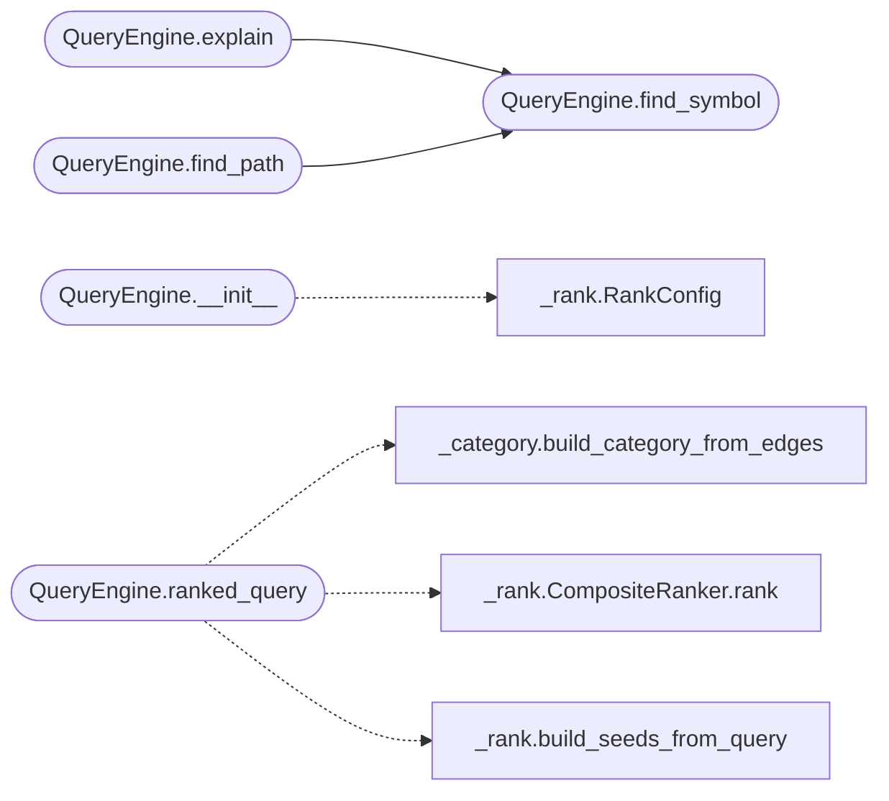

# `readmenator._query`

> Source: [readmenator/_query.py:1](../../readmenator/_query.py#L1) | language `py` | coverage 100.0% | [API index](../index.md)

Query engine for the readmenator knowledge base.

Supports natural-language-like search (`[`query`](#queryengine-query)`), symbol explanation
(`[`explain`](#queryengine-explain)`), dependency-path tracing (`[`find_path`](#queryengine-find_path)`), ranked queries
via PageRank/PPR integration (`[`ranked_query`](#queryengine-ranked_query)`), and a concise codebase
overview (`[`summary`](#queryengine-summary)`). All queries operate on an in-memory index built
from the scanned Node/Edge list.

## Contents

- **Classes:** [`QueryEngine`](#queryengine)

## Call Graph

Solid arrows stay in this module, dashed arrows leave it.



## Classes

<a id="queryengine"></a>

### `QueryEngine`

`class` | [readmenator/_query.py:25](../../readmenator/_query.py#L25)

```python
class QueryEngine
```

In-memory query engine over the scanned knowledge graph.

Builds a symbol-name index and an import-adjacency graph on
construction. Provides exact and fuzzy symbol lookup, detailed
explanation output, BFS shortest-path resolution, free-text
search, and a summary report.

**Members**

| Member | Kind | Summary |
|---|---|---|
| [`__init__`](#queryengine-__init__) | constructor | Initialise internal indexes from scanned data. |
| [`ranked_query`](#queryengine-ranked_query) | method | Answer *query* with a ranked list of relevant nodes. |
| [`find_symbol`](#queryengine-find_symbol) | method | Look up *name* by exact match, then by substring fuzzy match. |
| [`explain`](#queryengine-explain) | method | Return a detailed multi-line explanation of *name*. |
| [`find_path`](#queryengine-find_path) | method | Find the shortest import path from *symbol_a* to *symbol_b*. |
| [`query`](#queryengine-query) | method | Free-text search over symbols and file paths. |
| [`summary`](#queryengine-summary) | method | Return a concise overview of the loaded knowledge base. |

<a id="queryengine-__init__"></a>

#### `QueryEngine.__init__`

`constructor` | [readmenator/_query.py:34](../../readmenator/_query.py#L34)

```python
def __init__(self, nodes: List[Node], edges: List[Edge], resolved_edges: Optional[List[Edge]] = None, ranker: Optional[CompositeRanker] = None, config: Optional[RankConfig] = None)
```

Initialise internal indexes from scanned data.

**Parameters**

| Name | Type | Default | Description |
|---|---|---|---|
| `nodes` | `List[Node]` |  | List of scanned file nodes. |
| `edges` | `List[Edge]` |  | List of import-relationship edges. |
| `resolved_edges` | `Optional[List[Edge]]` | `None` | Optional resolved-import edges (both source and target are project file IDs). |
| `ranker` | `Optional[CompositeRanker]` | `None` | Optional CompositeRanker for ranked queries. |
| `config` | `Optional[RankConfig]` | `None` | Optional RankConfig if ranker is not provided. |

*Calls:* [`RankConfig`](readmenator._rank.py.md#rankconfig)

*Called by:* [`readmenatorApplication.explain`](readmenator._app.py.md#readmenatorapplication-explain), [`readmenatorApplication.find_path`](readmenator._app.py.md#readmenatorapplication-find_path), [`readmenatorApplication.query`](readmenator._app.py.md#readmenatorapplication-query), [`readmenatorApplication.rank_query`](readmenator._app.py.md#readmenatorapplication-rank_query), [`readmenatorApplication.run`](readmenator._app.py.md#readmenatorapplication-run), [`readmenatorApplication.summary`](readmenator._app.py.md#readmenatorapplication-summary)

<a id="queryengine-ranked_query"></a>

#### `QueryEngine.ranked_query`

`method` | [readmenator/_query.py:73](../../readmenator/_query.py#L73)

```python
def ranked_query(self, query: str, top_n: Optional[int] = None) -> RankedResult
```

Answer *query* with a ranked list of relevant nodes.

Uses Personalized PageRank seeded from lexical matches
against the query text, combined with authority, test
coverage, doc coverage, and freshness signals.

**Parameters**

| Name | Type | Default | Description |
|---|---|---|---|
| `query` | `str` |  | Free-text query string. |
| `top_n` | `Optional[int]` | `None` | Number of results to return (default: RankConfig.top_n). |

**Returns:** `RankedResult` - A RankedResult with scored items and explanations.

*Calls:* [`build_category_from_edges`](readmenator._category.py.md#build_category_from_edges), [`CompositeRanker.rank`](readmenator._rank.py.md#compositeranker-rank), [`build_seeds_from_query`](readmenator._rank.py.md#build_seeds_from_query)

*Called by:* [`readmenatorApplication.rank_query`](readmenator._app.py.md#readmenatorapplication-rank_query), [`readmenatorApplication.run`](readmenator._app.py.md#readmenatorapplication-run)

<a id="queryengine-find_symbol"></a>

#### `QueryEngine.find_symbol`

`method` | [readmenator/_query.py:220](../../readmenator/_query.py#L220)

```python
def find_symbol(self, name: str) -> Optional[List[tuple]]
```

Look up *name* by exact match, then by substring fuzzy match.

**Parameters**

| Name | Type | Default | Description |
|---|---|---|---|
| `name` | `str` |  |  |

**Returns:** `Optional[List[tuple]]` - A list of (Node, Symbol) tuples, or ``None`` if not found.

*Called by:* [`QueryEngine.explain`](#queryengine-explain), [`QueryEngine.find_path`](#queryengine-find_path)

<a id="queryengine-explain"></a>

#### `QueryEngine.explain`

`method` | [readmenator/_query.py:238](../../readmenator/_query.py#L238)

```python
def explain(self, name: str) -> Optional[str]
```

Return a detailed multi-line explanation of *name*.

Includes kind, file path, line number, docstring, signature,
imports, reverse dependencies ("imported by"), and sibling
symbols in the same file.

**Parameters**

| Name | Type | Default | Description |
|---|---|---|---|
| `name` | `str` |  |  |

**Returns:** `Optional[str]` - Formatted string or ``None`` if the symbol is not found.

*Calls:* [`QueryEngine.find_symbol`](#queryengine-find_symbol)

*Called by:* [`readmenatorApplication.explain`](readmenator._app.py.md#readmenatorapplication-explain)

<a id="queryengine-find_path"></a>

#### `QueryEngine.find_path`

`method` | [readmenator/_query.py:285](../../readmenator/_query.py#L285)

```python
def find_path(self, symbol_a: str, symbol_b: str) -> Optional[List[str]]
```

Find the shortest import path from *symbol_a* to *symbol_b*.

Uses BFS on the resolved import graph (project-internal edges)
first, traversing in both directions (forward = A imports B,
reverse = B is imported by A). Falls back to the raw import
graph if no resolved path exists.

**Parameters**

| Name | Type | Default | Description |
|---|---|---|---|
| `symbol_a` | `str` |  |  |
| `symbol_b` | `str` |  |  |

**Returns:** `Optional[List[str]]` - List of file node IDs forming the dependency chain, or ``None``.

*Calls:* [`QueryEngine.find_symbol`](#queryengine-find_symbol)

*Called by:* [`readmenatorApplication.find_path`](readmenator._app.py.md#readmenatorapplication-find_path)

<a id="queryengine-query"></a>

#### `QueryEngine.query`

`method` | [readmenator/_query.py:355](../../readmenator/_query.py#L355)

```python
def query(self, question: str) -> str
```

Free-text search over symbols and file paths.

Tokenises the input, matches against symbol names (substring)
and then against file paths as a fallback. Returns a
human-readable result string summarising matches or a
no-results message with KB statistics.

**Parameters**

| Name | Type | Default | Description |
|---|---|---|---|
| `question` | `str` |  |  |

**Returns:** `str`

*Called by:* [`readmenatorApplication.query`](readmenator._app.py.md#readmenatorapplication-query)

<a id="queryengine-summary"></a>

#### `QueryEngine.summary`

`method` | [readmenator/_query.py:411](../../readmenator/_query.py#L411)

```python
def summary(self) -> str
```

Return a concise overview of the loaded knowledge base.

Reports file count, symbol count, import count, language
diversity, top-level modules (by import popularity), and
lists of key class-like and function-like symbols.

**Returns:** `str`

*Called by:* [`readmenatorApplication.summary`](readmenator._app.py.md#readmenatorapplication-summary)

---
