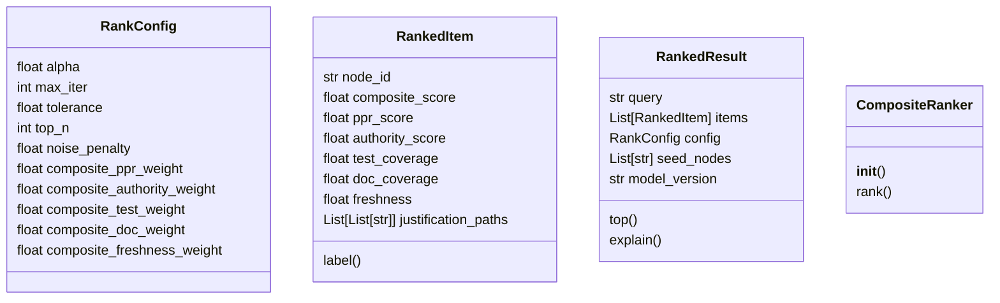
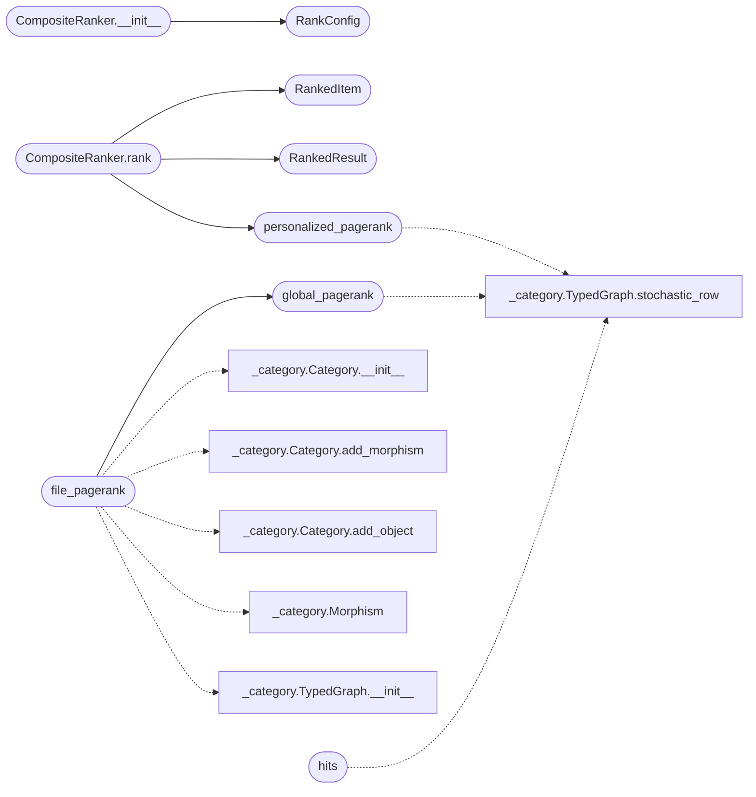

# `readmenator._rank`

> Source: [readmenator/_rank.py:1](../../readmenator/_rank.py#L1) | language `py` | coverage 81.2% | [API index](../index.md)

PageRank, Personalized PageRank, HITS, and composite scoring.

Provides typed-graph-aware ranking for the readmenator knowledge graph.
Global PageRank measures structural authority; Personalized PageRank
measures query-specific relevance; HITS separates authorities from hubs;
composite scoring combines multiple quality signals into a single
explainable rank.

## Contents

- **Classes:** [`RankConfig`](#rankconfig), [`RankedItem`](#rankeditem), [`RankedResult`](#rankedresult), [`CompositeRanker`](#compositeranker)
- **Functions:** [`global_pagerank`](#global_pagerank), [`file_pagerank`](#file_pagerank), [`personalized_pagerank`](#personalized_pagerank), [`hits`](#hits), [`build_seeds_from_query`](#build_seeds_from_query), [`build_seeds_for_context`](#build_seeds_for_context)
- **Constants:** [`HUB_PENALTY_NAMES`](#hub_penalty_names)

## Type Diagram



## Call Graph

Solid arrows stay in this module, dashed arrows leave it.



## Classes

<a id="rankconfig"></a>

### `RankConfig`

`class` `dataclass` | [readmenator/_rank.py:32](../../readmenator/_rank.py#L32)

Decorators: `@dataclass`

```python
class RankConfig
```

Tuneable parameters for the ranking system.

**Attributes**

| Name | Type | Default | Description |
|---|---|---|---|
| [`alpha`](#rankconfig-alpha) | `float` | `0.85` | Damping factor for PageRank (default 0.85). |
| [`max_iter`](#rankconfig-max_iter) | `int` | `100` | Maximum power-iteration steps. |
| [`tolerance`](#rankconfig-tolerance) | `float` | `1e-06` | Convergence threshold (L1 norm). |
| [`top_n`](#rankconfig-top_n) | `int` | `10` | Default number of ranked results to return. |
| [`noise_penalty`](#rankconfig-noise_penalty) | `float` | `0.7` | Multiplier applied to hub-penalty names when they are not part of the query seeds. |
| [`composite_ppr_weight`](#rankconfig-composite_ppr_weight) | `float` | `0.45` | Weight for PPR in composite score. |
| [`composite_authority_weight`](#rankconfig-composite_authority_weight) | `float` | `0.2` | Weight for global PageRank. |
| [`composite_test_weight`](#rankconfig-composite_test_weight) | `float` | `0.15` | Weight for test coverage signal. |
| [`composite_doc_weight`](#rankconfig-composite_doc_weight) | `float` | `0.1` | Weight for documentation coverage. |
| [`composite_freshness_weight`](#rankconfig-composite_freshness_weight) | `float` | `0.1` | Weight for code freshness. |

---

<a id="rankeditem"></a>

### `RankedItem`

`class` `dataclass` | [readmenator/_rank.py:354](../../readmenator/_rank.py#L354)

Decorators: `@dataclass`

```python
class RankedItem
```

A single ranked result with score decomposition.

**Attributes**

| Name | Type | Default | Description |
|---|---|---|---|
| [`node_id`](#rankeditem-node_id) | `str` |  | The ranked node ID. |
| [`composite_score`](#rankeditem-composite_score) | `float` |  | Final multi-signal score. |
| [`ppr_score`](#rankeditem-ppr_score) | `float` |  | Personalized PageRank contribution. |
| [`authority_score`](#rankeditem-authority_score) | `float` |  | Global PageRank contribution. |
| [`test_coverage`](#rankeditem-test_coverage) | `float` | `0.0` | Fraction of symbols referenced in test files. |
| [`doc_coverage`](#rankeditem-doc_coverage) | `float` | `0.0` | Fraction of symbols with documentation. |
| [`freshness`](#rankeditem-freshness) | `float` | `0.0` | Decay-weighted recency signal. |
| [`justification_paths`](#rankeditem-justification_paths) | `List[List[str]]` | `field(default_factory=list)` | Shortest paths from seed nodes to this node. |

**Members**

| Member | Kind | Summary |
|---|---|---|
| [`label`](#rankeditem-label) | property |  |

<a id="rankeditem-label"></a>

#### `RankedItem.label`

`property` | [readmenator/_rank.py:378](../../readmenator/_rank.py#L378)

Decorators: `@property`

```python
def label(self) -> str
```

**Returns:** `str`

---

<a id="rankedresult"></a>

### `RankedResult`

`class` `dataclass` | [readmenator/_rank.py:383](../../readmenator/_rank.py#L383)

Decorators: `@dataclass`

```python
class RankedResult
```

Complete ranking result for a query or context.

**Attributes**

| Name | Type | Default | Description |
|---|---|---|---|
| [`query`](#rankedresult-query) | `str` |  | The query string or context label. |
| [`items`](#rankedresult-items) | `List[RankedItem]` |  | Ranked items in descending score order. |
| [`config`](#rankedresult-config) | `RankConfig` |  | The RankConfig used. |
| [`seed_nodes`](#rankedresult-seed_nodes) | `List[str]` |  | The seed node IDs used for PPR. |
| [`model_version`](#rankedresult-model_version) | `str` | `'v1.0'` | Version identifier for the ranking model. |

**Members**

| Member | Kind | Summary |
|---|---|---|
| [`top`](#rankedresult-top) | method |  |
| [`explain`](#rankedresult-explain) | method | Return a human-readable explanation of why *node_id* ranks as it does. |

<a id="rankedresult-top"></a>

#### `RankedResult.top`

`method` | [readmenator/_rank.py:400](../../readmenator/_rank.py#L400)

```python
def top(self, n: int = 10) -> List[RankedItem]
```

**Parameters**

| Name | Type | Default | Description |
|---|---|---|---|
| `n` | `int` | `10` |  |

**Returns:** `List[RankedItem]`

*Called by:* [`rank_summary`](readmenator._explain.py.md#rank_summary)

<a id="rankedresult-explain"></a>

#### `RankedResult.explain`

`method` | [readmenator/_rank.py:403](../../readmenator/_rank.py#L403)

```python
def explain(self, node_id: str) -> Optional[str]
```

Return a human-readable explanation of why *node_id* ranks as it does.

**Parameters**

| Name | Type | Default | Description |
|---|---|---|---|
| `node_id` | `str` |  |  |

**Returns:** `Optional[str]`

---

<a id="compositeranker"></a>

### `CompositeRanker`

`class` | [readmenator/_rank.py:411](../../readmenator/_rank.py#L411)

```python
class CompositeRanker
```

Combines PPR, authority, test/doc coverage, and freshness.

Produces a single composite score per node:
S_q(n) = w_ppr * PPR_q(n) + w_auth * Auth(n) + w_test * Test(n)
       + w_doc * Doc(n) + w_fresh * Fresh(n)

**Members**

| Member | Kind | Summary |
|---|---|---|
| [`__init__`](#compositeranker-__init__) | constructor |  |
| [`rank`](#compositeranker-rank) | method | Compute composite ranking for a query. |

<a id="compositeranker-__init__"></a>

#### `CompositeRanker.__init__`

`constructor` | [readmenator/_rank.py:419](../../readmenator/_rank.py#L419)

```python
def __init__(self, graph: TypedGraph, config: Optional[RankConfig] = None)
```

**Parameters**

| Name | Type | Default | Description |
|---|---|---|---|
| `graph` | `TypedGraph` |  |  |
| `config` | `Optional[RankConfig]` | `None` |  |

*Calls:* [`RankConfig`](#rankconfig)

*Called by:* [`AnalyzerFactory.make_ranker`](readmenator._pipeline.py.md#analyzerfactory-make_ranker)

<a id="compositeranker-rank"></a>

#### `CompositeRanker.rank`

`method` | [readmenator/_rank.py:438](../../readmenator/_rank.py#L438)

```python
def rank(self, query: str, seeds: Dict[str, float], category: Category, node_ids: List[str], test_coverage: Optional[Dict[str, float]] = None, doc_coverage: Optional[Dict[str, float]] = None, freshness: Optional[Dict[str, float]] = None) -> RankedResult
```

Compute composite ranking for a query.

**Parameters**

| Name | Type | Default | Description |
|---|---|---|---|
| `query` | `str` |  | Query string. |
| `seeds` | `Dict[str, float]` |  | PPR seed vector. |
| `category` | `Category` |  | Category with morphisms for path finding. |
| `node_ids` | `List[str]` |  | All valid node IDs. |
| `test_coverage` | `Optional[Dict[str, float]]` | `None` | Optional dict of node_id -> test coverage (0-1). |
| `doc_coverage` | `Optional[Dict[str, float]]` | `None` | Optional dict of node_id -> doc coverage (0-1). |
| `freshness` | `Optional[Dict[str, float]]` | `None` | Optional dict of node_id -> freshness (0-1). |

**Returns:** `RankedResult` - A RankedResult with scored and sorted items.

*Calls:* [`RankedItem`](#rankeditem), [`RankedResult`](#rankedresult), [`personalized_pagerank`](#personalized_pagerank)

*Called by:* [`QueryEngine.ranked_query`](readmenator._query.py.md#queryengine-ranked_query)

---

## Functions

<a id="global_pagerank"></a>

### `global_pagerank`

`function` | [readmenator/_rank.py:61](../../readmenator/_rank.py#L61)

```python
def global_pagerank(graph: TypedGraph, alpha: float = 0.85, max_iter: int = 100, tolerance: float = 1e-06) -> Dict[str, float]
```

Compute global PageRank on the typed weighted graph.

Uses power iteration on the stochastic matrix derived from
the TypedGraph's edge weights. Dangling nodes (no outgoing
edges) are handled by uniform random teleportation.

**Parameters**

| Name | Type | Default | Description |
|---|---|---|---|
| `graph` | `TypedGraph` |  | A TypedGraph instance with weighted edges. |
| `alpha` | `float` | `0.85` | Damping factor (probability of following an edge). |
| `max_iter` | `int` | `100` | Maximum power-iteration steps. |
| `tolerance` | `float` | `1e-06` | Convergence threshold (L1 norm). |

**Returns:** `Dict[str, float]` - Dict mapping node_id -> PageRank score. Scores sum to 1.0.

*Calls:* [`TypedGraph.stochastic_row`](readmenator._category.py.md#typedgraph-stochastic_row)

*Called by:* [`file_pagerank`](#file_pagerank)

---

<a id="file_pagerank"></a>

### `file_pagerank`

`function` | [readmenator/_rank.py:119](../../readmenator/_rank.py#L119)

```python
def file_pagerank(file_ids: List[str], edges: List[Tuple[str, str]], alpha: float = 0.85, max_iter: int = 100, tolerance: float = 1e-06) -> Dict[str, float]
```

Directed PageRank over file-to-file dependency pairs.

A file that many files depend on accumulates authority. Self loops
and pairs naming unknown files are ignored.

**Parameters**

| Name | Type | Default | Description |
|---|---|---|---|
| `file_ids` | `List[str]` |  | Every file identifier (isolated files keep teleport mass). |
| `edges` | `List[Tuple[str, str]]` |  | (importer, imported) pairs. |
| `alpha` | `float` | `0.85` | Damping factor. |
| `max_iter` | `int` | `100` | Maximum power-iteration steps. |
| `tolerance` | `float` | `1e-06` | Convergence threshold (L1 norm). |

**Returns:** `Dict[str, float]` - Dict mapping file id -> PageRank score; empty for no files.

*Calls:* [`Category.__init__`](readmenator._category.py.md#category-__init__), [`Category.add_morphism`](readmenator._category.py.md#category-add_morphism), [`Category.add_object`](readmenator._category.py.md#category-add_object), [`Morphism`](readmenator._category.py.md#morphism), [`TypedGraph.__init__`](readmenator._category.py.md#typedgraph-__init__), [`global_pagerank`](#global_pagerank)

*Called by:* [`ComponentDiagramBuilder.build`](readmenator._components.py.md#componentdiagrambuilder-build), [`ForceGraphRenderer.build_payload`](readmenator._forcegraph.py.md#forcegraphrenderer-build_payload), [`CinematicVideoRenderer.collect`](readmenator._video.py.md#cinematicvideorenderer-collect)

---

<a id="personalized_pagerank"></a>

### `personalized_pagerank`

`function` | [readmenator/_rank.py:153](../../readmenator/_rank.py#L153)

```python
def personalized_pagerank(graph: TypedGraph, seeds: Dict[str, float], alpha: float = 0.85, max_iter: int = 100, tolerance: float = 1e-06) -> Dict[str, float]
```

Compute Personalized PageRank with a seed-node preference vector.

Instead of uniform teleportation, probability mass is distributed
according to the seed vector. This makes the ranking sensitive to
a specific query or context.

**Parameters**

| Name | Type | Default | Description |
|---|---|---|---|
| `graph` | `TypedGraph` |  | A TypedGraph instance. |
| `seeds` | `Dict[str, float]` |  | Dict mapping seed node_id -> preference mass (sums to 1.0). |
| `alpha` | `float` | `0.85` | Damping factor. |
| `max_iter` | `int` | `100` | Maximum power-iteration steps. |
| `tolerance` | `float` | `1e-06` | Convergence threshold (L1 norm). |

**Returns:** `Dict[str, float]` - Dict mapping node_id -> PPR score. Scores sum to 1.0.

*Calls:* [`TypedGraph.stochastic_row`](readmenator._category.py.md#typedgraph-stochastic_row)

*Called by:* [`GraphRagSearcher.local_search`](readmenator._graphrag.py.md#graphragsearcher-local_search), [`CompositeRanker.rank`](#compositeranker-rank)

---

<a id="hits"></a>

### `hits`

`function` | [readmenator/_rank.py:223](../../readmenator/_rank.py#L223)

```python
def hits(graph: TypedGraph, max_iter: int = 100, tolerance: float = 1e-06) -> Tuple[Dict[str, float], Dict[str, float]]
```

Compute HITS (Hyperlink-Induced Topic Search) authorities and hubs.

Authorities are nodes with many incoming edges from good hubs.
Hubs are nodes with many outgoing edges to good authorities.

**Parameters**

| Name | Type | Default | Description |
|---|---|---|---|
| `graph` | `TypedGraph` |  |  |
| `max_iter` | `int` | `100` |  |
| `tolerance` | `float` | `1e-06` |  |

**Returns:** `Tuple[Dict[str, float], Dict[str, float]]` - Tuple of (authorities, hubs) as dicts mapping node_id -> score.
Scores are L2-normalised.

*Calls:* [`TypedGraph.stochastic_row`](readmenator._category.py.md#typedgraph-stochastic_row)

---

<a id="build_seeds_from_query"></a>

### `build_seeds_from_query`

`function` | [readmenator/_rank.py:274](../../readmenator/_rank.py#L274)

```python
def build_seeds_from_query(query: str, node_ids: List[str], node_labels: Dict[str, str], symbols: Dict[str, List[str]]) -> Dict[str, float]
```

Build a PPR seed vector from a natural-language query string.

Matches query tokens against node IDs, labels, and symbol names.
Seeds are assigned equal mass. If no match is found, returns
empty dict (will use uniform teleportation).

**Parameters**

| Name | Type | Default | Description |
|---|---|---|---|
| `query` | `str` |  | Free-text query string. |
| `node_ids` | `List[str]` |  | All valid node IDs. |
| `node_labels` | `Dict[str, str]` |  | Mapping from node_id -> display label. |
| `symbols` | `Dict[str, List[str]]` |  | Mapping from node_id -> list of symbol names. |

**Returns:** `Dict[str, float]` - Dict of seed node_id -> equal mass fraction.

*Called by:* [`QueryEngine.ranked_query`](readmenator._query.py.md#queryengine-ranked_query)

---

<a id="build_seeds_for_context"></a>

### `build_seeds_for_context`

`function` | [readmenator/_rank.py:320](../../readmenator/_rank.py#L320)

```python
def build_seeds_for_context(node_ids: List[str], anchor_patterns: List[str]) -> Dict[str, float]
```

Build a PPR seed vector from anchor pattern strings.

Nodes whose ID or label contains any anchor pattern receive
equal seed mass. Useful for section-level seeding.

**Parameters**

| Name | Type | Default | Description |
|---|---|---|---|
| `node_ids` | `List[str]` |  | All valid node IDs. |
| `anchor_patterns` | `List[str]` |  | List of substrings to match. |

**Returns:** `Dict[str, float]` - Dict of seed node_id -> equal mass fraction.

---

## Constants

<a id="hub_penalty_names"></a>

### `HUB_PENALTY_NAMES`

`constant` | [readmenator/_rank.py:24](../../readmenator/_rank.py#L24)

```python
HUB_PENALTY_NAMES: Set[str]
```

---
