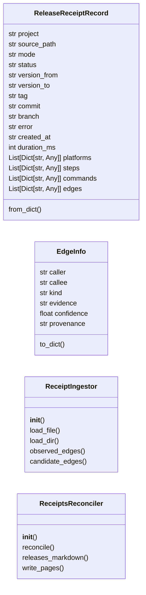
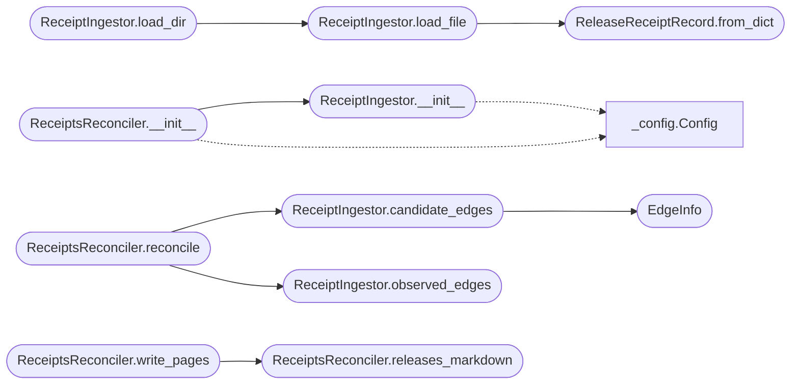

# `readmenator._receipts`

> Source: [readmenator/_receipts.py:1](../../readmenator/_receipts.py#L1) | language `py` | coverage 43.8% | [API index](../index.md)

Release receipts ingest contract: deploys as first-class evidence.

deploynator writes `release-receipts/*.json` receipts. This contract
loads them, extracts observed edges (caller -> callee with exit codes
and provenance), reconciles candidate edges (feasible sets from
config/CLI/interface) against observed ones, and renders a release
history page plus an edge-reconciliation JSON artifact.

Golden rule: only `observed` edges are facts. `candidate` edges were
never executed (feasible-set hypotheses from config); `predicted`
edges come from the uncertainty engine and are always labeled with
model version and confidence.

## Contents

- **Classes:** [`ReleaseReceiptRecord`](#releasereceiptrecord), [`EdgeInfo`](#edgeinfo), [`ReceiptIngestor`](#receiptingestor), [`ReceiptsReconciler`](#receiptsreconciler)
- **Constants:** [`RECEIPT_SCHEMA_PREFIX`](#receipt_schema_prefix), [`KIND_OBSERVED`](#kind_observed), [`KIND_CANDIDATE`](#kind_candidate), [`KIND_PREDICTED`](#kind_predicted), [`EDGES_JSON_NAME`](#edges_json_name), [`RELEASES_PAGE_NAME`](#releases_page_name)

## Type Diagram



## Call Graph

Solid arrows stay in this module, dashed arrows leave it.



## Classes

<a id="releasereceiptrecord"></a>

### `ReleaseReceiptRecord`

`class` `dataclass` | [readmenator/_receipts.py:43](../../readmenator/_receipts.py#L43)

Decorators: `@dataclass`

```python
class ReleaseReceiptRecord
```

A parsed deploynator release receipt.

**Attributes**

| Name | Type | Default | Description |
|---|---|---|---|
| [`project`](#releasereceiptrecord-project) | `str` |  |  |
| [`source_path`](#releasereceiptrecord-source_path) | `str` |  |  |
| [`mode`](#releasereceiptrecord-mode) | `str` |  |  |
| [`status`](#releasereceiptrecord-status) | `str` |  |  |
| [`version_from`](#releasereceiptrecord-version_from) | `str` | `''` |  |
| [`version_to`](#releasereceiptrecord-version_to) | `str` | `''` |  |
| [`tag`](#releasereceiptrecord-tag) | `str` | `''` |  |
| [`commit`](#releasereceiptrecord-commit) | `str` | `''` |  |
| [`branch`](#releasereceiptrecord-branch) | `str` | `''` |  |
| [`error`](#releasereceiptrecord-error) | `str` | `''` |  |
| [`created_at`](#releasereceiptrecord-created_at) | `str` | `''` |  |
| [`duration_ms`](#releasereceiptrecord-duration_ms) | `int` | `0` |  |
| [`platforms`](#releasereceiptrecord-platforms) | `List[Dict[str, Any]]` | `field(default_factory=list)` |  |
| [`steps`](#releasereceiptrecord-steps) | `List[Dict[str, Any]]` | `field(default_factory=list)` |  |
| [`commands`](#releasereceiptrecord-commands) | `List[Dict[str, Any]]` | `field(default_factory=list)` |  |
| [`edges`](#releasereceiptrecord-edges) | `List[Dict[str, Any]]` | `field(default_factory=list)` |  |

**Members**

| Member | Kind | Summary |
|---|---|---|
| [`from_dict`](#releasereceiptrecord-from_dict) | classmethod |  |

<a id="releasereceiptrecord-from_dict"></a>

#### `ReleaseReceiptRecord.from_dict`

`classmethod` | [readmenator/_receipts.py:64](../../readmenator/_receipts.py#L64)

Decorators: `@classmethod`

```python
def from_dict(cls, data: Dict[str, Any], source_path: str) -> 'ReleaseReceiptRecord'
```

**Parameters**

| Name | Type | Default | Description |
|---|---|---|---|
| `data` | `Dict[str, Any]` |  |  |
| `source_path` | `str` |  |  |

**Returns:** `'ReleaseReceiptRecord'`

**Raises**

- `ValueError`: (raised in the body, not documented)

*Called by:* [`ReceiptIngestor.load_file`](#receiptingestor-load_file)

---

<a id="edgeinfo"></a>

### `EdgeInfo`

`class` `dataclass` | [readmenator/_receipts.py:91](../../readmenator/_receipts.py#L91)

Decorators: `@dataclass(frozen=True)`

```python
class EdgeInfo
```

One evidence edge: caller -> callee with provenance.

**Attributes**

| Name | Type | Default | Description |
|---|---|---|---|
| [`caller`](#edgeinfo-caller) | `str` |  |  |
| [`callee`](#edgeinfo-callee) | `str` |  |  |
| [`kind`](#edgeinfo-kind) | `str` |  |  |
| [`evidence`](#edgeinfo-evidence) | `str` |  |  |
| [`confidence`](#edgeinfo-confidence) | `float` |  |  |
| [`provenance`](#edgeinfo-provenance) | `str` | `''` |  |

**Members**

| Member | Kind | Summary |
|---|---|---|
| [`to_dict`](#edgeinfo-to_dict) | method |  |

<a id="edgeinfo-to_dict"></a>

#### `EdgeInfo.to_dict`

`method` | [readmenator/_receipts.py:101](../../readmenator/_receipts.py#L101)

```python
def to_dict(self) -> Dict[str, Any]
```

**Returns:** `Dict[str, Any]`

---

<a id="receiptingestor"></a>

### `ReceiptIngestor`

`class` | [readmenator/_receipts.py:113](../../readmenator/_receipts.py#L113)

```python
class ReceiptIngestor
```

Loads release receipts and reconciles their evidence edges.

**Members**

| Member | Kind | Summary |
|---|---|---|
| [`__init__`](#receiptingestor-__init__) | constructor |  |
| [`load_file`](#receiptingestor-load_file) | method |  |
| [`load_dir`](#receiptingestor-load_dir) | method |  |
| [`observed_edges`](#receiptingestor-observed_edges) | method | Observed facts: explicit receipt edges plus command-derived ones. |
| [`candidate_edges`](#receiptingestor-candidate_edges) | method | Feasible-set edges (kind=candidate) declared by receipts. |

<a id="receiptingestor-__init__"></a>

#### `ReceiptIngestor.__init__`

`constructor` | [readmenator/_receipts.py:116](../../readmenator/_receipts.py#L116)

```python
def __init__(self, config: Optional[Config] = None) -> None
```

**Parameters**

| Name | Type | Default | Description |
|---|---|---|---|
| `config` | `Optional[Config]` | `None` |  |

*Calls:* [`Config`](readmenator._config.py.md#config)

*Called by:* [`ReceiptsReconciler.__init__`](#receiptsreconciler-__init__)

<a id="receiptingestor-load_file"></a>

#### `ReceiptIngestor.load_file`

`method` | [readmenator/_receipts.py:121](../../readmenator/_receipts.py#L121)

```python
def load_file(self, path: str) -> ReleaseReceiptRecord
```

**Parameters**

| Name | Type | Default | Description |
|---|---|---|---|
| `path` | `str` |  |  |

**Returns:** `ReleaseReceiptRecord`

**Raises**

- `ValueError`: (raised in the body, not documented)

*Calls:* [`ReleaseReceiptRecord.from_dict`](#releasereceiptrecord-from_dict)

*Called by:* [`ReceiptIngestor.load_dir`](#receiptingestor-load_dir)

<a id="receiptingestor-load_dir"></a>

#### `ReceiptIngestor.load_dir`

`method` | [readmenator/_receipts.py:134](../../readmenator/_receipts.py#L134)

```python
def load_dir(self, receipts_dir: str) -> List[ReleaseReceiptRecord]
```

**Parameters**

| Name | Type | Default | Description |
|---|---|---|---|
| `receipts_dir` | `str` |  |  |

**Returns:** `List[ReleaseReceiptRecord]`

**Raises**

- `ValueError`: (raised in the body, not documented)

*Calls:* [`ReceiptIngestor.load_file`](#receiptingestor-load_file)

*Called by:* [`readmenatorApplication.ingest_receipts`](readmenator._app.py.md#readmenatorapplication-ingest_receipts)

<a id="receiptingestor-observed_edges"></a>

#### `ReceiptIngestor.observed_edges`

`method` | [readmenator/_receipts.py:156](../../readmenator/_receipts.py#L156)

```python
def observed_edges(self, records: Sequence[ReleaseReceiptRecord]) -> List[EdgeInfo]
```

Observed facts: explicit receipt edges plus command-derived ones.

**Parameters**

| Name | Type | Default | Description |
|---|---|---|---|
| `records` | `Sequence[ReleaseReceiptRecord]` |  |  |

**Returns:** `List[EdgeInfo]`

*Called by:* [`readmenatorApplication.ingest_receipts`](readmenator._app.py.md#readmenatorapplication-ingest_receipts), [`ReceiptsReconciler.reconcile`](#receiptsreconciler-reconcile)

<a id="receiptingestor-candidate_edges"></a>

#### `ReceiptIngestor.candidate_edges`

`method` | [readmenator/_receipts.py:169](../../readmenator/_receipts.py#L169)

```python
def candidate_edges(self, records: Sequence[ReleaseReceiptRecord]) -> List[EdgeInfo]
```

Feasible-set edges (kind=candidate) declared by receipts.

**Parameters**

| Name | Type | Default | Description |
|---|---|---|---|
| `records` | `Sequence[ReleaseReceiptRecord]` |  |  |

**Returns:** `List[EdgeInfo]`

*Calls:* [`EdgeInfo`](#edgeinfo)

*Called by:* [`readmenatorApplication.ingest_receipts`](readmenator._app.py.md#readmenatorapplication-ingest_receipts), [`ReceiptsReconciler.reconcile`](#receiptsreconciler-reconcile)

---

<a id="receiptsreconciler"></a>

### `ReceiptsReconciler`

`class` | [readmenator/_receipts.py:269](../../readmenator/_receipts.py#L269)

```python
class ReceiptsReconciler
```

Reconciles candidate vs observed edges and renders artifacts.

**Members**

| Member | Kind | Summary |
|---|---|---|
| [`__init__`](#receiptsreconciler-__init__) | constructor |  |
| [`reconcile`](#receiptsreconciler-reconcile) | method |  |
| [`releases_markdown`](#receiptsreconciler-releases_markdown) | method |  |
| [`write_pages`](#receiptsreconciler-write_pages) | method |  |

<a id="receiptsreconciler-__init__"></a>

#### `ReceiptsReconciler.__init__`

`constructor` | [readmenator/_receipts.py:272](../../readmenator/_receipts.py#L272)

```python
def __init__(self, config: Optional[Config] = None) -> None
```

**Parameters**

| Name | Type | Default | Description |
|---|---|---|---|
| `config` | `Optional[Config]` | `None` |  |

*Calls:* [`Config`](readmenator._config.py.md#config), [`ReceiptIngestor.__init__`](#receiptingestor-__init__)

*Called by:* [`readmenatorApplication.ingest_receipts`](readmenator._app.py.md#readmenatorapplication-ingest_receipts)

<a id="receiptsreconciler-reconcile"></a>

#### `ReceiptsReconciler.reconcile`

`method` | [readmenator/_receipts.py:276](../../readmenator/_receipts.py#L276)

```python
def reconcile(self, records: Sequence[ReleaseReceiptRecord], candidate_edges: Sequence[EdgeInfo] = (), predicted_edges: Sequence[EdgeInfo] = ()) -> Dict[str, Any]
```

**Parameters**

| Name | Type | Default | Description |
|---|---|---|---|
| `records` | `Sequence[ReleaseReceiptRecord]` |  |  |
| `candidate_edges` | `Sequence[EdgeInfo]` | `()` |  |
| `predicted_edges` | `Sequence[EdgeInfo]` | `()` |  |

**Returns:** `Dict[str, Any]`

*Calls:* [`ReceiptIngestor.candidate_edges`](#receiptingestor-candidate_edges), [`ReceiptIngestor.observed_edges`](#receiptingestor-observed_edges)

*Called by:* [`readmenatorApplication.ingest_receipts`](readmenator._app.py.md#readmenatorapplication-ingest_receipts)

<a id="receiptsreconciler-releases_markdown"></a>

#### `ReceiptsReconciler.releases_markdown`

`method` | [readmenator/_receipts.py:307](../../readmenator/_receipts.py#L307)

```python
def releases_markdown(self, report: Dict[str, Any]) -> str
```

**Parameters**

| Name | Type | Default | Description |
|---|---|---|---|
| `report` | `Dict[str, Any]` |  |  |

**Returns:** `str`

*Called by:* [`ReceiptsReconciler.write_pages`](#receiptsreconciler-write_pages)

<a id="receiptsreconciler-write_pages"></a>

#### `ReceiptsReconciler.write_pages`

`method` | [readmenator/_receipts.py:330](../../readmenator/_receipts.py#L330)

```python
def write_pages(self, report: Dict[str, Any], target_dir: str, out_dirname: str = '') -> str
```

**Parameters**

| Name | Type | Default | Description |
|---|---|---|---|
| `report` | `Dict[str, Any]` |  |  |
| `target_dir` | `str` |  |  |
| `out_dirname` | `str` | `''` |  |

**Returns:** `str`

**Raises**

- `ValueError`: (raised in the body, not documented)

*Calls:* [`ReceiptsReconciler.releases_markdown`](#receiptsreconciler-releases_markdown)

*Called by:* [`readmenatorApplication.ingest_receipts`](readmenator._app.py.md#readmenatorapplication-ingest_receipts)

---

## Constants

<a id="receipt_schema_prefix"></a>

### `RECEIPT_SCHEMA_PREFIX`

`constant` | [readmenator/_receipts.py:25](../../readmenator/_receipts.py#L25)

```python
RECEIPT_SCHEMA_PREFIX = 'deploynator/receipt@'
```

---

<a id="kind_observed"></a>

### `KIND_OBSERVED`

`constant` | [readmenator/_receipts.py:27](../../readmenator/_receipts.py#L27)

```python
KIND_OBSERVED = 'observed'
```

---

<a id="kind_candidate"></a>

### `KIND_CANDIDATE`

`constant` | [readmenator/_receipts.py:28](../../readmenator/_receipts.py#L28)

```python
KIND_CANDIDATE = 'candidate'
```

---

<a id="kind_predicted"></a>

### `KIND_PREDICTED`

`constant` | [readmenator/_receipts.py:29](../../readmenator/_receipts.py#L29)

```python
KIND_PREDICTED = 'predicted'
```

---

<a id="edges_json_name"></a>

### `EDGES_JSON_NAME`

`constant` | [readmenator/_receipts.py:34](../../readmenator/_receipts.py#L34)

```python
EDGES_JSON_NAME = 'release-edges.json'
```

---

<a id="releases_page_name"></a>

### `RELEASES_PAGE_NAME`

`constant` | [readmenator/_receipts.py:35](../../readmenator/_receipts.py#L35)

```python
RELEASES_PAGE_NAME = 'RELEASES.md'
```

---
