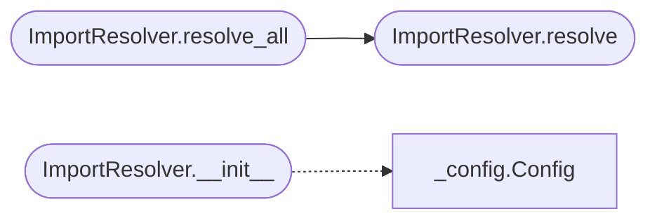

# `readmenator._resolver`

> Source: [readmenator/_resolver.py:1](../../readmenator/_resolver.py#L1) | language `py` | coverage 100.0% | [API index](../index.md)

Import path resolver for the readmenator knowledge graph.

Maps raw import strings (e.g. ``"os"``, ``"../utils"``, ``"java.util.List"``)
to actual file node IDs within the scanned project so that dependency-
tracing operations work on concrete files rather than opaque strings.

## Contents

- **Classes:** [`ImportResolver`](#importresolver)

## Call Graph

Solid arrows stay in this module, dashed arrows leave it.



## Classes

<a id="importresolver"></a>

### `ImportResolver`

`class` | [readmenator/_resolver.py:18](../../readmenator/_resolver.py#L18)

```python
class ImportResolver
```

Resolves raw import strings to project file paths.

Uses heuristics tuned to each language's import conventions:
Python dots to slashes, Java dots to directory separators,
relative-path resolution, and extensionless module detection.

**Members**

| Member | Kind | Summary |
|---|---|---|
| [`__init__`](#importresolver-__init__) | constructor | Initialise the resolver with all known file paths. |
| [`resolve`](#importresolver-resolve) | method | Resolve an import string to a concrete project file path. |
| [`resolve_all`](#importresolver-resolve_all) | method | Resolve *import_str* to all possible matching project file paths. |

<a id="importresolver-__init__"></a>

#### `ImportResolver.__init__`

`constructor` | [readmenator/_resolver.py:61](../../readmenator/_resolver.py#L61)

```python
def __init__(self, file_ids: List[str], root: str = '.', extensions: Optional[Tuple[str, ...]] = None, include_dirs: Optional[Tuple[str, ...]] = None)
```

Initialise the resolver with all known file paths.

**Parameters**

| Name | Type | Default | Description |
|---|---|---|---|
| `file_ids` | `List[str]` |  | List of relative file paths from the scan. |
| `root` | `str` | `'.'` | Root directory for relative-path resolution. |
| `extensions` | `Optional[Tuple[str, ...]]` | `None` | Known source extensions, defaults to Config. |
| `include_dirs` | `Optional[Tuple[str, ...]]` | `None` | Extra include search dirs (``-I`` style). |

*Calls:* [`Config`](readmenator._config.py.md#config)

*Called by:* [`ForceGraphRenderer.build_payload`](readmenator._forcegraph.py.md#forcegraphrenderer-build_payload), [`GraphRagBuilder.build`](readmenator._graphrag.py.md#graphragbuilder-build)

<a id="importresolver-resolve"></a>

#### `ImportResolver.resolve`

`method` | [readmenator/_resolver.py:110](../../readmenator/_resolver.py#L110)

```python
def resolve(self, import_str: str, source_file: str = '') -> Optional[str]
```

Resolve an import string to a concrete project file path.

**Parameters**

| Name | Type | Default | Description |
|---|---|---|---|
| `import_str` | `str` |  | The raw import string from the parser. |
| `source_file` | `str` | `''` | The file that contains the import (for relative resolution). |

**Returns:** `Optional[str]` - Matching file node ID or ``None`` if no match found.

*Called by:* [`ForceGraphRenderer.build_payload`](readmenator._forcegraph.py.md#forcegraphrenderer-build_payload), [`GraphRagBuilder.build`](readmenator._graphrag.py.md#graphragbuilder-build), [`ImportResolver.resolve_all`](#importresolver-resolve_all)

<a id="importresolver-resolve_all"></a>

#### `ImportResolver.resolve_all`

`method` | [readmenator/_resolver.py:163](../../readmenator/_resolver.py#L163)

```python
def resolve_all(self, import_str: str, source_file: str = '') -> List[str]
```

Resolve *import_str* to all possible matching project file paths.

**Parameters**

| Name | Type | Default | Description |
|---|---|---|---|
| `import_str` | `str` |  | The raw import string. |
| `source_file` | `str` | `''` | The file that contains the import. |

**Returns:** `List[str]` - List of matching file node IDs (may be empty).

*Calls:* [`ImportResolver.resolve`](#importresolver-resolve)

---
