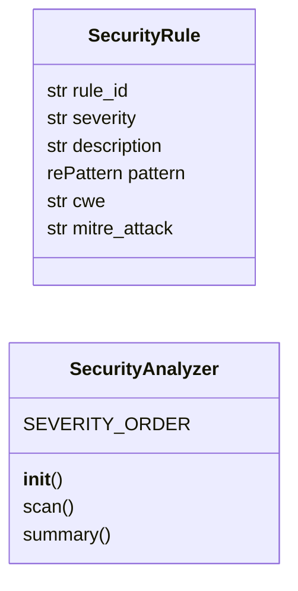
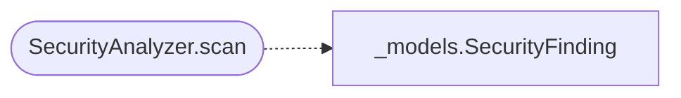

# `readmenator._security`

> Source: [readmenator/_security.py:1](../../readmenator/_security.py#L1) | language `py` | coverage 57.1% | [API index](../index.md)

Pattern-based static security analysis for the readmenator knowledge graph.

Scans source files across all supported languages for dangerous patterns:
command injection, SQL injection, XSS, weak crypto, unsafe deserialization,
hardcoded secrets, and more. Pure regex-based, zero external dependencies.

Rules are loaded from readmenator-rules/_security_rules.yml at runtime,
eliminating hardcoded patterns from source code (per the externalization
principle). Falls back to built-in rules if the YAML file is not present.

## Contents

- **Classes:** [`SecurityRule`](#securityrule), [`SecurityAnalyzer`](#securityanalyzer)
- **Functions:** [`fix_hint_for`](#fix_hint_for)

## Type Diagram



## Call Graph

Solid arrows stay in this module, dashed arrows leave it.



## Classes

<a id="securityrule"></a>

### `SecurityRule`

`class` `dataclass` | [readmenator/_security.py:24](../../readmenator/_security.py#L24)

Decorators: `@dataclass`

```python
class SecurityRule
```

A single security detection rule loaded from YAML or built-in.

**Attributes**

| Name | Type | Default | Description |
|---|---|---|---|
| [`rule_id`](#securityrule-rule_id) | `str` |  | Unique identifier (e.g. "PY001"). |
| [`severity`](#securityrule-severity) | `str` |  | Severity level (critical, high, medium, low, info). |
| [`description`](#securityrule-description) | `str` |  | Human-readable description of the issue. |
| [`pattern`](#securityrule-pattern) | `re.Pattern` |  | Compiled regex to search for. |
| [`cwe`](#securityrule-cwe) | `str` |  | CWE identifier string. |
| [`mitre_attack`](#securityrule-mitre_attack) | `str` | `''` | MITRE ATT&CK technique ID (e.g. "T1059.001"). |

---

<a id="securityanalyzer"></a>

### `SecurityAnalyzer`

`class` | [readmenator/_security.py:486](../../readmenator/_security.py#L486)

```python
class SecurityAnalyzer
```

Pattern-based static security scanner.

Loads rules from the external YAML rules file when available,
falling back to the built-in hardcoded rule sets. Walks the
target directory applying rules to every supported source file.

**Attributes**

| Name | Type | Default | Description |
|---|---|---|---|
| [`SEVERITY_ORDER`](#securityanalyzer-severity_order) |  | `{'critical': 0, 'high': 1, 'medium': 2, 'low': 3, 'info': 4}` |  |

**Members**

| Member | Kind | Summary |
|---|---|---|
| [`__init__`](#securityanalyzer-__init__) | constructor |  |
| [`scan`](#securityanalyzer-scan) | method |  |
| [`summary`](#securityanalyzer-summary) | method |  |

<a id="securityanalyzer-__init__"></a>

#### `SecurityAnalyzer.__init__`

`constructor` | [readmenator/_security.py:496](../../readmenator/_security.py#L496)

```python
def __init__(self, config: Config) -> None
```

**Parameters**

| Name | Type | Default | Description |
|---|---|---|---|
| `config` | `Config` |  |  |

*Called by:* [`AnalyzerFactory.security`](readmenator._pipeline.py.md#analyzerfactory-security)

<a id="securityanalyzer-scan"></a>

#### `SecurityAnalyzer.scan`

`method` | [readmenator/_security.py:513](../../readmenator/_security.py#L513)

```python
def scan(self, root: Path) -> List[SecurityFinding]
```

**Parameters**

| Name | Type | Default | Description |
|---|---|---|---|
| `root` | `Path` |  |  |

**Returns:** `List[SecurityFinding]`

**Raises**

- `ValueError`: (raised in the body, not documented)

*Calls:* [`SecurityFinding`](readmenator._models.py.md#securityfinding)

<a id="securityanalyzer-summary"></a>

#### `SecurityAnalyzer.summary`

`method` | [readmenator/_security.py:572](../../readmenator/_security.py#L572)

```python
def summary(self, findings: List[SecurityFinding]) -> str
```

**Parameters**

| Name | Type | Default | Description |
|---|---|---|---|
| `findings` | `List[SecurityFinding]` |  |  |

**Returns:** `str`

---

## Functions

<a id="fix_hint_for"></a>

### `fix_hint_for`

`function` | [readmenator/_security.py:620](../../readmenator/_security.py#L620)

```python
def fix_hint_for(finding: SecurityFinding) -> str
```

Return a one-line remediation hint for a security finding.

Looks up the finding CWE in the guidance map and falls back to a
generic least-privilege hint for unmapped identifiers.

**Parameters**

| Name | Type | Default | Description |
|---|---|---|---|
| `finding` | `SecurityFinding` |  | Security finding with a CWE identifier string. |

**Returns:** `str` - One-line remediation hint without markdown formatting.

---
