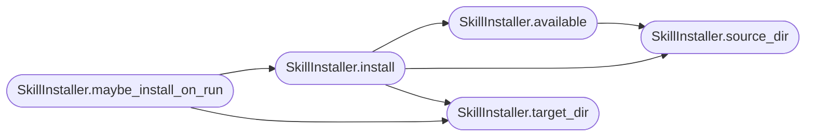

# `readmenator._skill_installer`

> Source: [readmenator/_skill_installer.py:1](../../readmenator/_skill_installer.py#L1) | language `py` | coverage 100.0% | [API index](../index.md)

Installs the packaged ReadMenator agent skills into a project.

Skills follow the Agent Skills layout (``<name>/SKILL.md`` with YAML
frontmatter) used by Claude Code and compatible agents. Only the
``readmenator-*`` skill directories shipped in ``readmenator/_skills`` are
written; any other skill in the target directory is left untouched.

## Contents

- **Classes:** [`SkillInstaller`](#skillinstaller)
- **Constants:** [`SKILL_PREFIX`](#skill_prefix)

## Call Graph

Solid arrows stay in this module, dashed arrows leave it.



## Classes

<a id="skillinstaller"></a>

### `SkillInstaller`

`class` | [readmenator/_skill_installer.py:22](../../readmenator/_skill_installer.py#L22)

```python
class SkillInstaller
```

Copies packaged skills into `[`SKILLS_TARGET_DIR`](readmenator._config.py.md#config-skills_target_dir)` (idempotent).

**Members**

| Member | Kind | Summary |
|---|---|---|
| [`__init__`](#skillinstaller-__init__) | constructor | Initialise with application configuration. |
| [`source_dir`](#skillinstaller-source_dir) | staticmethod | Return the packaged skills directory. |
| [`available`](#skillinstaller-available) | method | Return the names of the packaged skills, sorted. |
| [`target_dir`](#skillinstaller-target_dir) | method | Resolve the destination skills directory. |
| [`install`](#skillinstaller-install) | method | Write every packaged skill whose content changed. |
| [`maybe_install_on_run`](#skillinstaller-maybe_install_on_run) | method | Install during run() only when the project already uses agent skills. |

<a id="skillinstaller-__init__"></a>

#### `SkillInstaller.__init__`

`constructor` | [readmenator/_skill_installer.py:25](../../readmenator/_skill_installer.py#L25)

```python
def __init__(self, config: Config) -> None
```

Initialise with application configuration.

**Parameters**

| Name | Type | Default | Description |
|---|---|---|---|
| `config` | `Config` |  | SKILLS_* settings. |

*Called by:* [`AnalyzerFactory.skills`](readmenator._pipeline.py.md#analyzerfactory-skills)

<a id="skillinstaller-source_dir"></a>

#### `SkillInstaller.source_dir`

`staticmethod` | [readmenator/_skill_installer.py:34](../../readmenator/_skill_installer.py#L34)

Decorators: `@staticmethod`

```python
def source_dir() -> Path
```

Return the packaged skills directory.

**Returns:** `Path`

*Called by:* [`SkillInstaller.available`](#skillinstaller-available), [`SkillInstaller.install`](#skillinstaller-install)

<a id="skillinstaller-available"></a>

#### `SkillInstaller.available`

`method` | [readmenator/_skill_installer.py:38](../../readmenator/_skill_installer.py#L38)

```python
def available(self) -> List[str]
```

Return the names of the packaged skills, sorted.

**Returns:** `List[str]`

*Calls:* [`SkillInstaller.source_dir`](#skillinstaller-source_dir)

*Called by:* [`SkillInstaller.install`](#skillinstaller-install)

<a id="skillinstaller-target_dir"></a>

#### `SkillInstaller.target_dir`

`method` | [readmenator/_skill_installer.py:48](../../readmenator/_skill_installer.py#L48)

```python
def target_dir(self, project_root: str, target: Optional[str] = None) -> Path
```

Resolve the destination skills directory.

**Parameters**

| Name | Type | Default | Description |
|---|---|---|---|
| `project_root` | `str` |  | Project root directory. |
| `target` | `Optional[str]` | `None` | Optional explicit directory (relative to the project root when not absolute). |

**Returns:** `Path` - Destination directory path.

*Called by:* [`SkillInstaller.install`](#skillinstaller-install), [`SkillInstaller.maybe_install_on_run`](#skillinstaller-maybe_install_on_run)

<a id="skillinstaller-install"></a>

#### `SkillInstaller.install`

`method` | [readmenator/_skill_installer.py:61](../../readmenator/_skill_installer.py#L61)

```python
def install(self, project_root: str, target: Optional[str] = None) -> List[Path]
```

Write every packaged skill whose content changed.

**Parameters**

| Name | Type | Default | Description |
|---|---|---|---|
| `project_root` | `str` |  | Project root directory. |
| `target` | `Optional[str]` | `None` | Optional explicit destination directory. |

**Returns:** `List[Path]` - Paths of SKILL.md files written in this call.

*Calls:* [`SkillInstaller.available`](#skillinstaller-available), [`SkillInstaller.source_dir`](#skillinstaller-source_dir), [`SkillInstaller.target_dir`](#skillinstaller-target_dir)

*Called by:* [`SkillInstaller.maybe_install_on_run`](#skillinstaller-maybe_install_on_run)

<a id="skillinstaller-maybe_install_on_run"></a>

#### `SkillInstaller.maybe_install_on_run`

`method` | [readmenator/_skill_installer.py:87](../../readmenator/_skill_installer.py#L87)

```python
def maybe_install_on_run(self, project_root: str) -> List[Path]
```

Install during run() only when the project already uses agent skills.

The default target is written only when its parent directory (for
example ``.claude/``) already exists, so plain projects never gain a
new hidden directory.

**Parameters**

| Name | Type | Default | Description |
|---|---|---|---|
| `project_root` | `str` |  | Project root directory. |

**Returns:** `List[Path]` - Paths written, empty when skipped.

*Calls:* [`SkillInstaller.install`](#skillinstaller-install), [`SkillInstaller.target_dir`](#skillinstaller-target_dir)

---

## Constants

<a id="skill_prefix"></a>

### `SKILL_PREFIX`

`constant` | [readmenator/_skill_installer.py:19](../../readmenator/_skill_installer.py#L19)

```python
SKILL_PREFIX = 'readmenator-'
```

---
