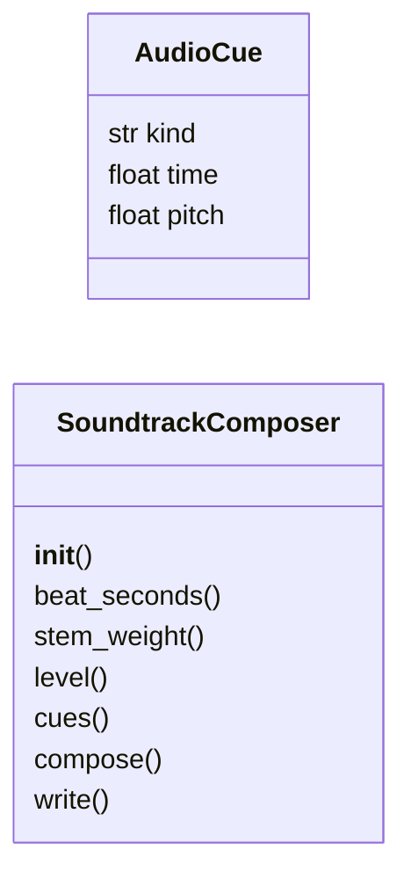

# `readmenator._soundtrack`

> Source: [readmenator/_soundtrack.py:1](../../readmenator/_soundtrack.py#L1) | language `py` | coverage 100.0% | [API index](../index.md)

Procedural synthwave soundtrack for the overview video.

Composes a deterministic stereo score from the scene timeline with the
standard library only: a four-stem loop (pad, bass, drums, arpeggio)
whose density follows the energy of each scene, a downbeat that lands
on the first frame of every act, a riser into each act, an impact on
each cut and one rising ping per release of the growth timelapse.

Zero tokens, zero network, zero native dependencies: samples are
synthesised in pure Python and returned as 16-bit PCM WAV bytes.

## Contents

- **Classes:** [`AudioCue`](#audiocue), [`SoundtrackComposer`](#soundtrackcomposer)
- **Constants:** [`PCM_PEAK`](#pcm_peak), [`CHANNELS`](#channels), [`SAMPLE_WIDTH`](#sample_width), [`STEPS_PER_BEAT`](#steps_per_beat), [`BEATS_PER_BAR`](#beats_per_bar), [`SEMITONES`](#semitones), [`TWO_PI`](#two_pi), [`THIRDS`](#thirds), [`STEMS`](#stems)

## Type Diagram



## Call Graph

Solid arrows stay in this module, dashed arrows leave it.

```mermaid
flowchart LR
    n_readmenator__soundtrack_py__SoundtrackComposer_cues(["SoundtrackComposer.cues"])
    n_readmenator__soundtrack_py__AudioCue(["AudioCue"])
    n_readmenator__soundtrack_py__SoundtrackComposer_compose(["SoundtrackComposer.compose"])
    n_readmenator__soundtrack_py__SoundtrackComposer_write(["SoundtrackComposer.write"])
    n_readmenator__soundtrack_py__SoundtrackComposer_cues --> n_readmenator__soundtrack_py__AudioCue
    n_readmenator__soundtrack_py__SoundtrackComposer_compose --> n_readmenator__soundtrack_py__SoundtrackComposer_cues
    n_readmenator__soundtrack_py__SoundtrackComposer_write --> n_readmenator__soundtrack_py__SoundtrackComposer_compose
```



## Classes

<a id="audiocue"></a>

### `AudioCue`

`class` `dataclass` | [readmenator/_soundtrack.py:39](../../readmenator/_soundtrack.py#L39)

Decorators: `@dataclass(frozen=True)`

```python
class AudioCue
```

One timed sound event laid over the music bed.

**Attributes**

| Name | Type | Default | Description |
|---|---|---|---|
| [`kind`](#audiocue-kind) | `str` |  | Event kind: impact, riser or ping. |
| [`time`](#audiocue-time) | `float` |  | Start time in seconds on the video clock. |
| [`pitch`](#audiocue-pitch) | `float` | `0.0` | Frequency in hertz for pitched events, 0.0 otherwise. |

---

<a id="soundtrackcomposer"></a>

### `SoundtrackComposer`

`class` | [readmenator/_soundtrack.py:71](../../readmenator/_soundtrack.py#L71)

```python
class SoundtrackComposer
```

Compose the video score from the scene timeline.

**Parameters**

| Name | Type | Default | Description |
|---|---|---|---|
| `config` |  |  | Effective configuration carrying every VIDEO_AUDIO_* value. |

**Members**

| Member | Kind | Summary |
|---|---|---|
| [`__init__`](#soundtrackcomposer-__init__) | constructor |  |
| [`beat_seconds`](#soundtrackcomposer-beat_seconds) | property | Exact duration of one beat of the rendered loop, in seconds. |
| [`stem_weight`](#soundtrackcomposer-stem_weight) | method | Return how present a stem is (0..1) at one energy level. |
| [`level`](#soundtrackcomposer-level) | method | Return the music energy (0..1) of a scene kind. |
| [`cues`](#soundtrackcomposer-cues) | method | Derive the timed events from the scene timeline. |
| [`compose`](#soundtrackcomposer-compose) | method | Compose the full score and return it as WAV bytes. |
| [`write`](#soundtrackcomposer-write) | method | Compose the score and write it to *path*. |

<a id="soundtrackcomposer-__init__"></a>

#### `SoundtrackComposer.__init__`

`constructor` | [readmenator/_soundtrack.py:78](../../readmenator/_soundtrack.py#L78)

```python
def __init__(self, config: Config) -> None
```

**Parameters**

| Name | Type | Default | Description |
|---|---|---|---|
| `config` | `Config` |  | Effective configuration carrying every VIDEO_AUDIO_* value. |

*Called by:* [`CinematicVideoRenderer.audio_track`](readmenator._video.py.md#cinematicvideorenderer-audio_track), [`CinematicVideoRenderer.render`](readmenator._video.py.md#cinematicvideorenderer-render), [`CinematicVideoRenderer.render_single_frame`](readmenator._video.py.md#cinematicvideorenderer-render_single_frame)

<a id="soundtrackcomposer-beat_seconds"></a>

#### `SoundtrackComposer.beat_seconds`

`property` | [readmenator/_soundtrack.py:89](../../readmenator/_soundtrack.py#L89)

Decorators: `@property`

```python
def beat_seconds(self) -> float
```

Exact duration of one beat of the rendered loop, in seconds.

**Returns:** `float`

<a id="soundtrackcomposer-stem_weight"></a>

#### `SoundtrackComposer.stem_weight`

`method` | [readmenator/_soundtrack.py:93](../../readmenator/_soundtrack.py#L93)

```python
def stem_weight(self, name: str, level: float) -> float
```

Return how present a stem is (0..1) at one energy level.

**Parameters**

| Name | Type | Default | Description |
|---|---|---|---|
| `name` | `str` |  |  |
| `level` | `float` |  |  |

**Returns:** `float`

*Called by:* [`score_sync`](readmenator._video.py.md#score_sync)

<a id="soundtrackcomposer-level"></a>

#### `SoundtrackComposer.level`

`method` | [readmenator/_soundtrack.py:99](../../readmenator/_soundtrack.py#L99)

```python
def level(self, kind: str) -> float
```

Return the music energy (0..1) of a scene kind.

**Parameters**

| Name | Type | Default | Description |
|---|---|---|---|
| `kind` | `str` |  |  |

**Returns:** `float`

*Called by:* [`score_sync`](readmenator._video.py.md#score_sync)

<a id="soundtrackcomposer-cues"></a>

#### `SoundtrackComposer.cues`

`method` | [readmenator/_soundtrack.py:105](../../readmenator/_soundtrack.py#L105)

```python
def cues(self, scenes: Sequence[Dict[str, Any]], release_times: Sequence[float] = ()) -> List[AudioCue]
```

Derive the timed events from the scene timeline.

Every scene that restarts the beat (acts, invite, outro) gets an
impact on its first frame and a riser leading into it. Each
release time of the growth act gets a ping on a rising scale.

**Parameters**

| Name | Type | Default | Description |
|---|---|---|---|
| `scenes` | `Sequence[Dict[str, Any]]` |  | Scene dictionaries with kind, start and dur. |
| `release_times` | `Sequence[float]` | `()` | Video-clock seconds at which releases land. |

**Returns:** `List[AudioCue]` - Cues sorted by time, then kind.

*Calls:* [`AudioCue`](#audiocue)

*Called by:* [`SoundtrackComposer.compose`](#soundtrackcomposer-compose)

<a id="soundtrackcomposer-compose"></a>

#### `SoundtrackComposer.compose`

`method` | [readmenator/_soundtrack.py:139](../../readmenator/_soundtrack.py#L139)

```python
def compose(self, scenes: Sequence[Dict[str, Any]], total: float, release_times: Sequence[float] = ()) -> bytes
```

Compose the full score and return it as WAV bytes.

**Parameters**

| Name | Type | Default | Description |
|---|---|---|---|
| `scenes` | `Sequence[Dict[str, Any]]` |  | Scene dictionaries with kind, start and dur. |
| `total` | `float` |  | Video duration in seconds. |
| `release_times` | `Sequence[float]` | `()` | Video-clock seconds at which releases land. |

**Returns:** `bytes` - A complete 16-bit stereo PCM WAV file.

*Calls:* [`SoundtrackComposer.cues`](#soundtrackcomposer-cues)

*Called by:* [`SoundtrackComposer.write`](#soundtrackcomposer-write)

<a id="soundtrackcomposer-write"></a>

#### `SoundtrackComposer.write`

`method` | [readmenator/_soundtrack.py:168](../../readmenator/_soundtrack.py#L168)

```python
def write(self, path: str, scenes: Sequence[Dict[str, Any]], total: float, release_times: Sequence[float] = ()) -> str
```

Compose the score and write it to *path*.

**Parameters**

| Name | Type | Default | Description |
|---|---|---|---|
| `path` | `str` |  | Destination WAV path. |
| `scenes` | `Sequence[Dict[str, Any]]` |  | Scene dictionaries with kind, start and dur. |
| `total` | `float` |  | Video duration in seconds. |
| `release_times` | `Sequence[float]` | `()` | Video-clock seconds at which releases land. |

**Returns:** `str` - The written path.

*Calls:* [`SoundtrackComposer.compose`](#soundtrackcomposer-compose)

*Called by:* [`CinematicVideoRenderer.audio_track`](readmenator._video.py.md#cinematicvideorenderer-audio_track)

---

## Constants

<a id="pcm_peak"></a>

### `PCM_PEAK`

`constant` | [readmenator/_soundtrack.py:27](../../readmenator/_soundtrack.py#L27)

```python
PCM_PEAK = 32767
```

---

<a id="channels"></a>

### `CHANNELS`

`constant` | [readmenator/_soundtrack.py:28](../../readmenator/_soundtrack.py#L28)

```python
CHANNELS = 2
```

---

<a id="sample_width"></a>

### `SAMPLE_WIDTH`

`constant` | [readmenator/_soundtrack.py:29](../../readmenator/_soundtrack.py#L29)

```python
SAMPLE_WIDTH = 2
```

---

<a id="steps_per_beat"></a>

### `STEPS_PER_BEAT`

`constant` | [readmenator/_soundtrack.py:30](../../readmenator/_soundtrack.py#L30)

```python
STEPS_PER_BEAT = 4
```

---

<a id="beats_per_bar"></a>

### `BEATS_PER_BAR`

`constant` | [readmenator/_soundtrack.py:31](../../readmenator/_soundtrack.py#L31)

```python
BEATS_PER_BAR = 4
```

---

<a id="semitones"></a>

### `SEMITONES`

`constant` | [readmenator/_soundtrack.py:32](../../readmenator/_soundtrack.py#L32)

```python
SEMITONES = 12.0
```

---

<a id="two_pi"></a>

### `TWO_PI`

`constant` | [readmenator/_soundtrack.py:33](../../readmenator/_soundtrack.py#L33)

```python
TWO_PI = 2.0 * math.pi
```

---

<a id="thirds"></a>

### `THIRDS`

`constant` | [readmenator/_soundtrack.py:34](../../readmenator/_soundtrack.py#L34)

```python
THIRDS = {'minor': 3, 'major': 4}
```

---

<a id="stems"></a>

### `STEMS`

`constant` | [readmenator/_soundtrack.py:35](../../readmenator/_soundtrack.py#L35)

```python
STEMS = ('pad', 'bass', 'drums', 'arp')
```

---
