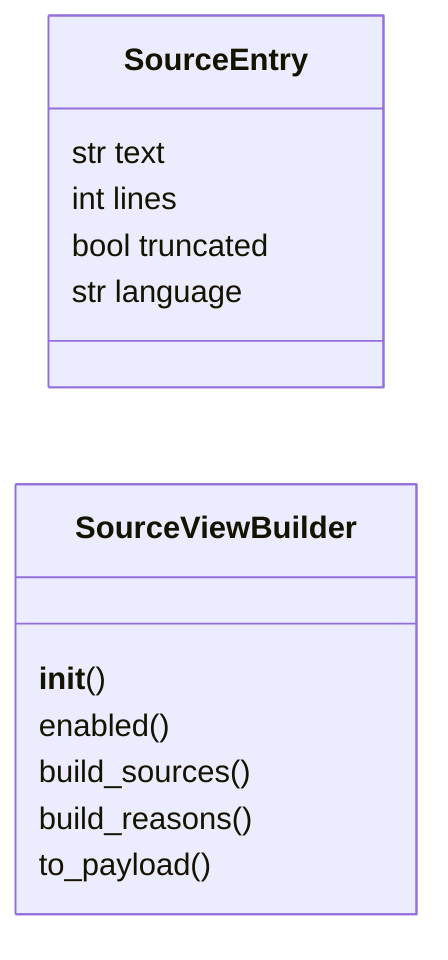

# `readmenator._sourceview`

> Source: [readmenator/_sourceview.py:1](../../readmenator/_sourceview.py#L1) | language `py` | coverage 100.0% | [API index](../index.md)

Source viewer payload builder for the graph explorers.

Builds the per-file source texts embedded in the force-graph and edge
bundle explorer pages. The frontend renders them lazily inside a drawer
with offline syntax highlighting, theme-aware colors, hover cards, and
Ctrl+Click go-to-definition driven by the symbol index already present
in the payload. No network requests are involved.

## Contents

- **Classes:** [`SourceEntry`](#sourceentry), [`SourceViewBuilder`](#sourceviewbuilder)

## Type Diagram



## Classes

<a id="sourceentry"></a>

### `SourceEntry`

`class` `dataclass` | [readmenator/_sourceview.py:20](../../readmenator/_sourceview.py#L20)

Decorators: `@dataclass`

```python
class SourceEntry
```

Bounded source text for one file.

**Attributes**

| Name | Type | Default | Description |
|---|---|---|---|
| [`text`](#sourceentry-text) | `str` |  | Truncated source text ("" when unavailable or private). |
| [`lines`](#sourceentry-lines) | `int` |  | Total line count of the original content. |
| [`truncated`](#sourceentry-truncated) | `bool` |  | True when the text was cut to fit the budgets. |
| [`language`](#sourceentry-language) | `str` |  | Language label copied from the scanned node. |

---

<a id="sourceviewbuilder"></a>

### `SourceViewBuilder`

`class` | [readmenator/_sourceview.py:36](../../readmenator/_sourceview.py#L36)

```python
class SourceViewBuilder
```

Builds bounded source payloads for the explorer drawer.

**Members**

| Member | Kind | Summary |
|---|---|---|
| [`__init__`](#sourceviewbuilder-__init__) | constructor | Initialise with application configuration. |
| [`enabled`](#sourceviewbuilder-enabled) | method | Return True when sources may be embedded in the payload. |
| [`build_sources`](#sourceviewbuilder-build_sources) | method | Build bounded source entries for every node in sorted order. |
| [`build_reasons`](#sourceviewbuilder-build_reasons) | method | Explain every file left without embedded source. |
| [`to_payload`](#sourceviewbuilder-to_payload) | method | Serialise source entries to JSON-safe payload records. |

<a id="sourceviewbuilder-__init__"></a>

#### `SourceViewBuilder.__init__`

`constructor` | [readmenator/_sourceview.py:39](../../readmenator/_sourceview.py#L39)

```python
def __init__(self, config: Config) -> None
```

Initialise with application configuration.

**Parameters**

| Name | Type | Default | Description |
|---|---|---|---|
| `config` | `Config` |  | Settings for source viewer budgets and privacy mode. |

*Called by:* [`ExplorerState.source`](readmenator._explorer.py.md#explorerstate-source), [`ForceGraphRenderer.build_payload`](readmenator._forcegraph.py.md#forcegraphrenderer-build_payload), [`AnalyzerFactory.sourceview`](readmenator._pipeline.py.md#analyzerfactory-sourceview)

<a id="sourceviewbuilder-enabled"></a>

#### `SourceViewBuilder.enabled`

`method` | [readmenator/_sourceview.py:47](../../readmenator/_sourceview.py#L47)

```python
def enabled(self) -> bool
```

Return True when sources may be embedded in the payload.

**Returns:** `bool` - False when disabled by config or privacy mode.

*Called by:* [`ForceGraphRenderer.build_payload`](readmenator._forcegraph.py.md#forcegraphrenderer-build_payload)

<a id="sourceviewbuilder-build_sources"></a>

#### `SourceViewBuilder.build_sources`

`method` | [readmenator/_sourceview.py:55](../../readmenator/_sourceview.py#L55)

```python
def build_sources(self, nodes: List[Node], content_map: Dict[str, str] | None) -> Dict[str, SourceEntry]
```

Build bounded source entries for every node in sorted order.

**Parameters**

| Name | Type | Default | Description |
|---|---|---|---|
| `nodes` | `List[Node]` |  | Scanned file nodes. |
| `content_map` | `Dict[str, str] \| None` |  | Mapping of file identifier to full file content. |

**Returns:** `Dict[str, SourceEntry]` - Mapping of file identifier to bounded SourceEntry.

*Called by:* [`ExplorerState.source`](readmenator._explorer.py.md#explorerstate-source), [`ForceGraphRenderer.build_payload`](readmenator._forcegraph.py.md#forcegraphrenderer-build_payload)

<a id="sourceviewbuilder-build_reasons"></a>

#### `SourceViewBuilder.build_reasons`

`method` | [readmenator/_sourceview.py:70](../../readmenator/_sourceview.py#L70)

```python
def build_reasons(self, nodes: List[Node], content_map: Dict[str, str] | None) -> Dict[str, str]
```

Explain every file left without embedded source.

**Parameters**

| Name | Type | Default | Description |
|---|---|---|---|
| `nodes` | `List[Node]` |  | Scanned file nodes. |
| `content_map` | `Dict[str, str] \| None` |  | Mapping of file identifier to full file content. |

**Returns:** `Dict[str, str]` - Mapping of file identifier to reason: ``"empty"`` when the
file has no content, ``"budget"`` when a SOURCEVIEW_* budget
cut it. Files with embedded source are absent. Empty when
the viewer is disabled (privacy mode or SOURCEVIEW_ENABLED
off) or no contents were provided.

*Called by:* [`ForceGraphRenderer.build_payload`](readmenator._forcegraph.py.md#forcegraphrenderer-build_payload)

<a id="sourceviewbuilder-to_payload"></a>

#### `SourceViewBuilder.to_payload`

`method` | [readmenator/_sourceview.py:149](../../readmenator/_sourceview.py#L149)

```python
def to_payload(self, sources: Dict[str, SourceEntry]) -> Dict[str, Dict[str, object]]
```

Serialise source entries to JSON-safe payload records.

**Parameters**

| Name | Type | Default | Description |
|---|---|---|---|
| `sources` | `Dict[str, SourceEntry]` |  | Mapping from build_sources. |

**Returns:** `Dict[str, Dict[str, object]]` - Mapping of file identifier to payload record.

*Called by:* [`ForceGraphRenderer.build_payload`](readmenator._forcegraph.py.md#forcegraphrenderer-build_payload)

---
