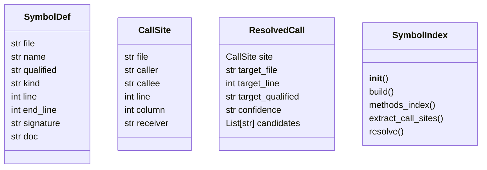
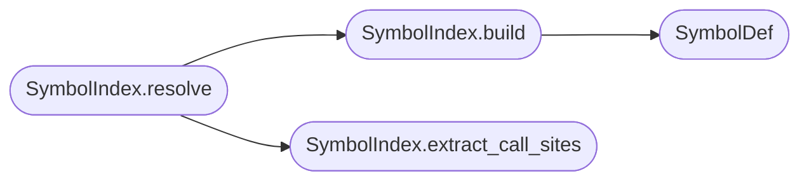

# `readmenator._symindex`

> Source: [readmenator/_symindex.py:1](../../readmenator/_symindex.py#L1) | language `py` | coverage 100.0% | [API index](../index.md)

Deterministic symbol index with call-site resolution.

Token-free and LSP-free alternative to language-server reference
resolution: builds file:line spans for every extracted symbol, finds
call sites with line numbers (exact via ``ast`` for Python,
regex approximation elsewhere), and resolves each callee to its
definition with an explicit confidence tier. Powers the ARC004
unresolved-call lint rule and the component-diagram key edges.

## Contents

- **Classes:** [`SymbolDef`](#symboldef), [`CallSite`](#callsite), [`ResolvedCall`](#resolvedcall), [`SymbolIndex`](#symbolindex)
- **Constants:** [`CALL_CONFIDENCE_ORDER`](#call_confidence_order)

## Type Diagram



## Call Graph

Solid arrows stay in this module, dashed arrows leave it.



## Classes

<a id="symboldef"></a>

### `SymbolDef`

`class` `dataclass` | [readmenator/_symindex.py:56](../../readmenator/_symindex.py#L56)

Decorators: `@dataclass`

```python
class SymbolDef
```

One symbol definition with its file span.

**Attributes**

| Name | Type | Default | Description |
|---|---|---|---|
| [`file`](#symboldef-file) | `str` |  | Relative file identifier. |
| [`name`](#symboldef-name) | `str` |  | Simple symbol name. |
| [`qualified`](#symboldef-qualified) | `str` |  | Qualified key (``file::name``). |
| [`kind`](#symboldef-kind) | `str` |  | Symbol kind (class, function, method, ...). |
| [`line`](#symboldef-line) | `int` |  | One-based definition line. |
| [`end_line`](#symboldef-end_line) | `int` |  | One-based last line of the span. |
| [`signature`](#symboldef-signature) | `str` | `''` | Signature snippet. |
| [`doc`](#symboldef-doc) | `str` | `''` | First doc sentence. |

---

<a id="callsite"></a>

### `CallSite`

`class` `dataclass` | [readmenator/_symindex.py:81](../../readmenator/_symindex.py#L81)

Decorators: `@dataclass`

```python
class CallSite
```

One call occurrence with its location.

**Attributes**

| Name | Type | Default | Description |
|---|---|---|---|
| [`file`](#callsite-file) | `str` |  | Relative file identifier. |
| [`caller`](#callsite-caller) | `str` |  | Enclosing symbol name ("" at module scope). |
| [`callee`](#callsite-callee) | `str` |  | Called simple name. |
| [`line`](#callsite-line) | `int` | `0` | One-based call line (0 when unknown). |
| [`column`](#callsite-column) | `int` | `0` | Zero-based call column (0 when unknown). |
| [`receiver`](#callsite-receiver) | `str` | `''` | Expression before the dot for attribute calls ("" for plain calls). |

---

<a id="resolvedcall"></a>

### `ResolvedCall`

`class` `dataclass` | [readmenator/_symindex.py:102](../../readmenator/_symindex.py#L102)

Decorators: `@dataclass`

```python
class ResolvedCall
```

A call site linked to its best definition candidate.

**Attributes**

| Name | Type | Default | Description |
|---|---|---|---|
| [`site`](#resolvedcall-site) | `CallSite` |  | The originating call site. |
| [`target_file`](#resolvedcall-target_file) | `str` | `''` | Definition file ("" when unresolved). |
| [`target_line`](#resolvedcall-target_line) | `int` | `0` | Definition line (0 when unresolved). |
| [`target_qualified`](#resolvedcall-target_qualified) | `str` | `''` | Qualified definition key ("" when unresolved). |
| [`confidence`](#resolvedcall-confidence) | `str` | `'UNRESOLVED'` | Resolution tier (see CALL_CONFIDENCE_ORDER). |
| [`candidates`](#resolvedcall-candidates) | `List[str]` | `field(default_factory=list)` | All same-name definition files (ambiguity evidence). |

---

<a id="symbolindex"></a>

### `SymbolIndex`

`class` | [readmenator/_symindex.py:132](../../readmenator/_symindex.py#L132)

```python
class SymbolIndex
```

Builds definition spans and resolves call sites to definitions.

**Members**

| Member | Kind | Summary |
|---|---|---|
| [`__init__`](#symbolindex-__init__) | constructor | Initialise with application configuration. |
| [`build`](#symbolindex-build) | method | Index every symbol with its file span. |
| [`methods_index`](#symbolindex-methods_index) | method | Serialise definitions to component-diagram methods_index entries. |
| [`extract_call_sites`](#symbolindex-extract_call_sites) | method | Find call sites with line numbers in one file. |
| [`resolve`](#symbolindex-resolve) | method | Resolve every call to its best definition candidate. |

<a id="symbolindex-__init__"></a>

#### `SymbolIndex.__init__`

`constructor` | [readmenator/_symindex.py:135](../../readmenator/_symindex.py#L135)

```python
def __init__(self, config: Config) -> None
```

Initialise with application configuration.

**Parameters**

| Name | Type | Default | Description |
|---|---|---|---|
| `config` | `Config` |  | Settings for builtin stoplist and call-site budgets. |

*Called by:* [`ComponentDiagramBuilder.__init__`](readmenator._components.py.md#componentdiagrambuilder-__init__), [`ExecutionFlowBuilder.call_graph`](readmenator._flowcharts.py.md#executionflowbuilder-call_graph), [`AnalyzerFactory.symindex`](readmenator._pipeline.py.md#analyzerfactory-symindex)

<a id="symbolindex-build"></a>

#### `SymbolIndex.build`

`method` | [readmenator/_symindex.py:144](../../readmenator/_symindex.py#L144)

```python
def build(self, nodes: List[Node], content_map: Optional[Dict[str, str]] = None) -> Dict[str, List[SymbolDef]]
```

Index every symbol with its file span.

**Parameters**

| Name | Type | Default | Description |
|---|---|---|---|
| `nodes` | `List[Node]` |  | Scanned file nodes. |
| `content_map` | `Optional[Dict[str, str]]` | `None` | Optional file contents for span end lines. |

**Returns:** `Dict[str, List[SymbolDef]]` - Mapping of file identifier to ordered SymbolDef list.

*Calls:* [`SymbolDef`](#symboldef)

*Called by:* [`ComponentDiagramBuilder.build`](readmenator._components.py.md#componentdiagrambuilder-build), [`ExecutionFlowBuilder.call_graph`](readmenator._flowcharts.py.md#executionflowbuilder-call_graph), [`SymbolIndex.resolve`](#symbolindex-resolve)

<a id="symbolindex-methods_index"></a>

#### `SymbolIndex.methods_index`

`method` | [readmenator/_symindex.py:184](../../readmenator/_symindex.py#L184)

```python
def methods_index(self, index: Dict[str, List[SymbolDef]]) -> Dict[str, Dict[str, object]]
```

Serialise definitions to component-diagram methods_index entries.

**Parameters**

| Name | Type | Default | Description |
|---|---|---|---|
| `index` | `Dict[str, List[SymbolDef]]` |  | Mapping from build(). |

**Returns:** `Dict[str, Dict[str, object]]` - Mapping of ``file|qualified`` to file, name, lines, and type.

*Called by:* [`ComponentDiagramBuilder.build`](readmenator._components.py.md#componentdiagrambuilder-build)

<a id="symbolindex-extract_call_sites"></a>

#### `SymbolIndex.extract_call_sites`

`method` | [readmenator/_symindex.py:212](../../readmenator/_symindex.py#L212)

```python
def extract_call_sites(self, file_id: str, content: str, language: str, symbols: Optional[List[SymbolDef]] = None) -> List[CallSite]
```

Find call sites with line numbers in one file.

**Parameters**

| Name | Type | Default | Description |
|---|---|---|---|
| `file_id` | `str` |  | Relative file identifier. |
| `content` | `str` |  | Full file content. |
| `language` | `str` |  | Language label from the scanner. |
| `symbols` | `Optional[List[SymbolDef]]` | `None` | Optional definitions for caller attribution. |

**Returns:** `List[CallSite]` - Call sites in file order (capped by configuration).

*Called by:* [`SymbolIndex.resolve`](#symbolindex-resolve)

<a id="symbolindex-resolve"></a>

#### `SymbolIndex.resolve`

`method` | [readmenator/_symindex.py:237](../../readmenator/_symindex.py#L237)

```python
def resolve(self, nodes: List[Node], edges: List[Edge], resolved_edges: Optional[List[Edge]] = None, content_map: Optional[Dict[str, str]] = None) -> List[ResolvedCall]
```

Resolve every call to its best definition candidate.

Prefers content-derived call sites (with lines) and falls back
to parser `[`calls`](readmenator._apidocs.py.md#apientity-calls)` edges (line 0) when content is missing.

**Parameters**

| Name | Type | Default | Description |
|---|---|---|---|
| `nodes` | `List[Node]` |  | Scanned file nodes. |
| `edges` | `List[Edge]` |  | Raw edges including `[`calls`](readmenator._apidocs.py.md#apientity-calls)` relations. |
| `resolved_edges` | `Optional[List[Edge]]` | `None` | Optional resolved-import edges. |
| `content_map` | `Optional[Dict[str, str]]` | `None` | Optional file contents for call-site lines. |

**Returns:** `List[ResolvedCall]` - Resolved calls sorted by file, line, and callee.

*Calls:* [`SymbolIndex.build`](#symbolindex-build), [`SymbolIndex.extract_call_sites`](#symbolindex-extract_call_sites)

*Called by:* [`ComponentDiagramBuilder.build`](readmenator._components.py.md#componentdiagrambuilder-build), [`ExecutionFlowBuilder.call_graph`](readmenator._flowcharts.py.md#executionflowbuilder-call_graph)

---

## Constants

<a id="call_confidence_order"></a>

### `CALL_CONFIDENCE_ORDER`

`constant` | [readmenator/_symindex.py:22](../../readmenator/_symindex.py#L22)

```python
CALL_CONFIDENCE_ORDER: Tuple[str, ...]
```

---
