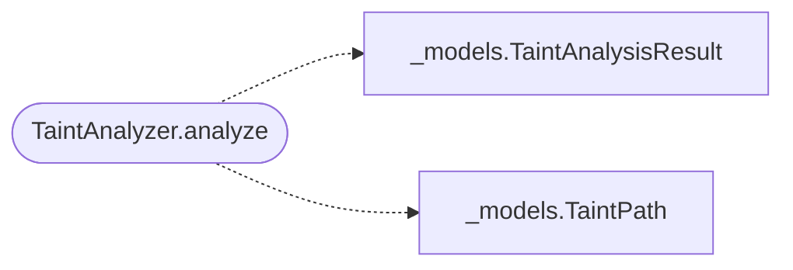

# `readmenator._taint`

> Source: [readmenator/_taint.py:1](../../readmenator/_taint.py#L1) | language `py` | coverage 75.0% | [API index](../index.md)

Taint propagation analysis of dangerous imports through the resolved import graph.

## Contents

- **Classes:** [`TaintAnalyzer`](#taintanalyzer)

## Call Graph

Solid arrows stay in this module, dashed arrows leave it.



## Classes

<a id="taintanalyzer"></a>

### `TaintAnalyzer`

`class` | [readmenator/_taint.py:12](../../readmenator/_taint.py#L12)

```python
class TaintAnalyzer
```

Propagation-based taint analysis over the resolved import graph.

Identifies files that import known-dangerous modules or functions
(sources) and traces how that danger propagates through the import
graph to files that never directly import the dangerous module
but receive taint through transitive dependencies.

**Attributes**

| Name | Type | Default | Description |
|---|---|---|---|
| [`DANGEROUS_IMPORTS`](#taintanalyzer-dangerous_imports) | `Dict[str, str]` | `{'subprocess': 'Command injection via subprocess', 'os.system': 'Command injection via os.system', 'os.popen': 'Command injection via os.popen', 'eval': 'Arbitrary code execution via eval', 'exec': 'Arbitrary code execution via exec', 'compile': 'Arbitrary code execution via compile', 'pickle.loads': 'Unsafe deserialization via pickle', 'pickle.load': 'Unsafe deserialization via pickle', 'yaml.load': 'Unsafe deserialization via yaml.load (without Loader)', 'cPickle.loads': 'Unsafe deserialization via cPickle', 'cPickle.load': 'Unsafe deserialization via cPickle', 'marshal.load': 'Unsafe deserialization via marshal', 'marshal.loads': 'Unsafe deserialization via marshal', 'shelve.open': 'Unsafe deserialization via shelve', 'sqlite3.execute': 'SQL injection risk', 'sqlite3.executemany': 'SQL injection risk', 'os.environ': 'Environment variable access (sensitive)', 'getpass.getpass': 'Password prompt (sensitive)', 'input': 'Unsafe input in Python 2 / risk of eval', '__import__': 'Dynamic import (code injection risk)', 'requests': 'External HTTP request (SSRF risk)', 'urllib.request': 'External HTTP request (SSRF risk)', 'urlopen': 'External HTTP request (SSRF risk)'}` |  |
| [`DANGEROUS_IMPORTS_BY_LANGUAGE`](#taintanalyzer-dangerous_imports_by_language) | `Dict[str, Dict[str, str]]` | `{'.py': DANGEROUS_IMPORTS, '.js': {'eval(': 'Arbitrary code execution via eval', 'Function(': 'Arbitrary code construction', 'child_process.exec': 'Command injection', 'child_process.spawn': 'Command injection', 'execSync': 'Command injection', "require('child_process')": 'Command injection via child_process'}, '.ts': {'eval(': 'Arbitrary code execution via eval', 'child_process.exec': 'Command injection', 'child_process.spawn': 'Command injection'}}` |  |
| [`SEVERITIES`](#taintanalyzer-severities) | `Dict[str, str]` | `{'subprocess': 'high', 'os.system': 'critical', 'eval': 'critical', 'exec': 'critical', 'pickle.loads': 'high', 'sqlite3.execute': 'medium'}` |  |

**Members**

| Member | Kind | Summary |
|---|---|---|
| [`__init__`](#taintanalyzer-__init__) | constructor |  |
| [`analyze`](#taintanalyzer-analyze) | method | Run taint propagation analysis on the codebase. |

<a id="taintanalyzer-__init__"></a>

#### `TaintAnalyzer.__init__`

`constructor` | [readmenator/_taint.py:73](../../readmenator/_taint.py#L73)

```python
def __init__(self, config: Config) -> None
```

**Parameters**

| Name | Type | Default | Description |
|---|---|---|---|
| `config` | `Config` |  |  |

*Called by:* [`AnalyzerFactory.taint`](readmenator._pipeline.py.md#analyzerfactory-taint)

<a id="taintanalyzer-analyze"></a>

#### `TaintAnalyzer.analyze`

`method` | [readmenator/_taint.py:77](../../readmenator/_taint.py#L77)

```python
def analyze(self, nodes: List[Node], edges: List[Edge], resolved_edges: Optional[List[Edge]] = None) -> TaintAnalysisResult
```

Run taint propagation analysis on the codebase.

Scans all nodes for direct dangerous imports, then propagates
taint through the resolved import graph. Returns all discovered
taint paths from sources to sinks.

**Parameters**

| Name | Type | Default | Description |
|---|---|---|---|
| `nodes` | `List[Node]` |  |  |
| `edges` | `List[Edge]` |  |  |
| `resolved_edges` | `Optional[List[Edge]]` | `None` |  |

**Returns:** `TaintAnalysisResult`

*Calls:* [`TaintAnalysisResult`](readmenator._models.py.md#taintanalysisresult), [`TaintPath`](readmenator._models.py.md#taintpath)

---
