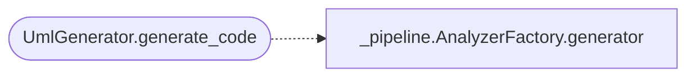

# `readmenator._uml`

> Source: [readmenator/_uml.py:1](../../readmenator/_uml.py#L1) | language `py` | coverage 20.0% | [API index](../index.md)

UML class diagram renderer (Mermaid classDiagram) and 12-language stub generator.

## Contents

- **Classes:** [`UmlGenerator`](#umlgenerator)

## Call Graph

Solid arrows stay in this module, dashed arrows leave it.



## Classes

<a id="umlgenerator"></a>

### `UmlGenerator`

`class` | [readmenator/_uml.py:34](../../readmenator/_uml.py#L34)

```python
class UmlGenerator
```

**Members**

| Member | Kind | Summary |
|---|---|---|
| [`__init__`](#umlgenerator-__init__) | constructor |  |
| [`render_mermaid_class_diagram`](#umlgenerator-render_mermaid_class_diagram) | method |  |
| [`generate_code`](#umlgenerator-generate_code) | method |  |

<a id="umlgenerator-__init__"></a>

#### `UmlGenerator.__init__`

`constructor` | [readmenator/_uml.py:36](../../readmenator/_uml.py#L36)

```python
def __init__(self, config: Config) -> None
```

**Parameters**

| Name | Type | Default | Description |
|---|---|---|---|
| `config` | `Config` |  |  |

*Called by:* [`DocumentationGenerator.__init__`](readmenator._documentation.py.md#documentationgenerator-__init__), [`AnalyzerFactory.uml`](readmenator._pipeline.py.md#analyzerfactory-uml)

<a id="umlgenerator-render_mermaid_class_diagram"></a>

#### `UmlGenerator.render_mermaid_class_diagram`

`method` | [readmenator/_uml.py:39](../../readmenator/_uml.py#L39)

```python
def render_mermaid_class_diagram(self, nodes: List[Node], edges: List[Edge]) -> str
```

**Parameters**

| Name | Type | Default | Description |
|---|---|---|---|
| `nodes` | `List[Node]` |  |  |
| `edges` | `List[Edge]` |  |  |

**Returns:** `str`

<a id="umlgenerator-generate_code"></a>

#### `UmlGenerator.generate_code`

`method` | [readmenator/_uml.py:129](../../readmenator/_uml.py#L129)

```python
def generate_code(self, nodes: List[Node], edges: List[Edge], target_language: str) -> str
```

**Parameters**

| Name | Type | Default | Description |
|---|---|---|---|
| `nodes` | `List[Node]` |  |  |
| `edges` | `List[Edge]` |  |  |
| `target_language` | `str` |  |  |

**Returns:** `str`

*Calls:* [`AnalyzerFactory.generator`](readmenator._pipeline.py.md#analyzerfactory-generator)

---
