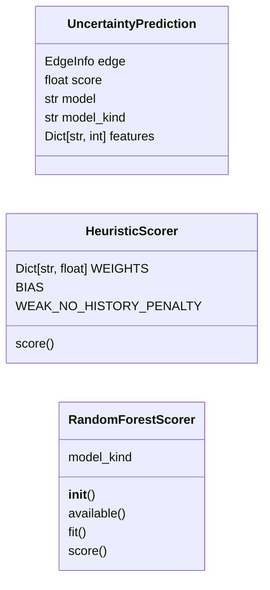
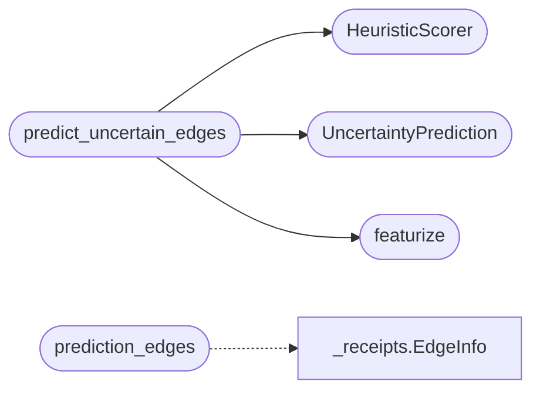

# `readmenator._uncertainty`

> Source: [readmenator/_uncertainty.py:1](../../readmenator/_uncertainty.py#L1) | language `py` | coverage 41.7% | [API index](../index.md)

Uncertainty engine: classify candidate edges, never invent facts.

Input: candidate edges (kind=candidate) declared by release receipts
(feasible sets from config / CLI / interface contract) plus the
observed edges recorded so far. Output: predicted edges -- always
labeled ``predicted`` with the model name, the probability and the
feature vector that produced them, for downstream audit.

Two scorers:
  - HeuristicScorer: pure-Python, zero-dependency logistic-style
    readout over the feature vector.
  - RandomForestScorer: optional sklearn ensemble trained on the
    receipt history (observed edges are label 1, unobserved
    candidates label 0), calibrating per-class confidence. Falls back
    to the heuristic scorer when sklearn is unavailable.

Golden rule: a prediction is a hypothesis with provenance; presenting
it as fact is the cardinal error.

## Contents

- **Classes:** [`UncertaintyPrediction`](#uncertaintyprediction), [`HeuristicScorer`](#heuristicscorer), [`RandomForestScorer`](#randomforestscorer)
- **Functions:** [`featurize`](#featurize), [`predict_uncertain_edges`](#predict_uncertain_edges), [`prediction_edges`](#prediction_edges)
- **Constants:** [`MODEL_NAME`](#model_name), [`MODEL_VERSION`](#model_version), [`FEATURE_NAMES`](#feature_names)

## Type Diagram



## Call Graph

Solid arrows stay in this module, dashed arrows leave it.



## Classes

<a id="uncertaintyprediction"></a>

### `UncertaintyPrediction`

`class` `dataclass` | [readmenator/_uncertainty.py:93](../../readmenator/_uncertainty.py#L93)

Decorators: `@dataclass`

```python
class UncertaintyPrediction
```

**Attributes**

| Name | Type | Default | Description |
|---|---|---|---|
| [`edge`](#uncertaintyprediction-edge) | `EdgeInfo` |  |  |
| [`score`](#uncertaintyprediction-score) | `float` |  |  |
| [`model`](#uncertaintyprediction-model) | `str` | `f'{MODEL_NAME}:{MODEL_VERSION}'` |  |
| [`model_kind`](#uncertaintyprediction-model_kind) | `str` | `'heuristic'` |  |
| [`features`](#uncertaintyprediction-features) | `Dict[str, int]` | `field(default_factory=dict)` |  |

---

<a id="heuristicscorer"></a>

### `HeuristicScorer`

`class` | [readmenator/_uncertainty.py:101](../../readmenator/_uncertainty.py#L101)

```python
class HeuristicScorer
```

Deterministic zero-dependency scorer.

Readout: logistic(theta . features) with hand-set weights derived
from the evidence hierarchy. Calibrated on the receipt corpus
structure, not fitted per project.

**Attributes**

| Name | Type | Default | Description |
|---|---|---|---|
| [`WEIGHTS`](#heuristicscorer-weights) | `Dict[str, float]` | `{'confidence': 0.0015, 'evidence_config': 0.5, 'evidence_cli': 0.9, 'evidence_toml': 0.55, 'evidence_interface': -1.2, 'evidence_platform': 0.3, 'target_github': 0.0, 'target_gitlab': 0.0, 'target_bitbucket': 0.0, 'target_git': 0.2, 'target_pypi_or_docs': -0.35, 'historically_observed': -2.4, 'target_observed': 1.4}` |  |
| [`BIAS`](#heuristicscorer-bias) |  | `0.4` |  |
| [`WEAK_NO_HISTORY_PENALTY`](#heuristicscorer-weak_no_history_penalty) |  | `1.4` |  |

**Members**

| Member | Kind | Summary |
|---|---|---|
| [`score`](#heuristicscorer-score) | method |  |

<a id="heuristicscorer-score"></a>

#### `HeuristicScorer.score`

`method` | [readmenator/_uncertainty.py:129](../../readmenator/_uncertainty.py#L129)

```python
def score(self, features: Dict[str, int]) -> float
```

**Parameters**

| Name | Type | Default | Description |
|---|---|---|---|
| `features` | `Dict[str, int]` |  |  |

**Returns:** `float`

---

<a id="randomforestscorer"></a>

### `RandomForestScorer`

`class` | [readmenator/_uncertainty.py:138](../../readmenator/_uncertainty.py#L138)

```python
class RandomForestScorer
```

Optional sklearn-based classifier over past receipt outcomes.

**Attributes**

| Name | Type | Default | Description |
|---|---|---|---|
| [`model_kind`](#randomforestscorer-model_kind) |  | `'random_forest'` |  |

**Members**

| Member | Kind | Summary |
|---|---|---|
| [`__init__`](#randomforestscorer-__init__) | constructor |  |
| [`available`](#randomforestscorer-available) | staticmethod |  |
| [`fit`](#randomforestscorer-fit) | method |  |
| [`score`](#randomforestscorer-score) | method |  |

<a id="randomforestscorer-__init__"></a>

#### `RandomForestScorer.__init__`

`constructor` | [readmenator/_uncertainty.py:143](../../readmenator/_uncertainty.py#L143)

```python
def __init__(self, n_estimators: int = 120, random_state: int = 42) -> None
```

**Parameters**

| Name | Type | Default | Description |
|---|---|---|---|
| `n_estimators` | `int` | `120` |  |
| `random_state` | `int` | `42` |  |

<a id="randomforestscorer-available"></a>

#### `RandomForestScorer.available`

`staticmethod` | [readmenator/_uncertainty.py:149](../../readmenator/_uncertainty.py#L149)

Decorators: `@staticmethod`

```python
def available() -> bool
```

**Returns:** `bool`

<a id="randomforestscorer-fit"></a>

#### `RandomForestScorer.fit`

`method` | [readmenator/_uncertainty.py:156](../../readmenator/_uncertainty.py#L156)

```python
def fit(self, x: List[Dict[str, int]], y: List[int]) -> None
```

**Parameters**

| Name | Type | Default | Description |
|---|---|---|---|
| `x` | `List[Dict[str, int]]` |  |  |
| `y` | `List[int]` |  |  |

**Raises**

- `ValueError`: (raised in the body, not documented)

<a id="randomforestscorer-score"></a>

#### `RandomForestScorer.score`

`method` | [readmenator/_uncertainty.py:171](../../readmenator/_uncertainty.py#L171)

```python
def score(self, features: Dict[str, int]) -> float
```

**Parameters**

| Name | Type | Default | Description |
|---|---|---|---|
| `features` | `Dict[str, int]` |  |  |

**Returns:** `float`

**Raises**

- `ValueError`: (raised in the body, not documented)

---

## Functions

<a id="featurize"></a>

### `featurize`

`function` | [readmenator/_uncertainty.py:83](../../readmenator/_uncertainty.py#L83)

```python
def featurize(edge: EdgeInfo, known_observed: set) -> Dict[str, int]
```

**Parameters**

| Name | Type | Default | Description |
|---|---|---|---|
| `edge` | `EdgeInfo` |  |  |
| `known_observed` | `set` |  |  |

**Returns:** `Dict[str, int]`

*Called by:* [`predict_uncertain_edges`](#predict_uncertain_edges)

---

<a id="predict_uncertain_edges"></a>

### `predict_uncertain_edges`

`function` | [readmenator/_uncertainty.py:187](../../readmenator/_uncertainty.py#L187)

```python
def predict_uncertain_edges(candidate_edges: Sequence[EdgeInfo], known_observed: set, config: Optional[Config] = None, min_confidence: float = 0.5, scorer: Optional[Any] = None) -> List[UncertaintyPrediction]
```

Predict outcome probabilities for candidate edges.

Never returns information presented as fact: every result is a
``predicted`` edge with model provenance and the feature vector.

**Parameters**

| Name | Type | Default | Description |
|---|---|---|---|
| `candidate_edges` | `Sequence[EdgeInfo]` |  |  |
| `known_observed` | `set` |  |  |
| `config` | `Optional[Config]` | `None` |  |
| `min_confidence` | `float` | `0.5` |  |
| `scorer` | `Optional[Any]` | `None` |  |

**Returns:** `List[UncertaintyPrediction]`

*Calls:* [`HeuristicScorer`](#heuristicscorer), [`UncertaintyPrediction`](#uncertaintyprediction), [`featurize`](#featurize)

*Called by:* [`readmenatorApplication.ingest_receipts`](readmenator._app.py.md#readmenatorapplication-ingest_receipts)

---

<a id="prediction_edges"></a>

### `prediction_edges`

`function` | [readmenator/_uncertainty.py:214](../../readmenator/_uncertainty.py#L214)

```python
def prediction_edges(predictions: Sequence[UncertaintyPrediction], provenance_version: str = MODEL_VERSION) -> List[EdgeInfo]
```

Convert predictions into EdgeInfo records (kind=predicted).

**Parameters**

| Name | Type | Default | Description |
|---|---|---|---|
| `predictions` | `Sequence[UncertaintyPrediction]` |  |  |
| `provenance_version` | `str` | `MODEL_VERSION` |  |

**Returns:** `List[EdgeInfo]`

*Calls:* [`EdgeInfo`](readmenator._receipts.py.md#edgeinfo)

*Called by:* [`readmenatorApplication.ingest_receipts`](readmenator._app.py.md#readmenatorapplication-ingest_receipts)

---

## Constants

<a id="model_name"></a>

### `MODEL_NAME`

`constant` | [readmenator/_uncertainty.py:30](../../readmenator/_uncertainty.py#L30)

```python
MODEL_NAME = 'readmenator-uncertainty'
```

---

<a id="model_version"></a>

### `MODEL_VERSION`

`constant` | [readmenator/_uncertainty.py:31](../../readmenator/_uncertainty.py#L31)

```python
MODEL_VERSION = 'v1'
```

---

<a id="feature_names"></a>

### `FEATURE_NAMES`

`constant` | [readmenator/_uncertainty.py:33](../../readmenator/_uncertainty.py#L33)

```python
FEATURE_NAMES: Tuple[str, ...]
```

---
