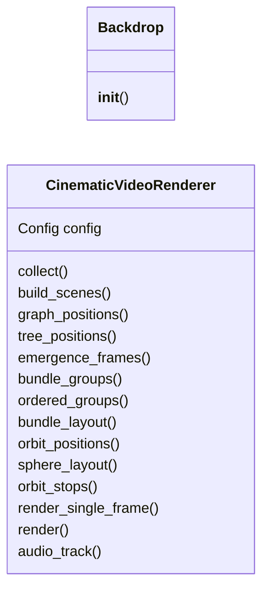
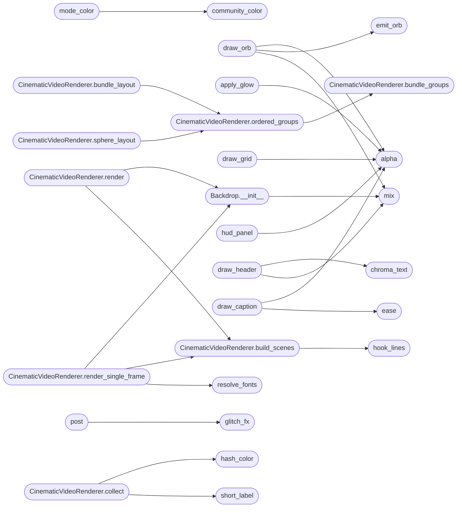

# `readmenator._video`

> Source: [readmenator/_video.py:1](../../readmenator/_video.py#L1) | language `py` | coverage 100.0% | [API index](../index.md)

Cinematic codebase overview video, general purpose.

Renders a short synthwave explainer for any project analysed by
readmenator, in the visual language of the miniGCC self-host video
(neon HUD panels, striped sun, scrolling grid, bloom, scanlines,
chromatic text, glitch transitions). Every number on screen comes
from a real scan: file/symbol/import counts, detected layers, god
nodes, communities, the resolved import graph, per-file hash colors
and top security findings.

Zero tokens: pure PIL frame drawing piped to ffmpeg. Optional
dependency: when PIL or ffmpeg is missing the caller skips with a
warning instead of failing the rebuild.

## Contents

- **Classes:** [`Backdrop`](#backdrop), [`CinematicVideoRenderer`](#cinematicvideorenderer)
- **Functions:** [`ease`](#ease), [`fmt_int`](#fmt_int), [`mix`](#mix), [`alpha`](#alpha), [`hash_color`](#hash_color), [`short_label`](#short_label), [`community_color`](#community_color), [`project3d`](#project3d), [`mode_color`](#mode_color), [`emit_orb`](#emit_orb), [`emit_beam`](#emit_beam), [`draw_orb`](#draw_orb), [`apply_glow`](#apply_glow), [`draw_cloud3d`](#draw_cloud3d), [`draw_sphere3d`](#draw_sphere3d), [`dependencies_available`](#dependencies_available), [`resolve_fonts`](#resolve_fonts), [`draw_grid`](#draw_grid), [`draw_sun`](#draw_sun), [`post`](#post), [`glitch_fx`](#glitch_fx), [`chroma_text`](#chroma_text), [`hud_panel`](#hud_panel), [`draw_header`](#draw_header), [`draw_caption`](#draw_caption), [`hook_lines`](#hook_lines), [`score_ping_times`](#score_ping_times), [`growth_release_times`](#growth_release_times), [`chapter_metadata`](#chapter_metadata), [`score_sync`](#score_sync), [`impact_punch`](#impact_punch), [`draw_stars`](#draw_stars)
- **Constants:** [`BG_TOP`](#bg_top), [`BG_HORIZON`](#bg_horizon), [`PANEL_FILL`](#panel_fill), [`PANEL_HEAD`](#panel_head), [`TXT`](#txt), [`DIM`](#dim), [`FAINT`](#faint), [`MAGENTA`](#magenta), [`CYAN`](#cyan), [`YELLOW`](#yellow), [`GREEN`](#green), [`ORANGE`](#orange), [`VIOLET`](#violet), [`RED`](#red), [`COMMUNITY_PALETTE`](#community_palette), [`LAYER_COLORS`](#layer_colors), [`ACT_CARDS`](#act_cards), [`COLOR_MODES`](#color_modes)

## Type Diagram



## Call Graph

Solid arrows stay in this module, dashed arrows leave it.



## Classes

<a id="backdrop"></a>

### `Backdrop`

`class` | [readmenator/_video.py:838](../../readmenator/_video.py#L838)

```python
class Backdrop
```

Precomputed synthwave background with sun and CRT mask.

**Members**

| Member | Kind | Summary |
|---|---|---|
| [`__init__`](#backdrop-__init__) | constructor | Build the gradient sky, star field, sun and CRT mask. |

<a id="backdrop-__init__"></a>

#### `Backdrop.__init__`

`constructor` | [readmenator/_video.py:841](../../readmenator/_video.py#L841)

```python
def __init__(self, width: int, height: int) -> None
```

Build the gradient sky, star field, sun and CRT mask.

**Parameters**

| Name | Type | Default | Description |
|---|---|---|---|
| `width` | `int` |  |  |
| `height` | `int` |  |  |

*Calls:* [`mix`](#mix)

*Called by:* [`CinematicVideoRenderer.render`](#cinematicvideorenderer-render), [`CinematicVideoRenderer.render_single_frame`](#cinematicvideorenderer-render_single_frame)

---

<a id="cinematicvideorenderer"></a>

### `CinematicVideoRenderer`

`class` `dataclass` | [readmenator/_video.py:1034](../../readmenator/_video.py#L1034)

Decorators: `@dataclass`

```python
class CinematicVideoRenderer
```

Builds and renders the general-purpose codebase overview video.

**Attributes**

| Name | Type | Default | Description |
|---|---|---|---|
| [`config`](#cinematicvideorenderer-config) | `Config` |  |  |

**Members**

| Member | Kind | Summary |
|---|---|---|
| [`collect`](#cinematicvideorenderer-collect) | method | Collect every number each scene draws, from real scan data. |
| [`build_scenes`](#cinematicvideorenderer-build_scenes) | method | Lay every scene on the global clock. |
| [`graph_positions`](#cinematicvideorenderer-graph_positions) | method | Compute deterministic positions for graph nodes inside a box. |
| [`tree_positions`](#cinematicvideorenderer-tree_positions) | method | Place the full BFS tree radially: root in the center, one ring per depth. |
| [`emergence_frames`](#cinematicvideorenderer-emergence_frames) | method | ForceAtlas2 snapshots of the resolved import graph fitted to a pixel box. |
| [`bundle_groups`](#cinematicvideorenderer-bundle_groups) | method | Group graph files by community (hubs first), unassigned files last. |
| [`ordered_groups`](#cinematicvideorenderer-ordered_groups) | method | Bundle groups reordered to shorten bundled edges (same optimizer as the explorer). |
| [`bundle_layout`](#cinematicvideorenderer-bundle_layout) | method | Hierarchical edge bundling of resolved imports grouped by community. |
| [`orbit_positions`](#cinematicvideorenderer-orbit_positions) | method | 3D ForceAtlas2 layout of the graph, centered and scaled to the unit sphere. |
| [`sphere_layout`](#cinematicvideorenderer-sphere_layout) | method | Spherical edge bundling of resolved imports on community caps. |
| [`orbit_stops`](#cinematicvideorenderer-orbit_stops) | method | Camera tour stops: the largest communities with their 3D centroid. |
| [`render_single_frame`](#cinematicvideorenderer-render_single_frame) | method | Render one frame to raw RGB bytes without touching ffmpeg. |
| [`render`](#cinematicvideorenderer-render) | method | Render all frames and encode to mp4, muxing music if configured. |
| [`audio_track`](#cinematicvideorenderer-audio_track) | method | Return the audio file to mux, or "" for a silent video. |

<a id="cinematicvideorenderer-collect"></a>

#### `CinematicVideoRenderer.collect`

`method` | [readmenator/_video.py:1039](../../readmenator/_video.py#L1039)

```python
def collect(self, nodes: List[Node], edges: List[Edge], resolved_edges: Optional[List[Edge]], analysis: Optional[AnalysisResult], layers: Optional[Dict[str, str]], findings: Optional[List[SecurityFinding]], analysis_v2: Optional[AnalysisResultV2], project_name: str, content_map: Optional[Dict[str, str]] = None, concept_graph: Optional[Any] = None, project_root: str = '') -> Dict[str, Any]
```

Collect every number each scene draws, from real scan data.

**Parameters**

| Name | Type | Default | Description |
|---|---|---|---|
| `nodes` | `List[Node]` |  | Scanned file nodes. |
| `edges` | `List[Edge]` |  | Raw edges (imports, calls, inherits). |
| `resolved_edges` | `Optional[List[Edge]]` |  | Import edges resolved to project files. |
| `analysis` | `Optional[AnalysisResult]` |  | Graph analysis result. |
| `layers` | `Optional[Dict[str, str]]` |  | File to architectural layer map. |
| `findings` | `Optional[List[SecurityFinding]]` |  | Security findings. |
| `analysis_v2` | `Optional[AnalysisResultV2]` |  | Deep analysis result. |
| `project_name` | `str` |  | Display name of the project. |
| `content_map` | `Optional[Dict[str, str]]` | `None` | Raw file contents. |
| `concept_graph` | `Optional[Any]` | `None` | Optional semantic concept graph. |
| `project_root` | `str` | `''` | Repository root, used to read the release history. |

**Returns:** `Dict[str, Any]` - The scene payload every act reads from.

*Calls:* [`build_flow_graphs`](readmenator._flowcharts.py.md#build_flow_graphs), [`file_pagerank`](readmenator._rank.py.md#file_pagerank), [`hash_color`](#hash_color), [`short_label`](#short_label)

<a id="cinematicvideorenderer-build_scenes"></a>

#### `CinematicVideoRenderer.build_scenes`

`method` | [readmenator/_video.py:1338](../../readmenator/_video.py#L1338)

```python
def build_scenes(self, data: Dict[str, Any]) -> Tuple[List[Dict[str, Any]], float]
```

Lay every scene on the global clock.

Acts with a non-positive duration are skipped together with their card.

**Parameters**

| Name | Type | Default | Description |
|---|---|---|---|
| `data` | `Dict[str, Any]` |  |  |

**Returns:** `Tuple[List[Dict[str, Any]], float]`

*Calls:* [`hook_lines`](#hook_lines)

*Called by:* [`CinematicVideoRenderer.render`](#cinematicvideorenderer-render), [`CinematicVideoRenderer.render_single_frame`](#cinematicvideorenderer-render_single_frame)

<a id="cinematicvideorenderer-graph_positions"></a>

#### `CinematicVideoRenderer.graph_positions`

`method` | [readmenator/_video.py:1376](../../readmenator/_video.py#L1376)

```python
def graph_positions(self, data: Dict[str, Any], box: Tuple[int, int, int, int]) -> Dict[str, Tuple[float, float]]
```

Compute deterministic positions for graph nodes inside a box.

**Parameters**

| Name | Type | Default | Description |
|---|---|---|---|
| `data` | `Dict[str, Any]` |  |  |
| `box` | `Tuple[int, int, int, int]` |  |  |

**Returns:** `Dict[str, Tuple[float, float]]`

<a id="cinematicvideorenderer-tree_positions"></a>

#### `CinematicVideoRenderer.tree_positions`

`method` | [readmenator/_video.py:1423](../../readmenator/_video.py#L1423)

```python
def tree_positions(self, data: Dict[str, Any], box: Tuple[int, int, int, int]) -> Dict[str, Tuple[float, float]]
```

Place the full BFS tree radially: root in the center, one ring per depth.

Each node gets an angular sector proportional to its number of
leaves, so every dependent fits on screen without truncation.

**Parameters**

| Name | Type | Default | Description |
|---|---|---|---|
| `data` | `Dict[str, Any]` |  |  |
| `box` | `Tuple[int, int, int, int]` |  |  |

**Returns:** `Dict[str, Tuple[float, float]]`

<a id="cinematicvideorenderer-emergence_frames"></a>

#### `CinematicVideoRenderer.emergence_frames`

`method` | [readmenator/_video.py:1466](../../readmenator/_video.py#L1466)

```python
def emergence_frames(self, data: Dict[str, Any], box: Tuple[int, int, int, int]) -> List[Dict[str, Tuple[float, float]]]
```

ForceAtlas2 snapshots of the resolved import graph fitted to a pixel box.

**Parameters**

| Name | Type | Default | Description |
|---|---|---|---|
| `data` | `Dict[str, Any]` |  |  |
| `box` | `Tuple[int, int, int, int]` |  |  |

**Returns:** `List[Dict[str, Tuple[float, float]]]`

*Calls:* [`ForceAtlas2Settings`](readmenator._graphlayout.py.md#forceatlas2settings), [`fit_frames`](readmenator._graphlayout.py.md#fit_frames), [`forceatlas2_frames`](readmenator._graphlayout.py.md#forceatlas2_frames)

<a id="cinematicvideorenderer-bundle_groups"></a>

#### `CinematicVideoRenderer.bundle_groups`

`method` | [readmenator/_video.py:1476](../../readmenator/_video.py#L1476)

```python
def bundle_groups(self, data: Dict[str, Any]) -> Dict[str, List[str]]
```

Group graph files by community (hubs first), unassigned files last.

**Parameters**

| Name | Type | Default | Description |
|---|---|---|---|
| `data` | `Dict[str, Any]` |  |  |

**Returns:** `Dict[str, List[str]]`

*Called by:* [`CinematicVideoRenderer.ordered_groups`](#cinematicvideorenderer-ordered_groups)

<a id="cinematicvideorenderer-ordered_groups"></a>

#### `CinematicVideoRenderer.ordered_groups`

`method` | [readmenator/_video.py:1491](../../readmenator/_video.py#L1491)

```python
def ordered_groups(self, data: Dict[str, Any]) -> Dict[str, List[str]]
```

Bundle groups reordered to shorten bundled edges (same optimizer as the explorer).

**Parameters**

| Name | Type | Default | Description |
|---|---|---|---|
| `data` | `Dict[str, Any]` |  |  |

**Returns:** `Dict[str, List[str]]`

*Calls:* [`optimize_bundle_order`](readmenator._graphlayout.py.md#optimize_bundle_order), [`CinematicVideoRenderer.bundle_groups`](#cinematicvideorenderer-bundle_groups)

*Called by:* [`CinematicVideoRenderer.bundle_layout`](#cinematicvideorenderer-bundle_layout), [`CinematicVideoRenderer.sphere_layout`](#cinematicvideorenderer-sphere_layout)

<a id="cinematicvideorenderer-bundle_layout"></a>

#### `CinematicVideoRenderer.bundle_layout`

`method` | [readmenator/_video.py:1501](../../readmenator/_video.py#L1501)

```python
def bundle_layout(self, data: Dict[str, Any], box: Tuple[int, int, int, int]) -> BundleLayout
```

Hierarchical edge bundling of resolved imports grouped by community.

**Parameters**

| Name | Type | Default | Description |
|---|---|---|---|
| `data` | `Dict[str, Any]` |  |  |
| `box` | `Tuple[int, int, int, int]` |  |  |

**Returns:** `BundleLayout`

*Calls:* [`hierarchical_edge_bundling`](readmenator._graphlayout.py.md#hierarchical_edge_bundling), [`CinematicVideoRenderer.ordered_groups`](#cinematicvideorenderer-ordered_groups)

<a id="cinematicvideorenderer-orbit_positions"></a>

#### `CinematicVideoRenderer.orbit_positions`

`method` | [readmenator/_video.py:1510](../../readmenator/_video.py#L1510)

```python
def orbit_positions(self, data: Dict[str, Any]) -> Dict[str, Tuple[float, float, float]]
```

3D ForceAtlas2 layout of the graph, centered and scaled to the unit sphere.

**Parameters**

| Name | Type | Default | Description |
|---|---|---|---|
| `data` | `Dict[str, Any]` |  |  |

**Returns:** `Dict[str, Tuple[float, float, float]]`

*Calls:* [`ForceAtlas2Settings`](readmenator._graphlayout.py.md#forceatlas2settings), [`forceatlas2_frames`](readmenator._graphlayout.py.md#forceatlas2_frames), [`normalize_cloud`](readmenator._graphlayout.py.md#normalize_cloud)

<a id="cinematicvideorenderer-sphere_layout"></a>

#### `CinematicVideoRenderer.sphere_layout`

`method` | [readmenator/_video.py:1520](../../readmenator/_video.py#L1520)

```python
def sphere_layout(self, data: Dict[str, Any]) -> SphereBundleLayout
```

Spherical edge bundling of resolved imports on community caps.

**Parameters**

| Name | Type | Default | Description |
|---|---|---|---|
| `data` | `Dict[str, Any]` |  |  |

**Returns:** `SphereBundleLayout`

*Calls:* [`spherical_edge_bundling`](readmenator._graphlayout.py.md#spherical_edge_bundling), [`CinematicVideoRenderer.ordered_groups`](#cinematicvideorenderer-ordered_groups)

<a id="cinematicvideorenderer-orbit_stops"></a>

#### `CinematicVideoRenderer.orbit_stops`

`method` | [readmenator/_video.py:1529](../../readmenator/_video.py#L1529)

```python
def orbit_stops(self, data: Dict[str, Any], positions: Dict[str, Tuple[float, float, float]]) -> List[Dict[str, Any]]
```

Camera tour stops: the largest communities with their 3D centroid.

**Parameters**

| Name | Type | Default | Description |
|---|---|---|---|
| `data` | `Dict[str, Any]` |  |  |
| `positions` | `Dict[str, Tuple[float, float, float]]` |  |  |

**Returns:** `List[Dict[str, Any]]`

<a id="cinematicvideorenderer-render_single_frame"></a>

#### `CinematicVideoRenderer.render_single_frame`

`method` | [readmenator/_video.py:1613](../../readmenator/_video.py#L1613)

```python
def render_single_frame(self, data: Dict[str, Any], frame_index: int) -> bytes
```

Render one frame to raw RGB bytes without touching ffmpeg.

**Parameters**

| Name | Type | Default | Description |
|---|---|---|---|
| `data` | `Dict[str, Any]` |  |  |
| `frame_index` | `int` |  |  |

**Returns:** `bytes`

*Calls:* [`SoundtrackComposer.__init__`](readmenator._soundtrack.py.md#soundtrackcomposer-__init__), [`Backdrop.__init__`](#backdrop-__init__), [`CinematicVideoRenderer.build_scenes`](#cinematicvideorenderer-build_scenes), [`resolve_fonts`](#resolve_fonts)

<a id="cinematicvideorenderer-render"></a>

#### `CinematicVideoRenderer.render`

`method` | [readmenator/_video.py:1628](../../readmenator/_video.py#L1628)

```python
def render(self, data: Dict[str, Any], output_path: str) -> str
```

Render all frames and encode to mp4, muxing music if configured.

**Parameters**

| Name | Type | Default | Description |
|---|---|---|---|
| `data` | `Dict[str, Any]` |  |  |
| `output_path` | `str` |  |  |

**Returns:** `str`

**Raises**

- `RuntimeError`: (raised in the body, not documented)

*Calls:* [`SoundtrackComposer.__init__`](readmenator._soundtrack.py.md#soundtrackcomposer-__init__), [`Backdrop.__init__`](#backdrop-__init__), [`CinematicVideoRenderer.build_scenes`](#cinematicvideorenderer-build_scenes), [`resolve_fonts`](#resolve_fonts)

<a id="cinematicvideorenderer-audio_track"></a>

#### `CinematicVideoRenderer.audio_track`

`method` | [readmenator/_video.py:1698](../../readmenator/_video.py#L1698)

```python
def audio_track(self, data: Dict[str, Any], scenes: List[Dict[str, Any]], total: float, workdir: str) -> str
```

Return the audio file to mux, or "" for a silent video.

A user supplied track (VIDEO_MUSIC_PATH or READMENATOR_MUSIC) wins;
otherwise the procedural score is composed when VIDEO_AUDIO_ENABLED.
A failed composition never fails the render.

**Parameters**

| Name | Type | Default | Description |
|---|---|---|---|
| `data` | `Dict[str, Any]` |  |  |
| `scenes` | `List[Dict[str, Any]]` |  |  |
| `total` | `float` |  |  |
| `workdir` | `str` |  |  |

**Returns:** `str`

*Calls:* [`SoundtrackComposer.__init__`](readmenator._soundtrack.py.md#soundtrackcomposer-__init__), [`SoundtrackComposer.write`](readmenator._soundtrack.py.md#soundtrackcomposer-write), [`score_ping_times`](#score_ping_times)

---

## Functions

<a id="ease"></a>

### `ease`

`function` | [readmenator/_video.py:108](../../readmenator/_video.py#L108)

```python
def ease(x: float) -> float
```

Quintic smootherstep clamped to [0, 1].

Perlin's 6x^5 - 15x^4 + 10x^3 has zero first and second derivatives
at both ends, so reveals, counters, and camera moves start and stop
without the visible acceleration jump of cubic smoothstep.

**Parameters**

| Name | Type | Default | Description |
|---|---|---|---|
| `x` | `float` |  |  |

**Returns:** `float`

*Called by:* [`draw_caption`](#draw_caption)

---

<a id="fmt_int"></a>

### `fmt_int`

`function` | [readmenator/_video.py:119](../../readmenator/_video.py#L119)

```python
def fmt_int(n: int) -> str
```

Group thousands with commas.

**Parameters**

| Name | Type | Default | Description |
|---|---|---|---|
| `n` | `int` |  |  |

**Returns:** `str`

*Called by:* [`hook_lines`](#hook_lines)

---

<a id="mix"></a>

### `mix`

`function` | [readmenator/_video.py:124](../../readmenator/_video.py#L124)

```python
def mix(a: Tuple[int, int, int], b: Tuple[int, int, int], t: float) -> Tuple[int, int, int]
```

Linear blend of two RGB colors.

**Parameters**

| Name | Type | Default | Description |
|---|---|---|---|
| `a` | `Tuple[int, int, int]` |  |  |
| `b` | `Tuple[int, int, int]` |  |  |
| `t` | `float` |  |  |

**Returns:** `Tuple[int, int, int]`

*Called by:* [`Backdrop.__init__`](#backdrop-__init__), [`draw_header`](#draw_header), [`draw_orb`](#draw_orb)

---

<a id="alpha"></a>

### `alpha`

`function` | [readmenator/_video.py:129](../../readmenator/_video.py#L129)

```python
def alpha(c: Tuple[int, int, int], a: float) -> Tuple[int, int, int, int]
```

RGB color plus an alpha in [0, 1] as an RGBA tuple.

**Parameters**

| Name | Type | Default | Description |
|---|---|---|---|
| `c` | `Tuple[int, int, int]` |  |  |
| `a` | `float` |  |  |

**Returns:** `Tuple[int, int, int, int]`

*Called by:* [`apply_glow`](#apply_glow), [`draw_caption`](#draw_caption), [`draw_grid`](#draw_grid), [`draw_orb`](#draw_orb), [`draw_stars`](#draw_stars), [`hud_panel`](#hud_panel)

---

<a id="hash_color"></a>

### `hash_color`

`function` | [readmenator/_video.py:134](../../readmenator/_video.py#L134)

```python
def hash_color(digest: bytes) -> Tuple[int, int, int]
```

Neon color derived from a digest: the file fingerprint.

**Parameters**

| Name | Type | Default | Description |
|---|---|---|---|
| `digest` | `bytes` |  |  |

**Returns:** `Tuple[int, int, int]`

*Called by:* [`CinematicVideoRenderer.collect`](#cinematicvideorenderer-collect)

---

<a id="short_label"></a>

### `short_label`

`function` | [readmenator/_video.py:143](../../readmenator/_video.py#L143)

```python
def short_label(text: str, limit: int) -> str
```

Truncate a label to a character budget without newlines.

**Parameters**

| Name | Type | Default | Description |
|---|---|---|---|
| `text` | `str` |  |  |
| `limit` | `int` |  |  |

**Returns:** `str`

*Called by:* [`CinematicVideoRenderer.collect`](#cinematicvideorenderer-collect), [`hook_lines`](#hook_lines)

---

<a id="community_color"></a>

### `community_color`

`function` | [readmenator/_video.py:188](../../readmenator/_video.py#L188)

```python
def community_color(index: int) -> Tuple[int, int, int]
```

Neon color for a community index (grey for unassigned).

**Parameters**

| Name | Type | Default | Description |
|---|---|---|---|
| `index` | `int` |  |  |

**Returns:** `Tuple[int, int, int]`

*Called by:* [`mode_color`](#mode_color)

---

<a id="project3d"></a>

### `project3d`

`function` | [readmenator/_video.py:206](../../readmenator/_video.py#L206)

```python
def project3d(p: Tuple[float, ...], yaw: float, pitch: float, target: Tuple[float, ...], scale: float, center: Tuple[float, float], perspective: float) -> Tuple[float, float, float, float]
```

Project a 3D point through an orbiting perspective camera.

The camera looks at target from the -z side after rotating the
world by yaw (around y) and pitch (around x).

**Parameters**

| Name | Type | Default | Description |
|---|---|---|---|
| `p` | `Tuple[float, ...]` |  |  |
| `yaw` | `float` |  |  |
| `pitch` | `float` |  |  |
| `target` | `Tuple[float, ...]` |  |  |
| `scale` | `float` |  |  |
| `center` | `Tuple[float, float]` |  |  |
| `perspective` | `float` |  |  |

**Returns:** `Tuple[float, float, float, float]` - Screen x, screen y, view depth (smaller is nearer), and the
perspective scale factor.

---

<a id="mode_color"></a>

### `mode_color`

`function` | [readmenator/_video.py:245](../../readmenator/_video.py#L245)

```python
def mode_color(data: Dict[str, Any], nid: str, mode: str) -> Tuple[int, int, int]
```

Node color under an explorer color mode (community, layer, language).

**Parameters**

| Name | Type | Default | Description |
|---|---|---|---|
| `data` | `Dict[str, Any]` |  |  |
| `nid` | `str` |  |  |
| `mode` | `str` |  |  |

**Returns:** `Tuple[int, int, int]`

*Calls:* [`community_color`](#community_color)

---

<a id="emit_orb"></a>

### `emit_orb`

`function` | [readmenator/_video.py:285](../../readmenator/_video.py#L285)

```python
def emit_orb(x: float, y: float, r: float, col: Tuple[int, int, int], a: float, fog: bool = False) -> None
```

Record a light source for the glow pass of the surface being painted.

**Parameters**

| Name | Type | Default | Description |
|---|---|---|---|
| `x` | `float` |  | Center x in the surface being painted. |
| `y` | `float` |  | Center y in the surface being painted. |
| `r` | `float` |  | Radius of the emitter (a fog blob keeps it, an orb is widened by VIDEO_GLOW_SPREAD). |
| `col` | `Tuple[int, int, int]` |  | Light color. |
| `a` | `float` |  | Light intensity in [0, 1]. |
| `fog` | `bool` | `False` | True for a volumetric haze blob. |

*Called by:* [`draw_orb`](#draw_orb)

---

<a id="emit_beam"></a>

### `emit_beam`

`function` | [readmenator/_video.py:300](../../readmenator/_video.py#L300)

```python
def emit_beam(points: List[Tuple[float, float]], col: Tuple[int, int, int], a: float, width: float = 2.0) -> None
```

Record a glowing polyline for the glow pass of the surface being painted.

**Parameters**

| Name | Type | Default | Description |
|---|---|---|---|
| `points` | `List[Tuple[float, float]]` |  |  |
| `col` | `Tuple[int, int, int]` |  |  |
| `a` | `float` |  |  |
| `width` | `float` | `2.0` |  |

---

<a id="draw_orb"></a>

### `draw_orb`

`function` | [readmenator/_video.py:306](../../readmenator/_video.py#L306)

```python
def draw_orb(d: Any, x: float, y: float, r: float, col: Tuple[int, int, int], a: float, glow: float = 1.0) -> None
```

Draw a luminous node: colored body, lighter heart, white-hot core, emitted light.

**Parameters**

| Name | Type | Default | Description |
|---|---|---|---|
| `d` | `Any` |  | Drawing surface. |
| `x` | `float` |  | Center x. |
| `y` | `float` |  | Center y. |
| `r` | `float` |  | Body radius in pixels. |
| `col` | `Tuple[int, int, int]` |  | Body color. |
| `a` | `float` |  | Opacity in [0, 1]. |
| `glow` | `float` | `1.0` | Multiplier of the light the node emits into the glow pass. |

*Calls:* [`alpha`](#alpha), [`emit_orb`](#emit_orb), [`mix`](#mix)

---

<a id="apply_glow"></a>

### `apply_glow`

`function` | [readmenator/_video.py:327](../../readmenator/_video.py#L327)

```python
def apply_glow(img: Any, emitters: List[Tuple[Any, ...]], cfg: Config) -> Any
```

Add the light of every recorded emitter to *img* (additive bloom).

Emitters are painted at half resolution on black, blurred once
tightly and once widely, and added to the frame, so nodes read as
light sources, lit edges as beams and fog blobs as volumetric haze.

**Parameters**

| Name | Type | Default | Description |
|---|---|---|---|
| `img` | `Any` |  | RGB surface the emitters were recorded for. |
| `emitters` | `List[Tuple[Any, ...]]` |  | Records from emit_orb and emit_beam. |
| `cfg` | `Config` |  | Video settings (VIDEO_GLOW_*). |

**Returns:** `Any` - The surface with the glow added.

*Calls:* [`alpha`](#alpha)

---

<a id="draw_cloud3d"></a>

### `draw_cloud3d`

`function` | [readmenator/_video.py:392](../../readmenator/_video.py#L392)

```python
def draw_cloud3d(img: Any, data: Dict[str, Any], box: Tuple[int, int, int, int], cfg: Config, yaw: float, pitch: float, target: Tuple[float, ...], zoom: float, mode: str, lit_nodes: Optional[set], edge_lit: Optional[Any], gt: float, fonts: Dict[str, Any], appear: float = 1.0, labels: int = 0) -> None
```

Draw the 3D force graph (graph-force 3D view) through an orbiting camera.

Drawing is clipped to box.

**Parameters**

| Name | Type | Default | Description |
|---|---|---|---|
| `img` | `Any` |  | Frame image. |
| `data` | `Dict[str, Any]` |  | Collected scene data with orbit_pos. |
| `box` | `Tuple[int, int, int, int]` |  | Pixel box the cloud is fitted into. |
| `cfg` | `Config` |  | Video settings. |
| `yaw` | `float` |  | Camera yaw in radians. |
| `pitch` | `float` |  | Camera pitch in radians. |
| `target` | `Tuple[float, ...]` |  | Look-at point in layout space. |
| `zoom` | `float` |  | Scale multiplier. |
| `mode` | `str` |  | Color mode (community, layer, language). |
| `lit_nodes` | `Optional[set]` |  | Highlighted node ids, or None for no focus. |
| `edge_lit` | `Optional[Any]` |  | Predicate (a, b) -> bool for highlighted edges, or None. |
| `gt` | `float` |  | Global time for particles and pulses. |
| `fonts` | `Dict[str, Any]` |  | Font set. |
| `appear` | `float` | `1.0` | Assembly progress in [0, 1] (nodes grow out of the center). |
| `labels` | `int` | `0` | Number of PageRank-ranked labels to place. |

---

<a id="draw_sphere3d"></a>

### `draw_sphere3d`

`function` | [readmenator/_video.py:608](../../readmenator/_video.py#L608)

```python
def draw_sphere3d(img: Any, data: Dict[str, Any], box: Tuple[int, int, int, int], cfg: Config, yaw: float, pitch: float, morph: float, reveal: float, spot: Optional[int], gt: float, fonts: Dict[str, Any], group_labels: bool = True, zoom: float = 1.0) -> None
```

Draw the bundled sphere, optionally morphing out of the 3D force layout.

Drawing is clipped to box.

**Parameters**

| Name | Type | Default | Description |
|---|---|---|---|
| `img` | `Any` |  | Frame image. |
| `data` | `Dict[str, Any]` |  | Collected scene data with sphere and orbit_pos. |
| `box` | `Tuple[int, int, int, int]` |  | Pixel box the sphere is fitted into. |
| `cfg` | `Config` |  | Video settings. |
| `yaw` | `float` |  | Camera yaw in radians. |
| `pitch` | `float` |  | Camera pitch in radians. |
| `morph` | `float` |  | 0 = force layout positions, 1 = sphere positions. |
| `reveal` | `float` |  | Fraction of each bundled curve drawn. |
| `spot` | `Optional[int]` |  | Community index in the spotlight, or None. |
| `gt` | `float` |  | Global time for particles. |
| `fonts` | `Dict[str, Any]` |  | Font set. |
| `group_labels` | `bool` | `True` | Draw cap labels when the morph is complete. |
| `zoom` | `float` | `1.0` | Scale multiplier of the globe. |

---

<a id="dependencies_available"></a>

### `dependencies_available`

`function` | [readmenator/_video.py:790](../../readmenator/_video.py#L790)

```python
def dependencies_available() -> bool
```

Check that PIL and ffmpeg exist for video rendering.

**Returns:** `bool`

---

<a id="resolve_fonts"></a>

### `resolve_fonts`

`function` | [readmenator/_video.py:799](../../readmenator/_video.py#L799)

```python
def resolve_fonts() -> Dict[str, Any]
```

Resolve monospace fonts through fontconfig with PIL fallback.

**Returns:** `Dict[str, Any]`

*Called by:* [`CinematicVideoRenderer.render`](#cinematicvideorenderer-render), [`CinematicVideoRenderer.render_single_frame`](#cinematicvideorenderer-render_single_frame)

---

<a id="draw_grid"></a>

### `draw_grid`

`function` | [readmenator/_video.py:901](../../readmenator/_video.py#L901)

```python
def draw_grid(img: Any, t: float, strength: float, bd: Backdrop) -> None
```

Draw the scrolling perspective grid below the horizon.

**Parameters**

| Name | Type | Default | Description |
|---|---|---|---|
| `img` | `Any` |  |  |
| `t` | `float` |  |  |
| `strength` | `float` |  |  |
| `bd` | `Backdrop` |  |  |

*Calls:* [`alpha`](#alpha)

---

<a id="draw_sun"></a>

### `draw_sun`

`function` | [readmenator/_video.py:921](../../readmenator/_video.py#L921)

```python
def draw_sun(img: Any, a: float, bd: Backdrop, cy: Optional[int] = None) -> None
```

Paste the striped synthwave sun behind the horizon.

**Parameters**

| Name | Type | Default | Description |
|---|---|---|---|
| `img` | `Any` |  |  |
| `a` | `float` |  |  |
| `bd` | `Backdrop` |  |  |
| `cy` | `Optional[int]` | `None` |  |

---

<a id="post"></a>

### `post`

`function` | [readmenator/_video.py:938](../../readmenator/_video.py#L938)

```python
def post(img: Any, glitch: float = 0.0, seed: int = 0, boost: float = 0.0) -> Any
```

Apply bloom (lifted by *boost* on the beat), scanlines, vignette and optional glitch.

**Parameters**

| Name | Type | Default | Description |
|---|---|---|---|
| `img` | `Any` |  |  |
| `glitch` | `float` | `0.0` |  |
| `seed` | `int` | `0` |  |
| `boost` | `float` | `0.0` |  |

**Returns:** `Any`

*Calls:* [`glitch_fx`](#glitch_fx)

---

<a id="glitch_fx"></a>

### `glitch_fx`

`function` | [readmenator/_video.py:957](../../readmenator/_video.py#L957)

```python
def glitch_fx(img: Any, amount: float, seed: int) -> Any
```

RGB split plus horizontal slice displacement.

**Parameters**

| Name | Type | Default | Description |
|---|---|---|---|
| `img` | `Any` |  |  |
| `amount` | `float` |  |  |
| `seed` | `int` |  |  |

**Returns:** `Any`

*Called by:* [`post`](#post)

---

<a id="chroma_text"></a>

### `chroma_text`

`function` | [readmenator/_video.py:980](../../readmenator/_video.py#L980)

```python
def chroma_text(img: Any, xy: Tuple[float, float], text: str, font: Any, col: Tuple[int, int, int], spread: int = 2, anchor: str = 'la') -> None
```

Draw text with red/cyan CRT chromatic aberration.

**Parameters**

| Name | Type | Default | Description |
|---|---|---|---|
| `img` | `Any` |  |  |
| `xy` | `Tuple[float, float]` |  |  |
| `text` | `str` |  |  |
| `font` | `Any` |  |  |
| `col` | `Tuple[int, int, int]` |  |  |
| `spread` | `int` | `2` |  |
| `anchor` | `str` | `'la'` |  |

*Called by:* [`draw_header`](#draw_header)

---

<a id="hud_panel"></a>

### `hud_panel`

`function` | [readmenator/_video.py:991](../../readmenator/_video.py#L991)

```python
def hud_panel(d: Any, box: Tuple[int, int, int, int], title: str, fonts: Dict[str, Any], col: Tuple[int, int, int] = CYAN) -> None
```

Draw a translucent HUD panel with neon edge and corner brackets.

**Parameters**

| Name | Type | Default | Description |
|---|---|---|---|
| `d` | `Any` |  |  |
| `box` | `Tuple[int, int, int, int]` |  |  |
| `title` | `str` |  |  |
| `fonts` | `Dict[str, Any]` |  |  |
| `col` | `Tuple[int, int, int]` | `CYAN` |  |

*Calls:* [`alpha`](#alpha)

---

<a id="draw_header"></a>

### `draw_header`

`function` | [readmenator/_video.py:1004](../../readmenator/_video.py#L1004)

```python
def draw_header(img: Any, d: Any, gt: float, total: float, project: str, act_label: str, fonts: Dict[str, Any], width: int) -> None
```

Draw the top strip with project title, act label and progress.

**Parameters**

| Name | Type | Default | Description |
|---|---|---|---|
| `img` | `Any` |  |  |
| `d` | `Any` |  |  |
| `gt` | `float` |  |  |
| `total` | `float` |  |  |
| `project` | `str` |  |  |
| `act_label` | `str` |  |  |
| `fonts` | `Dict[str, Any]` |  |  |
| `width` | `int` |  |  |

*Calls:* [`chroma_text`](#chroma_text), [`mix`](#mix)

---

<a id="draw_caption"></a>

### `draw_caption`

`function` | [readmenator/_video.py:1018](../../readmenator/_video.py#L1018)

```python
def draw_caption(d: Any, text: str, lt: float, dur: float, fonts: Dict[str, Any], width: int, y: int) -> None
```

Draw the lower-third narration line with typing effect.

**Parameters**

| Name | Type | Default | Description |
|---|---|---|---|
| `d` | `Any` |  |  |
| `text` | `str` |  |  |
| `lt` | `float` |  |  |
| `dur` | `float` |  |  |
| `fonts` | `Dict[str, Any]` |  |  |
| `width` | `int` |  |  |
| `y` | `int` |  |  |

*Calls:* [`alpha`](#alpha), [`ease`](#ease)

---

<a id="hook_lines"></a>

### `hook_lines`

`function` | [readmenator/_video.py:1722](../../readmenator/_video.py#L1722)

```python
def hook_lines(data: Dict[str, Any]) -> List[str]
```

Cold-open statements: the most striking measured facts of the project.

Every line is derived from the scan (file and symbol counts, the
blast radius of the most central file, the release history). An
empty project yields no lines, which skips the cold open.

**Parameters**

| Name | Type | Default | Description |
|---|---|---|---|
| `data` | `Dict[str, Any]` |  |  |

**Returns:** `List[str]`

*Calls:* [`fmt_int`](#fmt_int), [`short_label`](#short_label)

*Called by:* [`CinematicVideoRenderer.build_scenes`](#cinematicvideorenderer-build_scenes)

---

<a id="score_ping_times"></a>

### `score_ping_times`

`function` | [readmenator/_video.py:1745](../../readmenator/_video.py#L1745)

```python
def score_ping_times(scenes: List[Dict[str, Any]], data: Dict[str, Any], cfg: Config) -> List[float]
```

Video-clock seconds of every pinged moment: cold-open lines, then releases.

**Parameters**

| Name | Type | Default | Description |
|---|---|---|---|
| `scenes` | `List[Dict[str, Any]]` |  |  |
| `data` | `Dict[str, Any]` |  |  |
| `cfg` | `Config` |  |  |

**Returns:** `List[float]`

*Calls:* [`growth_release_times`](#growth_release_times)

*Called by:* [`CinematicVideoRenderer.audio_track`](#cinematicvideorenderer-audio_track)

---

<a id="growth_release_times"></a>

### `growth_release_times`

`function` | [readmenator/_video.py:1755](../../readmenator/_video.py#L1755)

```python
def growth_release_times(scenes: List[Dict[str, Any]], data: Dict[str, Any], cfg: Config) -> List[float]
```

Video-clock seconds at which each release lands in the growth act.

Mirrors the birth timing of the growth scene: releases are spread
evenly over the growing phase, the first one at the scene start.

**Parameters**

| Name | Type | Default | Description |
|---|---|---|---|
| `scenes` | `List[Dict[str, Any]]` |  |  |
| `data` | `Dict[str, Any]` |  |  |
| `cfg` | `Config` |  |  |

**Returns:** `List[float]`

*Called by:* [`score_ping_times`](#score_ping_times)

---

<a id="chapter_metadata"></a>

### `chapter_metadata`

`function` | [readmenator/_video.py:1781](../../readmenator/_video.py#L1781)

```python
def chapter_metadata(scenes: List[Dict[str, Any]], total: float, cfg: Config, project: str = '') -> str
```

Render ffmetadata chapters, one per act, starting at its title card.

**Parameters**

| Name | Type | Default | Description |
|---|---|---|---|
| `scenes` | `List[Dict[str, Any]]` |  | Scenes on the global clock. |
| `total` | `float` |  | Video duration in seconds. |
| `cfg` | `Config` |  | Configuration carrying VIDEO_CHAPTER_TITLES. |
| `project` | `str` | `''` | Project name used as the container title. |

**Returns:** `str` - FFMETADATA1 text with millisecond chapter marks covering the video.

---

<a id="score_sync"></a>

### `score_sync`

`function` | [readmenator/_video.py:1878](../../readmenator/_video.py#L1878)

```python
def score_sync(scenes: List[Dict[str, Any]], index: int, lt: float, cfg: Config, composer: Optional[SoundtrackComposer]) -> Tuple[float, float]
```

Return (beat, punch) in [0, 1] for a frame, matching the generated score.

The beat envelope peaks on every kick of the scene's loop (which
restarts on the first frame of each scene outside
VIDEO_AUDIO_CONTINUE_KINDS) and is scaled by how present the drums
are at that scene's energy. The punch decays from the cut of every
scene that receives an audio impact. Both are zero without a score.

**Parameters**

| Name | Type | Default | Description |
|---|---|---|---|
| `scenes` | `List[Dict[str, Any]]` |  |  |
| `index` | `int` |  |  |
| `lt` | `float` |  |  |
| `cfg` | `Config` |  |  |
| `composer` | `Optional[SoundtrackComposer]` |  |  |

**Returns:** `Tuple[float, float]`

*Calls:* [`SoundtrackComposer.level`](readmenator._soundtrack.py.md#soundtrackcomposer-level), [`SoundtrackComposer.stem_weight`](readmenator._soundtrack.py.md#soundtrackcomposer-stem_weight)

---

<a id="impact_punch"></a>

### `impact_punch`

`function` | [readmenator/_video.py:1907](../../readmenator/_video.py#L1907)

```python
def impact_punch(img: Any, punch: float, cfg: Config) -> Any
```

Zoom-punch and flash a frame on a cut (punch in [0, 1]).

**Parameters**

| Name | Type | Default | Description |
|---|---|---|---|
| `img` | `Any` |  |  |
| `punch` | `float` |  |  |
| `cfg` | `Config` |  |  |

**Returns:** `Any`

---

<a id="draw_stars"></a>

### `draw_stars`

`function` | [readmenator/_video.py:1919](../../readmenator/_video.py#L1919)

```python
def draw_stars(d: Any, box: Tuple[int, int, int, int], yaw: float, pitch: float, gt: float, count: int) -> None
```

Draw a deterministic star field that turns with the 3D camera.

Stars are fixed directions on the celestial sphere, rotated by the
camera yaw and pitch, so they drift behind the graph and give the
orbit a sense of depth.

**Parameters**

| Name | Type | Default | Description |
|---|---|---|---|
| `d` | `Any` |  |  |
| `box` | `Tuple[int, int, int, int]` |  |  |
| `yaw` | `float` |  |  |
| `pitch` | `float` |  |  |
| `gt` | `float` |  |  |
| `count` | `int` |  |  |

*Calls:* [`alpha`](#alpha)

---

## Constants

<a id="bg_top"></a>

### `BG_TOP`

`constant` | [readmenator/_video.py:53](../../readmenator/_video.py#L53)

```python
BG_TOP = (6, 3, 16)
```

---

<a id="bg_horizon"></a>

### `BG_HORIZON`

`constant` | [readmenator/_video.py:54](../../readmenator/_video.py#L54)

```python
BG_HORIZON = (34, 6, 52)
```

---

<a id="panel_fill"></a>

### `PANEL_FILL`

`constant` | [readmenator/_video.py:55](../../readmenator/_video.py#L55)

```python
PANEL_FILL = (10, 7, 26, 225)
```

---

<a id="panel_head"></a>

### `PANEL_HEAD`

`constant` | [readmenator/_video.py:56](../../readmenator/_video.py#L56)

```python
PANEL_HEAD = (22, 12, 48, 240)
```

---

<a id="txt"></a>

### `TXT`

`constant` | [readmenator/_video.py:57](../../readmenator/_video.py#L57)

```python
TXT = (222, 220, 255)
```

---

<a id="dim"></a>

### `DIM`

`constant` | [readmenator/_video.py:58](../../readmenator/_video.py#L58)

```python
DIM = (130, 120, 180)
```

---

<a id="faint"></a>

### `FAINT`

`constant` | [readmenator/_video.py:59](../../readmenator/_video.py#L59)

```python
FAINT = (80, 70, 125)
```

---

<a id="magenta"></a>

### `MAGENTA`

`constant` | [readmenator/_video.py:60](../../readmenator/_video.py#L60)

```python
MAGENTA = (255, 46, 151)
```

---

<a id="cyan"></a>

### `CYAN`

`constant` | [readmenator/_video.py:61](../../readmenator/_video.py#L61)

```python
CYAN = (0, 234, 255)
```

---

<a id="yellow"></a>

### `YELLOW`

`constant` | [readmenator/_video.py:62](../../readmenator/_video.py#L62)

```python
YELLOW = (255, 225, 60)
```

---

<a id="green"></a>

### `GREEN`

`constant` | [readmenator/_video.py:63](../../readmenator/_video.py#L63)

```python
GREEN = (57, 255, 136)
```

---

<a id="orange"></a>

### `ORANGE`

`constant` | [readmenator/_video.py:64](../../readmenator/_video.py#L64)

```python
ORANGE = (255, 140, 50)
```

---

<a id="violet"></a>

### `VIOLET`

`constant` | [readmenator/_video.py:65](../../readmenator/_video.py#L65)

```python
VIOLET = (170, 100, 255)
```

---

<a id="red"></a>

### `RED`

`constant` | [readmenator/_video.py:66](../../readmenator/_video.py#L66)

```python
RED = (255, 60, 90)
```

---

<a id="community_palette"></a>

### `COMMUNITY_PALETTE`

`constant` | [readmenator/_video.py:68](../../readmenator/_video.py#L68)

```python
COMMUNITY_PALETTE
```

---

<a id="layer_colors"></a>

### `LAYER_COLORS`

`constant` | [readmenator/_video.py:73](../../readmenator/_video.py#L73)

```python
LAYER_COLORS
```

---

<a id="act_cards"></a>

### `ACT_CARDS`

`constant` | [readmenator/_video.py:82](../../readmenator/_video.py#L82)

```python
ACT_CARDS
```

---

<a id="color_modes"></a>

### `COLOR_MODES`

`constant` | [readmenator/_video.py:97](../../readmenator/_video.py#L97)

```python
COLOR_MODES = ('community', 'layer', 'language')
```

---
