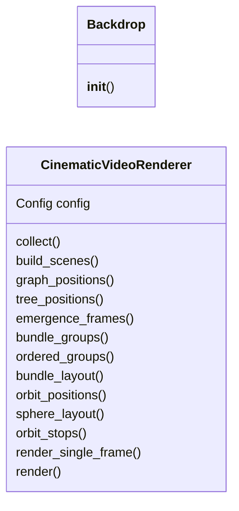
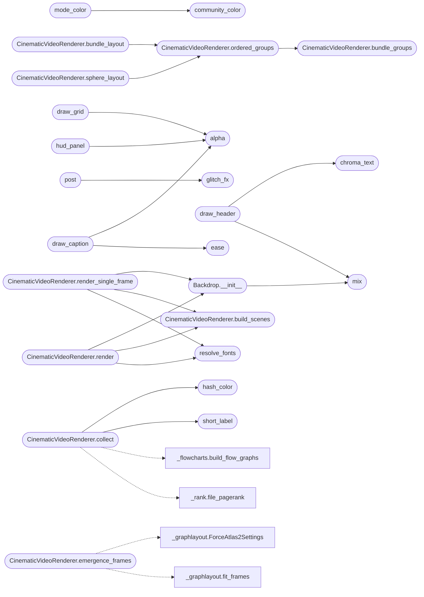

# `readmenator._video`

> Source: [readmenator/_video.py:1](../../readmenator/_video.py#L1) | language `py` | coverage 100.0% | [API index](../index.md)

Cinematic codebase overview video, general purpose.

Renders a short synthwave explainer for any project analysed by
readmenator, in the visual language of the miniGCC self-host video
(neon HUD panels, striped sun, scrolling grid, bloom, scanlines,
chromatic text, glitch transitions). Every number on screen comes
from a real scan: file/symbol/import counts, detected layers, god
nodes, communities, the resolved import graph, per-file hash colors
and top security findings.

Zero tokens: pure PIL frame drawing piped to ffmpeg. Optional
dependency: when PIL or ffmpeg is missing the caller skips with a
warning instead of failing the rebuild.

## Contents

- **Classes:** [`Backdrop`](#backdrop), [`CinematicVideoRenderer`](#cinematicvideorenderer)
- **Functions:** [`ease`](#ease), [`fmt_int`](#fmt_int), [`mix`](#mix), [`alpha`](#alpha), [`hash_color`](#hash_color), [`short_label`](#short_label), [`community_color`](#community_color), [`project3d`](#project3d), [`mode_color`](#mode_color), [`draw_cloud3d`](#draw_cloud3d), [`draw_sphere3d`](#draw_sphere3d), [`dependencies_available`](#dependencies_available), [`resolve_fonts`](#resolve_fonts), [`draw_grid`](#draw_grid), [`draw_sun`](#draw_sun), [`post`](#post), [`glitch_fx`](#glitch_fx), [`chroma_text`](#chroma_text), [`hud_panel`](#hud_panel), [`draw_header`](#draw_header), [`draw_caption`](#draw_caption)
- **Constants:** [`BG_TOP`](#bg_top), [`BG_HORIZON`](#bg_horizon), [`PANEL_FILL`](#panel_fill), [`PANEL_HEAD`](#panel_head), [`TXT`](#txt), [`DIM`](#dim), [`FAINT`](#faint), [`MAGENTA`](#magenta), [`CYAN`](#cyan), [`YELLOW`](#yellow), [`GREEN`](#green), [`ORANGE`](#orange), [`VIOLET`](#violet), [`RED`](#red), [`COMMUNITY_PALETTE`](#community_palette), [`LAYER_COLORS`](#layer_colors), [`ACT_CARDS`](#act_cards), [`COLOR_MODES`](#color_modes)

## Type Diagram



## Call Graph

Solid arrows stay in this module, dashed arrows leave it.



## Classes

<a id="backdrop"></a>

### `Backdrop`

`class` | [readmenator/_video.py:618](../../readmenator/_video.py#L618)

```python
class Backdrop
```

Precomputed synthwave background with sun and CRT mask.

**Members**

| Member | Kind | Summary |
|---|---|---|
| [`__init__`](#backdrop-__init__) | constructor | Build the gradient sky, star field, sun and CRT mask. |

<a id="backdrop-__init__"></a>

#### `Backdrop.__init__`

`constructor` | [readmenator/_video.py:621](../../readmenator/_video.py#L621)

```python
def __init__(self, width: int, height: int) -> None
```

Build the gradient sky, star field, sun and CRT mask.

**Parameters**

| Name | Type | Default | Description |
|---|---|---|---|
| `width` | `int` |  |  |
| `height` | `int` |  |  |

*Calls:* [`mix`](#mix)

*Called by:* [`CinematicVideoRenderer.render`](#cinematicvideorenderer-render), [`CinematicVideoRenderer.render_single_frame`](#cinematicvideorenderer-render_single_frame)

---

<a id="cinematicvideorenderer"></a>

### `CinematicVideoRenderer`

`class` `dataclass` | [readmenator/_video.py:813](../../readmenator/_video.py#L813)

Decorators: `@dataclass`

```python
class CinematicVideoRenderer
```

Builds and renders the general-purpose codebase overview video.

**Attributes**

| Name | Type | Default | Description |
|---|---|---|---|
| [`config`](#cinematicvideorenderer-config) | `Config` |  |  |

**Members**

| Member | Kind | Summary |
|---|---|---|
| [`collect`](#cinematicvideorenderer-collect) | method | Collect every number each scene draws, from real scan data. |
| [`build_scenes`](#cinematicvideorenderer-build_scenes) | method | Lay every scene on the global clock. |
| [`graph_positions`](#cinematicvideorenderer-graph_positions) | method | Compute deterministic positions for graph nodes inside a box. |
| [`tree_positions`](#cinematicvideorenderer-tree_positions) | method | Place the full BFS tree radially: root in the center, one ring per depth. |
| [`emergence_frames`](#cinematicvideorenderer-emergence_frames) | method | ForceAtlas2 snapshots of the resolved import graph fitted to a pixel box. |
| [`bundle_groups`](#cinematicvideorenderer-bundle_groups) | method | Group graph files by community (hubs first), unassigned files last. |
| [`ordered_groups`](#cinematicvideorenderer-ordered_groups) | method | Bundle groups reordered to shorten bundled edges (same optimizer as the explorer). |
| [`bundle_layout`](#cinematicvideorenderer-bundle_layout) | method | Hierarchical edge bundling of resolved imports grouped by community. |
| [`orbit_positions`](#cinematicvideorenderer-orbit_positions) | method | 3D ForceAtlas2 layout of the graph, centered and scaled to the unit sphere. |
| [`sphere_layout`](#cinematicvideorenderer-sphere_layout) | method | Spherical edge bundling of resolved imports on community caps. |
| [`orbit_stops`](#cinematicvideorenderer-orbit_stops) | method | Camera tour stops: the largest communities with their 3D centroid. |
| [`render_single_frame`](#cinematicvideorenderer-render_single_frame) | method | Render one frame to raw RGB bytes without touching ffmpeg. |
| [`render`](#cinematicvideorenderer-render) | method | Render all frames and encode to mp4, muxing music if configured. |

<a id="cinematicvideorenderer-collect"></a>

#### `CinematicVideoRenderer.collect`

`method` | [readmenator/_video.py:818](../../readmenator/_video.py#L818)

```python
def collect(self, nodes: List[Node], edges: List[Edge], resolved_edges: Optional[List[Edge]], analysis: Optional[AnalysisResult], layers: Optional[Dict[str, str]], findings: Optional[List[SecurityFinding]], analysis_v2: Optional[AnalysisResultV2], project_name: str, content_map: Optional[Dict[str, str]] = None, concept_graph: Optional[Any] = None) -> Dict[str, Any]
```

Collect every number each scene draws, from real scan data.

**Parameters**

| Name | Type | Default | Description |
|---|---|---|---|
| `nodes` | `List[Node]` |  |  |
| `edges` | `List[Edge]` |  |  |
| `resolved_edges` | `Optional[List[Edge]]` |  |  |
| `analysis` | `Optional[AnalysisResult]` |  |  |
| `layers` | `Optional[Dict[str, str]]` |  |  |
| `findings` | `Optional[List[SecurityFinding]]` |  |  |
| `analysis_v2` | `Optional[AnalysisResultV2]` |  |  |
| `project_name` | `str` |  |  |
| `content_map` | `Optional[Dict[str, str]]` | `None` |  |
| `concept_graph` | `Optional[Any]` | `None` |  |

**Returns:** `Dict[str, Any]`

*Calls:* [`build_flow_graphs`](readmenator._flowcharts.py.md#build_flow_graphs), [`file_pagerank`](readmenator._rank.py.md#file_pagerank), [`hash_color`](#hash_color), [`short_label`](#short_label)

<a id="cinematicvideorenderer-build_scenes"></a>

#### `CinematicVideoRenderer.build_scenes`

`method` | [readmenator/_video.py:1042](../../readmenator/_video.py#L1042)

```python
def build_scenes(self, data: Dict[str, Any]) -> Tuple[List[Dict[str, Any]], float]
```

Lay every scene on the global clock.

Acts with a non-positive duration are skipped together with their card.

**Parameters**

| Name | Type | Default | Description |
|---|---|---|---|
| `data` | `Dict[str, Any]` |  |  |

**Returns:** `Tuple[List[Dict[str, Any]], float]`

*Called by:* [`CinematicVideoRenderer.render`](#cinematicvideorenderer-render), [`CinematicVideoRenderer.render_single_frame`](#cinematicvideorenderer-render_single_frame)

<a id="cinematicvideorenderer-graph_positions"></a>

#### `CinematicVideoRenderer.graph_positions`

`method` | [readmenator/_video.py:1072](../../readmenator/_video.py#L1072)

```python
def graph_positions(self, data: Dict[str, Any], box: Tuple[int, int, int, int]) -> Dict[str, Tuple[float, float]]
```

Compute deterministic positions for graph nodes inside a box.

**Parameters**

| Name | Type | Default | Description |
|---|---|---|---|
| `data` | `Dict[str, Any]` |  |  |
| `box` | `Tuple[int, int, int, int]` |  |  |

**Returns:** `Dict[str, Tuple[float, float]]`

<a id="cinematicvideorenderer-tree_positions"></a>

#### `CinematicVideoRenderer.tree_positions`

`method` | [readmenator/_video.py:1119](../../readmenator/_video.py#L1119)

```python
def tree_positions(self, data: Dict[str, Any], box: Tuple[int, int, int, int]) -> Dict[str, Tuple[float, float]]
```

Place the full BFS tree radially: root in the center, one ring per depth.

Each node gets an angular sector proportional to its number of
leaves, so every dependent fits on screen without truncation.

**Parameters**

| Name | Type | Default | Description |
|---|---|---|---|
| `data` | `Dict[str, Any]` |  |  |
| `box` | `Tuple[int, int, int, int]` |  |  |

**Returns:** `Dict[str, Tuple[float, float]]`

<a id="cinematicvideorenderer-emergence_frames"></a>

#### `CinematicVideoRenderer.emergence_frames`

`method` | [readmenator/_video.py:1162](../../readmenator/_video.py#L1162)

```python
def emergence_frames(self, data: Dict[str, Any], box: Tuple[int, int, int, int]) -> List[Dict[str, Tuple[float, float]]]
```

ForceAtlas2 snapshots of the resolved import graph fitted to a pixel box.

**Parameters**

| Name | Type | Default | Description |
|---|---|---|---|
| `data` | `Dict[str, Any]` |  |  |
| `box` | `Tuple[int, int, int, int]` |  |  |

**Returns:** `List[Dict[str, Tuple[float, float]]]`

*Calls:* [`ForceAtlas2Settings`](readmenator._graphlayout.py.md#forceatlas2settings), [`fit_frames`](readmenator._graphlayout.py.md#fit_frames), [`forceatlas2_frames`](readmenator._graphlayout.py.md#forceatlas2_frames)

<a id="cinematicvideorenderer-bundle_groups"></a>

#### `CinematicVideoRenderer.bundle_groups`

`method` | [readmenator/_video.py:1172](../../readmenator/_video.py#L1172)

```python
def bundle_groups(self, data: Dict[str, Any]) -> Dict[str, List[str]]
```

Group graph files by community (hubs first), unassigned files last.

**Parameters**

| Name | Type | Default | Description |
|---|---|---|---|
| `data` | `Dict[str, Any]` |  |  |

**Returns:** `Dict[str, List[str]]`

*Called by:* [`CinematicVideoRenderer.ordered_groups`](#cinematicvideorenderer-ordered_groups)

<a id="cinematicvideorenderer-ordered_groups"></a>

#### `CinematicVideoRenderer.ordered_groups`

`method` | [readmenator/_video.py:1187](../../readmenator/_video.py#L1187)

```python
def ordered_groups(self, data: Dict[str, Any]) -> Dict[str, List[str]]
```

Bundle groups reordered to shorten bundled edges (same optimizer as the explorer).

**Parameters**

| Name | Type | Default | Description |
|---|---|---|---|
| `data` | `Dict[str, Any]` |  |  |

**Returns:** `Dict[str, List[str]]`

*Calls:* [`optimize_bundle_order`](readmenator._graphlayout.py.md#optimize_bundle_order), [`CinematicVideoRenderer.bundle_groups`](#cinematicvideorenderer-bundle_groups)

*Called by:* [`CinematicVideoRenderer.bundle_layout`](#cinematicvideorenderer-bundle_layout), [`CinematicVideoRenderer.sphere_layout`](#cinematicvideorenderer-sphere_layout)

<a id="cinematicvideorenderer-bundle_layout"></a>

#### `CinematicVideoRenderer.bundle_layout`

`method` | [readmenator/_video.py:1197](../../readmenator/_video.py#L1197)

```python
def bundle_layout(self, data: Dict[str, Any], box: Tuple[int, int, int, int]) -> BundleLayout
```

Hierarchical edge bundling of resolved imports grouped by community.

**Parameters**

| Name | Type | Default | Description |
|---|---|---|---|
| `data` | `Dict[str, Any]` |  |  |
| `box` | `Tuple[int, int, int, int]` |  |  |

**Returns:** `BundleLayout`

*Calls:* [`hierarchical_edge_bundling`](readmenator._graphlayout.py.md#hierarchical_edge_bundling), [`CinematicVideoRenderer.ordered_groups`](#cinematicvideorenderer-ordered_groups)

<a id="cinematicvideorenderer-orbit_positions"></a>

#### `CinematicVideoRenderer.orbit_positions`

`method` | [readmenator/_video.py:1206](../../readmenator/_video.py#L1206)

```python
def orbit_positions(self, data: Dict[str, Any]) -> Dict[str, Tuple[float, float, float]]
```

3D ForceAtlas2 layout of the graph, centered and scaled to the unit sphere.

**Parameters**

| Name | Type | Default | Description |
|---|---|---|---|
| `data` | `Dict[str, Any]` |  |  |

**Returns:** `Dict[str, Tuple[float, float, float]]`

*Calls:* [`ForceAtlas2Settings`](readmenator._graphlayout.py.md#forceatlas2settings), [`forceatlas2_frames`](readmenator._graphlayout.py.md#forceatlas2_frames), [`normalize_cloud`](readmenator._graphlayout.py.md#normalize_cloud)

<a id="cinematicvideorenderer-sphere_layout"></a>

#### `CinematicVideoRenderer.sphere_layout`

`method` | [readmenator/_video.py:1216](../../readmenator/_video.py#L1216)

```python
def sphere_layout(self, data: Dict[str, Any]) -> SphereBundleLayout
```

Spherical edge bundling of resolved imports on community caps.

**Parameters**

| Name | Type | Default | Description |
|---|---|---|---|
| `data` | `Dict[str, Any]` |  |  |

**Returns:** `SphereBundleLayout`

*Calls:* [`spherical_edge_bundling`](readmenator._graphlayout.py.md#spherical_edge_bundling), [`CinematicVideoRenderer.ordered_groups`](#cinematicvideorenderer-ordered_groups)

<a id="cinematicvideorenderer-orbit_stops"></a>

#### `CinematicVideoRenderer.orbit_stops`

`method` | [readmenator/_video.py:1225](../../readmenator/_video.py#L1225)

```python
def orbit_stops(self, data: Dict[str, Any], positions: Dict[str, Tuple[float, float, float]]) -> List[Dict[str, Any]]
```

Camera tour stops: the largest communities with their 3D centroid.

**Parameters**

| Name | Type | Default | Description |
|---|---|---|---|
| `data` | `Dict[str, Any]` |  |  |
| `positions` | `Dict[str, Tuple[float, float, float]]` |  |  |

**Returns:** `List[Dict[str, Any]]`

<a id="cinematicvideorenderer-render_single_frame"></a>

#### `CinematicVideoRenderer.render_single_frame`

`method` | [readmenator/_video.py:1254](../../readmenator/_video.py#L1254)

```python
def render_single_frame(self, data: Dict[str, Any], frame_index: int) -> bytes
```

Render one frame to raw RGB bytes without touching ffmpeg.

**Parameters**

| Name | Type | Default | Description |
|---|---|---|---|
| `data` | `Dict[str, Any]` |  |  |
| `frame_index` | `int` |  |  |

**Returns:** `bytes`

*Calls:* [`Backdrop.__init__`](#backdrop-__init__), [`CinematicVideoRenderer.build_scenes`](#cinematicvideorenderer-build_scenes), [`resolve_fonts`](#resolve_fonts)

<a id="cinematicvideorenderer-render"></a>

#### `CinematicVideoRenderer.render`

`method` | [readmenator/_video.py:1268](../../readmenator/_video.py#L1268)

```python
def render(self, data: Dict[str, Any], output_path: str) -> str
```

Render all frames and encode to mp4, muxing music if configured.

**Parameters**

| Name | Type | Default | Description |
|---|---|---|---|
| `data` | `Dict[str, Any]` |  |  |
| `output_path` | `str` |  |  |

**Returns:** `str`

**Raises**

- `RuntimeError`: (raised in the body, not documented)

*Calls:* [`Backdrop.__init__`](#backdrop-__init__), [`CinematicVideoRenderer.build_scenes`](#cinematicvideorenderer-build_scenes), [`resolve_fonts`](#resolve_fonts)

---

## Functions

<a id="ease"></a>

### `ease`

`function` | [readmenator/_video.py:100](../../readmenator/_video.py#L100)

```python
def ease(x: float) -> float
```

Quintic smootherstep clamped to [0, 1].

Perlin's 6x^5 - 15x^4 + 10x^3 has zero first and second derivatives
at both ends, so reveals, counters, and camera moves start and stop
without the visible acceleration jump of cubic smoothstep.

**Parameters**

| Name | Type | Default | Description |
|---|---|---|---|
| `x` | `float` |  |  |

**Returns:** `float`

*Called by:* [`draw_caption`](#draw_caption)

---

<a id="fmt_int"></a>

### `fmt_int`

`function` | [readmenator/_video.py:111](../../readmenator/_video.py#L111)

```python
def fmt_int(n: int) -> str
```

Group thousands with commas.

**Parameters**

| Name | Type | Default | Description |
|---|---|---|---|
| `n` | `int` |  |  |

**Returns:** `str`

---

<a id="mix"></a>

### `mix`

`function` | [readmenator/_video.py:116](../../readmenator/_video.py#L116)

```python
def mix(a: Tuple[int, int, int], b: Tuple[int, int, int], t: float) -> Tuple[int, int, int]
```

Linear blend of two RGB colors.

**Parameters**

| Name | Type | Default | Description |
|---|---|---|---|
| `a` | `Tuple[int, int, int]` |  |  |
| `b` | `Tuple[int, int, int]` |  |  |
| `t` | `float` |  |  |

**Returns:** `Tuple[int, int, int]`

*Called by:* [`Backdrop.__init__`](#backdrop-__init__), [`draw_header`](#draw_header)

---

<a id="alpha"></a>

### `alpha`

`function` | [readmenator/_video.py:121](../../readmenator/_video.py#L121)

```python
def alpha(c: Tuple[int, int, int], a: float) -> Tuple[int, int, int, int]
```

RGB color plus an alpha in [0, 1] as an RGBA tuple.

**Parameters**

| Name | Type | Default | Description |
|---|---|---|---|
| `c` | `Tuple[int, int, int]` |  |  |
| `a` | `float` |  |  |

**Returns:** `Tuple[int, int, int, int]`

*Called by:* [`draw_caption`](#draw_caption), [`draw_grid`](#draw_grid), [`hud_panel`](#hud_panel)

---

<a id="hash_color"></a>

### `hash_color`

`function` | [readmenator/_video.py:126](../../readmenator/_video.py#L126)

```python
def hash_color(digest: bytes) -> Tuple[int, int, int]
```

Neon color derived from a digest: the file fingerprint.

**Parameters**

| Name | Type | Default | Description |
|---|---|---|---|
| `digest` | `bytes` |  |  |

**Returns:** `Tuple[int, int, int]`

*Called by:* [`CinematicVideoRenderer.collect`](#cinematicvideorenderer-collect)

---

<a id="short_label"></a>

### `short_label`

`function` | [readmenator/_video.py:135](../../readmenator/_video.py#L135)

```python
def short_label(text: str, limit: int) -> str
```

Truncate a label to a character budget without newlines.

**Parameters**

| Name | Type | Default | Description |
|---|---|---|---|
| `text` | `str` |  |  |
| `limit` | `int` |  |  |

**Returns:** `str`

*Called by:* [`CinematicVideoRenderer.collect`](#cinematicvideorenderer-collect)

---

<a id="community_color"></a>

### `community_color`

`function` | [readmenator/_video.py:180](../../readmenator/_video.py#L180)

```python
def community_color(index: int) -> Tuple[int, int, int]
```

Neon color for a community index (grey for unassigned).

**Parameters**

| Name | Type | Default | Description |
|---|---|---|---|
| `index` | `int` |  |  |

**Returns:** `Tuple[int, int, int]`

*Called by:* [`mode_color`](#mode_color)

---

<a id="project3d"></a>

### `project3d`

`function` | [readmenator/_video.py:198](../../readmenator/_video.py#L198)

```python
def project3d(p: Tuple[float, ...], yaw: float, pitch: float, target: Tuple[float, ...], scale: float, center: Tuple[float, float], perspective: float) -> Tuple[float, float, float, float]
```

Project a 3D point through an orbiting perspective camera.

The camera looks at target from the -z side after rotating the
world by yaw (around y) and pitch (around x).

**Parameters**

| Name | Type | Default | Description |
|---|---|---|---|
| `p` | `Tuple[float, ...]` |  |  |
| `yaw` | `float` |  |  |
| `pitch` | `float` |  |  |
| `target` | `Tuple[float, ...]` |  |  |
| `scale` | `float` |  |  |
| `center` | `Tuple[float, float]` |  |  |
| `perspective` | `float` |  |  |

**Returns:** `Tuple[float, float, float, float]` - Screen x, screen y, view depth (smaller is nearer), and the
perspective scale factor.

---

<a id="mode_color"></a>

### `mode_color`

`function` | [readmenator/_video.py:237](../../readmenator/_video.py#L237)

```python
def mode_color(data: Dict[str, Any], nid: str, mode: str) -> Tuple[int, int, int]
```

Node color under an explorer color mode (community, layer, language).

**Parameters**

| Name | Type | Default | Description |
|---|---|---|---|
| `data` | `Dict[str, Any]` |  |  |
| `nid` | `str` |  |  |
| `mode` | `str` |  |  |

**Returns:** `Tuple[int, int, int]`

*Calls:* [`community_color`](#community_color)

---

<a id="draw_cloud3d"></a>

### `draw_cloud3d`

`function` | [readmenator/_video.py:286](../../readmenator/_video.py#L286)

```python
def draw_cloud3d(img: Any, data: Dict[str, Any], box: Tuple[int, int, int, int], cfg: Config, yaw: float, pitch: float, target: Tuple[float, ...], zoom: float, mode: str, lit_nodes: Optional[set], edge_lit: Optional[Any], gt: float, fonts: Dict[str, Any], appear: float = 1.0, labels: int = 0) -> None
```

Draw the 3D force graph (graph-force 3D view) through an orbiting camera.

Drawing is clipped to box.

**Parameters**

| Name | Type | Default | Description |
|---|---|---|---|
| `img` | `Any` |  | Frame image. |
| `data` | `Dict[str, Any]` |  | Collected scene data with orbit_pos. |
| `box` | `Tuple[int, int, int, int]` |  | Pixel box the cloud is fitted into. |
| `cfg` | `Config` |  | Video settings. |
| `yaw` | `float` |  | Camera yaw in radians. |
| `pitch` | `float` |  | Camera pitch in radians. |
| `target` | `Tuple[float, ...]` |  | Look-at point in layout space. |
| `zoom` | `float` |  | Scale multiplier. |
| `mode` | `str` |  | Color mode (community, layer, language). |
| `lit_nodes` | `Optional[set]` |  | Highlighted node ids, or None for no focus. |
| `edge_lit` | `Optional[Any]` |  | Predicate (a, b) -> bool for highlighted edges, or None. |
| `gt` | `float` |  | Global time for particles and pulses. |
| `fonts` | `Dict[str, Any]` |  | Font set. |
| `appear` | `float` | `1.0` | Assembly progress in [0, 1] (nodes grow out of the center). |
| `labels` | `int` | `0` | Number of PageRank-ranked labels to place. |

---

<a id="draw_sphere3d"></a>

### `draw_sphere3d`

`function` | [readmenator/_video.py:406](../../readmenator/_video.py#L406)

```python
def draw_sphere3d(img: Any, data: Dict[str, Any], box: Tuple[int, int, int, int], cfg: Config, yaw: float, pitch: float, morph: float, reveal: float, spot: Optional[int], gt: float, fonts: Dict[str, Any], group_labels: bool = True) -> None
```

Draw the bundled sphere, optionally morphing out of the 3D force layout.

Drawing is clipped to box.

**Parameters**

| Name | Type | Default | Description |
|---|---|---|---|
| `img` | `Any` |  | Frame image. |
| `data` | `Dict[str, Any]` |  | Collected scene data with sphere and orbit_pos. |
| `box` | `Tuple[int, int, int, int]` |  | Pixel box the sphere is fitted into. |
| `cfg` | `Config` |  | Video settings. |
| `yaw` | `float` |  | Camera yaw in radians. |
| `pitch` | `float` |  | Camera pitch in radians. |
| `morph` | `float` |  | 0 = force layout positions, 1 = sphere positions. |
| `reveal` | `float` |  | Fraction of each bundled curve drawn. |
| `spot` | `Optional[int]` |  | Community index in the spotlight, or None. |
| `gt` | `float` |  | Global time for particles. |
| `fonts` | `Dict[str, Any]` |  | Font set. |
| `group_labels` | `bool` | `True` | Draw cap labels when the morph is complete. |

---

<a id="dependencies_available"></a>

### `dependencies_available`

`function` | [readmenator/_video.py:570](../../readmenator/_video.py#L570)

```python
def dependencies_available() -> bool
```

Check that PIL and ffmpeg exist for video rendering.

**Returns:** `bool`

---

<a id="resolve_fonts"></a>

### `resolve_fonts`

`function` | [readmenator/_video.py:579](../../readmenator/_video.py#L579)

```python
def resolve_fonts() -> Dict[str, Any]
```

Resolve monospace fonts through fontconfig with PIL fallback.

**Returns:** `Dict[str, Any]`

*Called by:* [`CinematicVideoRenderer.render`](#cinematicvideorenderer-render), [`CinematicVideoRenderer.render_single_frame`](#cinematicvideorenderer-render_single_frame)

---

<a id="draw_grid"></a>

### `draw_grid`

`function` | [readmenator/_video.py:681](../../readmenator/_video.py#L681)

```python
def draw_grid(img: Any, t: float, strength: float, bd: Backdrop) -> None
```

Draw the scrolling perspective grid below the horizon.

**Parameters**

| Name | Type | Default | Description |
|---|---|---|---|
| `img` | `Any` |  |  |
| `t` | `float` |  |  |
| `strength` | `float` |  |  |
| `bd` | `Backdrop` |  |  |

*Calls:* [`alpha`](#alpha)

---

<a id="draw_sun"></a>

### `draw_sun`

`function` | [readmenator/_video.py:701](../../readmenator/_video.py#L701)

```python
def draw_sun(img: Any, a: float, bd: Backdrop, cy: Optional[int] = None) -> None
```

Paste the striped synthwave sun behind the horizon.

**Parameters**

| Name | Type | Default | Description |
|---|---|---|---|
| `img` | `Any` |  |  |
| `a` | `float` |  |  |
| `bd` | `Backdrop` |  |  |
| `cy` | `Optional[int]` | `None` |  |

---

<a id="post"></a>

### `post`

`function` | [readmenator/_video.py:718](../../readmenator/_video.py#L718)

```python
def post(img: Any, glitch: float = 0.0, seed: int = 0) -> Any
```

Apply bloom, scanlines, vignette and optional glitch.

**Parameters**

| Name | Type | Default | Description |
|---|---|---|---|
| `img` | `Any` |  |  |
| `glitch` | `float` | `0.0` |  |
| `seed` | `int` | `0` |  |

**Returns:** `Any`

*Calls:* [`glitch_fx`](#glitch_fx)

---

<a id="glitch_fx"></a>

### `glitch_fx`

`function` | [readmenator/_video.py:736](../../readmenator/_video.py#L736)

```python
def glitch_fx(img: Any, amount: float, seed: int) -> Any
```

RGB split plus horizontal slice displacement.

**Parameters**

| Name | Type | Default | Description |
|---|---|---|---|
| `img` | `Any` |  |  |
| `amount` | `float` |  |  |
| `seed` | `int` |  |  |

**Returns:** `Any`

*Called by:* [`post`](#post)

---

<a id="chroma_text"></a>

### `chroma_text`

`function` | [readmenator/_video.py:759](../../readmenator/_video.py#L759)

```python
def chroma_text(img: Any, xy: Tuple[float, float], text: str, font: Any, col: Tuple[int, int, int], spread: int = 2, anchor: str = 'la') -> None
```

Draw text with red/cyan CRT chromatic aberration.

**Parameters**

| Name | Type | Default | Description |
|---|---|---|---|
| `img` | `Any` |  |  |
| `xy` | `Tuple[float, float]` |  |  |
| `text` | `str` |  |  |
| `font` | `Any` |  |  |
| `col` | `Tuple[int, int, int]` |  |  |
| `spread` | `int` | `2` |  |
| `anchor` | `str` | `'la'` |  |

*Called by:* [`draw_header`](#draw_header)

---

<a id="hud_panel"></a>

### `hud_panel`

`function` | [readmenator/_video.py:770](../../readmenator/_video.py#L770)

```python
def hud_panel(d: Any, box: Tuple[int, int, int, int], title: str, fonts: Dict[str, Any], col: Tuple[int, int, int] = CYAN) -> None
```

Draw a translucent HUD panel with neon edge and corner brackets.

**Parameters**

| Name | Type | Default | Description |
|---|---|---|---|
| `d` | `Any` |  |  |
| `box` | `Tuple[int, int, int, int]` |  |  |
| `title` | `str` |  |  |
| `fonts` | `Dict[str, Any]` |  |  |
| `col` | `Tuple[int, int, int]` | `CYAN` |  |

*Calls:* [`alpha`](#alpha)

---

<a id="draw_header"></a>

### `draw_header`

`function` | [readmenator/_video.py:783](../../readmenator/_video.py#L783)

```python
def draw_header(img: Any, d: Any, gt: float, total: float, project: str, act_label: str, fonts: Dict[str, Any], width: int) -> None
```

Draw the top strip with project title, act label and progress.

**Parameters**

| Name | Type | Default | Description |
|---|---|---|---|
| `img` | `Any` |  |  |
| `d` | `Any` |  |  |
| `gt` | `float` |  |  |
| `total` | `float` |  |  |
| `project` | `str` |  |  |
| `act_label` | `str` |  |  |
| `fonts` | `Dict[str, Any]` |  |  |
| `width` | `int` |  |  |

*Calls:* [`chroma_text`](#chroma_text), [`mix`](#mix)

---

<a id="draw_caption"></a>

### `draw_caption`

`function` | [readmenator/_video.py:797](../../readmenator/_video.py#L797)

```python
def draw_caption(d: Any, text: str, lt: float, dur: float, fonts: Dict[str, Any], width: int, y: int) -> None
```

Draw the lower-third narration line with typing effect.

**Parameters**

| Name | Type | Default | Description |
|---|---|---|---|
| `d` | `Any` |  |  |
| `text` | `str` |  |  |
| `lt` | `float` |  |  |
| `dur` | `float` |  |  |
| `fonts` | `Dict[str, Any]` |  |  |
| `width` | `int` |  |  |
| `y` | `int` |  |  |

*Calls:* [`alpha`](#alpha), [`ease`](#ease)

---

## Constants

<a id="bg_top"></a>

### `BG_TOP`

`constant` | [readmenator/_video.py:47](../../readmenator/_video.py#L47)

```python
BG_TOP = (6, 3, 16)
```

---

<a id="bg_horizon"></a>

### `BG_HORIZON`

`constant` | [readmenator/_video.py:48](../../readmenator/_video.py#L48)

```python
BG_HORIZON = (34, 6, 52)
```

---

<a id="panel_fill"></a>

### `PANEL_FILL`

`constant` | [readmenator/_video.py:49](../../readmenator/_video.py#L49)

```python
PANEL_FILL = (10, 7, 26, 225)
```

---

<a id="panel_head"></a>

### `PANEL_HEAD`

`constant` | [readmenator/_video.py:50](../../readmenator/_video.py#L50)

```python
PANEL_HEAD = (22, 12, 48, 240)
```

---

<a id="txt"></a>

### `TXT`

`constant` | [readmenator/_video.py:51](../../readmenator/_video.py#L51)

```python
TXT = (222, 220, 255)
```

---

<a id="dim"></a>

### `DIM`

`constant` | [readmenator/_video.py:52](../../readmenator/_video.py#L52)

```python
DIM = (130, 120, 180)
```

---

<a id="faint"></a>

### `FAINT`

`constant` | [readmenator/_video.py:53](../../readmenator/_video.py#L53)

```python
FAINT = (80, 70, 125)
```

---

<a id="magenta"></a>

### `MAGENTA`

`constant` | [readmenator/_video.py:54](../../readmenator/_video.py#L54)

```python
MAGENTA = (255, 46, 151)
```

---

<a id="cyan"></a>

### `CYAN`

`constant` | [readmenator/_video.py:55](../../readmenator/_video.py#L55)

```python
CYAN = (0, 234, 255)
```

---

<a id="yellow"></a>

### `YELLOW`

`constant` | [readmenator/_video.py:56](../../readmenator/_video.py#L56)

```python
YELLOW = (255, 225, 60)
```

---

<a id="green"></a>

### `GREEN`

`constant` | [readmenator/_video.py:57](../../readmenator/_video.py#L57)

```python
GREEN = (57, 255, 136)
```

---

<a id="orange"></a>

### `ORANGE`

`constant` | [readmenator/_video.py:58](../../readmenator/_video.py#L58)

```python
ORANGE = (255, 140, 50)
```

---

<a id="violet"></a>

### `VIOLET`

`constant` | [readmenator/_video.py:59](../../readmenator/_video.py#L59)

```python
VIOLET = (170, 100, 255)
```

---

<a id="red"></a>

### `RED`

`constant` | [readmenator/_video.py:60](../../readmenator/_video.py#L60)

```python
RED = (255, 60, 90)
```

---

<a id="community_palette"></a>

### `COMMUNITY_PALETTE`

`constant` | [readmenator/_video.py:62](../../readmenator/_video.py#L62)

```python
COMMUNITY_PALETTE
```

---

<a id="layer_colors"></a>

### `LAYER_COLORS`

`constant` | [readmenator/_video.py:67](../../readmenator/_video.py#L67)

```python
LAYER_COLORS
```

---

<a id="act_cards"></a>

### `ACT_CARDS`

`constant` | [readmenator/_video.py:76](../../readmenator/_video.py#L76)

```python
ACT_CARDS
```

---

<a id="color_modes"></a>

### `COLOR_MODES`

`constant` | [readmenator/_video.py:90](../../readmenator/_video.py#L90)

```python
COLOR_MODES = ('community', 'layer', 'language')
```

---
