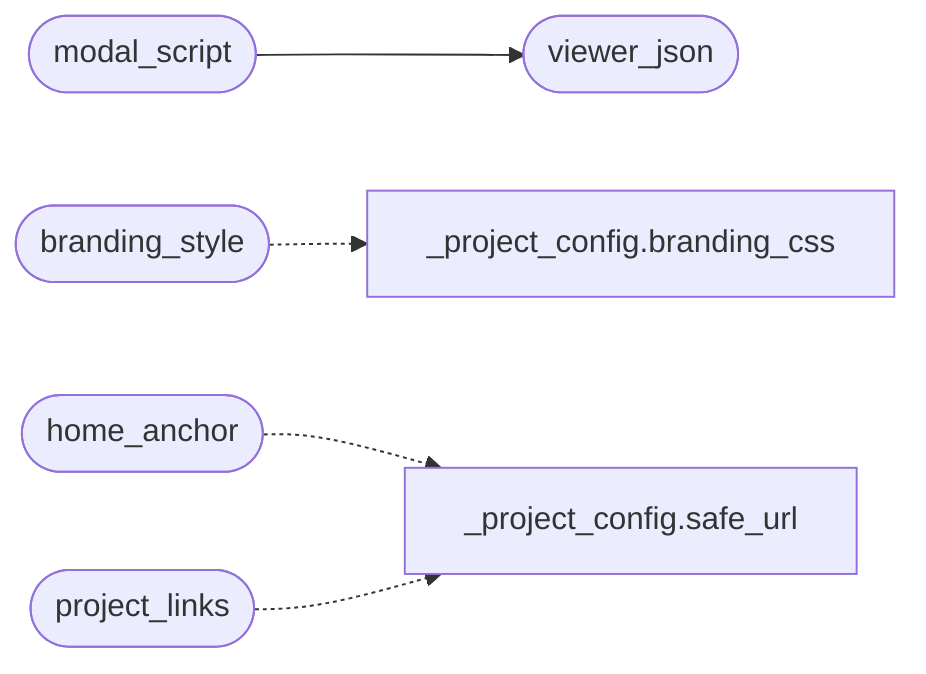

# `readmenator._viewer_ui`

> Source: [readmenator/_viewer_ui.py:1](../../readmenator/_viewer_ui.py#L1) | language `py` | coverage 100.0% | [API index](../index.md)

Shared Config button + modal for maps/explorer pages.

Every maps-family page (gallery index, force-graph, edge bundles,
flows) embeds the same ``Config`` control: a button that opens a modal
with the viewer subset of ``readmenator.toml``. ``Apply`` updates the
live view without a full page reload (only the affected segment is
re-rendered), persists the choice to ``localStorage``, and offers a
``Copy TOML`` action so the choice can be persisted back into
``readmenator.toml`` for the next rebuild.

Pages expose a hook instead of sharing internals:
``window.ReadmenatorViewerApply(patch)`` applies a ``{key: value}``
patch live and returns the list of modal keys it handled live
(``[]`` when none). Apply diffs the form against its opening values,
applies only what changed, and reports "Live: ..." vs "Needs rebuild:
..." per key. Reset asks for confirmation before clearing overrides.

## Contents

- **Functions:** [`viewer_json`](#viewer_json), [`branding_style`](#branding_style), [`home_anchor`](#home_anchor), [`project_links`](#project_links), [`modal_html`](#modal_html), [`modal_script`](#modal_script), [`config_button_markup`](#config_button_markup)
- **Constants:** [`VIEWER_SCHEMA`](#viewer_schema), [`VIEWER_MODAL_CSS`](#viewer_modal_css), [`VIEWER_MODAL_JS`](#viewer_modal_js), [`HOUSE_SVG`](#house_svg), [`GLOBE_SVG`](#globe_svg)

## Call Graph

Solid arrows stay in this module, dashed arrows leave it.



## Functions

<a id="viewer_json"></a>

### `viewer_json`

`function` | [readmenator/_viewer_ui.py:272](../../readmenator/_viewer_ui.py#L272)

```python
def viewer_json(config: Any) -> str
```

Serialize the viewer + branding subset of Config for embedding in pages.

**Parameters**

| Name | Type | Default | Description |
|---|---|---|---|
| `config` | `Any` |  | Effective configuration. |

**Returns:** `str` - JSON object string with viewer and branding keys (flat namespace).

*Called by:* [`modal_script`](#modal_script)

---

<a id="branding_style"></a>

### `branding_style`

`function` | [readmenator/_viewer_ui.py:318](../../readmenator/_viewer_ui.py#L318)

```python
def branding_style(config: Any) -> str
```

Return a style element overriding accent colors from branding.

**Parameters**

| Name | Type | Default | Description |
|---|---|---|---|
| `config` | `Any` |  | Effective configuration. |

**Returns:** `str` - Style element, or "" when no valid accent color is configured.

*Calls:* [`branding_css`](readmenator._project_config.py.md#branding_css)

---

<a id="home_anchor"></a>

### `home_anchor`

`function` | [readmenator/_viewer_ui.py:333](../../readmenator/_viewer_ui.py#L333)

```python
def home_anchor(config: Any) -> str
```

Return a home icon link to the configured maps home URL.

**Parameters**

| Name | Type | Default | Description |
|---|---|---|---|
| `config` | `Any` |  | Effective configuration. |

**Returns:** `str` - Anchor fragment, or "" when branding.home_url is not an http(s) link.

*Calls:* [`safe_url`](readmenator._project_config.py.md#safe_url)

*Called by:* [`BundleGraphRenderer.render`](readmenator._bundlegraph.py.md#bundlegraphrenderer-render), [`render_flows_page`](readmenator._flowpage.py.md#render_flows_page), [`ForceGraphRenderer.render`](readmenator._forcegraph.py.md#forcegraphrenderer-render)

---

<a id="project_links"></a>

### `project_links`

`function` | [readmenator/_viewer_ui.py:356](../../readmenator/_viewer_ui.py#L356)

```python
def project_links(config: Any) -> List[Dict[str, str]]
```

Return validated project link pills for footers and heroes.

**Parameters**

| Name | Type | Default | Description |
|---|---|---|---|
| `config` | `Any` |  | Effective configuration. |

**Returns:** `List[Dict[str, str]]` - List of {"label": ..., "url": ..., "icon": "github"|"globe"|"house"}.

*Calls:* [`safe_url`](readmenator._project_config.py.md#safe_url)

---

<a id="modal_html"></a>

### `modal_html`

`function` | [readmenator/_viewer_ui.py:380](../../readmenator/_viewer_ui.py#L380)

```python
def modal_html() -> str
```

Return the Config modal + scrim markup shared by every page.

**Returns:** `str`

*Called by:* [`BundleGraphRenderer.render`](readmenator._bundlegraph.py.md#bundlegraphrenderer-render), [`render_flows_page`](readmenator._flowpage.py.md#render_flows_page), [`ForceGraphRenderer.render`](readmenator._forcegraph.py.md#forcegraphrenderer-render)

---

<a id="modal_script"></a>

### `modal_script`

`function` | [readmenator/_viewer_ui.py:403](../../readmenator/_viewer_ui.py#L403)

```python
def modal_script(config: Any) -> str
```

Return the modal boot script with schema + viewer defaults injected.

**Parameters**

| Name | Type | Default | Description |
|---|---|---|---|
| `config` | `Any` |  | Effective configuration. |

**Returns:** `str` - Inline script body (without script tags).

*Calls:* [`viewer_json`](#viewer_json)

*Called by:* [`BundleGraphRenderer.render`](readmenator._bundlegraph.py.md#bundlegraphrenderer-render), [`render_flows_page`](readmenator._flowpage.py.md#render_flows_page), [`ForceGraphRenderer.render`](readmenator._forcegraph.py.md#forcegraphrenderer-render)

---

<a id="config_button_markup"></a>

### `config_button_markup`

`function` | [readmenator/_viewer_ui.py:419](../../readmenator/_viewer_ui.py#L419)

```python
def config_button_markup() -> str
```

Return the native Config toolbar button opening the shared modal.

Deliberately classless so every template styles it exactly like its
sibling buttons (the gallery pairs it with #theme via CSS).

**Returns:** `str` - Button HTML fragment.

---

## Constants

<a id="viewer_schema"></a>

### `VIEWER_SCHEMA`

`constant` | [readmenator/_viewer_ui.py:24](../../readmenator/_viewer_ui.py#L24)

```python
VIEWER_SCHEMA: List[Dict[str, Any]]
```

---

<a id="viewer_modal_css"></a>

### `VIEWER_MODAL_CSS`

`constant` | [readmenator/_viewer_ui.py:106](../../readmenator/_viewer_ui.py#L106)

```python
VIEWER_MODAL_CSS
```

---

<a id="viewer_modal_js"></a>

### `VIEWER_MODAL_JS`

`constant` | [readmenator/_viewer_ui.py:128](../../readmenator/_viewer_ui.py#L128)

```python
VIEWER_MODAL_JS
```

---

<a id="house_svg"></a>

### `HOUSE_SVG`

`constant` | [readmenator/_viewer_ui.py:305](../../readmenator/_viewer_ui.py#L305)

```python
HOUSE_SVG
```

---

<a id="globe_svg"></a>

### `GLOBE_SVG`

`constant` | [readmenator/_viewer_ui.py:310](../../readmenator/_viewer_ui.py#L310)

```python
GLOBE_SVG
```

---
