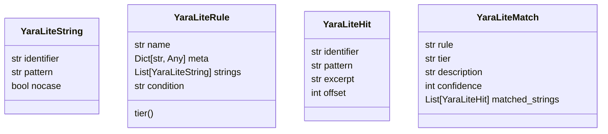
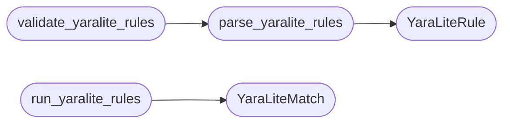

# `readmenator._yaralite`

> Source: [readmenator/_yaralite.py:1](../../readmenator/_yaralite.py#L1) | language `py` | coverage 100.0% | [API index](../index.md)

Zero-dependency YARA-lite rule parser and runner.

Implements the YARA subset readmenator needs (rule header, meta,
strings, condition with `N of (...)`, `any of them`, `$identifiers`)
so tiered T1/T2/T3 text rules ship without a native YARA dependency.
Conditions evaluate through a restricted grammar, never through
arbitrary code execution.

## Contents

- **Classes:** [`YaraLiteString`](#yaralitestring), [`YaraLiteRule`](#yaraliterule), [`YaraLiteHit`](#yaralitehit), [`YaraLiteMatch`](#yaralitematch)
- **Functions:** [`parse_yaralite_rules`](#parse_yaralite_rules), [`run_yaralite_rules`](#run_yaralite_rules), [`validate_yaralite_rules`](#validate_yaralite_rules)
- **Constants:** [`RULE_HEADER_RE`](#rule_header_re), [`COMMENT_RE`](#comment_re), [`STRING_RE`](#string_re), [`META_RE`](#meta_re)

## Type Diagram



## Call Graph

Solid arrows stay in this module, dashed arrows leave it.



## Classes

<a id="yaralitestring"></a>

### `YaraLiteString`

`class` `dataclass` | [readmenator/_yaralite.py:24](../../readmenator/_yaralite.py#L24)

Decorators: `@dataclass`

```python
class YaraLiteString
```

A single named string pattern inside a rule.

**Attributes**

| Name | Type | Default | Description |
|---|---|---|---|
| [`identifier`](#yaralitestring-identifier) | `str` |  |  |
| [`pattern`](#yaralitestring-pattern) | `str` |  |  |
| [`nocase`](#yaralitestring-nocase) | `bool` | `False` |  |

---

<a id="yaraliterule"></a>

### `YaraLiteRule`

`class` `dataclass` | [readmenator/_yaralite.py:33](../../readmenator/_yaralite.py#L33)

Decorators: `@dataclass`

```python
class YaraLiteRule
```

A parsed YARA-lite rule with tier metadata.

**Attributes**

| Name | Type | Default | Description |
|---|---|---|---|
| [`name`](#yaraliterule-name) | `str` |  |  |
| [`meta`](#yaraliterule-meta) | `Dict[str, Any]` | `field(default_factory=dict)` |  |
| [`strings`](#yaraliterule-strings) | `List[YaraLiteString]` | `field(default_factory=list)` |  |
| [`condition`](#yaraliterule-condition) | `str` | `''` |  |

**Members**

| Member | Kind | Summary |
|---|---|---|
| [`tier`](#yaraliterule-tier) | property | Return the rule tier from meta or name prefix. |

<a id="yaraliterule-tier"></a>

#### `YaraLiteRule.tier`

`property` | [readmenator/_yaralite.py:42](../../readmenator/_yaralite.py#L42)

Decorators: `@property`

```python
def tier(self) -> str
```

Return the rule tier from meta or name prefix.

**Returns:** `str`

---

<a id="yaralitehit"></a>

### `YaraLiteHit`

`class` `dataclass` | [readmenator/_yaralite.py:56](../../readmenator/_yaralite.py#L56)

Decorators: `@dataclass`

```python
class YaraLiteHit
```

A single matched string occurrence.

**Attributes**

| Name | Type | Default | Description |
|---|---|---|---|
| [`identifier`](#yaralitehit-identifier) | `str` |  |  |
| [`pattern`](#yaralitehit-pattern) | `str` |  |  |
| [`excerpt`](#yaralitehit-excerpt) | `str` |  |  |
| [`offset`](#yaralitehit-offset) | `int` |  |  |

---

<a id="yaralitematch"></a>

### `YaraLiteMatch`

`class` `dataclass` | [readmenator/_yaralite.py:66](../../readmenator/_yaralite.py#L66)

Decorators: `@dataclass`

```python
class YaraLiteMatch
```

A rule match with all collected string hits.

**Attributes**

| Name | Type | Default | Description |
|---|---|---|---|
| [`rule`](#yaralitematch-rule) | `str` |  |  |
| [`tier`](#yaralitematch-tier) | `str` |  |  |
| [`description`](#yaralitematch-description) | `str` |  |  |
| [`confidence`](#yaralitematch-confidence) | `int` |  |  |
| [`matched_strings`](#yaralitematch-matched_strings) | `List[YaraLiteHit]` | `field(default_factory=list)` |  |

---

## Functions

<a id="parse_yaralite_rules"></a>

### `parse_yaralite_rules`

`function` | [readmenator/_yaralite.py:76](../../readmenator/_yaralite.py#L76)

```python
def parse_yaralite_rules(rules_text: str) -> Tuple[List[YaraLiteRule], List[str]]
```

Parse YARA-lite rules text into rules and error messages.

**Parameters**

| Name | Type | Default | Description |
|---|---|---|---|
| `rules_text` | `str` |  | Raw rules file content. |

**Returns:** `Tuple[List[YaraLiteRule], List[str]]` - Tuple of (rules, errors).

*Calls:* [`YaraLiteRule`](#yaraliterule)

*Called by:* [`validate_yaralite_rules`](#validate_yaralite_rules)

---

<a id="run_yaralite_rules"></a>

### `run_yaralite_rules`

`function` | [readmenator/_yaralite.py:112](../../readmenator/_yaralite.py#L112)

```python
def run_yaralite_rules(text: str, rules: List[YaraLiteRule]) -> List[YaraLiteMatch]
```

Run parsed rules against a scan-text blob.

**Parameters**

| Name | Type | Default | Description |
|---|---|---|---|
| `text` | `str` |  | Haystack text to scan. |
| `rules` | `List[YaraLiteRule]` |  | Parsed rules to evaluate. |

**Returns:** `List[YaraLiteMatch]` - List of rule matches.

*Calls:* [`YaraLiteMatch`](#yaralitematch)

---

<a id="validate_yaralite_rules"></a>

### `validate_yaralite_rules`

`function` | [readmenator/_yaralite.py:139](../../readmenator/_yaralite.py#L139)

```python
def validate_yaralite_rules(rules_text: str) -> Dict[str, Any]
```

Validate rules text and summarize tier counts.

**Parameters**

| Name | Type | Default | Description |
|---|---|---|---|
| `rules_text` | `str` |  | Raw rules file content. |

**Returns:** `Dict[str, Any]` - Validation payload with rule names, tier counts, and errors.

*Calls:* [`parse_yaralite_rules`](#parse_yaralite_rules)

*Called by:* [`readmenatorApplication.validate_yaralite`](readmenator._app.py.md#readmenatorapplication-validate_yaralite)

---

## Constants

<a id="rule_header_re"></a>

### `RULE_HEADER_RE`

`constant` | [readmenator/_yaralite.py:17](../../readmenator/_yaralite.py#L17)

```python
RULE_HEADER_RE = re.compile('\\brule\\s+([^\\s{]+)\\s*\\{', re.IGNORECASE)
```

---

<a id="comment_re"></a>

### `COMMENT_RE`

`constant` | [readmenator/_yaralite.py:18](../../readmenator/_yaralite.py#L18)

```python
COMMENT_RE = re.compile('/\\*.*?\\*/|//[^\\n]*', re.DOTALL)
```

---

<a id="string_re"></a>

### `STRING_RE`

`constant` | [readmenator/_yaralite.py:19](../../readmenator/_yaralite.py#L19)

```python
STRING_RE = re.compile('^\\s*(\\$\\w+)\\s*=\\s*\\"((?:\\\\.|[^\\"])*)\\"(.*)$')
```

---

<a id="meta_re"></a>

### `META_RE`

`constant` | [readmenator/_yaralite.py:20](../../readmenator/_yaralite.py#L20)

```python
META_RE = re.compile('^\\s*([A-Za-z_][A-Za-z0-9_]*)\\s*=\\s*(.+?)\\s*$')
```

---
