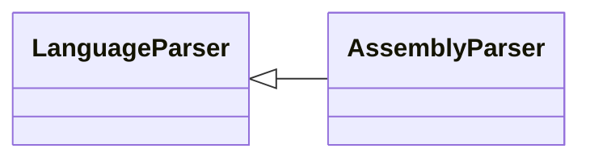

# `readmenator.parsers._assembly`

> Source: [readmenator/parsers/_assembly.py:1](../../readmenator/parsers/_assembly.py#L1) | language `py` | coverage 100.0% | [API index](../index.md)

Assembly parser: regex extraction of symbols, signatures, docstrings, and imports.

## Contents

- **Classes:** [`AssemblyParser`](#assemblyparser)

## Type Diagram



## Classes

<a id="assemblyparser"></a>

### `AssemblyParser`

`class` | [readmenator/parsers/_assembly.py:11](../../readmenator/parsers/_assembly.py#L11)

```python
class AssemblyParser(LanguageParser)
```

Bases: [`LanguageParser`](readmenator.parsers._base.py.md#languageparser)

Parser for assembly (.asm, .s, .S).

Extracts labels at the start of a line (``label:``) as function
symbols. This is a best-effort heuristic; local labels and
directives are not always distinguishable.

---
