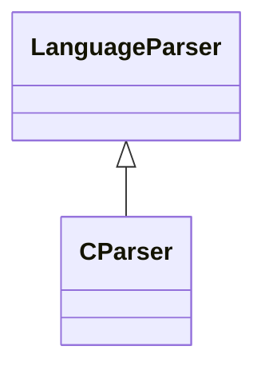

# `readmenator.parsers._c`

> Source: [readmenator/parsers/_c.py:1](../../readmenator/parsers/_c.py#L1) | language `py` | coverage 100.0% | [API index](../index.md)

C and C++ parser: regex extraction of symbols, signatures, docstrings, and imports.

## Contents

- **Classes:** [`CParser`](#cparser)

## Type Diagram



## Classes

<a id="cparser"></a>

### `CParser`

`class` | [readmenator/parsers/_c.py:30](../../readmenator/parsers/_c.py#L30)

```python
class CParser(LanguageParser)
```

Bases: [`LanguageParser`](readmenator.parsers._base.py.md#languageparser)

Parser for C, C++ (.c, .cpp, .cc, .cxx, .h, .hpp, .hxx).

Extracts includes, structs, classes, functions, and preprocessor
macros using regex heuristics tuned to C-family syntax.

---
