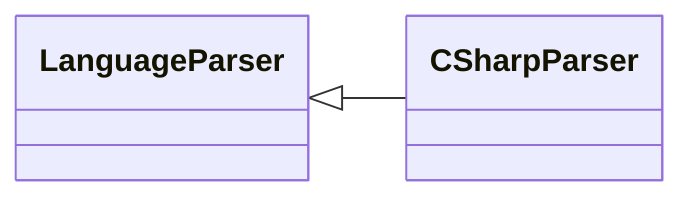

# `readmenator.parsers._csharp`

> Source: [readmenator/parsers/_csharp.py:1](../../readmenator/parsers/_csharp.py#L1) | language `py` | coverage 100.0% | [API index](../index.md)

C# parser: regex extraction of symbols, signatures, docstrings, and imports.

## Contents

- **Classes:** [`CSharpParser`](#csharpparser)

## Type Diagram



## Classes

<a id="csharpparser"></a>

### `CSharpParser`

`class` | [readmenator/parsers/_csharp.py:11](../../readmenator/parsers/_csharp.py#L11)

```python
class CSharpParser(LanguageParser)
```

Bases: [`LanguageParser`](readmenator.parsers._base.py.md#languageparser)

Parser for C# (.cs).

Extracts ``using`` directives, class/struct/interface/record
declarations, and methods with access modifiers.

---
