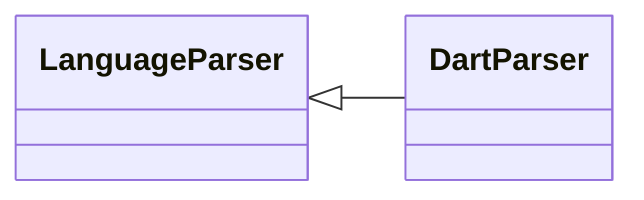

# `readmenator.parsers._dart`

> Source: [readmenator/parsers/_dart.py:1](../../readmenator/parsers/_dart.py#L1) | language `py` | coverage 100.0% | [API index](../index.md)

Dart parser: regex extraction of symbols, signatures, docstrings, and imports.

## Contents

- **Classes:** [`DartParser`](#dartparser)

## Type Diagram



## Classes

<a id="dartparser"></a>

### `DartParser`

`class` | [readmenator/parsers/_dart.py:11](../../readmenator/parsers/_dart.py#L11)

```python
class DartParser(LanguageParser)
```

Bases: [`LanguageParser`](readmenator.parsers._base.py.md#languageparser)

Parser for Dart (.dart).

Extracts import statements, class declarations (with extends),
and top-level or method function declarations by return type.

---
