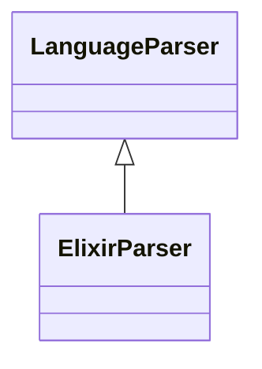

# `readmenator.parsers._elixir`

> Source: [readmenator/parsers/_elixir.py:1](../../readmenator/parsers/_elixir.py#L1) | language `py` | coverage 100.0% | [API index](../index.md)

Elixir parser: regex extraction of symbols, signatures, docstrings, and imports.

## Contents

- **Classes:** [`ElixirParser`](#elixirparser)

## Type Diagram



## Classes

<a id="elixirparser"></a>

### `ElixirParser`

`class` | [readmenator/parsers/_elixir.py:11](../../readmenator/parsers/_elixir.py#L11)

```python
class ElixirParser(LanguageParser)
```

Bases: [`LanguageParser`](readmenator.parsers._base.py.md#languageparser)

Parser for Elixir (.ex, .exs).

Extracts ``import``/``alias``/``require``/``use`` directives,
module definitions, and named function definitions.

---
