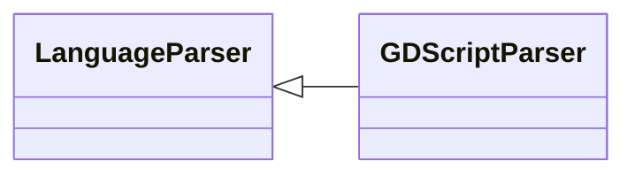

# `readmenator.parsers._gdscript`

> Source: [readmenator/parsers/_gdscript.py:1](../../readmenator/parsers/_gdscript.py#L1) | language `py` | coverage 100.0% | [API index](../index.md)

GDScript parser: regex extraction of symbols, signatures, docstrings, and imports.

## Contents

- **Classes:** [`GDScriptParser`](#gdscriptparser)

## Type Diagram



## Classes

<a id="gdscriptparser"></a>

### `GDScriptParser`

`class` | [readmenator/parsers/_gdscript.py:11](../../readmenator/parsers/_gdscript.py#L11)

```python
class GDScriptParser(LanguageParser)
```

Bases: [`LanguageParser`](readmenator.parsers._base.py.md#languageparser)

Parser for Godot GDScript (.gd).

Extracts ``extends`` / ``class_name`` directives and ``func``
method declarations.

---
