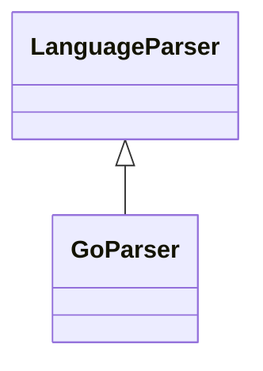

# `readmenator.parsers._go`

> Source: [readmenator/parsers/_go.py:1](../../readmenator/parsers/_go.py#L1) | language `py` | coverage 100.0% | [API index](../index.md)

Go parser: regex extraction of symbols, signatures, docstrings, and imports.

## Contents

- **Classes:** [`GoParser`](#goparser)

## Type Diagram



## Classes

<a id="goparser"></a>

### `GoParser`

`class` | [readmenator/parsers/_go.py:11](../../readmenator/parsers/_go.py#L11)

```python
class GoParser(LanguageParser)
```

Bases: [`LanguageParser`](readmenator.parsers._base.py.md#languageparser)

Parser for Go (.go).

Extracts import blocks or single import statements, exported
functions (including methods), and type definitions (struct/interface).

---
