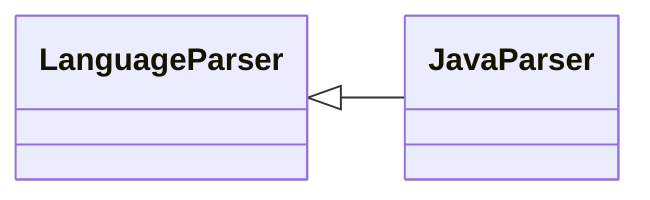

# `readmenator.parsers._java`

> Source: [readmenator/parsers/_java.py:1](../../readmenator/parsers/_java.py#L1) | language `py` | coverage 100.0% | [API index](../index.md)

Java parser: regex extraction of symbols, signatures, docstrings, and imports.

## Contents

- **Classes:** [`JavaParser`](#javaparser)

## Type Diagram



## Classes

<a id="javaparser"></a>

### `JavaParser`

`class` | [readmenator/parsers/_java.py:11](../../readmenator/parsers/_java.py#L11)

```python
class JavaParser(LanguageParser)
```

Bases: [`LanguageParser`](readmenator.parsers._base.py.md#languageparser)

Parser for Java (.java).

Extracts import statements, class and interface declarations,
and methods complete with access modifiers and type signatures.

---
