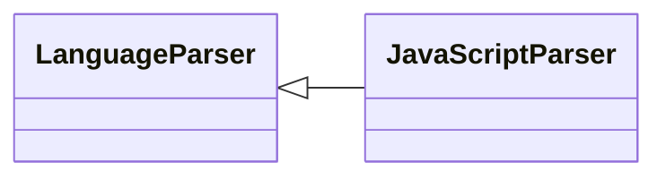

# `readmenator.parsers._javascript`

> Source: [readmenator/parsers/_javascript.py:1](../../readmenator/parsers/_javascript.py#L1) | language `py` | coverage 100.0% | [API index](../index.md)

JavaScript and TypeScript parser: regex extraction of symbols, signatures, docstrings, and imports.

## Contents

- **Classes:** [`JavaScriptParser`](#javascriptparser)

## Type Diagram



## Classes

<a id="javascriptparser"></a>

### `JavaScriptParser`

`class` | [readmenator/parsers/_javascript.py:11](../../readmenator/parsers/_javascript.py#L11)

```python
class JavaScriptParser(LanguageParser)
```

Bases: [`LanguageParser`](readmenator.parsers._base.py.md#languageparser)

Parser for JavaScript / TypeScript (.js, .ts, .jsx, .tsx).

Extracts ES module imports, CommonJS ``require`` calls, function
declarations, arrow-function variables, and class definitions
(including inheritance).

---
