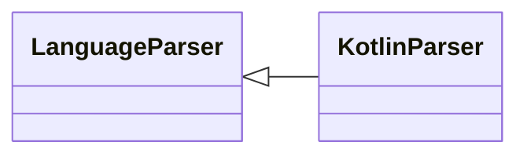

# `readmenator.parsers._kotlin`

> Source: [readmenator/parsers/_kotlin.py:1](../../readmenator/parsers/_kotlin.py#L1) | language `py` | coverage 100.0% | [API index](../index.md)

Kotlin parser: regex extraction of symbols, signatures, docstrings, and imports.

## Contents

- **Classes:** [`KotlinParser`](#kotlinparser)

## Type Diagram



## Classes

<a id="kotlinparser"></a>

### `KotlinParser`

`class` | [readmenator/parsers/_kotlin.py:11](../../readmenator/parsers/_kotlin.py#L11)

```python
class KotlinParser(LanguageParser)
```

Bases: [`LanguageParser`](readmenator.parsers._base.py.md#languageparser)

Parser for Kotlin (.kt, .kts).

Extracts ``import`` statements, class/object/interface/data class
declarations, and function definitions.

---
