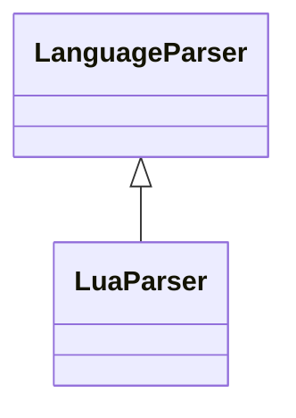

# `readmenator.parsers._lua`

> Source: [readmenator/parsers/_lua.py:1](../../readmenator/parsers/_lua.py#L1) | language `py` | coverage 100.0% | [API index](../index.md)

Lua parser: regex extraction of symbols, signatures, docstrings, and imports.

## Contents

- **Classes:** [`LuaParser`](#luaparser)

## Type Diagram



## Classes

<a id="luaparser"></a>

### `LuaParser`

`class` | [readmenator/parsers/_lua.py:11](../../readmenator/parsers/_lua.py#L11)

```python
class LuaParser(LanguageParser)
```

Bases: [`LanguageParser`](readmenator.parsers._base.py.md#languageparser)

Parser for Lua (.lua).

Extracts ``require`` imports, function declarations (named and
table-based), and module returns.

---
