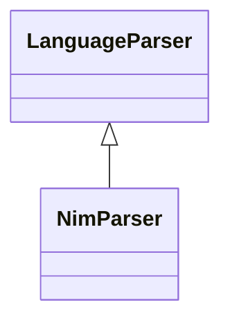

# `readmenator.parsers._nim`

> Source: [readmenator/parsers/_nim.py:1](../../readmenator/parsers/_nim.py#L1) | language `py` | coverage 100.0% | [API index](../index.md)

Nim parser: regex extraction of symbols, signatures, docstrings, and imports.

## Contents

- **Classes:** [`NimParser`](#nimparser)

## Type Diagram



## Classes

<a id="nimparser"></a>

### `NimParser`

`class` | [readmenator/parsers/_nim.py:11](../../readmenator/parsers/_nim.py#L11)

```python
class NimParser(LanguageParser)
```

Bases: [`LanguageParser`](readmenator.parsers._base.py.md#languageparser)

Parser for Nim (.nim).

Extracts ``import`` statements, ``proc`` / ``func`` / ``method``
declarations, and `[`type`](readmenator._docstrings.py.md#docfield-type)` definitions.

---
