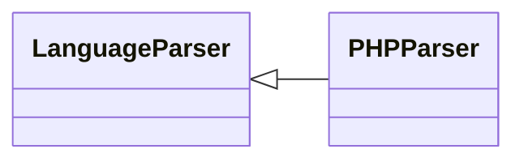

# `readmenator.parsers._php`

> Source: [readmenator/parsers/_php.py:1](../../readmenator/parsers/_php.py#L1) | language `py` | coverage 100.0% | [API index](../index.md)

PHP parser: regex extraction of symbols, signatures, docstrings, and imports.

## Contents

- **Classes:** [`PHPParser`](#phpparser)

## Type Diagram



## Classes

<a id="phpparser"></a>

### `PHPParser`

`class` | [readmenator/parsers/_php.py:11](../../readmenator/parsers/_php.py#L11)

```python
class PHPParser(LanguageParser)
```

Bases: [`LanguageParser`](readmenator.parsers._base.py.md#languageparser)

Parser for PHP (.php).

Extracts ``use/require/include`` (including ``_once`` variants),
function declarations, and class declarations.

---
