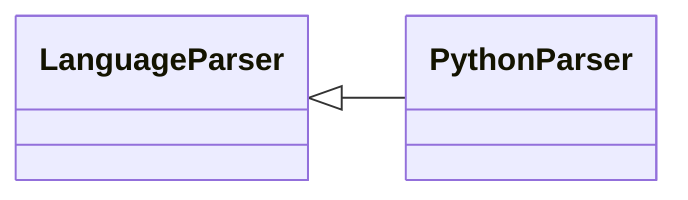

# `readmenator.parsers._python`

> Source: [readmenator/parsers/_python.py:1](../../readmenator/parsers/_python.py#L1) | language `py` | coverage 100.0% | [API index](../index.md)

Python parser: native ast extraction of symbols, signatures, docstrings, and imports.

## Contents

- **Classes:** [`PythonParser`](#pythonparser)

## Type Diagram



## Classes

<a id="pythonparser"></a>

### `PythonParser`

`class` | [readmenator/parsers/_python.py:12](../../readmenator/parsers/_python.py#L12)

```python
class PythonParser(LanguageParser)
```

Bases: [`LanguageParser`](readmenator.parsers._base.py.md#languageparser)

Parser for Python (.py) using the native ``ast`` module.

Extracts imports, functions (including async), and class
definitions with docstrings via ``ast.get_docstring``.

---
