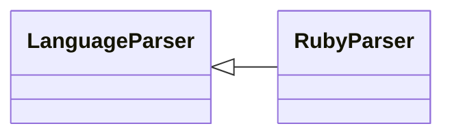

# `readmenator.parsers._ruby`

> Source: [readmenator/parsers/_ruby.py:1](../../readmenator/parsers/_ruby.py#L1) | language `py` | coverage 100.0% | [API index](../index.md)

Ruby parser: regex extraction of symbols, signatures, docstrings, and imports.

## Contents

- **Classes:** [`RubyParser`](#rubyparser)

## Type Diagram



## Classes

<a id="rubyparser"></a>

### `RubyParser`

`class` | [readmenator/parsers/_ruby.py:11](../../readmenator/parsers/_ruby.py#L11)

```python
class RubyParser(LanguageParser)
```

Bases: [`LanguageParser`](readmenator.parsers._base.py.md#languageparser)

Parser for Ruby (.rb).

Extracts ``require`` / ``require_relative`` imports, class and
module definitions with inheritance, and method definitions.

---
