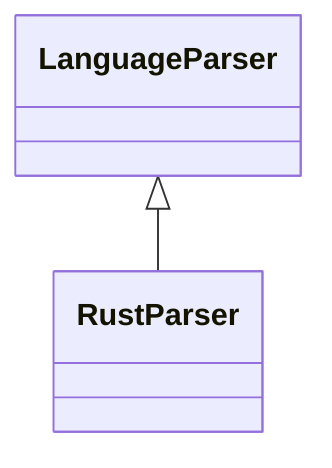

# `readmenator.parsers._rust`

> Source: [readmenator/parsers/_rust.py:1](../../readmenator/parsers/_rust.py#L1) | language `py` | coverage 100.0% | [API index](../index.md)

Rust parser: regex extraction of symbols, signatures, docstrings, and imports.

## Contents

- **Classes:** [`RustParser`](#rustparser)

## Type Diagram



## Classes

<a id="rustparser"></a>

### `RustParser`

`class` | [readmenator/parsers/_rust.py:11](../../readmenator/parsers/_rust.py#L11)

```python
class RustParser(LanguageParser)
```

Bases: [`LanguageParser`](readmenator.parsers._base.py.md#languageparser)

Parser for Rust (.rs).

Extracts ``use`` imports, public and private functions,
structs, traits, and enums.

---
