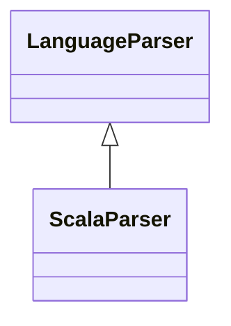

# `readmenator.parsers._scala`

> Source: [readmenator/parsers/_scala.py:1](../../readmenator/parsers/_scala.py#L1) | language `py` | coverage 100.0% | [API index](../index.md)

Scala parser: regex extraction of symbols, signatures, docstrings, and imports.

## Contents

- **Classes:** [`ScalaParser`](#scalaparser)

## Type Diagram



## Classes

<a id="scalaparser"></a>

### `ScalaParser`

`class` | [readmenator/parsers/_scala.py:11](../../readmenator/parsers/_scala.py#L11)

```python
class ScalaParser(LanguageParser)
```

Bases: [`LanguageParser`](readmenator.parsers._base.py.md#languageparser)

Parser for Scala (.scala).

Extracts ``import`` statements, class/object/trait declarations,
and method definitions.

---
